# 58개 원본 ID 비중복 가구 그룹 — 실제 원본 스프라이트 검수판

원본 PZ PNG의 타일을 v259 이미지 셀 메타데이터의 열/행/크기에 따라 잘라 비교했어. 원본 PNG 없는 경우에는 누락 표시가 나와.

50개 그룹은 Wiki 변형 접미사 제거 후 기본 이름이 같고, 8개 그룹은 기본 이름이 둘 이상이어서 분리했어.

66개 이름 계열은 디자인 확정 수가 아니고 Wiki 분류용 가족 이름이야.

58장 접촉시트 역시 실제 PZ 게임 엔티티/Moveable 오브젝트의 동일성을 직접 확정하지 않아.

## 전체 접촉시트

### 01 · Victorian 1 Victorian 1 Rug

원본: floors_rugs_01 · 위키 행 6개 · SAME_WIKI_BASE_WITH_EXPLICIT_VARIANTS

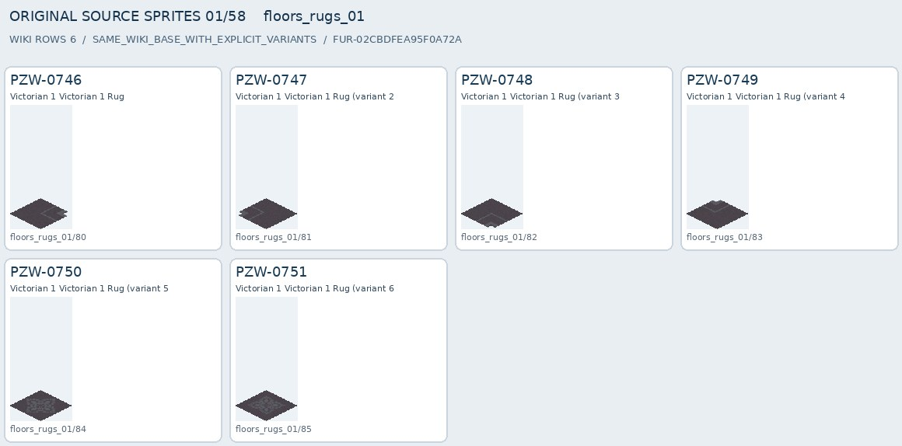

### 02 · Fancy Blue Rug

원본: floors_rugs_01 · 위키 행 6개 · SAME_WIKI_BASE_WITH_EXPLICIT_VARIANTS

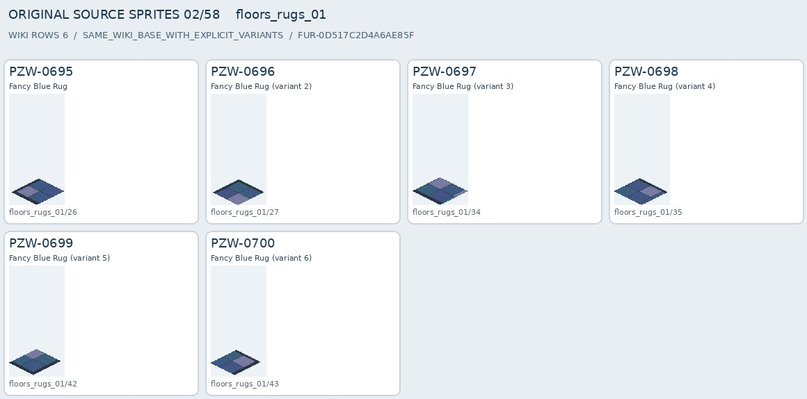

### 03 · White Smooth Tiles

원본: floors_interior_tilesandwood_01 · 위키 행 2개 · SAME_WIKI_BASE_WITH_EXPLICIT_VARIANTS

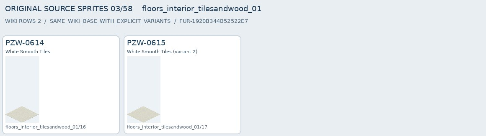

### 04 · The Ecstacy of Gold

원본: location_military_knox_01 · 위키 행 2개 · SAME_WIKI_BASE_WITH_EXPLICIT_VARIANTS

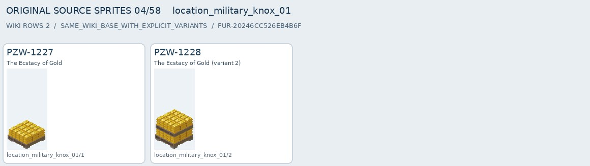

### 05 · Dragon Tree

원본: vegetation_indoor_01 · 위키 행 3개 · SAME_WIKI_BASE_WITH_EXPLICIT_VARIANTS

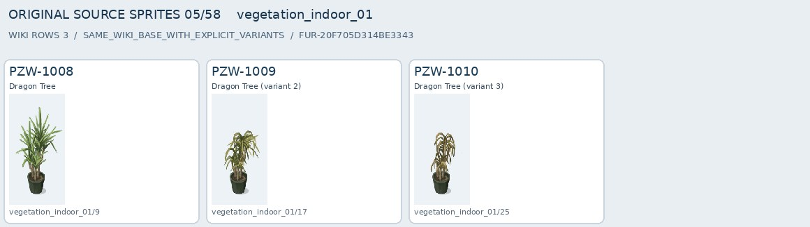

### 06 · Metal Drum

원본: crafted_01 · 위키 행 9개 · SAME_WIKI_BASE_WITH_EXPLICIT_VARIANTS

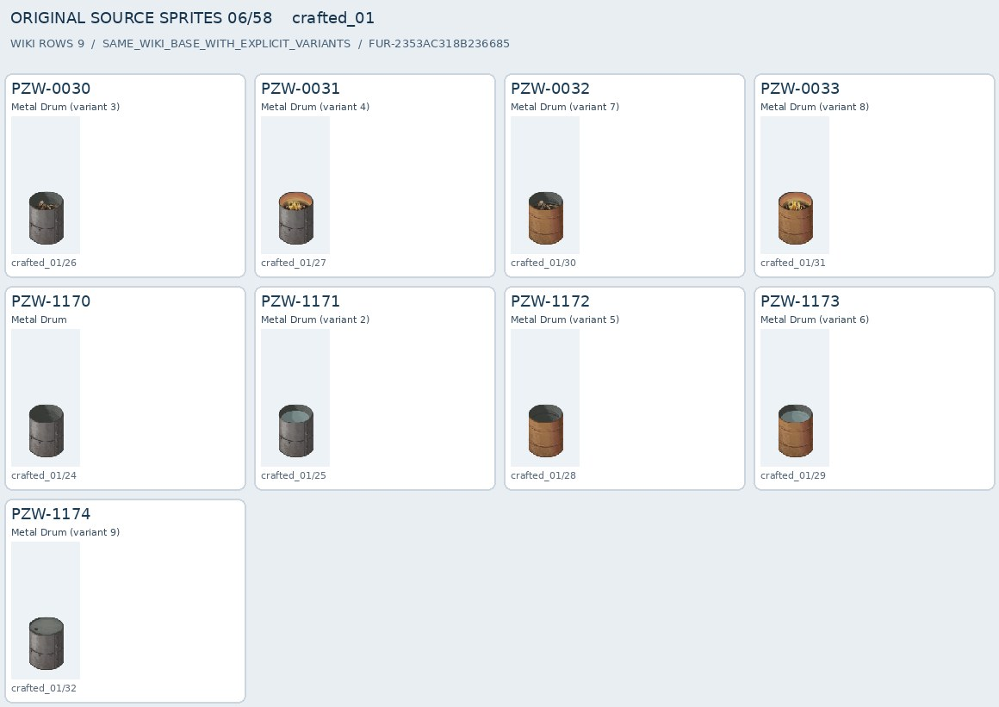

### 07 · Bush

원본: vegetation_foliage_01 · 위키 행 13개 · SAME_WIKI_BASE_WITH_EXPLICIT_VARIANTS

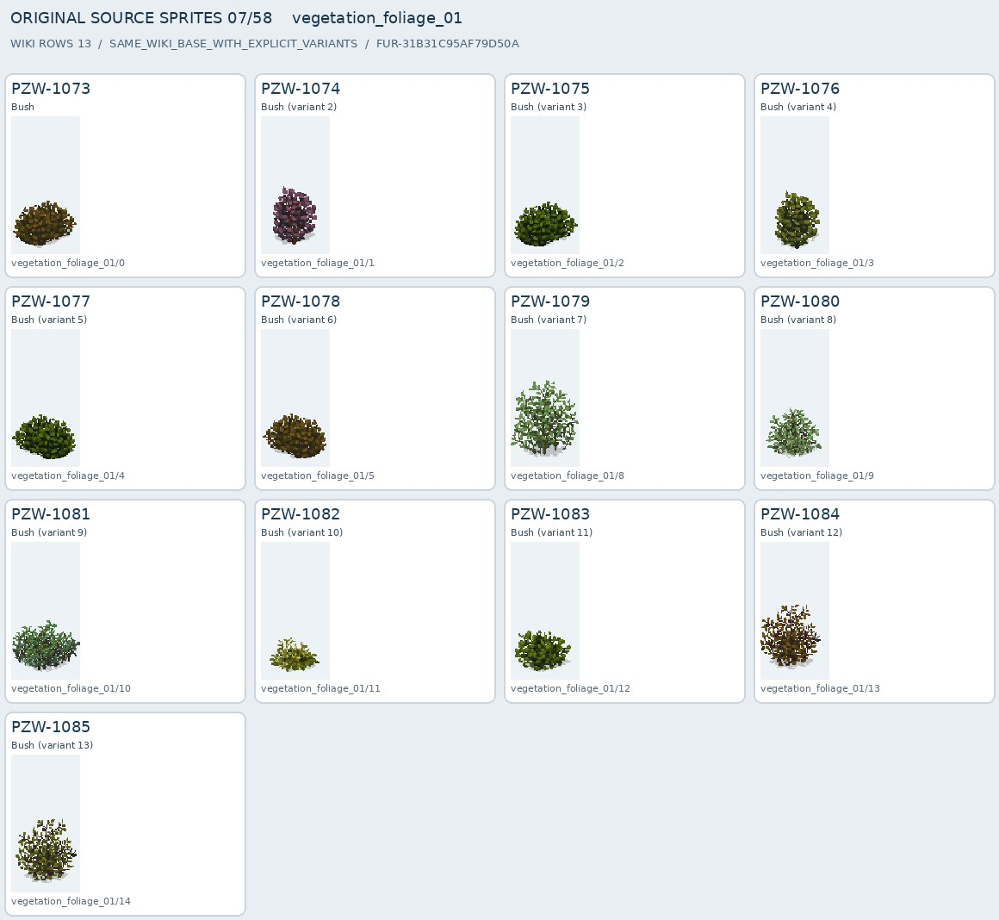

### 08 · Double Stacked Hay

원본: vegetation_farm_01 · 위키 행 4개 · SAME_WIKI_BASE_WITH_EXPLICIT_VARIANTS

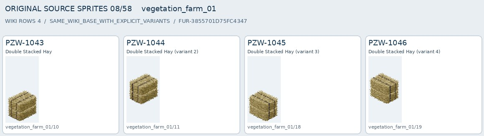

### 09 · Brazier

원본: crafted_02 · 위키 행 3개 · SAME_WIKI_BASE_WITH_EXPLICIT_VARIANTS

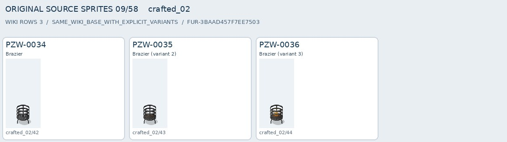

### 10 · Tiled Window|Window

원본: fixtures_windows_01 · 위키 행 2개 · MULTIPLE_BASE_NAMES_KEEP_SEPARATE

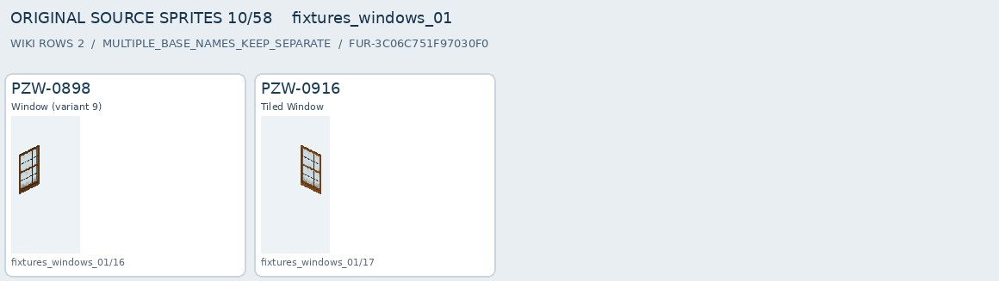

### 11 · Toddler Rug

원본: floors_rugs_01 · 위키 행 9개 · SAME_WIKI_BASE_WITH_EXPLICIT_VARIANTS

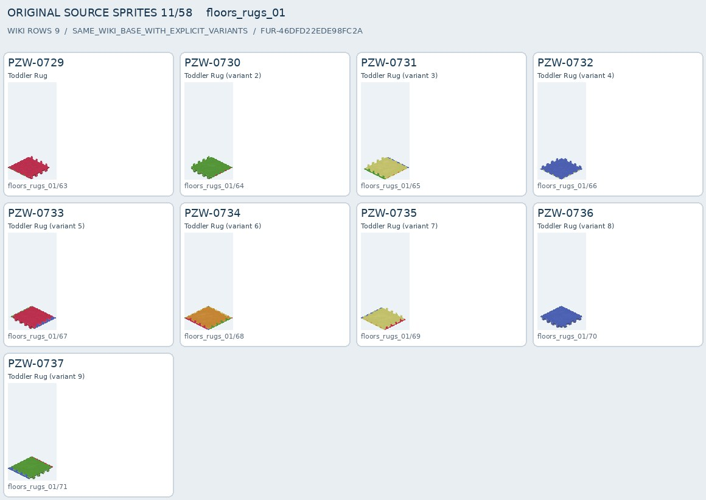

### 12 · Grey Diagonal Tiles

원본: floors_interior_tilesandwood_01 · 위키 행 2개 · SAME_WIKI_BASE_WITH_EXPLICIT_VARIANTS

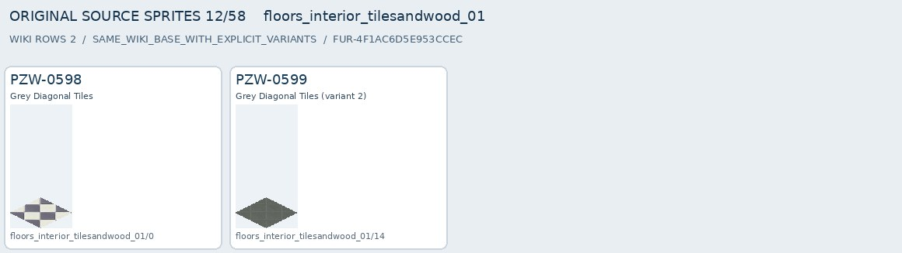

### 13 · Fancy Brown Rug

원본: floors_rugs_01 · 위키 행 6개 · SAME_WIKI_BASE_WITH_EXPLICIT_VARIANTS

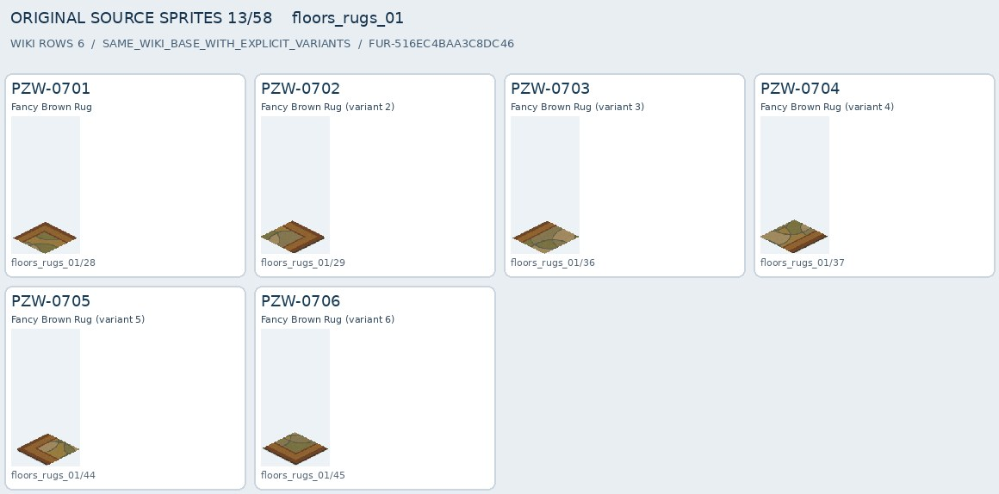

### 14 · Victorian 4 Rug

원본: floors_rugs_01 · 위키 행 6개 · SAME_WIKI_BASE_WITH_EXPLICIT_VARIANTS

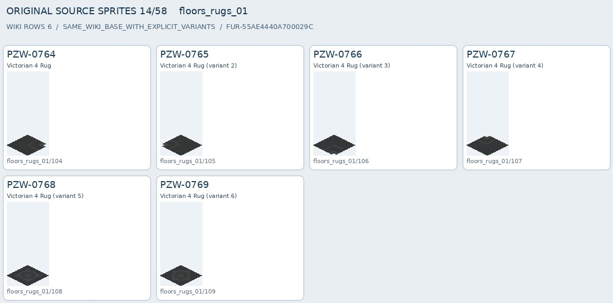

### 15 · Dark Grey Rug

원본: floors_rugs_01 · 위키 행 8개 · SAME_WIKI_BASE_WITH_EXPLICIT_VARIANTS

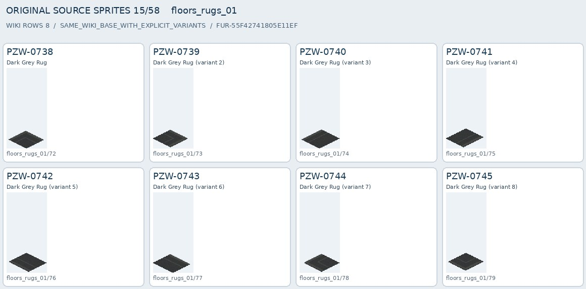

### 16 · Fancy Green Rug

원본: floors_rugs_01 · 위키 행 6개 · SAME_WIKI_BASE_WITH_EXPLICIT_VARIANTS

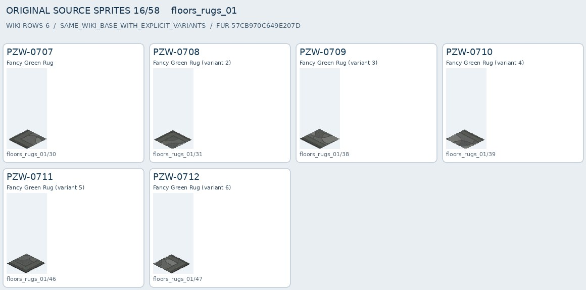

### 17 · Fancy Orange Rug

원본: floors_rugs_01 · 위키 행 6개 · SAME_WIKI_BASE_WITH_EXPLICIT_VARIANTS

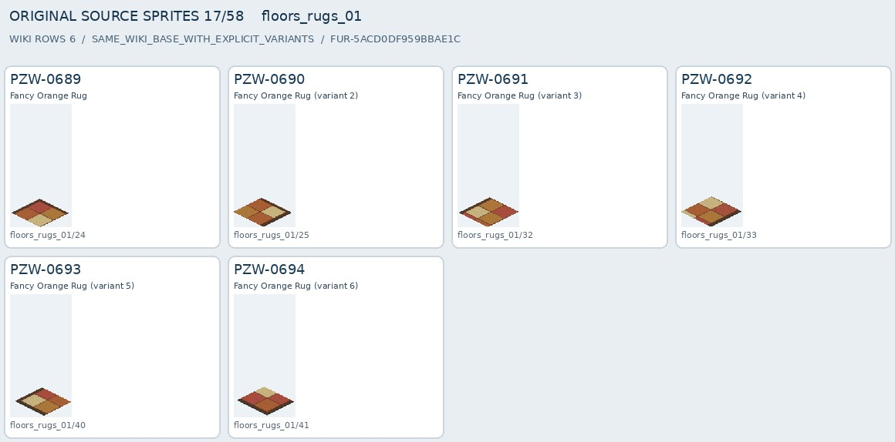

### 18 · Snake Plant

원본: vegetation_indoor_01 · 위키 행 3개 · SAME_WIKI_BASE_WITH_EXPLICIT_VARIANTS

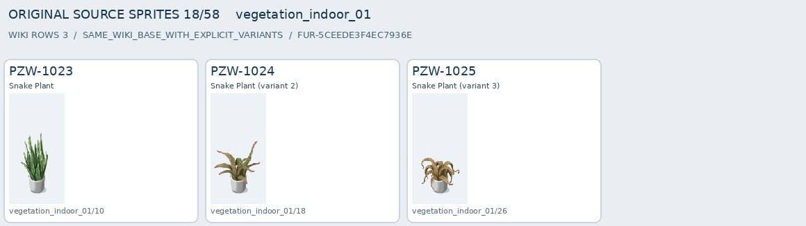

### 19 · Rain Collector Barrel

원본: carpentry_02 · 위키 행 10개 · SAME_WIKI_BASE_WITH_EXPLICIT_VARIANTS

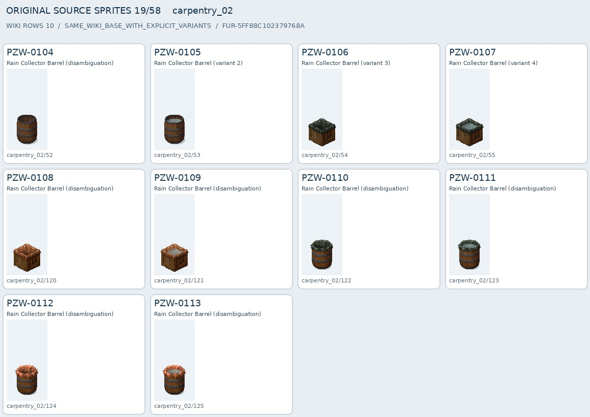

### 20 · Mannequin

원본: location_shop_mall_01 · 위키 행 12개 · SAME_WIKI_BASE_WITH_EXPLICIT_VARIANTS

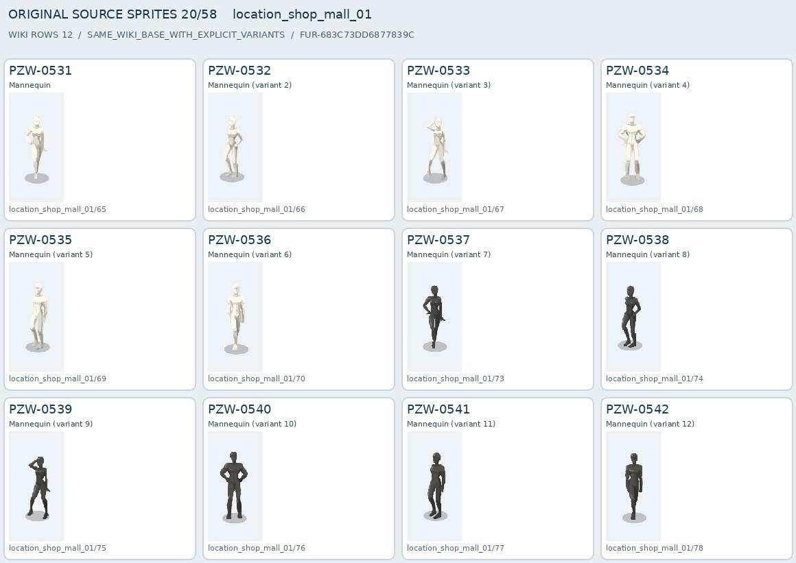

### 21 · Victorian 2 Rug

원본: floors_rugs_01 · 위키 행 6개 · SAME_WIKI_BASE_WITH_EXPLICIT_VARIANTS

### 22 · White Window|Window

원본: fixtures_windows_01 · 위키 행 2개 · MULTIPLE_BASE_NAMES_KEEP_SEPARATE

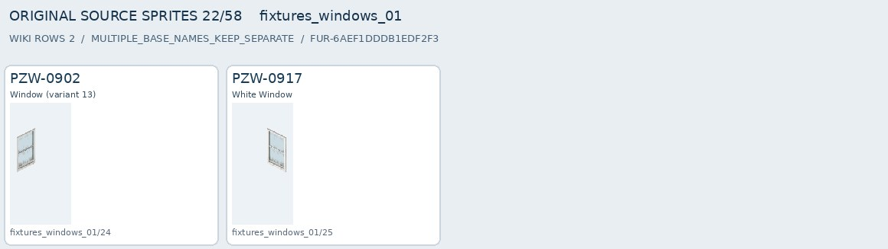

### 23 · Slider Window|Window

원본: fixtures_windows_01 · 위키 행 2개 · MULTIPLE_BASE_NAMES_KEEP_SEPARATE

### 24 · Bathroom Rug

원본: floors_rugs_01 · 위키 행 4개 · SAME_WIKI_BASE_WITH_EXPLICIT_VARIANTS

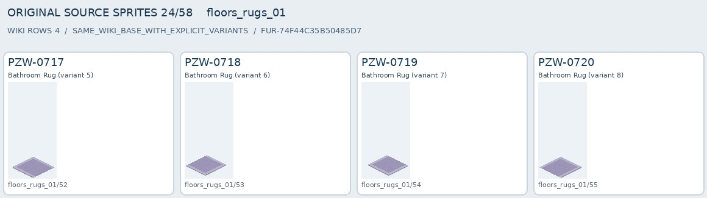

### 25 · Rug

원본: floors_rugs_01 · 위키 행 4개 · SAME_WIKI_BASE_WITH_EXPLICIT_VARIANTS

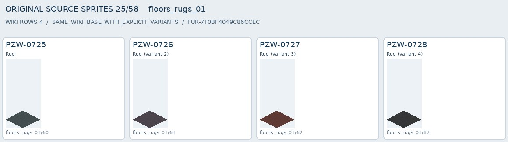

### 26 · Single Stacked Hay

원본: vegetation_farm_01 · 위키 행 4개 · SAME_WIKI_BASE_WITH_EXPLICIT_VARIANTS

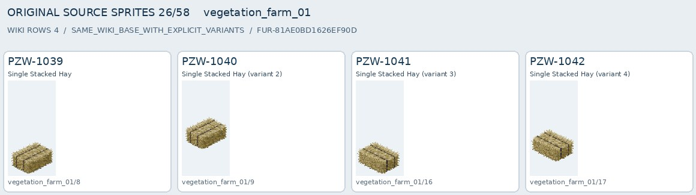

### 27 · Military Crate

원본: location_military_generic_01 · 위키 행 12개 · SAME_WIKI_BASE_WITH_EXPLICIT_VARIANTS

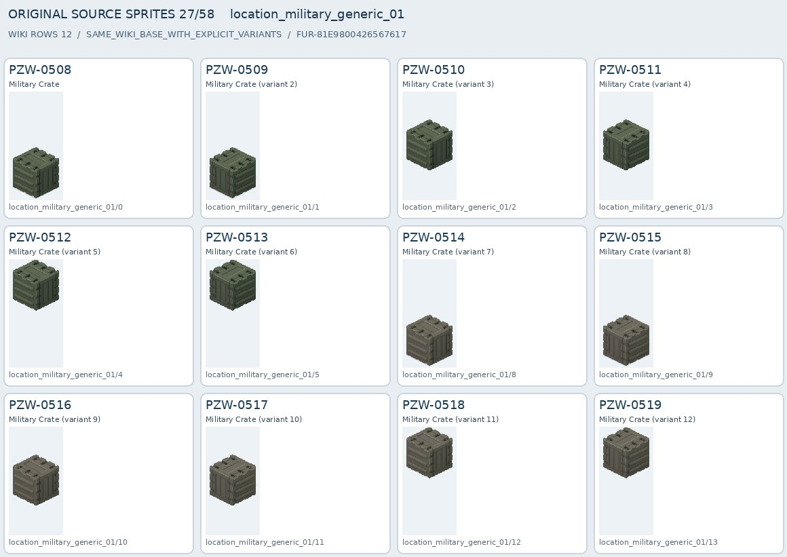

### 28 · Chinese Evergreen

원본: vegetation_indoor_01 · 위키 행 3개 · SAME_WIKI_BASE_WITH_EXPLICIT_VARIANTS

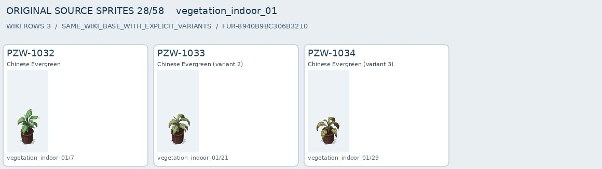

### 29 · Bird Bath

원본: vegetation_ornamental_01 · 위키 행 2개 · SAME_WIKI_BASE_WITH_EXPLICIT_VARIANTS

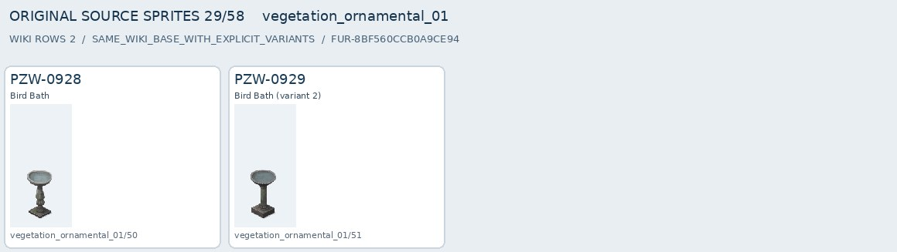

### 30 · Large Metal Trough

원본: location_farm_accesories_01 · 위키 행 2개 · SAME_WIKI_BASE_WITH_EXPLICIT_VARIANTS

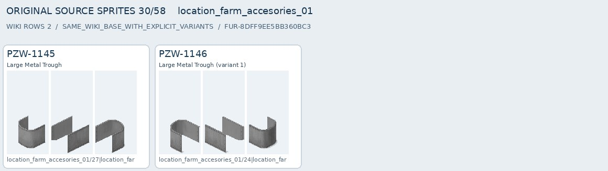

### 31 · Empty Military Barrier

원본: fencing_01 · 위키 행 2개 · SAME_WIKI_BASE_WITH_EXPLICIT_VARIANTS

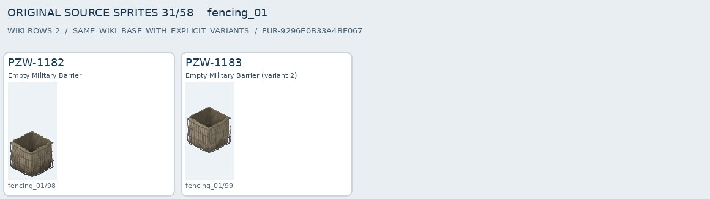

### 32 · Bathroom Rug

원본: floors_rugs_01 · 위키 행 4개 · SAME_WIKI_BASE_WITH_EXPLICIT_VARIANTS

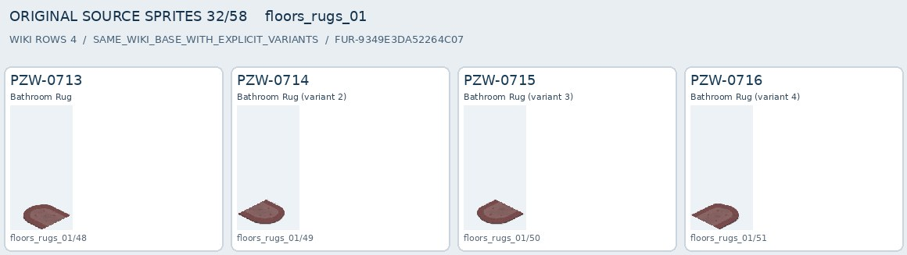

### 33 · White Tiled Window|Window

원본: fixtures_windows_01 · 위키 행 2개 · MULTIPLE_BASE_NAMES_KEEP_SEPARATE

### 34 · Brown Tiles

원본: floors_interior_tilesandwood_01 · 위키 행 2개 · SAME_WIKI_BASE_WITH_EXPLICIT_VARIANTS

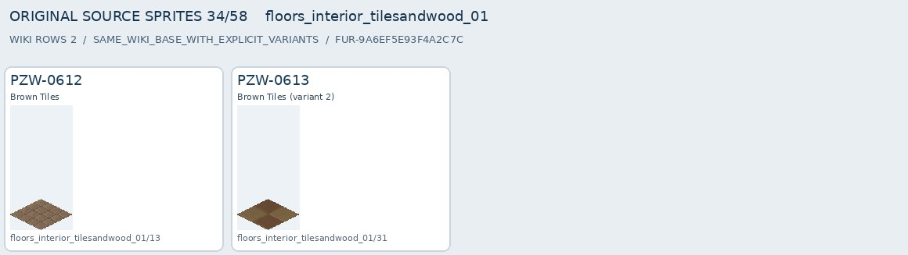

### 35 · Charcoal Burner

원본: crafted_02 · 위키 행 3개 · SAME_WIKI_BASE_WITH_EXPLICIT_VARIANTS

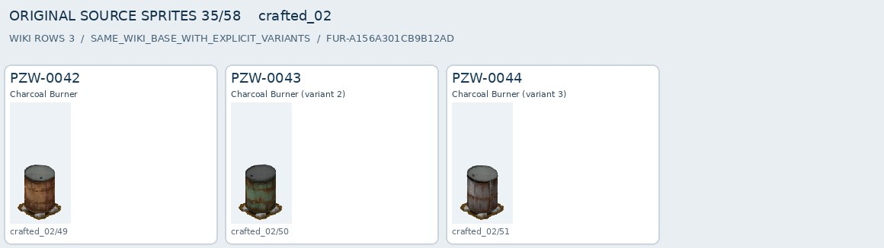

### 36 · Chrome Window|Window

원본: fixtures_windows_01 · 위키 행 2개 · MULTIPLE_BASE_NAMES_KEEP_SEPARATE

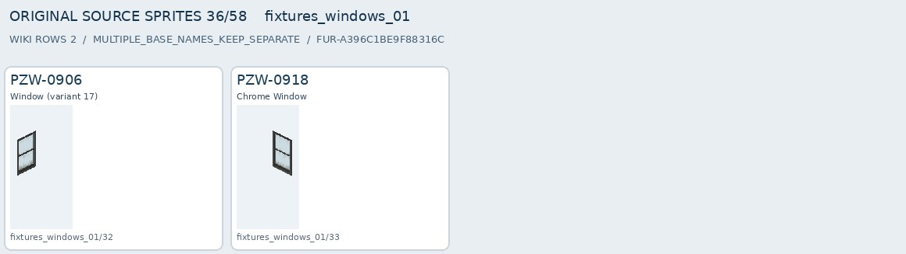

### 37 · Bordeaux Rug

원본: floors_rugs_01 · 위키 행 8개 · SAME_WIKI_BASE_WITH_EXPLICIT_VARIANTS

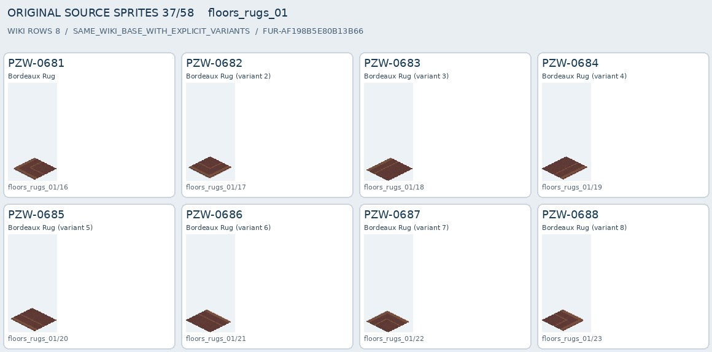

### 38 · Cartbox

원본: furniture_storage_02 · 위키 행 8개 · SAME_WIKI_BASE_WITH_EXPLICIT_VARIANTS

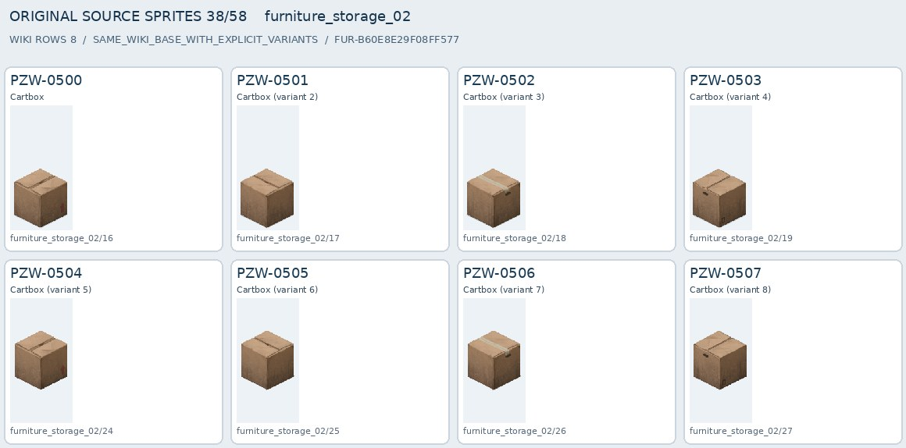

### 39 · Mannequin Stand

원본: location_shop_mall_01 · 위키 행 2개 · SAME_WIKI_BASE_WITH_EXPLICIT_VARIANTS

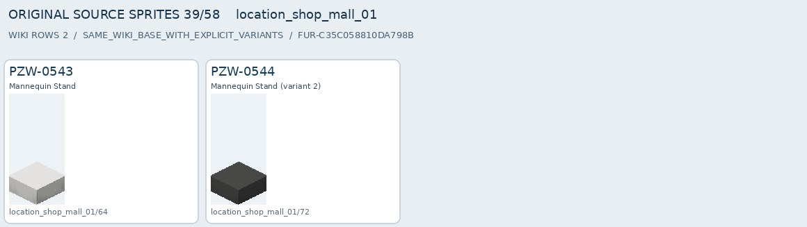

### 40 · Air conditioner

원본: rooftop_furniture · 위키 행 8개 · SAME_WIKI_BASE_WITH_EXPLICIT_VARIANTS

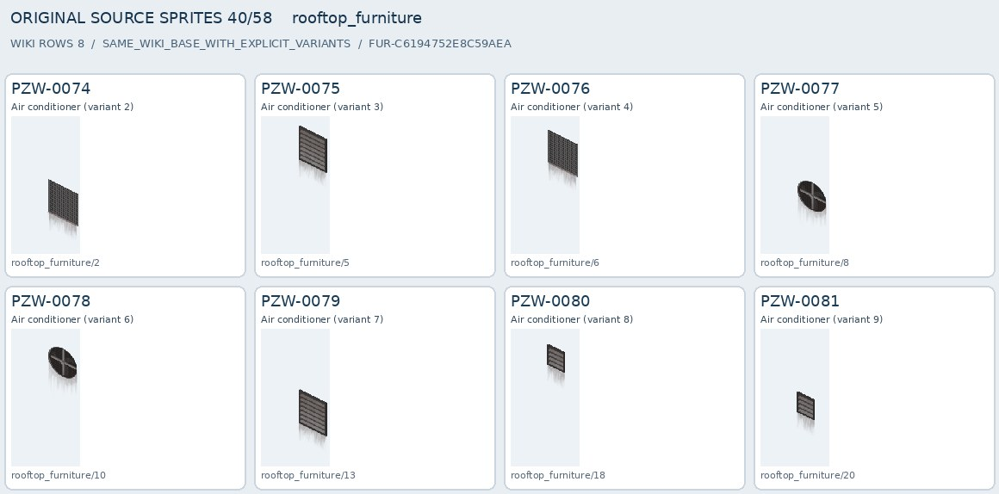

### 41 · Trash

원본: trash_01 · 위키 행 51개 · SAME_WIKI_BASE_WITH_EXPLICIT_VARIANTS

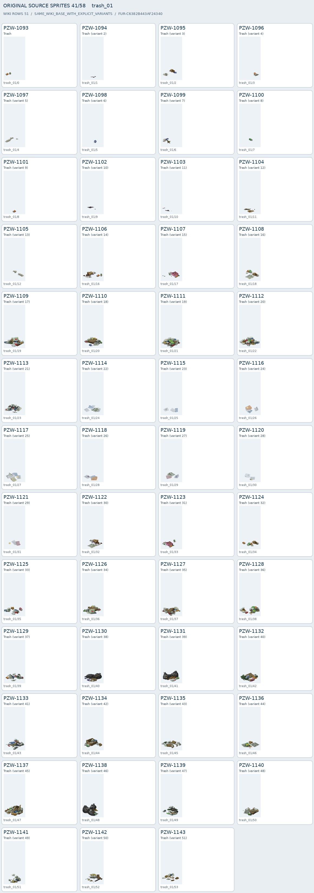

### 42 · Broad White Table|Large White Table

원본: furniture_tables_high_01 · 위키 행 2개 · MULTIPLE_BASE_NAMES_KEEP_SEPARATE

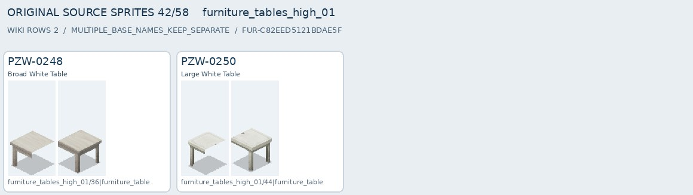

### 43 · Ficus

원본: vegetation_indoor_01 · 위키 행 3개 · SAME_WIKI_BASE_WITH_EXPLICIT_VARIANTS

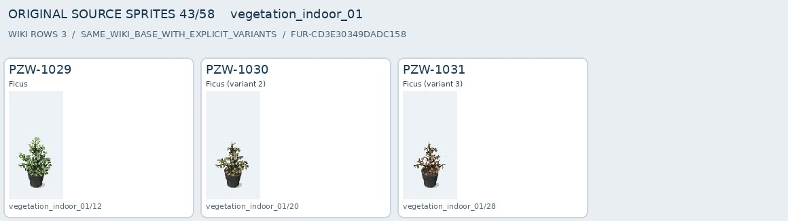

### 44 · Window

원본: fixtures_windows_01 · 위키 행 18개 · SAME_WIKI_BASE_WITH_EXPLICIT_VARIANTS

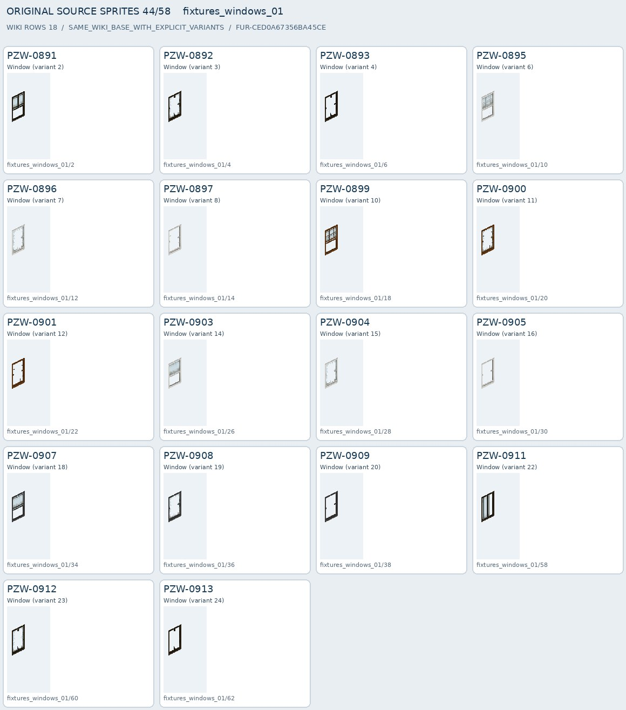

### 45 · Door Mat Rug

원본: floors_rugs_01 · 위키 행 4개 · SAME_WIKI_BASE_WITH_EXPLICIT_VARIANTS

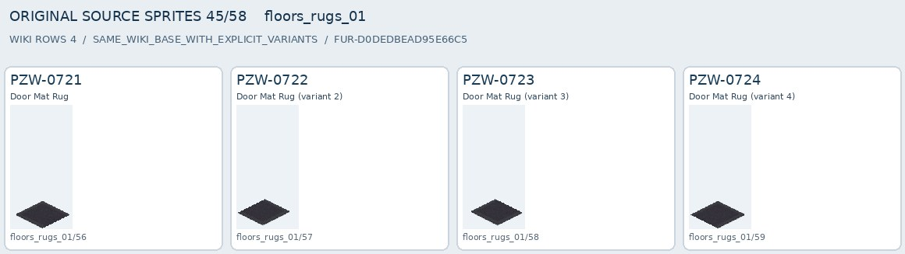

### 46 · Dark Green Rug

원본: floors_rugs_01 · 위키 행 8개 · SAME_WIKI_BASE_WITH_EXPLICIT_VARIANTS

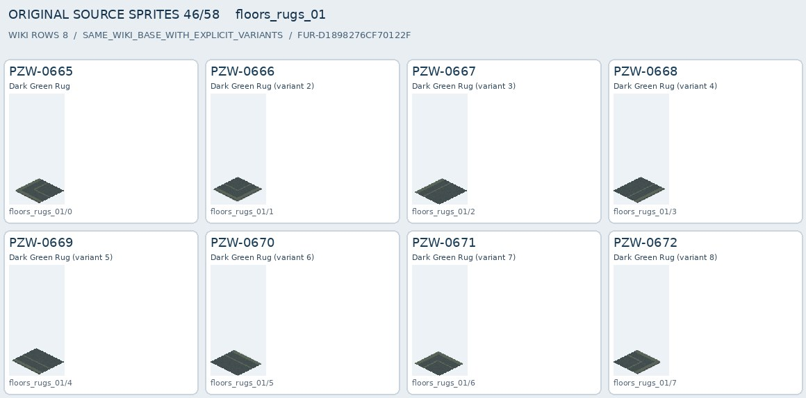

### 47 · Composter|Composter_2

원본: carpentry_02 · 위키 행 2개 · MULTIPLE_BASE_NAMES_KEEP_SEPARATE

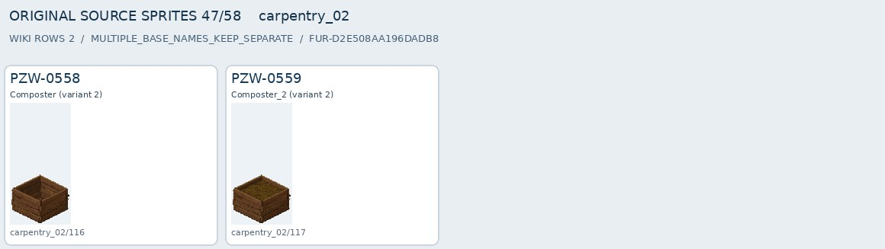

### 48 · Victorian 3 Rug

원본: floors_rugs_01 · 위키 행 6개 · SAME_WIKI_BASE_WITH_EXPLICIT_VARIANTS

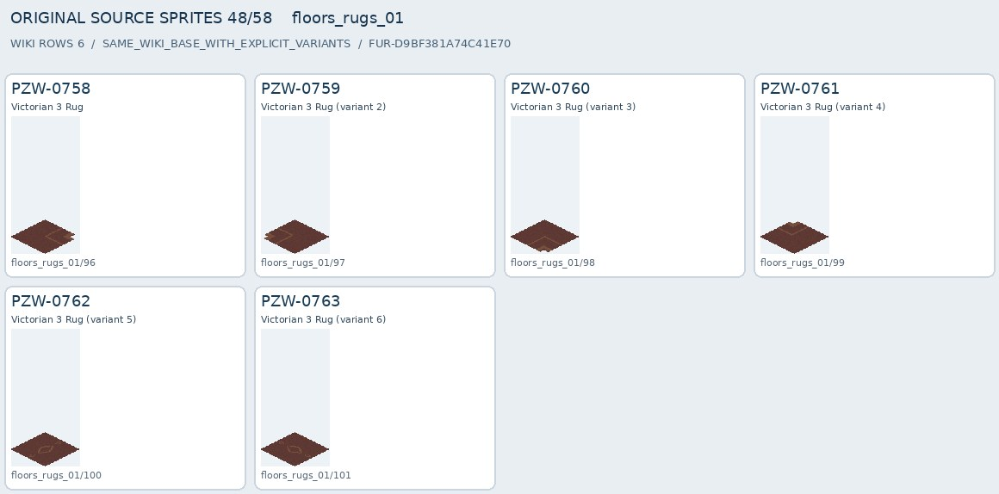

### 49 · Raised Plantbed

원본: vegetation_indoor_01 · 위키 행 4개 · SAME_WIKI_BASE_WITH_EXPLICIT_VARIANTS

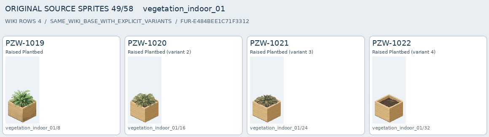

### 50 · Cast Iron Plant

원본: vegetation_indoor_01 · 위키 행 3개 · SAME_WIKI_BASE_WITH_EXPLICIT_VARIANTS

### 51 · Ornamental Bush

원본: vegetation_ornamental_01 · 위키 행 2개 · SAME_WIKI_BASE_WITH_EXPLICIT_VARIANTS

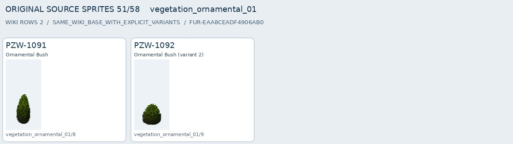

### 52 · Dark Purple Rug

원본: floors_rugs_01 · 위키 행 8개 · SAME_WIKI_BASE_WITH_EXPLICIT_VARIANTS

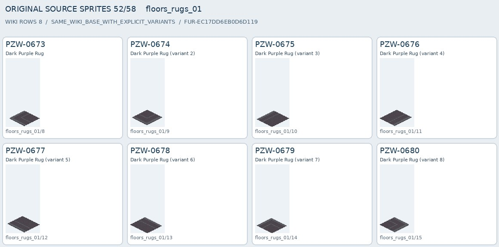

### 53 · Crate|Wooden Crate

원본: carpentry_01 · 위키 행 2개 · MULTIPLE_BASE_NAMES_KEEP_SEPARATE

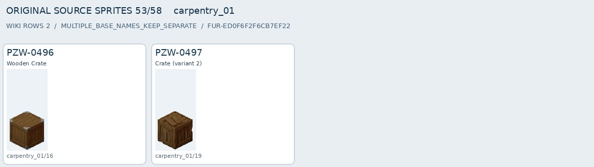

### 54 · Office Desk

원본: location_business_office_generic_01 · 위키 행 3개 · SAME_WIKI_BASE_WITH_EXPLICIT_VARIANTS

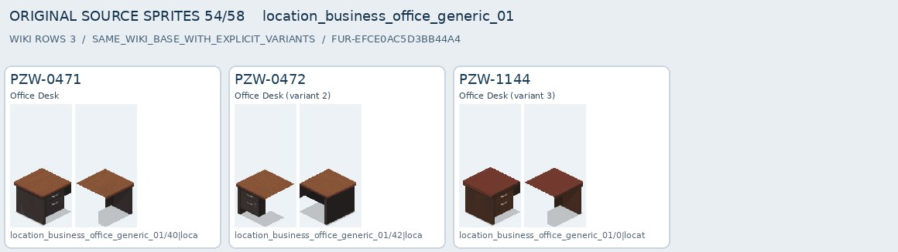

### 55 · Red Carpet

원본: floor_carpet_motif · 위키 행 15개 · SAME_WIKI_BASE_WITH_EXPLICIT_VARIANTS

### 56 · Flowerbed

원본: vegetation_ornamental_01 · 위키 행 22개 · SAME_WIKI_BASE_WITH_EXPLICIT_VARIANTS

### 57 · Wooden Bench

원본: furniture_seating_indoor_03 · 위키 행 2개 · SAME_WIKI_BASE_WITH_EXPLICIT_VARIANTS

### 58 · Road Cone

원본: street_decoration_01 · 위키 행 2개 · SAME_WIKI_BASE_WITH_EXPLICIT_VARIANTS

