# 신규 64그룹 원본 비교 도감

기존 v6 비교 이미지를 그대로 참조. 외형 관찰과 게임 동일성 검증은 별개다.

## FUR-08272DFFB321A0FF — Gas2Go Corner Counter

붉은 ㄱ자 상판과 크림색 수직 몸체; 안쪽 모서리가 들어간 카운터 조각.

원본 키: `location_shop_gas2go_01/20`

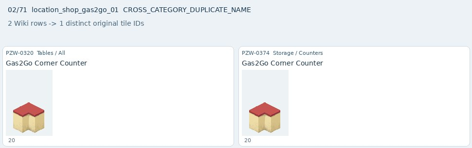

## FUR-087C9049F9799D15 — Fossoil Corner Counter

푸른 ㄱ자 상판과 살구색 몸체; 두 전면이 안쪽 모서리에서 만남.

원본 키: `location_shop_fossoil_01/20`

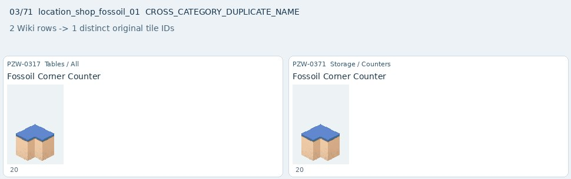

## FUR-1520C0531DAB33F3 — Motel Counter

밝은 직사각 상판 아래 흰색 문짝과 작은 손잡이가 있는 몸체.

원본 키: `location_hospitality_sunstarmotel_02/14`

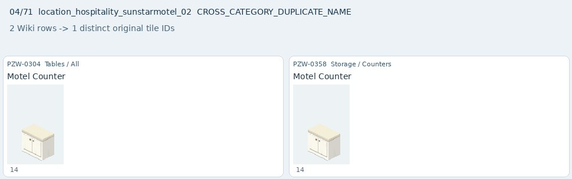

## FUR-1553C9869B8B256B — Zippee Corner Counter

붉은 ㄱ자 상판 아래 밝은 회색 세로 결의 몸체.

원본 키: `location_shop_zippee_01/20`

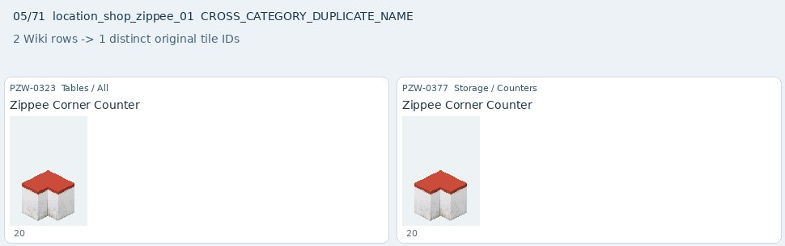

## FUR-192C3103A8AC37B7 — Washing Machine

회백색 상자 윗면의 덮개와 뒤쪽 검은 조작부; 바닥 쪽 어두운 띠.

원본 키: `appliances_laundry_01/4`

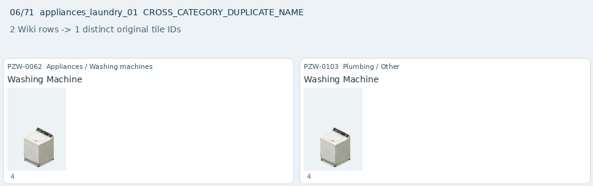

## FUR-1D2D6A0989BD415C — Red Oak Corner Counter

갈색 ㄱ자 상판과 짙은 갈색 수직 몸체; 안쪽 꺾임이 분명함.

원본 키: `fixtures_counters_01/52`

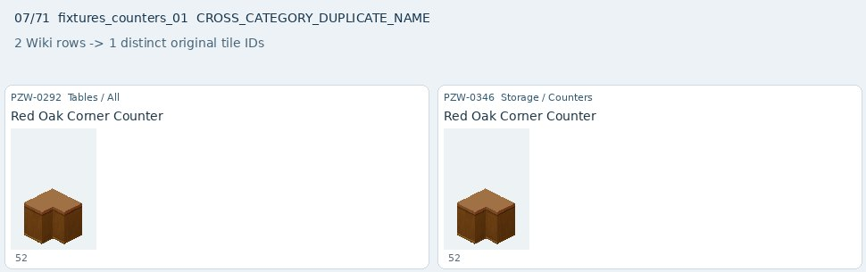

## FUR-2AA95200E478E93E — Medium Table

짙은 갈색 작은 사각 상판과 짧은 다리; 상판 테두리와 하부 가로대.

원본 키: `carpentry_02/5`

## FUR-2D4C7BA57575860D — Green Counter

녹회색 직사각 상판과 전면 두 문짝; 세로 손잡이 표시.

원본 키: `fixtures_counters_01/69`

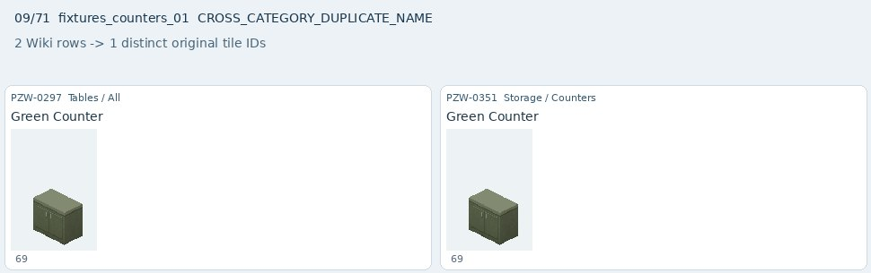

## FUR-32456AEF25C658E8 — Theater Corner Counter

밝은 ㄱ자 상판 아래 청색 몸체; 모서리의 세로 음영.

원본 키: `location_entertainment_theatre_01/12`

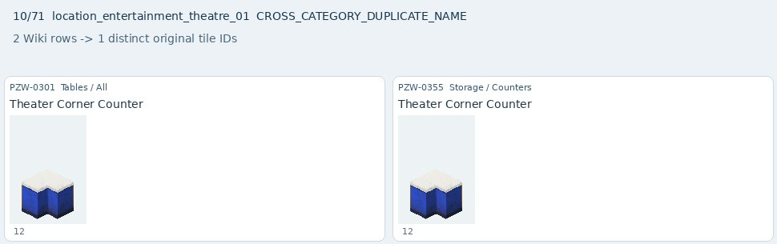

## FUR-362CDAFA2D1A80D7 — Dark Bar Counter

검정에 가까운 직사각 상판과 짙은 문짝; 작은 세로 손잡이.

원본 키: `location_restaurant_bar_01/21`

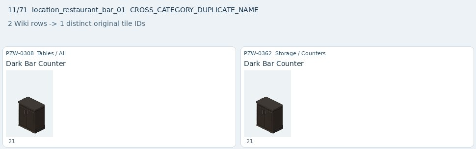

## FUR-384D6C4778E23F03 — Modern Corner Counter

밝은 베이지 ㄱ자 상판과 황갈색 수직 몸체.

원본 키: `fixtures_counters_01/4`

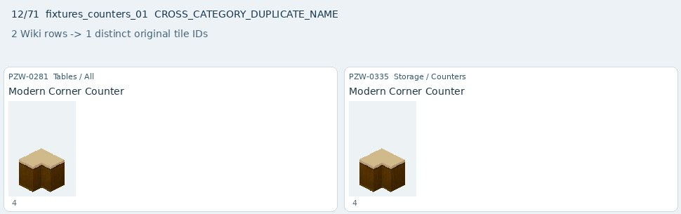

## FUR-3BED6C0B72C973E6 — Cedar Corner Counter

황갈색 ㄱ자 상판과 올리브 갈색 몸체; 목재처럼 보이는 면.

원본 키: `fixtures_counters_01/44`

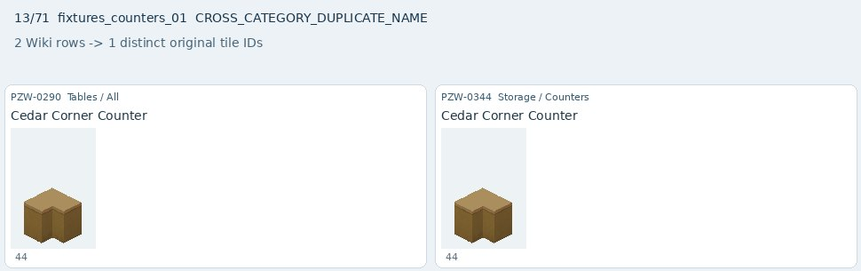

## FUR-3D1CB2BC49A0327F — Blue Combo Washer Dryer

푸른 윗판, 회백색 몸체, 전면 원형 테두리와 어두운 중심.

원본 키: `appliances_laundry_01/0`

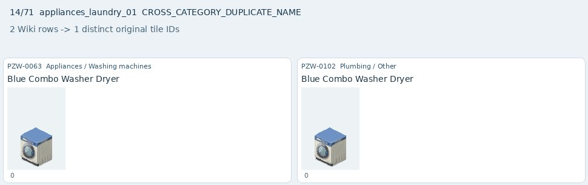

## FUR-404E9F32CE4C0EBC — Spiffos Counter

주황색 직사각 상판 아래 적갈색 몸체; 전면의 약한 수직 선.

원본 키: `location_restaurant_spiffos_01/61`

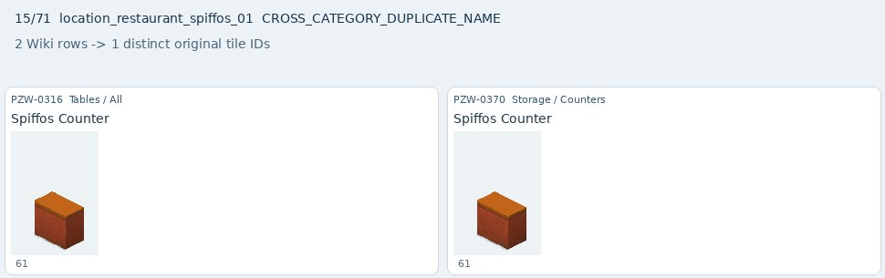

## FUR-40D354495115E331 — Shoddy Table

거친 갈색 판재 상판, 다리와 하부 가로대가 있는 작은 탁자형.

원본 키: `carpentry_02/1`

## FUR-5012742646C1EA98 — Oak Corner Bar Counter

회갈색 ㄱ자 상판과 짙은 세로 판재 몸체; 하단 테두리.

원본 키: `location_restaurant_bar_01/60`

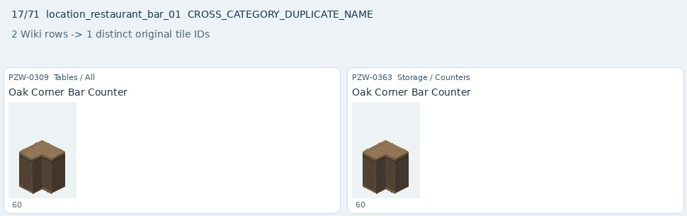

## FUR-5341A879DEAE9F05 — Standing Microphone

가는 검은 세로 지주, 위쪽 굽은 선과 작은 머리, 아래 세 갈래 받침.

원본 키: `appliances_com_01/69`

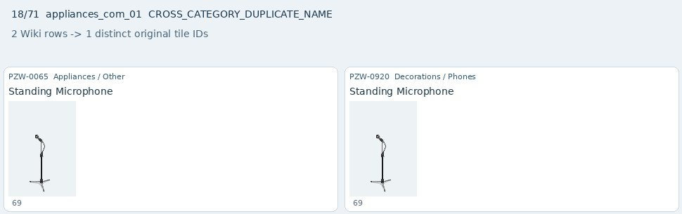

## FUR-546EEE8C8AA5AEF3 — Wooden Counter

평행 판재 직사각 상판과 짙은 목재형 수직 몸체; 전면 테두리.

원본 키: `carpentry_02/29`

## FUR-55696D5822798337 — Simple Small Drying Rack

216은 양쪽 지주 사이 여러 가로막대; 217은 좁게 보이는 삼각 지지대와 가로막대. 동일 타일별 그림이 두 분류에 반복됨.

원본 키: `vegetation_drying_01/216|vegetation_drying_01/217`

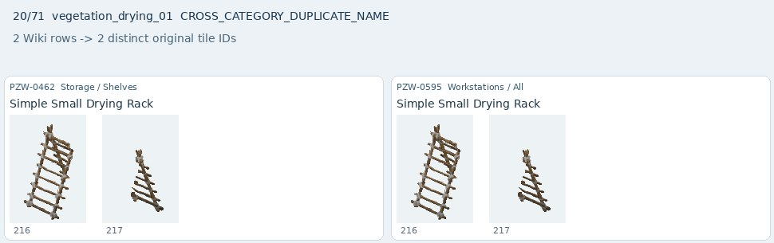

## FUR-5DC58FE4814D4DCD — Crude Metal Corner Counter

회색 ㄱ자 상판과 어두운 세로 골이 있는 몸체; 안쪽 모서리.

원본 키: `crafted_05/28`

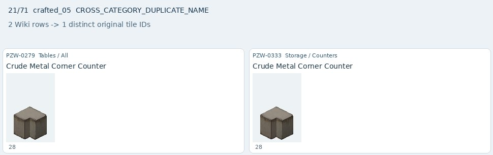

## FUR-621ADBA81B8A920D — Fossoil Counter

푸른 직사각 상판과 밝은 살구색 몸체; 앞면은 단순한 평면.

원본 키: `location_shop_fossoil_01/21`

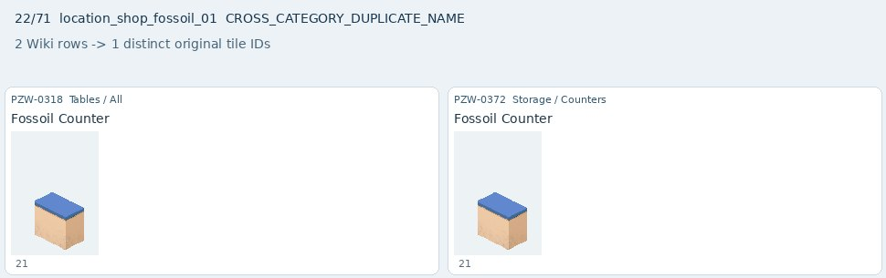

## FUR-64CE04267F144502 — Wooden Counter

갈색 판재 ㄱ자 상판과 테두리가 있는 어두운 전면 패널.

원본 키: `carpentry_02/20`

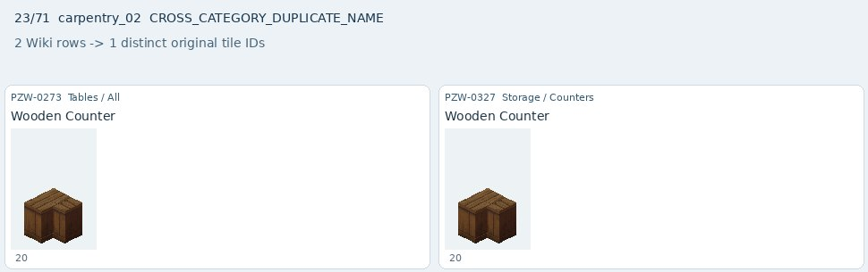

## FUR-66199BA9BEA2F348 — Theater Counter

흰색 직사각 상판 아래 진한 청색 몸체; 아래쪽 어두운 띠.

원본 키: `location_entertainment_theatre_01/13`

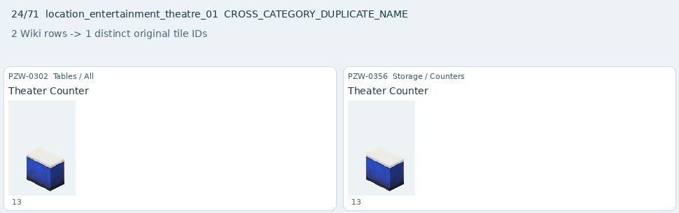

## FUR-69F40435B80452B2 — Modern Counter

크림색 직사각 상판과 갈색 패널 몸체; 손잡이는 뚜렷하지 않음.

원본 키: `fixtures_counters_01/5`

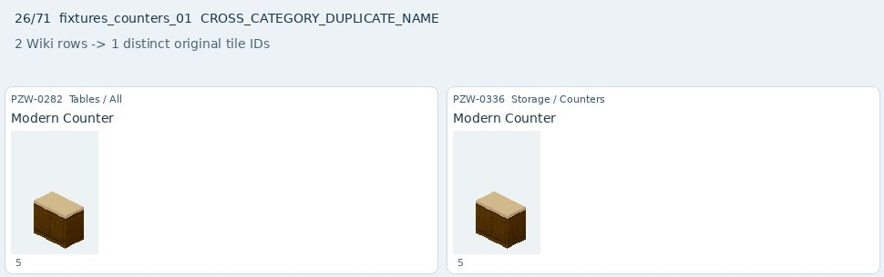

## FUR-713F3852CB95FB7A — Square Theater Counter

밝은 마름모 상판 아래 청색 두 면, 수평 밝은 띠와 모서리 세로 띠; 안쪽으로 패인 ㄱ자와 구별됨.

원본 키: `location_entertainment_theatre_01/16`

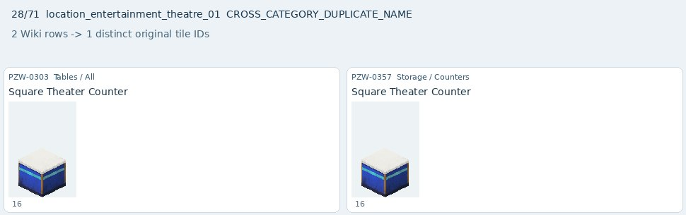

## FUR-7AF1C7634D48AD21 — Trailer Counter

베이지 직사각 상판과 황갈색 두 문짝; 문짝 안쪽 사각 테두리.

원본 키: `location_trailer_02/18`

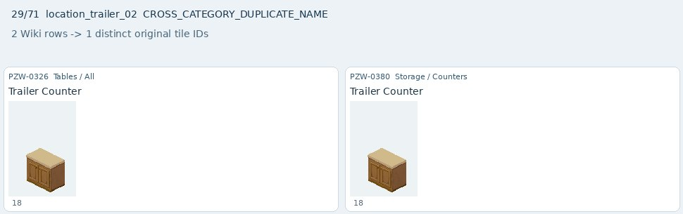

## FUR-7FEA51465F9357F2 — Electric Blower Forge

가느다란 네 다리 위 검은 사각 받침과 검은 돌출부; 독립 장비형 실루엣.

원본 키: `crafted_02/52`

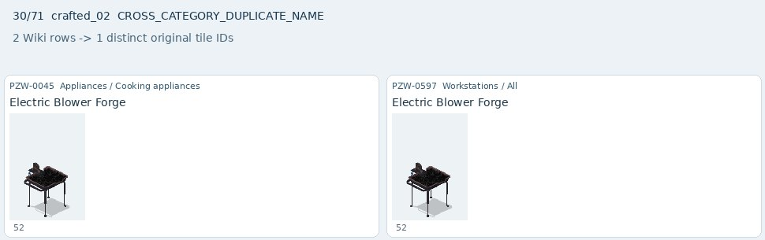

## FUR-8108D6AAA7C630F3 — Wooden Counter

평행한 갈색 상판 널과 어두운 전면 패널; 29번 계열과 유사해도 37번 키를 별도 유지.

원본 키: `carpentry_02/37`

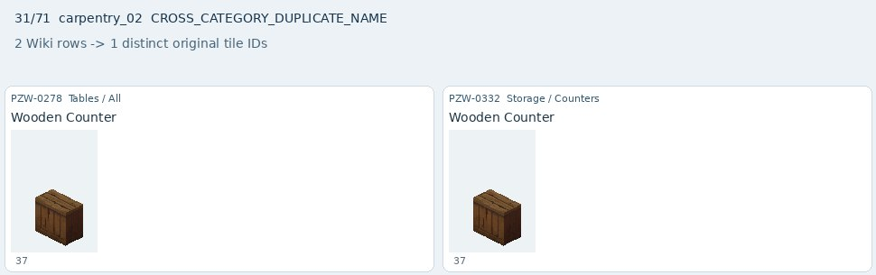

## FUR-8BF7B4701BB2CFE8 — White Display Counter

80·81·82에 밝은 상부 테두리, 경사진 유리 같은 면, 검은 하단 띠가 반복되며 끝 측판 유무가 다름. 연속 진열대의 부품 후보.

원본 키: `location_shop_generic_01/80|location_shop_generic_01/81|location_shop_generic_01/82`

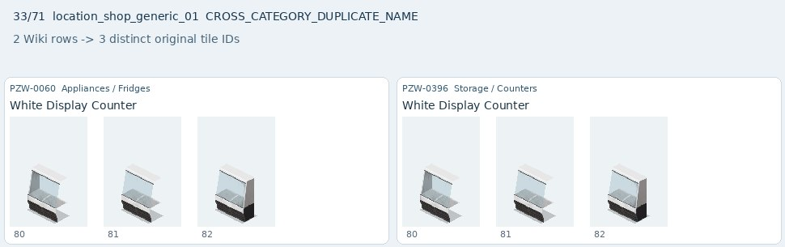

## FUR-8E50338184BE396F — Dark Corner Counter

짙은 회갈색 ㄱ자 상판과 거의 검은 몸체; 전면은 단순한 패널.

원본 키: `fixtures_counters_01/60`

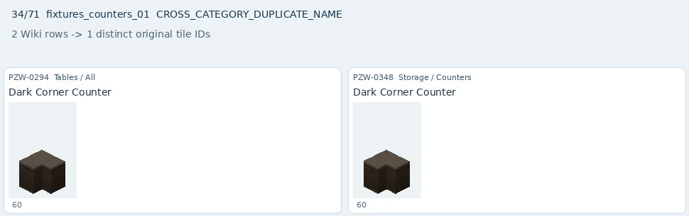

## FUR-91AAFC08238D0BC3 — Seahorse Coffee Counter

황토색 직사각 상판 아래 매우 짙은 갈색 몸체.

원본 키: `location_restaurant_seahorse_01/45`

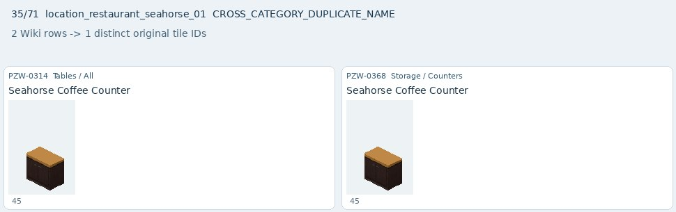

## FUR-973B45E156E84B3E — Dark Bar Corner Counter

검정에 가까운 ㄱ자 상판과 어두운 패널; 낮은 하단 테두리.

원본 키: `location_restaurant_bar_01/20`

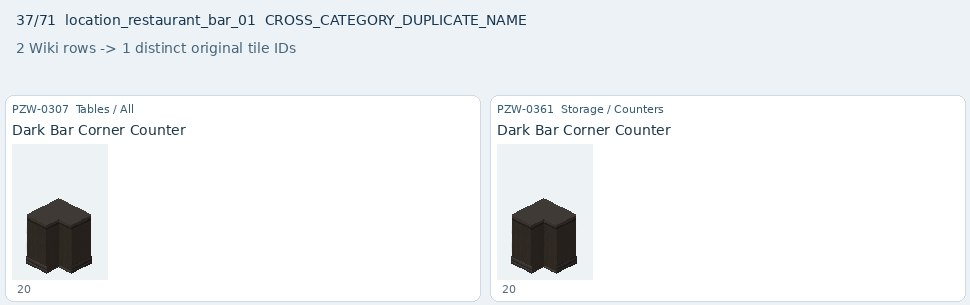

## FUR-97CD4E2946EDBB7F — Green Corner Counter

녹회색 ㄱ자 상판과 녹색 몸체; 안쪽 모서리와 면 음영.

원본 키: `fixtures_counters_01/68`

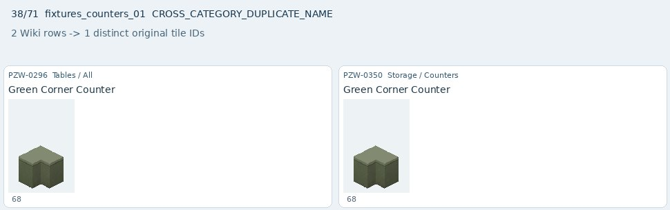

## FUR-9CEE6C8203802649 — Zippee Counter

붉은 직사각 상판 아래 흰색 세로 얼룩/결이 있는 몸체.

원본 키: `location_shop_zippee_01/21`

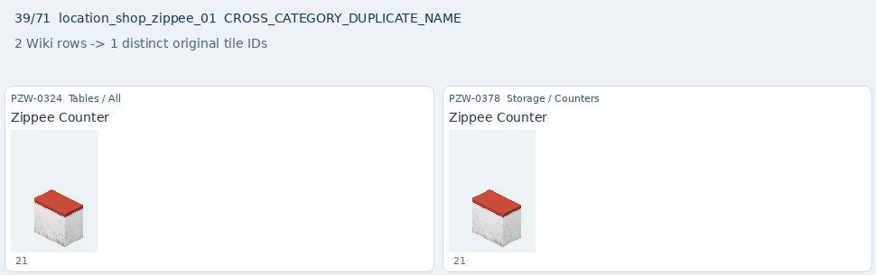

## FUR-9EACCB3BDD58C4B1 — Seahorse Coffee Corner Counter

황토색 ㄱ자 상판과 매우 짙은 갈색 몸체.

원본 키: `location_restaurant_seahorse_01/44`

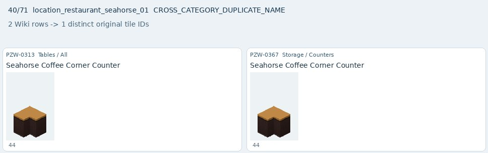

## FUR-9F52CEE95D94DF86 — Bar Counter

적갈색 직사각 상판과 갈색 패널; 아래쪽 가로 테두리.

원본 키: `location_restaurant_bar_01/5`

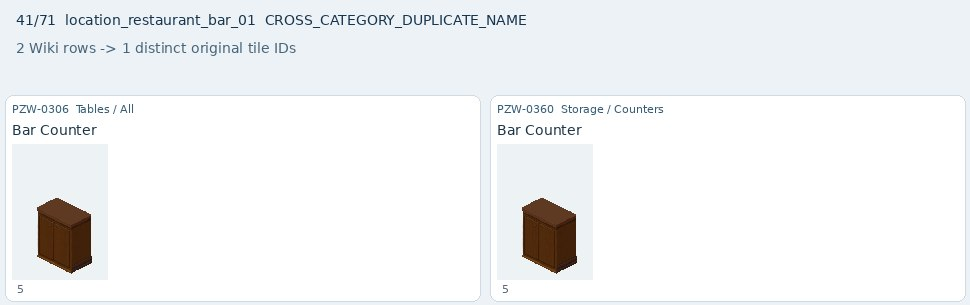

## FUR-9FC164C1B631B888 — Crude Metal Counter

회색 직사각 상판, 어두운 회색 몸체와 전면 고리처럼 보이는 손잡이.

원본 키: `crafted_05/29`

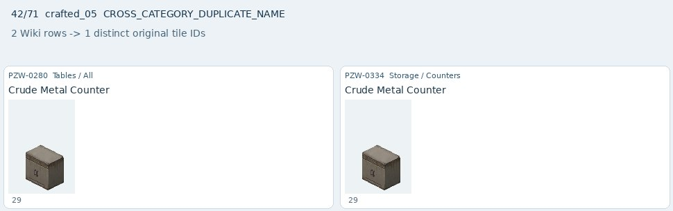

## FUR-A39BD4DD953B51B9 — Generic Cooled Shelves

64·65·66에 여러 층의 흰 가로 선반과 상부 덮개, 검은 하단이 반복; 양끝 측판 유무가 다름. 연속 선반 부품 후보.

원본 키: `location_shop_generic_01/64|location_shop_generic_01/65|location_shop_generic_01/66`

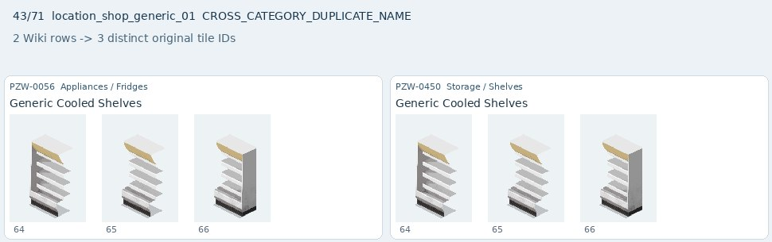

## FUR-A760C259D0FF3978 — Fancy Counter

황갈색 직사각 상판과 같은 계열의 짙은 몸체; 그림만으로 별도 기능은 불명.

원본 키: `fixtures_counters_01/16`

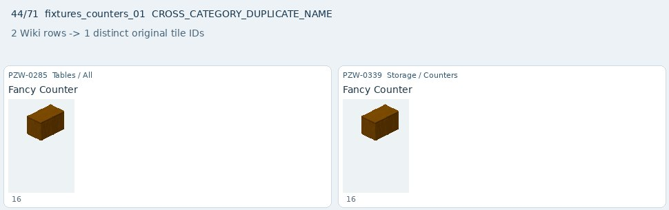

## FUR-A90FF59513ED44B6 — Pie Store Corner Counter

갈색 ㄱ자 상판과 목재색 테두리 속 흰색 세로 패널.

원본 키: `location_restaurant_pie_01/44`

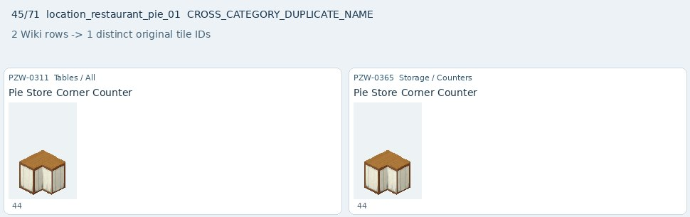

## FUR-B4C035F9A3DE728A — Hay Floor|Hay Floor (variant 2)

12·13 모두 황갈색 짚 같은 질감의 얇은 마름모 바닥 조각; 무늬 배열 차이. 각 번호가 Floors와 Plants에 반복됨.

원본 키: `vegetation_farm_01/12|vegetation_farm_01/13`

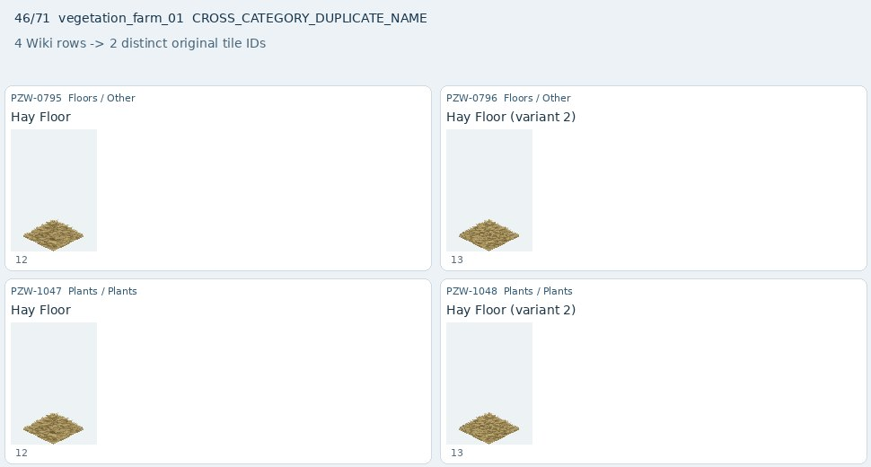

## FUR-BAFEA7F1E02F4269 — Crafter Corner Counter

갈색 판재 ㄱ자 상판, 어두운 몸체와 전면 세로 패널 테두리.

원본 키: `carpentry_02/28`

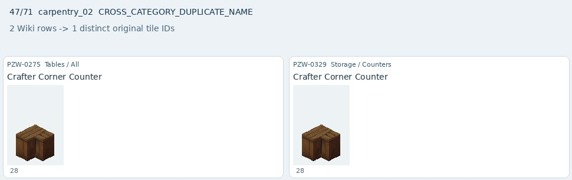

## FUR-BBF18F63E9082F05 — Wooden Counter

갈색 직사각 판재 상판과 어두운 전면 패널; 21번 독립 키 유지.

원본 키: `carpentry_02/21`

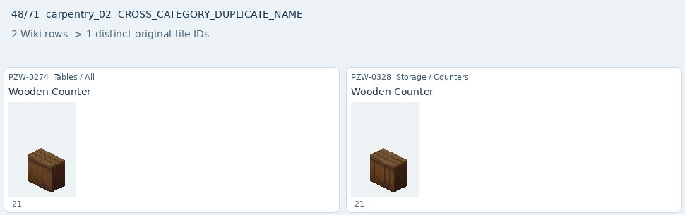

## FUR-C24D0FA54FB2C8AC — Oak Bar Counter

회갈색 직사각 상판과 짙은 세로 판재 몸체; 아래 테두리.

원본 키: `location_restaurant_bar_01/61`

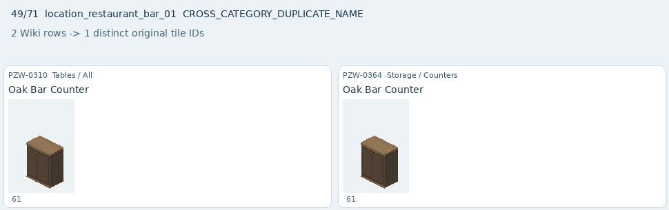

## FUR-C8CED9044DB2735D — Fossoil Low Shelves

푸른 직사각 상판 아래 밝은 측판과 두 층의 열린 선반칸.

원본 키: `location_shop_fossoil_01/70`

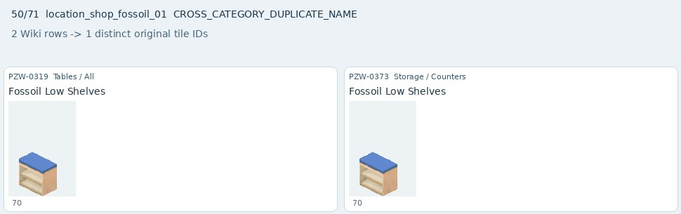

## FUR-CC820A8D4B678B41 — Red Oak Counter

밝은 갈색 직사각 상판과 짙은 갈색 단순 패널 몸체.

원본 키: `fixtures_counters_01/53`

## FUR-D1D25168549EB0F7 — Gas2Go Low Shelves

붉은 직사각 상판 아래 크림색 측판과 두 층의 열린 선반칸.

원본 키: `location_shop_gas2go_01/30`

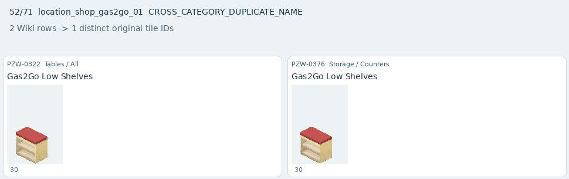

## FUR-D5B1587B845F01A4 — Gas2Go Counter

붉은 직사각 상판과 밝은 크림색의 막힌 전면 몸체.

원본 키: `location_shop_gas2go_01/21`

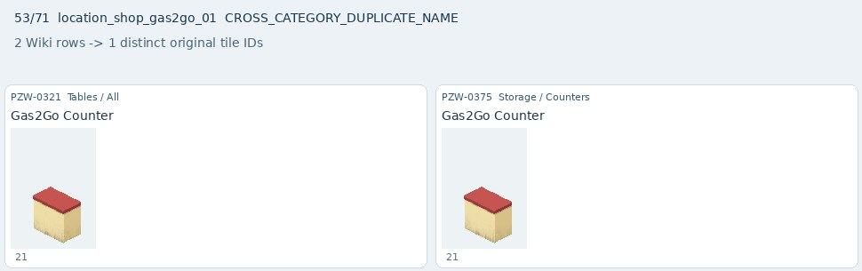

## FUR-D87FD1269367D77B — Rough Wooden Corner Counter

회갈색 ㄱ자 상판과 어두운 목재형 패널 몸체.

원본 키: `fixtures_counters_01/12`

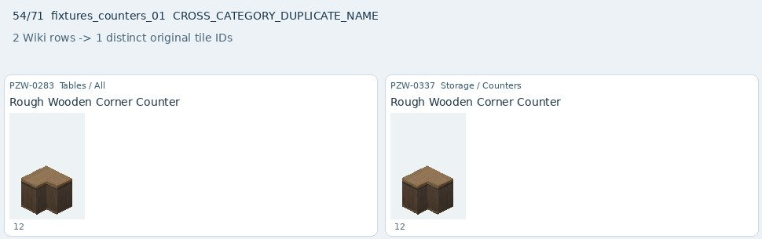

## FUR-D943C19090701B1A — White Counter

밝은 크림색 직사각 상판, 회백색 문짝과 가는 세로 손잡이.

원본 키: `fixtures_counters_01/77`

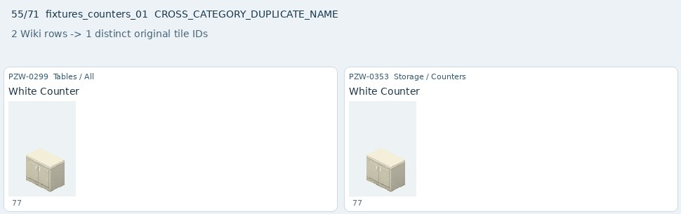

## FUR-DD06DDA06BD847DD — Glass Theater Counter

황갈색 테두리의 유리 같은 윗면과 진한 청색 몸체; 한쪽 면의 밝은 창.

원본 키: `location_entertainment_theatre_01/6`

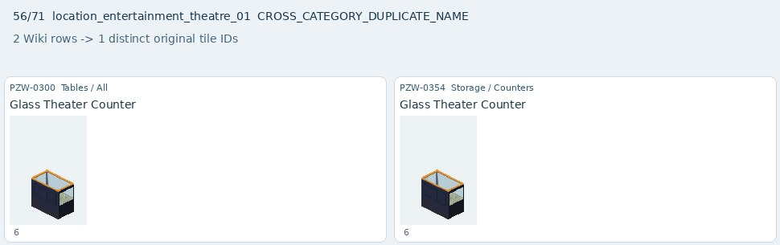

## FUR-E3418E6B3B3D893C — Cedar Counter

황갈색 직사각 상판과 올리브 갈색 문짝; 작은 손잡이.

원본 키: `fixtures_counters_01/45`

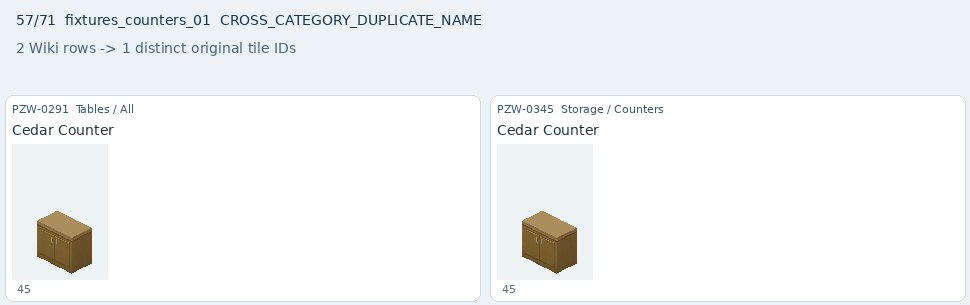

## FUR-E8005403163E626F — Metal Counter

회색 상판과 전면 서랍형 선, 가는 지지 다리 및 열린 하부 공간.

원본 키: `fixtures_counters_01/37`

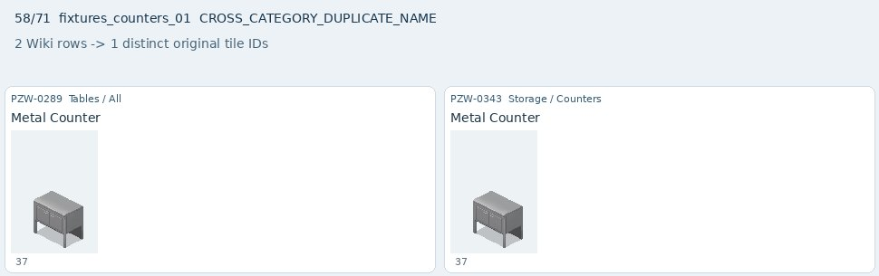

## FUR-E9877B6FBC642EF7 — Wooden Counter

갈색 판재 ㄱ자 상판과 짙은 전면 패널; 36번 키 유지.

원본 키: `carpentry_02/36`

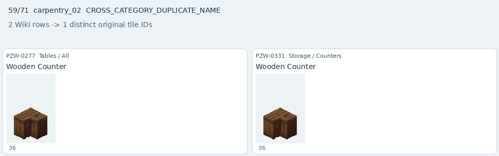

## FUR-E9F51E70208E2075 — Bar Corner Counter

적갈색 ㄱ자 상판과 갈색 패널 몸체; 아래쪽 짙은 테두리.

원본 키: `location_restaurant_bar_01/4`

## FUR-ED20FD30FAE3455E — White Corner Counter

크림색 ㄱ자 상판과 밝은 회백색 몸체; 안쪽 모서리.

원본 키: `fixtures_counters_01/76`

## FUR-F238E5CF5900BB76 — Quality Table

갈색 판재 상판과 비교적 반듯한 다리, 아래 가로 지지대가 있는 작은 탁자형.

원본 키: `carpentry_02/9`

## FUR-F4CA7C11F4849CDE — Wooden Counter

회갈색 직사각 상판과 어두운 목재형 패널 몸체.

원본 키: `fixtures_counters_01/13`

## FUR-F5731DA13C843CB6 — Spiffos Corner Counter

주황색 ㄱ자 상판 아래 적갈색 몸체.

원본 키: `location_restaurant_spiffos_01/60`

## FUR-F5B0C6163F56A1FA — Pie Store Counter

갈색 직사각 상판과 갈색 테두리 속 흰색 세로 패널.

원본 키: `location_restaurant_pie_01/45`

## FUR-F7A6DAEC92997A22 — Large Simple Drying Rack

232·234는 길쭉한 지주와 가로막대; 233·235는 기울어진 지지부와 가로막대. 네 타일은 틀의 방향·부품 후보이며 각각 완성 가구로 세지 않음.

원본 키: `vegetation_drying_01/232|vegetation_drying_01/233|vegetation_drying_01/234|vegetation_drying_01/235`

## FUR-F8BBB79AC2F1E163 — Zippee Display Counter

붉은 직사각 상판 아래 밝은 측판과 열린 두 선반칸.

원본 키: `location_shop_zippee_01/58`

## FUR-F9DDDD78F953381D — Metal Counter Corner

회색 ㄱ자 상판과 회색 수직 몸체; 하부가 부분적으로 열려 보이고 안쪽 지지선이 있음.

원본 키: `fixtures_counters_01/36`

## FUR-FB17E92DA7251FF0 — Dark Counter

짙은 회갈색 직사각 상판과 어두운 문짝; 두 작은 손잡이.

원본 키: `fixtures_counters_01/61`

