# 좀보이드 원본 가구 357종 이미지 도감

원본 PNG 조립 참고 이미지이며 Minecraft 가구 모델이 아니야. [검증 기준](README_KO.md)

## Counter (69스타일)

### 010 · Steel

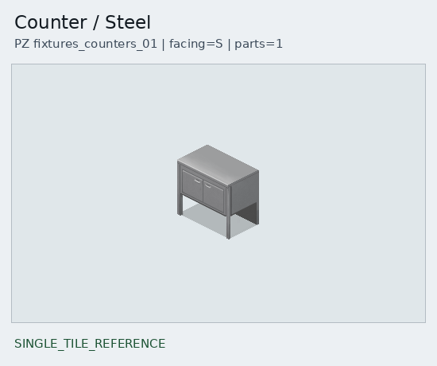

원본 방향: E|N|S|W / 타일셋: fixtures_counters_01 / 3D: ALL_VARIANT_PARTS_3D_BOUND

### 018 · Modern

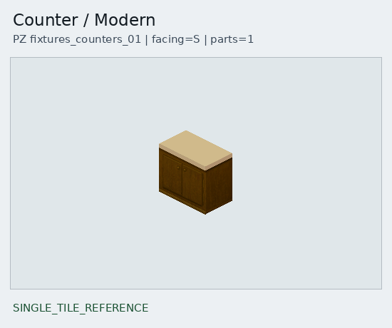

원본 방향: E|N|S|W / 타일셋: fixtures_counters_01 / 3D: ALL_VARIANT_PARTS_3D_BOUND

### 020 · Birchwood

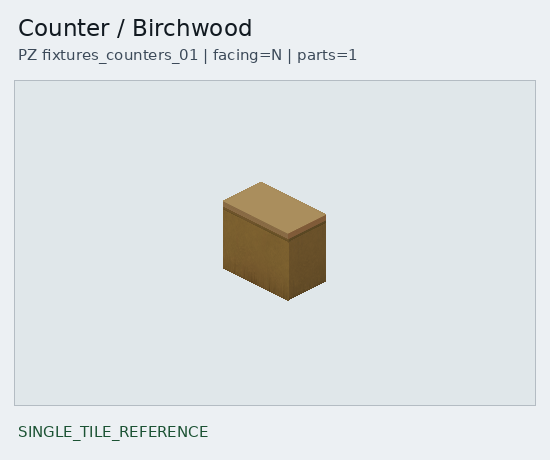

원본 방향: E|N|S|W / 타일셋: fixtures_counters_01 / 3D: ALL_VARIANT_PARTS_3D_BOUND

### 025 · White

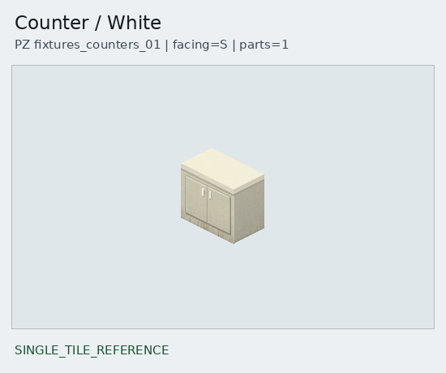

원본 방향: E|N|S|W / 타일셋: fixtures_counters_01 / 3D: ALL_VARIANT_PARTS_3D_BOUND

### 027 · Oak

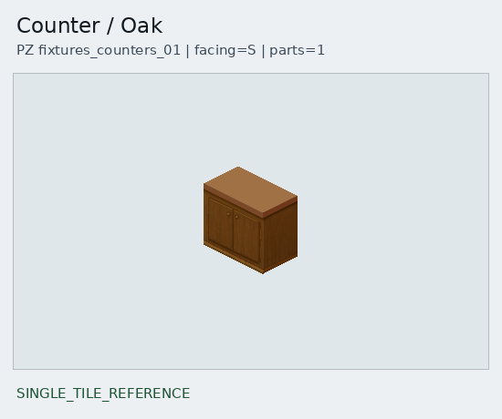

원본 방향: E|N|S|W / 타일셋: fixtures_counters_01 / 3D: ALL_VARIANT_PARTS_3D_BOUND

### 031 · Wooden

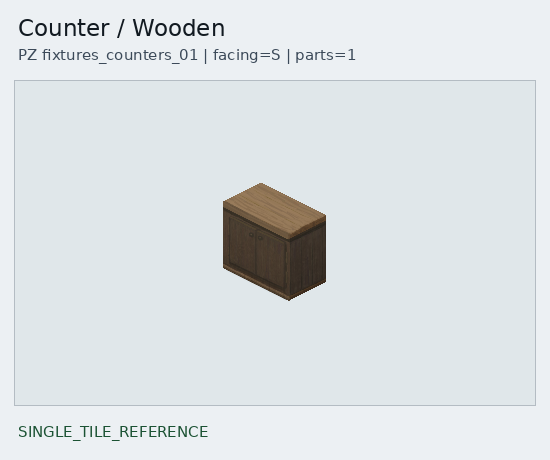

원본 방향: E|N|S|W / 타일셋: fixtures_counters_01 / 3D: ALL_VARIANT_PARTS_3D_BOUND

### 064 · Steel Corner

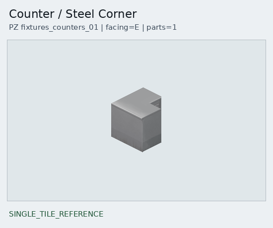

원본 방향: E|N|S|W / 타일셋: fixtures_counters_01 / 3D: ALL_VARIANT_PARTS_3D_BOUND

### 078 · Wooden Corner

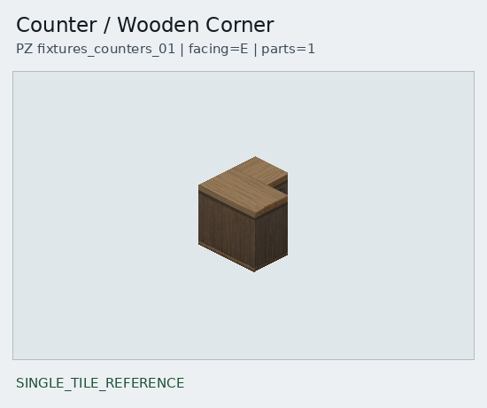

원본 방향: E|N|S|W / 타일셋: fixtures_counters_01|location_trailer_02 / 3D: ALL_VARIANT_PARTS_3D_BOUND

### 079 · Trailer

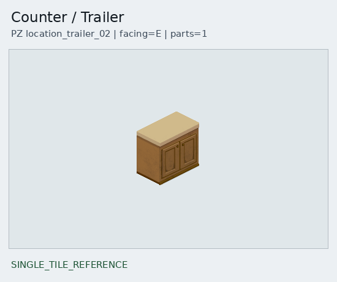

원본 방향: E|N|S|W / 타일셋: location_trailer_02 / 3D: ALL_VARIANT_PARTS_3D_BOUND

### 084 · Birchwood Corner

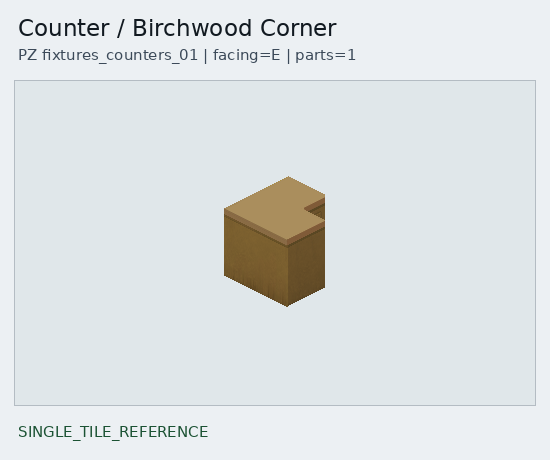

원본 방향: E|N|S|W / 타일셋: fixtures_counters_01 / 3D: ALL_VARIANT_PARTS_3D_BOUND

### 092 · Generic Shop

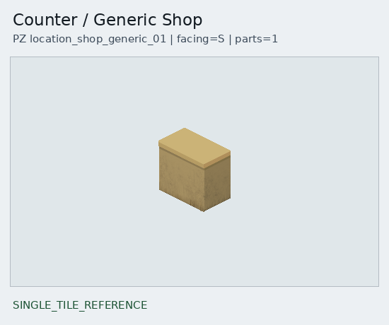

원본 방향: E|N|S|W / 타일셋: location_shop_generic_01 / 3D: ALL_VARIANT_PARTS_3D_BOUND

### 103 · Shop Display

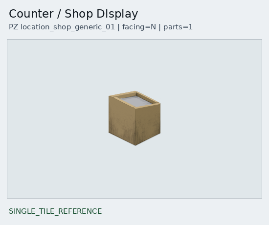

원본 방향: N|S|W / 타일셋: location_shop_generic_01 / 3D: ALL_VARIANT_PARTS_3D_BOUND

### 120 · Modern Corner

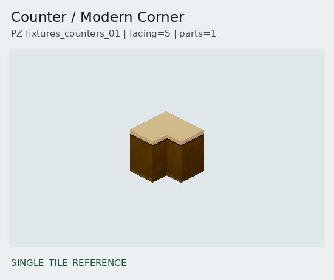

원본 방향: E|N|S|W / 타일셋: fixtures_counters_01 / 3D: ALL_VARIANT_PARTS_3D_BOUND

### 122 · Bar

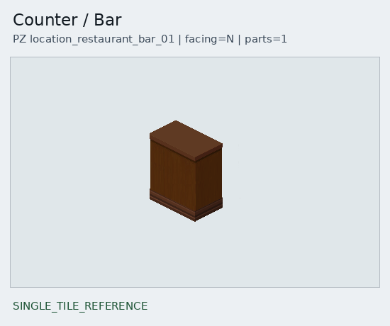

원본 방향: E|N|S|W / 타일셋: location_restaurant_bar_01 / 3D: ALL_VARIANT_PARTS_3D_BOUND

### 127 · Oak Corner

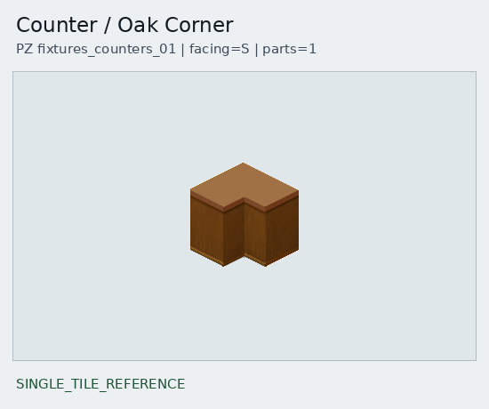

원본 방향: E|N|S|W / 타일셋: fixtures_counters_01 / 3D: ALL_VARIANT_PARTS_3D_BOUND

### 128 · White Corner

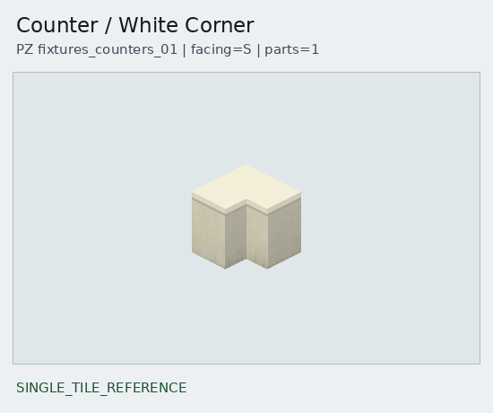

원본 방향: E|N|S|W / 타일셋: fixtures_counters_01 / 3D: ALL_VARIANT_PARTS_3D_BOUND

### 139 · Floating Trailer

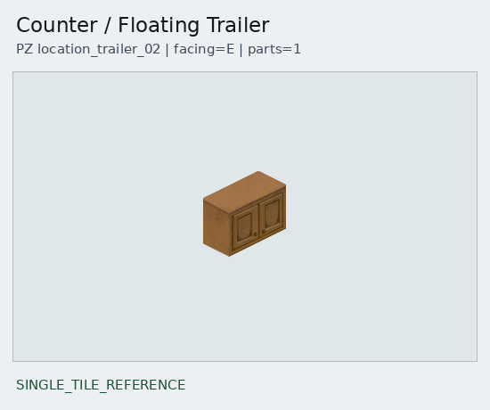

원본 방향: E|S|W / 타일셋: location_trailer_02 / 3D: ALL_VARIANT_PARTS_3D_BOUND

### 142 · Green

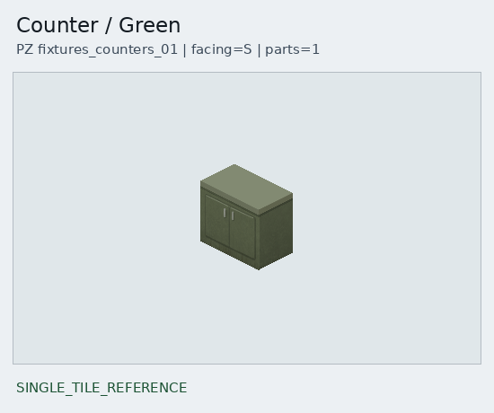

원본 방향: E|N|S|W / 타일셋: fixtures_counters_01 / 3D: ALL_VARIANT_PARTS_3D_BOUND

### 145 · Low Motel

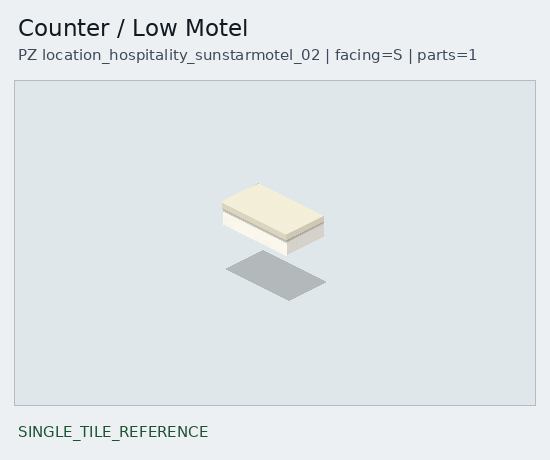

원본 방향: E|N|S|W / 타일셋: location_hospitality_sunstarmotel_02 / 3D: NO_PUBLIC_3D_BINDING

### 155 · White Floating

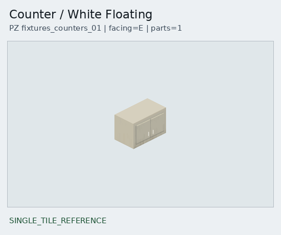

원본 방향: E|N|S|W / 타일셋: fixtures_counters_01 / 3D: ALL_VARIANT_PARTS_3D_BOUND

### 176 · Generic Shop Corner

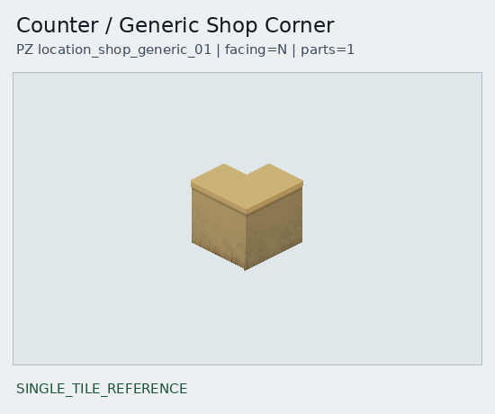

원본 방향: E|N|S|W / 타일셋: location_shop_generic_01 / 3D: NO_PUBLIC_3D_BINDING

### 177 · Dark

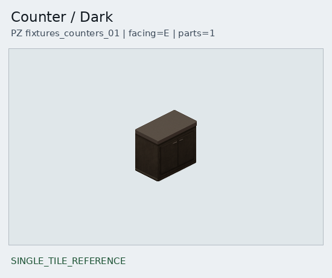

원본 방향: E|N|S|W / 타일셋: fixtures_counters_01 / 3D: ALL_VARIANT_PARTS_3D_BOUND

### 180 · Birchwood Floating

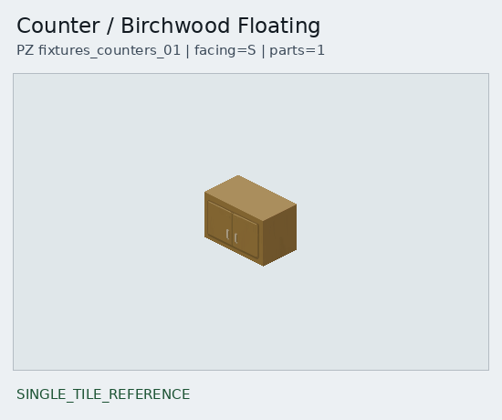

원본 방향: E|S / 타일셋: fixtures_counters_01 / 3D: ALL_VARIANT_PARTS_3D_BOUND

### 182 · Bar Corner

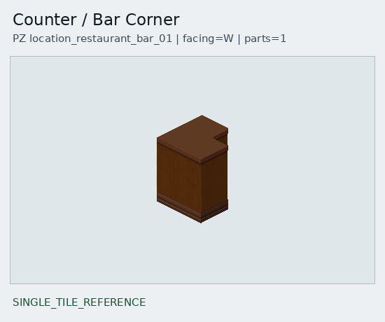

원본 방향: E|N|S|W / 타일셋: location_restaurant_bar_01 / 3D: ALL_VARIANT_PARTS_3D_BOUND

### 183 · Cantina Food

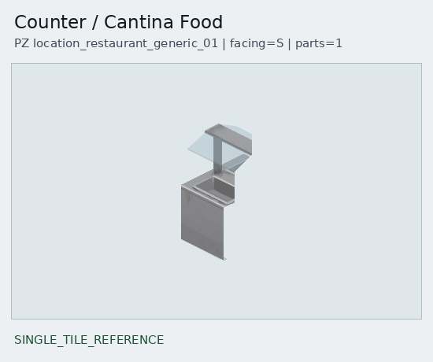

원본 방향: E|S / 타일셋: location_restaurant_generic_01 / 3D: NO_PUBLIC_3D_BINDING

### 185 · Oakwood Floating

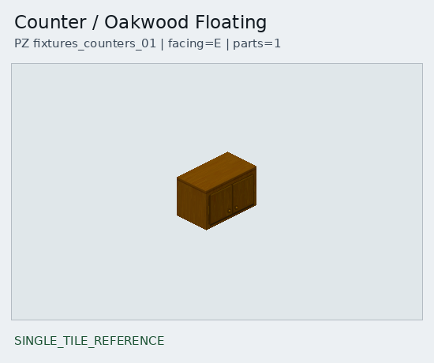

원본 방향: E|S / 타일셋: fixtures_counters_01 / 3D: ALL_VARIANT_PARTS_3D_BOUND

### 190 · Spiffos

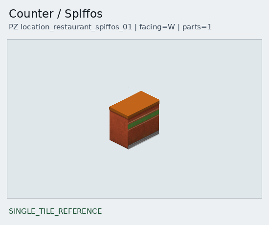

원본 방향: N|S|W / 타일셋: location_restaurant_spiffos_01 / 3D: NO_PUBLIC_3D_BINDING

### 192 · Steel Floating

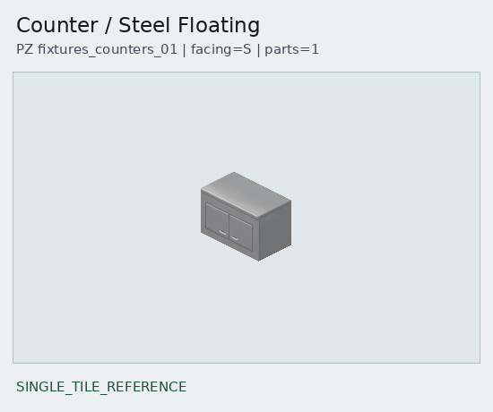

원본 방향: E|N|S / 타일셋: fixtures_counters_01 / 3D: ALL_VARIANT_PARTS_3D_BOUND

### 195 · Motel

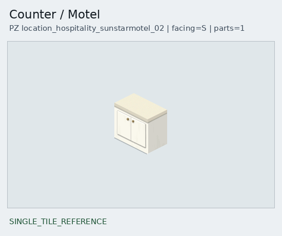

원본 방향: E|N|S|W / 타일셋: location_hospitality_sunstarmotel_02 / 3D: NO_PUBLIC_3D_BINDING

### 210 · Dark Corner

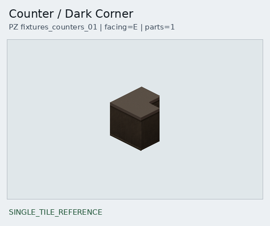

원본 방향: E|N|S|W / 타일셋: fixtures_counters_01 / 3D: ALL_VARIANT_PARTS_3D_BOUND

### 217 · Glass Display

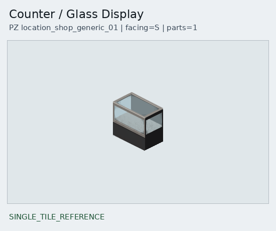

원본 방향: E|S|W / 타일셋: location_shop_generic_01 / 3D: NO_PUBLIC_3D_BINDING

### 225 · Green Corner

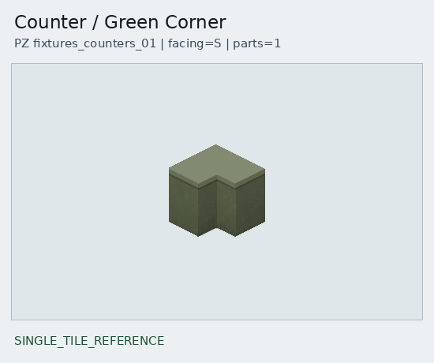

원본 방향: E|S|W / 타일셋: fixtures_counters_01 / 3D: ALL_VARIANT_PARTS_3D_BOUND

### 226 · Hardwood Floating

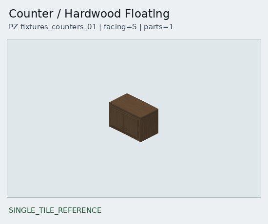

원본 방향: E|S / 타일셋: fixtures_counters_01 / 3D: ALL_VARIANT_PARTS_3D_BOUND

### 232 · Oak Floating

원본 방향: E|S / 타일셋: fixtures_counters_01 / 3D: ALL_VARIANT_PARTS_3D_BOUND

### 236 · Pie Store

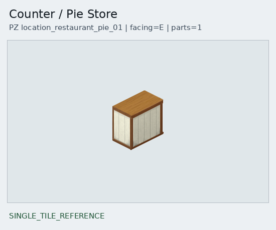

원본 방향: E|N|S|W / 타일셋: location_restaurant_pie_01 / 3D: NO_PUBLIC_3D_BINDING

### 251 · Birchwood Floating Corner

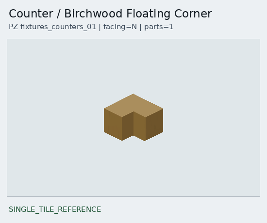

원본 방향: E|N|W / 타일셋: fixtures_counters_01 / 3D: ALL_VARIANT_PARTS_3D_BOUND

### 257 · Oak Bar

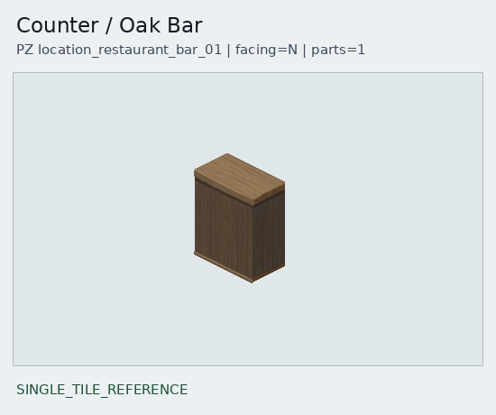

원본 방향: N|W / 타일셋: location_restaurant_bar_01 / 3D: ALL_VARIANT_PARTS_3D_BOUND

### 258 · Zippee

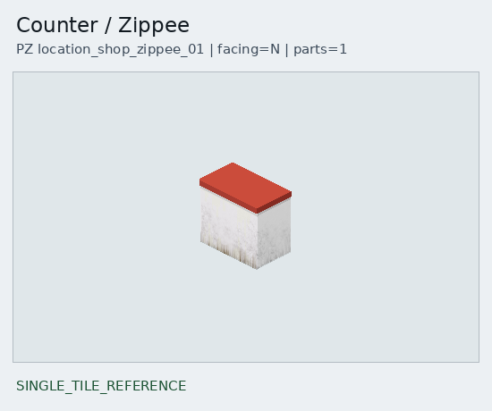

원본 방향: N|W / 타일셋: location_shop_zippee_01 / 3D: NO_PUBLIC_3D_BINDING

### 264 · Dark Bar

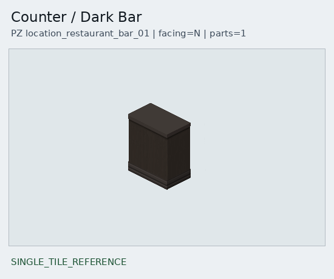

원본 방향: E|N / 타일셋: location_restaurant_bar_01 / 3D: ALL_VARIANT_PARTS_3D_BOUND

### 265 · White Display

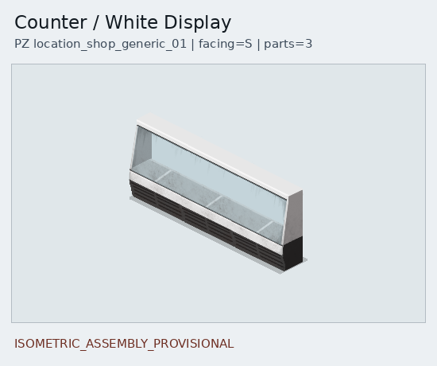

원본 방향: S / 타일셋: location_shop_generic_01 / 3D: ALL_VARIANT_PARTS_3D_BOUND

### 268 · Green Floating

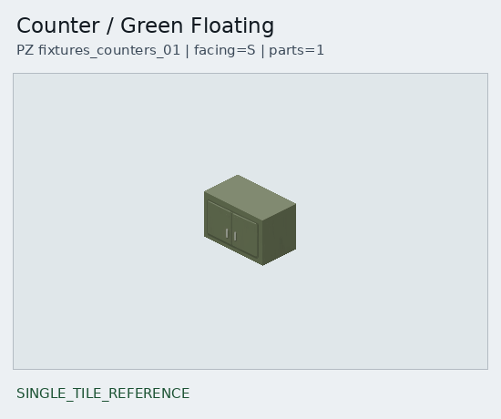

원본 방향: S / 타일셋: fixtures_counters_01 / 3D: ALL_VARIANT_PARTS_3D_BOUND

### 278 · Middle

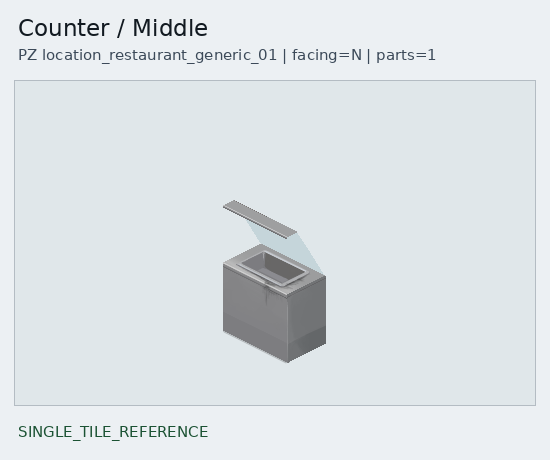

원본 방향: E|N / 타일셋: location_restaurant_generic_01 / 3D: NO_PUBLIC_3D_BINDING

### 279 · Mobile Tool

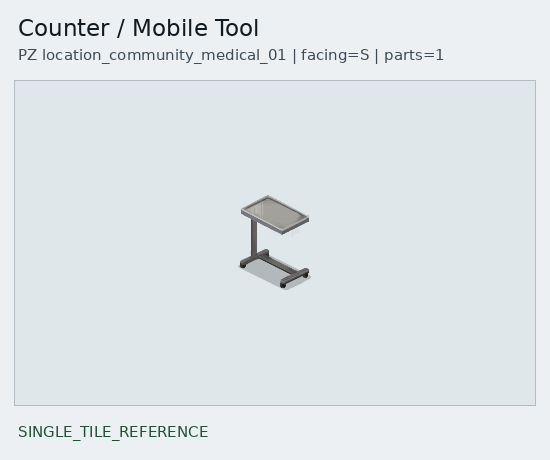

원본 방향: E|N|S|W / 타일셋: location_community_medical_01 / 3D: NO_PUBLIC_3D_BINDING

### 280 · Oak Employee Bank

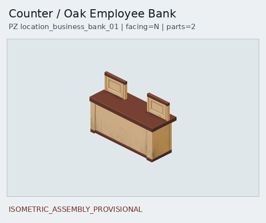

원본 방향: N / 타일셋: location_business_bank_01 / 3D: NO_PUBLIC_3D_BINDING

### 281 · Pizzawhirled

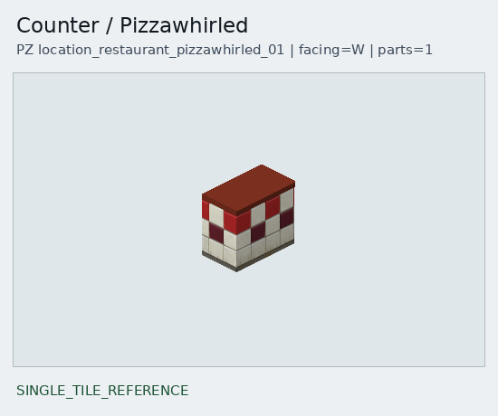

원본 방향: N|W / 타일셋: location_restaurant_pizzawhirled_01 / 3D: NO_PUBLIC_3D_BINDING

### 282 · Quality Crafted

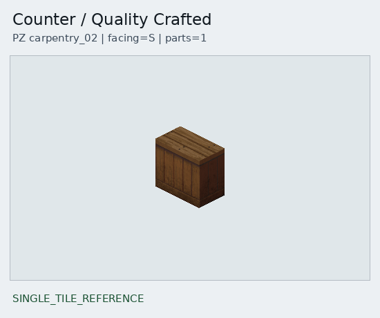

원본 방향: S|W / 타일셋: carpentry_02 / 3D: NO_PUBLIC_3D_BINDING

### 283 · Rounded Glass Display

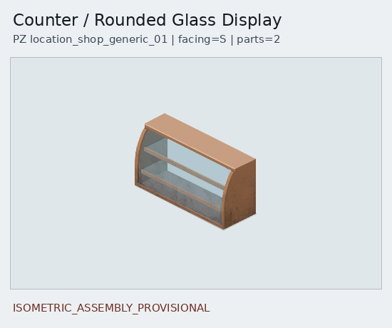

원본 방향: E|S / 타일셋: location_shop_generic_01 / 3D: NO_PUBLIC_3D_BINDING

### 284 · Theater

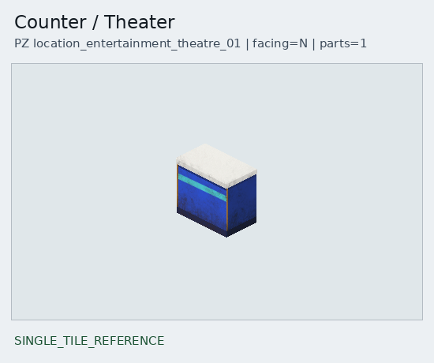

원본 방향: N / 타일셋: location_entertainment_theatre_01 / 3D: NO_PUBLIC_3D_BINDING

### 298 · Corner A

원본 방향: E|N / 타일셋: location_restaurant_generic_01 / 3D: NO_PUBLIC_3D_BINDING

### 299 · Corner B

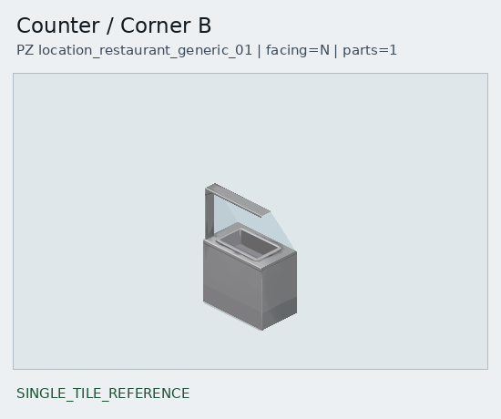

원본 방향: E|N / 타일셋: location_restaurant_generic_01 / 3D: NO_PUBLIC_3D_BINDING

### 300 · Fossoil

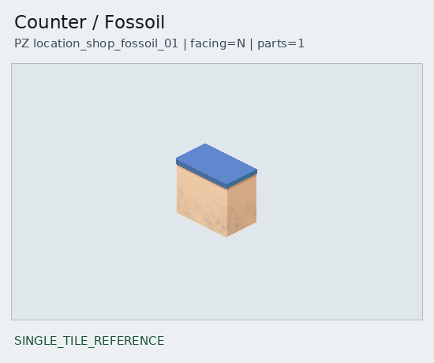

원본 방향: N / 타일셋: location_shop_fossoil_01 / 3D: NO_PUBLIC_3D_BINDING

### 301 · Glass Corner Display

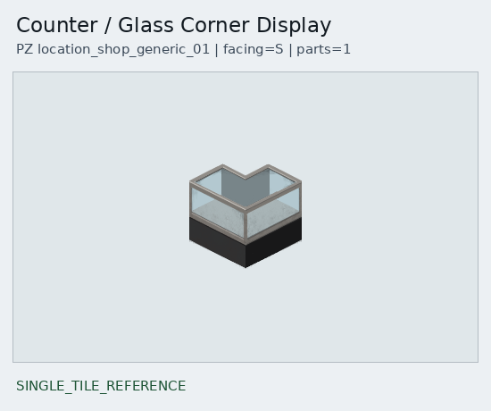

원본 방향: E|S|W / 타일셋: location_shop_generic_01 / 3D: NO_PUBLIC_3D_BINDING

### 302 · Glass Theater

원본 방향: N / 타일셋: location_entertainment_theatre_01 / 3D: NO_PUBLIC_3D_BINDING

### 303 · Pie Store Corner

원본 방향: E|W / 타일셋: location_restaurant_pie_01 / 3D: NO_PUBLIC_3D_BINDING

### 304 · Seahorse Coffee

원본 방향: S|W / 타일셋: location_restaurant_seahorse_01 / 3D: NO_PUBLIC_3D_BINDING

### 313 · Darkwood Floating Corner

원본 방향: E|N / 타일셋: fixtures_counters_01 / 3D: ALL_VARIANT_PARTS_3D_BOUND

### 324 · Crafted

원본 방향: S / 타일셋: carpentry_02 / 3D: NO_PUBLIC_3D_BINDING

### 325 · Dark Bar Corner

원본 방향: N|W / 타일셋: location_restaurant_bar_01 / 3D: ALL_VARIANT_PARTS_3D_BOUND

### 326 · Motel Corner

원본 방향: E|N|S|W / 타일셋: location_hospitality_sunstarmotel_02 / 3D: NO_PUBLIC_3D_BINDING

### 327 · Zippee Corner

원본 방향: N / 타일셋: location_shop_zippee_01 / 3D: NO_PUBLIC_3D_BINDING

### 328 · Zippee Display

원본 방향: N / 타일셋: location_shop_zippee_01 / 3D: NO_PUBLIC_3D_BINDING

### 339 · Oakwood Floating Corner

원본 방향: E|N / 타일셋: fixtures_counters_01 / 3D: ALL_VARIANT_PARTS_3D_BOUND

### 340 · Steel Floating Corner

원본 방향: N / 타일셋: fixtures_counters_01 / 3D: ALL_VARIANT_PARTS_3D_BOUND

### 341 · White Floating Corner

원본 방향: E / 타일셋: fixtures_counters_01 / 3D: ALL_VARIANT_PARTS_3D_BOUND

### 352 · Crafter Corner

원본 방향: S / 타일셋: carpentry_02 / 3D: NO_PUBLIC_3D_BINDING

### 353 · Oak Corner Bar

원본 방향: W / 타일셋: location_restaurant_bar_01 / 3D: ALL_VARIANT_PARTS_3D_BOUND

### 354 · Pizzawhirled Corner

원본 방향: N / 타일셋: location_restaurant_pizzawhirled_01 / 3D: NO_PUBLIC_3D_BINDING

### 355 · Seahorse Coffee Corner

원본 방향: W / 타일셋: location_restaurant_seahorse_01 / 3D: NO_PUBLIC_3D_BINDING

### 356 · Spiffos Corner

원본 방향: W / 타일셋: location_restaurant_spiffos_01 / 3D: NO_PUBLIC_3D_BINDING

## Chair (42스타일)

### 001 · Grey

원본 방향: E|N|S|W / 타일셋: furniture_seating_indoor_01 / 3D: ALL_VARIANT_PARTS_3D_BOUND

### 004 · Folding

원본 방향: E|N|S|W / 타일셋: furniture_seating_indoor_01 / 3D: ALL_VARIANT_PARTS_3D_BOUND

### 006 · Green Dinner

원본 방향: E|N|S|W / 타일셋: furniture_seating_indoor_01 / 3D: ALL_VARIANT_PARTS_3D_BOUND

### 009 · Wooden

원본 방향: E|N|S|W / 타일셋: furniture_seating_indoor_02 / 3D: ALL_VARIANT_PARTS_3D_BOUND

### 012 · Dark Wooden

원본 방향: E|N|S|W / 타일셋: furniture_seating_indoor_02 / 3D: ALL_VARIANT_PARTS_3D_BOUND

### 013 · Black Office

원본 방향: E|N|S|W / 타일셋: furniture_seating_indoor_01 / 3D: ALL_VARIANT_PARTS_3D_BOUND

### 017 · Plastic

원본 방향: E|N|S|W / 타일셋: furniture_seating_outdoor_01 / 3D: ALL_VARIANT_PARTS_3D_BOUND

### 030 · Blue Plastic

원본 방향: E|N|S|W / 타일셋: furniture_seating_indoor_02 / 3D: ALL_VARIANT_PARTS_3D_BOUND

### 034 · Fancy Wooden

원본 방향: E|N|S|W / 타일셋: furniture_seating_indoor_03 / 3D: ALL_VARIANT_PARTS_3D_BOUND

### 037 · White Wooden

원본 방향: E|N|S|W / 타일셋: furniture_seating_indoor_02 / 3D: ALL_VARIANT_PARTS_3D_BOUND

### 058 · Grey Plastic

원본 방향: E|N|S|W / 타일셋: furniture_seating_indoor_03 / 3D: ALL_VARIANT_PARTS_3D_BOUND

### 062 · Blue Rattan

원본 방향: E|N|S|W / 타일셋: furniture_seating_indoor_02 / 3D: ALL_VARIANT_PARTS_3D_BOUND

### 068 · Red Wooden

원본 방향: E|N|S|W / 타일셋: furniture_seating_indoor_02 / 3D: ALL_VARIANT_PARTS_3D_BOUND

### 072 · White Simple

원본 방향: E|N|S|W / 타일셋: furniture_seating_indoor_03 / 3D: ALL_VARIANT_PARTS_3D_BOUND

### 099 · Pile o' Crepe

원본 방향: E|N|S|W / 타일셋: location_restaurant_pileocrepe_01 / 3D: ALL_VARIANT_PARTS_3D_BOUND

### 107 · Brown Lazy

원본 방향: E|N|S|W / 타일셋: furniture_seating_indoor_02 / 3D: ALL_VARIANT_PARTS_3D_BOUND

### 123 · Fancy White

원본 방향: E|N|S|W / 타일셋: furniture_seating_indoor_01 / 3D: ALL_VARIANT_PARTS_3D_BOUND

### 125 · Beach

원본 방향: E|N|S|W / 타일셋: furniture_seating_outdoor_01 / 3D: ALL_VARIANT_PARTS_3D_BOUND

### 126 · Green Comfy

원본 방향: E|N|S|W / 타일셋: furniture_seating_indoor_01 / 3D: ALL_VARIANT_PARTS_3D_BOUND

### 129 · Light Blue

원본 방향: E|N|S|W / 타일셋: furniture_seating_indoor_03 / 3D: ALL_VARIANT_PARTS_3D_BOUND

### 133 · Black Fancy

원본 방향: E|N|S|W / 타일셋: furniture_seating_indoor_03 / 3D: ALL_VARIANT_PARTS_3D_BOUND

### 137 · White Lazy

원본 방향: E|N|S|W / 타일셋: furniture_seating_indoor_02 / 3D: ALL_VARIANT_PARTS_3D_BOUND

### 146 · Blue Comfy

원본 방향: E|N|S|W / 타일셋: furniture_seating_indoor_03 / 3D: ALL_VARIANT_PARTS_3D_BOUND

### 173 · Spiffos Dinner

원본 방향: N|S / 타일셋: location_restaurant_spiffos_02 / 3D: ALL_VARIANT_PARTS_3D_BOUND

### 178 · Red Theatre

원본 방향: W / 타일셋: location_entertainment_theatre_01 / 3D: NO_PUBLIC_3D_BINDING

### 194 · Modern White

원본 방향: E|N|S|W / 타일셋: furniture_seating_indoor_01|furniture_seating_indoor_03 / 3D: ALL_VARIANT_PARTS_3D_BOUND

### 204 · Makeshift

원본 방향: E|N|S|W / 타일셋: carpentry_01 / 3D: NO_PUBLIC_3D_BINDING

### 208 · Modern Red

원본 방향: E|N|S|W / 타일셋: furniture_seating_indoor_01 / 3D: ALL_VARIANT_PARTS_3D_BOUND

### 209 · Yellow Modern

원본 방향: E|N|S|W / 타일셋: furniture_seating_indoor_03 / 3D: ALL_VARIANT_PARTS_3D_BOUND

### 221 · Purple Rattan

원본 방향: E|N|S|W / 타일셋: furniture_seating_indoor_01 / 3D: ALL_VARIANT_PARTS_3D_BOUND

### 222 · Red Comfy

원본 방향: E|N|S / 타일셋: furniture_seating_indoor_01 / 3D: ALL_VARIANT_PARTS_3D_BOUND

### 230 · Darkblue Modern

원본 방향: E|W / 타일셋: furniture_seating_indoor_03 / 3D: ALL_VARIANT_PARTS_3D_BOUND

### 239 · Rocking

원본 방향: E|N|S / 타일셋: furniture_seating_indoor_03 / 3D: ALL_VARIANT_PARTS_3D_BOUND

### 247 · Salon

원본 방향: N|S|W / 타일셋: location_services_beauty_01 / 3D: NO_PUBLIC_3D_BINDING

### 250 · Victorian 5

원본 방향: E|N|S|W / 타일셋: furniture_seating_indoor_03 / 3D: ALL_VARIANT_PARTS_3D_BOUND

### 262 · Victorian 3

원본 방향: E|S|W / 타일셋: furniture_seating_indoor_03 / 3D: ALL_VARIANT_PARTS_3D_BOUND

### 263 · Victorian 4

원본 방향: E|N|W / 타일셋: furniture_seating_indoor_03 / 3D: ALL_VARIANT_PARTS_3D_BOUND

### 277 · Patient

원본 방향: E|N|S|W / 타일셋: location_community_medical_01 / 3D: NO_PUBLIC_3D_BINDING

### 297 · Exceptionally crafted

원본 방향: E|N|S|W / 타일셋: carpentry_01 / 3D: NO_PUBLIC_3D_BINDING

### 310 · Rocking 2

원본 방향: E|W / 타일셋: furniture_seating_indoor_03 / 3D: ALL_VARIANT_PARTS_3D_BOUND

### 311 · Victorian 6

원본 방향: E|S / 타일셋: furniture_seating_indoor_03 / 3D: ALL_VARIANT_PARTS_3D_BOUND

### 351 · Dentist Patient

원본 방향: S / 타일셋: location_community_medical_01 / 3D: NO_PUBLIC_3D_BINDING

## Shelves (32스타일)

### 007 · Oakwood

원본 방향: E|N|S|W / 타일셋: furniture_shelving_01 / 3D: ALL_VARIANT_PARTS_3D_BOUND

### 008 · Large Metal

원본 방향: E|S / 타일셋: furniture_shelving_01 / 3D: ALL_VARIANT_PARTS_3D_BOUND

### 026 · Low

원본 방향: E|N|S|W / 타일셋: furniture_shelving_01 / 3D: ALL_VARIANT_PARTS_3D_BOUND

### 038 · White Fancy

원본 방향: E|N|S|W / 타일셋: furniture_shelving_01 / 3D: ALL_VARIANT_PARTS_3D_BOUND

### 046 · Large Shop

원본 방향: E|N|S|W / 타일셋: location_shop_generic_01 / 3D: ALL_VARIANT_PARTS_3D_BOUND

### 050 · Metal Wall

원본 방향: E|N|S|W / 타일셋: furniture_shelving_01 / 3D: ALL_VARIANT_PARTS_3D_BOUND

### 065 · Big Wall

원본 방향: E|S / 타일셋: furniture_shelving_01 / 3D: ALL_VARIANT_PARTS_3D_BOUND

### 110 · Hardwood Wall

원본 방향: E|N|S|W / 타일셋: furniture_shelving_01 / 3D: ALL_VARIANT_PARTS_3D_BOUND

### 149 · Lightwood Wall

원본 방향: E|S / 타일셋: furniture_shelving_01 / 3D: ALL_VARIANT_PARTS_3D_BOUND

### 153 · Beige Rack Shop

원본 방향: E|S / 타일셋: location_shop_generic_01 / 3D: NO_PUBLIC_3D_BINDING

### 156 · Corner A

원본 방향: E|N|S|W / 타일셋: furniture_shelving_01 / 3D: ALL_VARIANT_PARTS_3D_BOUND

### 157 · Corner B

원본 방향: E|N|S|W / 타일셋: furniture_shelving_01 / 3D: ALL_VARIANT_PARTS_3D_BOUND

### 158 · Middle

원본 방향: E|N|S|W / 타일셋: furniture_shelving_01 / 3D: ALL_VARIANT_PARTS_3D_BOUND

### 187 · Generic Cooled

원본 방향: E|S / 타일셋: location_shop_generic_01 / 3D: NO_PUBLIC_3D_BINDING

### 196 · Trapzoid Shop

원본 방향: E|N|S / 타일셋: location_shop_generic_01 / 3D: NO_PUBLIC_3D_BINDING

### 199 · Large Rental

원본 방향: E|N|S|W / 타일셋: location_entertainment_theatre_01 / 3D: NO_PUBLIC_3D_BINDING

### 205 · Zippee Wall

원본 방향: E|N|S / 타일셋: location_shop_zippee_01 / 3D: ALL_VARIANT_PARTS_3D_BOUND

### 218 · Comics Shop

원본 방향: E|S / 타일셋: location_shop_generic_01 / 3D: NO_PUBLIC_3D_BINDING

### 219 · Long

원본 방향: E|S / 타일셋: location_shop_generic_01 / 3D: ALL_VARIANT_PARTS_3D_BOUND

### 227 · White Wall

원본 방향: E|S / 타일셋: furniture_shelving_01 / 3D: ALL_VARIANT_PARTS_3D_BOUND

### 249 · Fancy Wooden Shop

원본 방향: S / 타일셋: location_shop_generic_01 / 3D: ALL_VARIANT_PARTS_3D_BOUND

### 259 · Small Rental

원본 방향: E|W / 타일셋: location_entertainment_theatre_01 / 3D: NO_PUBLIC_3D_BINDING

### 274 · Dark Wall

원본 방향: E|S / 타일셋: furniture_shelving_01 / 3D: ALL_VARIANT_PARTS_3D_BOUND

### 293 · Big Wall Corner

원본 방향: S / 타일셋: furniture_shelving_01 / 3D: ALL_VARIANT_PARTS_3D_BOUND

### 305 · Wooden Shop

원본 방향: E / 타일셋: location_shop_generic_01 / 3D: ALL_VARIANT_PARTS_3D_BOUND

### 306 · Zippee Low Wall

원본 방향: S / 타일셋: location_shop_zippee_01 / 3D: ALL_VARIANT_PARTS_3D_BOUND

### 329 · Clothing Shop

원본 방향: S / 타일셋: location_shop_generic_01 / 3D: NO_PUBLIC_3D_BINDING

### 330 · Crafted Wooden

원본 방향: N|S / 타일셋: carpentry_02 / 3D: NO_PUBLIC_3D_BINDING

### 331 · Fossoil Low

원본 방향: S / 타일셋: location_shop_fossoil_01 / 3D: ALL_VARIANT_PARTS_3D_BOUND

### 332 · Generic Shop Low

원본 방향: S / 타일셋: location_shop_generic_01 / 3D: ALL_VARIANT_PARTS_3D_BOUND

### 333 · Greene's Grocery

원본 방향: S / 타일셋: location_shop_greenes_01 / 3D: NO_PUBLIC_3D_BINDING

### 348 · Hardwood Wall Corner

원본 방향: S / 타일셋: furniture_shelving_01 / 3D: ALL_VARIANT_PARTS_3D_BOUND

## Table (30스타일)

### 024 · Large Oak

원본 방향: E|S / 타일셋: furniture_tables_high_01 / 3D: ALL_VARIANT_PARTS_3D_BOUND

### 040 · Small

원본 방향: E|N|S|W / 타일셋: furniture_storage_01 / 3D: ALL_VARIANT_PARTS_3D_BOUND

### 052 · Large Simple

원본 방향: E|S / 타일셋: furniture_tables_high_01 / 3D: ALL_VARIANT_PARTS_3D_BOUND

### 069 · Large Light Oak

원본 방향: E|S / 타일셋: furniture_tables_high_01 / 3D: ALL_VARIANT_PARTS_3D_BOUND

### 071 · Light Wood Restaurant

원본 방향: E|S / 타일셋: location_restaurant_pileocrepe_01 / 3D: ALL_VARIANT_PARTS_3D_BOUND

### 081 · Fancy Low Glass

원본 방향: E|S / 타일셋: furniture_tables_low_01 / 3D: ALL_VARIANT_PARTS_3D_BOUND

### 085 · Large Brown

원본 방향: E|S / 타일셋: furniture_tables_high_01 / 3D: ALL_VARIANT_PARTS_3D_BOUND

### 087 · Large Smooth

원본 방향: E|S / 타일셋: furniture_tables_high_01 / 3D: ALL_VARIANT_PARTS_3D_BOUND

### 100 · Picknic

원본 방향: E|S / 타일셋: camping_01 / 3D: NO_PUBLIC_3D_BINDING

### 105 · Large Plastic

원본 방향: E|S / 타일셋: furniture_tables_high_01 / 3D: ALL_VARIANT_PARTS_3D_BOUND

### 116 · Large Dark Oak

원본 방향: E|S / 타일셋: furniture_tables_high_01|location_restaurant_bar_smutz / 3D: SOME_VARIANT_PARTS_3D_BOUND

### 159 · Large Dark Wooden

원본 방향: E|S / 타일셋: furniture_tables_high_01 / 3D: ALL_VARIANT_PARTS_3D_BOUND

### 160 · Pool

원본 방향: E|S / 타일셋: recreational_01 / 3D: NO_PUBLIC_3D_BINDING

### 203 · Large Dark

원본 방향: E|S / 타일셋: furniture_tables_high_01 / 3D: ALL_VARIANT_PARTS_3D_BOUND

### 206 · Lightwood Trailer

원본 방향: S / 타일셋: location_trailer_02 / 3D: NO_PUBLIC_3D_BINDING

### 215 · Long

원본 방향: E|S / 타일셋: furniture_tables_high_01 / 3D: ALL_VARIANT_PARTS_3D_BOUND

### 216 · Long Dark

원본 방향: E|S / 타일셋: furniture_tables_high_01 / 3D: ALL_VARIANT_PARTS_3D_BOUND

### 228 · Black Low Modern

원본 방향: E|S / 타일셋: furniture_tables_low_01 / 3D: ALL_VARIANT_PARTS_3D_BOUND

### 235 · Long Oak

원본 방향: E|S / 타일셋: furniture_tables_high_02 / 3D: ALL_VARIANT_PARTS_3D_BOUND

### 246 · Long Dark Oak

원본 방향: E|S / 타일셋: furniture_tables_high_02 / 3D: ALL_VARIANT_PARTS_3D_BOUND

### 260 · Spiffos Type A

원본 방향: S / 타일셋: location_restaurant_spiffos_02 / 3D: ALL_VARIANT_PARTS_3D_BOUND

### 266 · Spiffos Type B

원본 방향: E / 타일셋: location_restaurant_spiffos_02 / 3D: NO_PUBLIC_3D_BINDING

### 276 · Long Light

원본 방향: E|S / 타일셋: furniture_tables_high_01 / 3D: ALL_VARIANT_PARTS_3D_BOUND

### 286 · Large Bleached

원본 방향: E / 타일셋: location_restaurant_pileocrepe_01 / 3D: ALL_VARIANT_PARTS_3D_BOUND

### 287 · Pizza Dinner

원본 방향: E|S / 타일셋: location_restaurant_pizzawhirled_01 / 3D: ALL_VARIANT_PARTS_3D_BOUND

### 307 · Exceptional Large

원본 방향: E|S / 타일셋: carpentry_01 / 3D: NO_PUBLIC_3D_BINDING

### 320 · Large Light

원본 방향: S / 타일셋: furniture_tables_high_02 / 3D: ALL_VARIANT_PARTS_3D_BOUND

### 321 · Long White

원본 방향: E|S / 타일셋: furniture_tables_high_02 / 3D: ALL_VARIANT_PARTS_3D_BOUND

### 335 · Morgue

원본 방향: S / 타일셋: location_community_medical_01 / 3D: NO_PUBLIC_3D_BINDING

### 357 · Quality

원본 방향: W / 타일셋: carpentry_02 / 3D: NO_PUBLIC_3D_BINDING

## Couch (13스타일)

### 043 · Blue Rattan

원본 방향: E|N|S|W / 타일셋: furniture_seating_indoor_02 / 3D: ALL_VARIANT_PARTS_3D_BOUND

### 104 · Brown Lazy

원본 방향: E|N|S|W / 타일셋: furniture_seating_indoor_02 / 3D: ALL_VARIANT_PARTS_3D_BOUND

### 130 · Light Blue

원본 방향: E|N|S|W / 타일셋: furniture_seating_indoor_03 / 3D: ALL_VARIANT_PARTS_3D_BOUND

### 140 · Blue Comfy

원본 방향: E|N|S|W / 타일셋: furniture_seating_indoor_03 / 3D: ALL_VARIANT_PARTS_3D_BOUND

### 141 · White Lazy

원본 방향: E|N|S|W / 타일셋: furniture_seating_indoor_02 / 3D: ALL_VARIANT_PARTS_3D_BOUND

### 147 · Green Comfy

원본 방향: E|N|S|W / 타일셋: furniture_seating_indoor_01 / 3D: ALL_VARIANT_PARTS_3D_BOUND

### 223 · Purple Rattan

원본 방향: N|S|W / 타일셋: furniture_seating_indoor_01 / 3D: ALL_VARIANT_PARTS_3D_BOUND

### 224 · Yellow Modern

원본 방향: E|N|W / 타일셋: furniture_seating_indoor_03 / 3D: ALL_VARIANT_PARTS_3D_BOUND

### 231 · Red Comfy

원본 방향: E|N|S|W / 타일셋: furniture_seating_indoor_01 / 3D: ALL_VARIANT_PARTS_3D_BOUND

### 240 · Victorian C5

원본 방향: E|N|S|W / 타일셋: furniture_seating_indoor_03 / 3D: ALL_VARIANT_PARTS_3D_BOUND

### 312 · Victorian C4

원본 방향: N|S / 타일셋: furniture_seating_indoor_03 / 3D: ALL_VARIANT_PARTS_3D_BOUND

### 337 · Victorian C3

원본 방향: N / 타일셋: furniture_seating_indoor_03 / 3D: ALL_VARIANT_PARTS_3D_BOUND

### 338 · Victorian C6

원본 방향: N / 타일셋: furniture_seating_indoor_03 / 3D: ALL_VARIANT_PARTS_3D_BOUND

## Fridge (11스타일)

### 112 · Mini

원본 방향: E|N|S|W / 타일셋: appliances_refrigeration_01 / 3D: ALL_VARIANT_PARTS_3D_BOUND

### 117 · Industrial

원본 방향: E|N|S|W / 타일셋: appliances_refrigeration_01 / 3D: ALL_VARIANT_PARTS_3D_BOUND

### 118 · White Industrial

원본 방향: E|N|S|W / 타일셋: appliances_refrigeration_01 / 3D: ALL_VARIANT_PARTS_3D_BOUND

### 121 · Steel

원본 방향: E|N|S|W / 타일셋: appliances_refrigeration_01 / 3D: ALL_VARIANT_PARTS_3D_BOUND

### 124 · White

원본 방향: E|N|S|W / 타일셋: appliances_refrigeration_01 / 3D: ALL_VARIANT_PARTS_3D_BOUND

### 132 · Build-in Trailer

원본 방향: E|N|S|W / 타일셋: location_trailer_02 / 3D: NO_PUBLIC_3D_BINDING

### 144 · Plain

원본 방향: E|N|S|W / 타일셋: appliances_refrigeration_01 / 3D: ALL_VARIANT_PARTS_3D_BOUND

### 169 · Green

원본 방향: E|N|S|W / 타일셋: appliances_refrigeration_01 / 3D: ALL_VARIANT_PARTS_3D_BOUND

### 213 · Large

원본 방향: E|N|S / 타일셋: appliances_refrigeration_01 / 3D: ALL_VARIANT_PARTS_3D_BOUND

### 253 · Blue

원본 방향: E|N|S|W / 타일셋: appliances_refrigeration_01 / 3D: ALL_VARIANT_PARTS_3D_BOUND

### 254 · Red

원본 방향: E|N|S / 타일셋: appliances_refrigeration_01 / 3D: ALL_VARIANT_PARTS_3D_BOUND

## Bed (10스타일)

### 055 · Large Oak

원본 방향: E|N|S|W / 타일셋: furniture_bedding_01 / 3D: ALL_VARIANT_PARTS_3D_BOUND

### 090 · Large Modern

원본 방향: E|N|S|W / 타일셋: furniture_bedding_01 / 3D: ALL_VARIANT_PARTS_3D_BOUND

### 093 · Fancy

원본 방향: E|N|S|W / 타일셋: furniture_bedding_01 / 3D: ALL_VARIANT_PARTS_3D_BOUND

### 111 · Large Fancy

원본 방향: E|N|S|W / 타일셋: furniture_bedding_01 / 3D: ALL_VARIANT_PARTS_3D_BOUND

### 135 · Simple

원본 방향: E|N|S|W / 타일셋: furniture_bedding_01 / 3D: ALL_VARIANT_PARTS_3D_BOUND

### 168 · Blue

원본 방향: E|N|S|W / 타일셋: furniture_bedding_01 / 3D: ALL_VARIANT_PARTS_3D_BOUND

### 237 · Hospital

원본 방향: E|S / 타일셋: furniture_bedding_01|location_community_medical_01 / 3D: ALL_VARIANT_PARTS_3D_BOUND

### 267 · Light Wood

원본 방향: N|W / 타일셋: furniture_bedding_01 / 3D: ALL_VARIANT_PARTS_3D_BOUND

### 336 · Oak

원본 방향: W / 타일셋: furniture_bedding_01 / 3D: ALL_VARIANT_PARTS_3D_BOUND

### 350 · Crafted

원본 방향: S / 타일셋: carpentry_02 / 3D: NO_PUBLIC_3D_BINDING

## Sink (9스타일)

### 019 · White Standing

원본 방향: E|N|S|W / 타일셋: fixtures_sinks_01 / 3D: ALL_VARIANT_PARTS_3D_BOUND

### 029 · Industrial

원본 방향: E|N|S|W / 타일셋: fixtures_sinks_01 / 3D: ALL_VARIANT_PARTS_3D_BOUND

### 033 · Chrome

원본 방향: E|N|S|W / 타일셋: fixtures_sinks_01 / 3D: ALL_VARIANT_PARTS_3D_BOUND

### 041 · White Hanging

원본 방향: E|N|S|W / 타일셋: fixtures_sinks_01 / 3D: ALL_VARIANT_PARTS_3D_BOUND

### 044 · White

원본 방향: E|N|S|W / 타일셋: fixtures_sinks_01 / 3D: ALL_VARIANT_PARTS_3D_BOUND

### 047 · Dark Industrial

원본 방향: E|N|S|W / 타일셋: fixtures_sinks_01 / 3D: ALL_VARIANT_PARTS_3D_BOUND

### 166 · Large Industrial

원본 방향: E|N|S|W / 타일셋: fixtures_sinks_01 / 3D: ALL_VARIANT_PARTS_3D_BOUND

### 234 · Fancy Hanging

원본 방향: E|S / 타일셋: fixtures_sinks_01 / 3D: ALL_VARIANT_PARTS_3D_BOUND

### 245 · Beige

원본 방향: N|S|W / 타일셋: fixtures_sinks_01 / 3D: ALL_VARIANT_PARTS_3D_BOUND

## Bench (8스타일)

### 035 · Oakwood

원본 방향: E|S / 타일셋: furniture_seating_outdoor_01 / 3D: ALL_VARIANT_PARTS_3D_BOUND

### 059 · Park

원본 방향: E|N|S|W / 타일셋: furniture_seating_outdoor_01 / 3D: ALL_VARIANT_PARTS_3D_BOUND

### 066 · Fancy Outdoors

원본 방향: E|N|S|W / 타일셋: furniture_seating_outdoor_01 / 3D: ALL_VARIANT_PARTS_3D_BOUND

### 136 · Birchwood

원본 방향: S / 타일셋: furniture_seating_outdoor_01 / 3D: ALL_VARIANT_PARTS_3D_BOUND

### 163 · Sturdy

원본 방향: E|N|S|W / 타일셋: furniture_seating_indoor_02|furniture_seating_indoor_03 / 3D: ALL_VARIANT_PARTS_3D_BOUND

### 164 · Foot

원본 방향: N|W / 타일셋: location_community_medical_01 / 3D: NO_PUBLIC_3D_BINDING

### 200 · Sports

원본 방향: E|S / 타일셋: furniture_seating_indoor_03 / 3D: ALL_VARIANT_PARTS_3D_BOUND

### 238 · Long Wooden

원본 방향: E|S / 타일셋: furniture_seating_indoor_02 / 3D: ALL_VARIANT_PARTS_3D_BOUND

## Drawers (8스타일)

### 023 · Fancy Oak

원본 방향: E|N|S|W / 타일셋: furniture_storage_01 / 3D: ALL_VARIANT_PARTS_3D_BOUND

### 039 · Bedroom

원본 방향: E|N|S|W / 타일셋: furniture_storage_01 / 3D: ALL_VARIANT_PARTS_3D_BOUND

### 060 · Fancy

원본 방향: E|N|S|W / 타일셋: furniture_storage_01 / 3D: ALL_VARIANT_PARTS_3D_BOUND

### 063 · Light Wood

원본 방향: E|N|S|W / 타일셋: furniture_storage_01 / 3D: ALL_VARIANT_PARTS_3D_BOUND

### 096 · Mirror And

원본 방향: E|N|S|W / 타일셋: furniture_storage_01 / 3D: ALL_VARIANT_PARTS_3D_BOUND

### 115 · Dark Fancy

원본 방향: E|N|S|W / 타일셋: furniture_storage_01 / 3D: ALL_VARIANT_PARTS_3D_BOUND

### 179 · Pale

원본 방향: E|N|S|W / 타일셋: location_community_medical_01 / 3D: ALL_VARIANT_PARTS_3D_BOUND

### 252 · Lit Mirror And

원본 방향: E|N|S / 타일셋: furniture_storage_01 / 3D: ALL_VARIANT_PARTS_3D_BOUND

## Oven (7스타일)

### 056 · Modern

원본 방향: E|N|S|W / 타일셋: appliances_cooking_01 / 3D: ALL_VARIANT_PARTS_3D_BOUND

### 080 · Grey

원본 방향: E|N|S|W / 타일셋: appliances_cooking_01 / 3D: ALL_VARIANT_PARTS_3D_BOUND

### 134 · Green

원본 방향: E|N|S|W / 타일셋: appliances_cooking_01 / 3D: ALL_VARIANT_PARTS_3D_BOUND

### 171 · Red

원본 방향: E|N|S|W / 타일셋: appliances_cooking_01 / 3D: ALL_VARIANT_PARTS_3D_BOUND

### 175 · Industrial

원본 방향: E|N|S|W / 타일셋: appliances_cooking_01 / 3D: ALL_VARIANT_PARTS_3D_BOUND

### 202 · Large Modern

원본 방향: E|N|S / 타일셋: appliances_cooking_01 / 3D: ALL_VARIANT_PARTS_3D_BOUND

### 292 · Antique

원본 방향: E|N / 타일셋: appliances_cooking_01 / 3D: ALL_VARIANT_PARTS_3D_BOUND

## Wardrobe (7스타일)

### 061 · Oak

원본 방향: E|N|S|W / 타일셋: furniture_storage_01|furniture_storage_02 / 3D: ALL_VARIANT_PARTS_3D_BOUND

### 083 · Light Wood

원본 방향: E|N|S|W / 타일셋: furniture_storage_01 / 3D: ALL_VARIANT_PARTS_3D_BOUND

### 101 · Fancy Oak

원본 방향: E|N|S|W / 타일셋: furniture_storage_01 / 3D: ALL_VARIANT_PARTS_3D_BOUND

### 150 · Fancy White

원본 방향: E|N|S|W / 타일셋: furniture_storage_01 / 3D: ALL_VARIANT_PARTS_3D_BOUND

### 172 · White

원본 방향: E|N|S|W / 타일셋: furniture_storage_02 / 3D: ALL_VARIANT_PARTS_3D_BOUND

### 189 · Dark Fancy

원본 방향: E|N|S|W / 타일셋: furniture_storage_01 / 3D: ALL_VARIANT_PARTS_3D_BOUND

### 288 · Open

원본 방향: E|S / 타일셋: location_shop_generic_01 / 3D: NO_PUBLIC_3D_BINDING

## Cabinet (6스타일)

### 015 · White File

원본 방향: E|N|S|W / 타일셋: location_business_office_generic_01 / 3D: NO_PUBLIC_3D_BINDING

### 022 · Medicine

원본 방향: E|N|S|W / 타일셋: fixtures_bathroom_01 / 3D: ALL_VARIANT_PARTS_3D_BOUND

### 073 · First Aid

원본 방향: E|N|S|W / 타일셋: location_community_medical_01 / 3D: NO_PUBLIC_3D_BINDING

### 102 · Grey File

원본 방향: E|N|S|W / 타일셋: location_business_office_generic_01 / 3D: NO_PUBLIC_3D_BINDING

### 184 · China

원본 방향: E|N|S|W / 타일셋: furniture_storage_02 / 3D: NO_PUBLIC_3D_BINDING

### 323 · Wide Medical

원본 방향: E|S / 타일셋: location_community_medical_01 / 3D: NO_PUBLIC_3D_BINDING

## Low Table (6스타일)

### 045 · Light

원본 방향: E|S / 타일셋: furniture_tables_low_01 / 3D: ALL_VARIANT_PARTS_3D_BOUND

### 053 · Fancy

원본 방향: E|S / 타일셋: furniture_tables_low_01 / 3D: ALL_VARIANT_PARTS_3D_BOUND

### 067 · Brown

원본 방향: E|S / 타일셋: furniture_tables_low_01 / 3D: ALL_VARIANT_PARTS_3D_BOUND

### 097 · White

원본 방향: E|S / 타일셋: furniture_tables_low_01 / 3D: ALL_VARIANT_PARTS_3D_BOUND

### 148 · Long

원본 방향: E|S / 타일셋: furniture_tables_low_01 / 3D: ALL_VARIANT_PARTS_3D_BOUND

### 255 · Long Fancy

원본 방향: S / 타일셋: furniture_tables_low_01 / 3D: ALL_VARIANT_PARTS_3D_BOUND

## Locker (5스타일)

### 011 · Metal

원본 방향: E|N|S|W / 타일셋: furniture_storage_02 / 3D: ALL_VARIANT_PARTS_3D_BOUND

### 049 · Yellow Wall

원본 방향: E|N|S|W / 타일셋: furniture_storage_02 / 3D: ALL_VARIANT_PARTS_3D_BOUND

### 162 · Blue Wall

원본 방향: N|S|W / 타일셋: furniture_storage_02 / 3D: ALL_VARIANT_PARTS_3D_BOUND

### 186 · Green Wall

원본 방향: E|N|S|W / 타일셋: furniture_storage_02 / 3D: ALL_VARIANT_PARTS_3D_BOUND

### 285 · Military

원본 방향: E|N|S / 타일셋: location_military_generic_01 / 3D: NO_PUBLIC_3D_BINDING

## Barbecue (3스타일)

### 154 · Charcoal

원본 방향: 미기록 / 타일셋: appliances_cooking_01 / 3D: ALL_VARIANT_PARTS_3D_BOUND

### 207 · Jorge Foreguy

원본 방향: E|N|S|W / 타일셋: appliances_cooking_01 / 3D: ALL_VARIANT_PARTS_3D_BOUND

### 220 · Full Jorge Foreguy

원본 방향: E|N|S|W / 타일셋: appliances_cooking_01 / 3D: ALL_VARIANT_PARTS_3D_BOUND

## Bin (3스타일)

### 057 · Wheelie

원본 방향: E|N|S|W / 타일셋: trashcontainers_01 / 3D: ALL_VARIANT_PARTS_3D_BOUND

### 074 · Grey Garbage

원본 방향: E|S / 타일셋: trashcontainers_01 / 3D: ALL_VARIANT_PARTS_3D_BOUND

### 113 · Washing

원본 방향: N|W / 타일셋: appliances_laundry_01 / 3D: ALL_VARIANT_PARTS_3D_BOUND

## CustomName (3스타일)

### 342 · Premium Technologies Ham

원본 방향: 미기록 / 타일셋: appliances_com_01 / 3D: NO_PUBLIC_3D_BINDING

### 343 · US ARMY COMM. Ham

원본 방향: 미기록 / 타일셋: appliances_com_01 / 3D: NO_PUBLIC_3D_BINDING

### 344 · ValuTech

원본 방향: 미기록 / 타일셋: appliances_radio_01 / 3D: NO_PUBLIC_3D_BINDING

## Desk (3스타일)

### 165 · Lightwood

원본 방향: E|N|S|W / 타일셋: furniture_tables_high_01 / 3D: ALL_VARIANT_PARTS_3D_BOUND

### 191 · Medical

원본 방향: E|N|S|W / 타일셋: location_community_medical_01 / 3D: NO_PUBLIC_3D_BINDING

### 248 · Office 2

원본 방향: E|N|S|W / 타일셋: location_business_office_generic_01 / 3D: NO_PUBLIC_3D_BINDING

## Drum (3스타일)

### 269 · Kick

원본 방향: E|S|W / 타일셋: recreational_01 / 3D: NO_PUBLIC_3D_BINDING

### 270 · Snare

원본 방향: E|S|W / 타일셋: recreational_01 / 3D: NO_PUBLIC_3D_BINDING

### 271 · Tom

원본 방향: E|S|W / 타일셋: recreational_01 / 3D: NO_PUBLIC_3D_BINDING

## Machine (3스타일)

### 272 · Kaboom Arcade

원본 방향: E|N|W / 타일셋: recreational_01 / 3D: NO_PUBLIC_3D_BINDING

### 315 · Dr. Oids Arcade

원본 방향: W / 타일셋: recreational_01 / 3D: NO_PUBLIC_3D_BINDING

### 316 · PAWS Pinball

원본 방향: E / 타일셋: recreational_01 / 3D: NO_PUBLIC_3D_BINDING

## Mirror (3스타일)

### 243 · Middle

원본 방향: E|S / 타일셋: recreational_sports_01 / 3D: NO_PUBLIC_3D_BINDING

### 317 · Corner A

원본 방향: E|S / 타일셋: recreational_sports_01 / 3D: NO_PUBLIC_3D_BINDING

### 318 · Corner B

원본 방향: E|S / 타일셋: recreational_sports_01 / 3D: NO_PUBLIC_3D_BINDING

## Radio (3스타일)

### 151 · ValuTech

원본 방향: E|N|S|W / 타일셋: appliances_radio_01 / 3D: ALL_VARIANT_PARTS_3D_BOUND

### 244 · Premium Technologies Ham

원본 방향: E|N|W / 타일셋: appliances_com_01 / 3D: ALL_VARIANT_PARTS_3D_BOUND

### 273 · Premium Technologies

원본 방향: E|N|S / 타일셋: appliances_radio_01 / 3D: ALL_VARIANT_PARTS_3D_BOUND

## Stool (3스타일)

### 167 · Piano

원본 방향: E|S / 타일셋: recreational_01 / 3D: NO_PUBLIC_3D_BINDING

### 275 · Drum

원본 방향: 미기록 / 타일셋: recreational_01 / 3D: NO_PUBLIC_3D_BINDING

### 334 · Organs

원본 방향: E|N / 타일셋: location_community_church_small_01 / 3D: NO_PUBLIC_3D_BINDING

## Television (3스타일)

### 042 · ValuTech

원본 방향: E|N|S|W / 타일셋: appliances_television_01 / 3D: ALL_VARIANT_PARTS_3D_BOUND

### 091 · Antique

원본 방향: E|N|S|W / 타일셋: appliances_television_01 / 3D: ALL_VARIANT_PARTS_3D_BOUND

### 119 · Premium Technologies

원본 방향: E|N|S|W / 타일셋: appliances_television_01 / 3D: ALL_VARIANT_PARTS_3D_BOUND

## Toilet (3스타일)

### 002 · Fancy

원본 방향: E|N|S|W / 타일셋: fixtures_bathroom_01 / 3D: ALL_VARIANT_PARTS_3D_BOUND

### 070 · Hanging

원본 방향: E|N|S|W / 타일셋: fixtures_bathroom_01 / 3D: NO_PUBLIC_3D_BINDING

### 138 · Low

원본 방향: E|N|S|W / 타일셋: fixtures_bathroom_01 / 3D: ALL_VARIANT_PARTS_3D_BOUND

## Beds (2스타일)

### 229 · Twin

원본 방향: E|S / 타일셋: furniture_bedding_01 / 3D: NO_PUBLIC_3D_BINDING

### 261 · Bunk

원본 방향: E|S / 타일셋: furniture_bedding_01 / 3D: ALL_VARIANT_PARTS_3D_BOUND

## Box (2스타일)

### 054 · Battered Cartboard

원본 방향: E|S / 타일셋: trashcontainers_01 / 3D: ALL_VARIANT_PARTS_3D_BOUND

### 114 · Cartboard

원본 방향: E|S / 타일셋: trashcontainers_01 / 3D: ALL_VARIANT_PARTS_3D_BOUND

## Dishwasher (2스타일)

### 290 · Brown

원본 방향: E|S / 타일셋: appliances_cooking_01 / 3D: ALL_VARIANT_PARTS_3D_BOUND

### 314 · Metal

원본 방향: W / 타일셋: appliances_cooking_01 / 3D: ALL_VARIANT_PARTS_3D_BOUND

## Dumpster (2스타일)

### 075 · Orange

원본 방향: E|S / 타일셋: trashcontainers_01 / 3D: ALL_VARIANT_PARTS_3D_BOUND

### 143 · Blue

원본 방향: E|N|S|W / 타일셋: trashcontainers_01 / 3D: ALL_VARIANT_PARTS_3D_BOUND

## Freezer (2스타일)

### 131 · Chest

원본 방향: E|N|S|W / 타일셋: appliances_refrigeration_01 / 3D: ALL_VARIANT_PARTS_3D_BOUND

### 212 · Popsicle

원본 방향: E|S / 타일셋: appliances_refrigeration_01 / 3D: ALL_VARIANT_PARTS_3D_BOUND

## Microwave (2스타일)

### 077 · Chrome

원본 방향: E|N|S|W / 타일셋: appliances_cooking_01 / 3D: ALL_VARIANT_PARTS_3D_BOUND

### 108 · White

원본 방향: E|N|S|W / 타일셋: appliances_cooking_01 / 3D: ALL_VARIANT_PARTS_3D_BOUND

## Shower (2스타일)

### 152 · Deluxe

원본 방향: E|S / 타일셋: fixtures_bathroom_01 / 3D: NO_PUBLIC_3D_BINDING

### 188 · Wall

원본 방향: E|N|S|W / 타일셋: fixtures_bathroom_01 / 3D: NO_PUBLIC_3D_BINDING

## Speaker Cabinet (2스타일)

### 294 · Guitar

원본 방향: N|S / 타일셋: recreational_01 / 3D: NO_PUBLIC_3D_BINDING

### 295 · Wood

원본 방향: E|W / 타일셋: recreational_01 / 3D: NO_PUBLIC_3D_BINDING

## Amplifier (1스타일)

### 289 · Guitar

원본 방향: S|W / 타일셋: recreational_01 / 3D: NO_PUBLIC_3D_BINDING

## Antenna (1스타일)

### 089 · Old TV

원본 방향: E|S / 타일셋: appliances_com_01 / 3D: NO_PUBLIC_3D_BINDING

## Bath (1스타일)

### 021 · Large Deluxe

원본 방향: E|N|S|W / 타일셋: fixtures_bathroom_01 / 3D: ALL_VARIANT_PARTS_3D_BOUND

## Blower (1스타일)

### 036 · Air

원본 방향: E|N|S|W / 타일셋: fixtures_bathroom_01 / 3D: NO_PUBLIC_3D_BINDING

## Bowling Machine (1스타일)

### 308 · (GroupName 없음)

원본 방향: 미기록 / 타일셋: recreational_sports_01 / 3D: NO_PUBLIC_3D_BINDING

## Bowling Rack (1스타일)

### 309 · (GroupName 없음)

원본 방향: 미기록 / 타일셋: recreational_sports_01 / 3D: NO_PUBLIC_3D_BINDING

## Cartbox (1스타일)

### 003 · (GroupName 없음)

원본 방향: 미기록 / 타일셋: furniture_storage_02 / 3D: NO_PUBLIC_3D_BINDING

## Chest (1스타일)

### 076 · Small

원본 방향: E|N|S|W / 타일셋: furniture_storage_02 / 3D: ALL_VARIANT_PARTS_3D_BOUND

## Clothing Dryer (1스타일)

### 174 · White

원본 방향: E|N|S|W / 타일셋: appliances_laundry_01 / 3D: ALL_VARIANT_PARTS_3D_BOUND

## Combo Washer Dryer (1스타일)

### 088 · Blue

원본 방향: E|N|S|W / 타일셋: appliances_laundry_01 / 3D: ALL_VARIANT_PARTS_3D_BOUND

## Computer (1스타일)

### 048 · Desktop

원본 방향: E|N|S|W / 타일셋: appliances_com_01 / 3D: ALL_VARIANT_PARTS_3D_BOUND

## Contraption (1스타일)

### 197 · Fitness

원본 방향: E|N|S|W / 타일셋: recreational_sports_01 / 3D: NO_PUBLIC_3D_BINDING

## Dark Round Table (1스타일)

### 051 · (GroupName 없음)

원본 방향: 미기록 / 타일셋: furniture_tables_high_01 / 3D: ALL_VARIANT_PARTS_3D_BOUND

## Deluxe (1스타일)

### 181 · Espresso

원본 방향: E|N|S|W / 타일셋: appliances_cooking_01 / 3D: NO_PUBLIC_3D_BINDING

## Dish (1스타일)

### 211 · Satellite

원본 방향: E|S / 타일셋: appliances_com_01 / 3D: NO_PUBLIC_3D_BINDING

## Fancy Dark Table (1스타일)

### 241 · (GroupName 없음)

원본 방향: 미기록 / 타일셋: furniture_tables_high_01 / 3D: ALL_VARIANT_PARTS_3D_BOUND

## Fancy Table (1스타일)

### 086 · (GroupName 없음)

원본 방향: 미기록 / 타일셋: furniture_tables_high_01 / 3D: ALL_VARIANT_PARTS_3D_BOUND

## Fireplace (1스타일)

### 201 · (GroupName 없음)

원본 방향: 미기록 / 타일셋: fixtures_fireplaces_01 / 3D: NO_PUBLIC_3D_BINDING

## Generator (1스타일)

### 345 · Old

원본 방향: E / 타일셋: appliances_misc_01 / 3D: ALL_VARIANT_PARTS_3D_BOUND

## Grand Piano (1스타일)

### 346 · Black

원본 방향: S / 타일셋: recreational_01 / 3D: NO_PUBLIC_3D_BINDING

## Green Garbage Bin (1스타일)

### 028 · (GroupName 없음)

원본 방향: 미기록 / 타일셋: trashcontainers_01 / 3D: ALL_VARIANT_PARTS_3D_BOUND

## Hamster Wheel (1스타일)

### 161 · Human

원본 방향: E|N|S|W / 타일셋: recreational_sports_01 / 3D: NO_PUBLIC_3D_BINDING

## HK533p (1스타일)

### 347 · Imekagi

원본 방향: W / 타일셋: appliances_com_01 / 3D: NO_PUBLIC_3D_BINDING

## Hood (1스타일)

### 016 · Extractor

원본 방향: E|N|S|W / 타일셋: appliances_cooking_01 / 3D: ALL_VARIANT_PARTS_3D_BOUND

## Industrial (1스타일)

### 242 · Bake-O-Matic

원본 방향: E|N|S / 타일셋: appliances_cooking_01 / 3D: NO_PUBLIC_3D_BINDING

## Industrial 2000 (1스타일)

### 170 · Fryers Club

원본 방향: E|N|S|W / 타일셋: appliances_cooking_01 / 3D: NO_PUBLIC_3D_BINDING

## Jukebox (1스타일)

### 193 · Oldies

원본 방향: E|S / 타일셋: recreational_01 / 3D: NO_PUBLIC_3D_BINDING

## Lamp (1스타일)

### 233 · Fancy Green

원본 방향: E|S / 타일셋: recreational_01 / 3D: NO_PUBLIC_3D_BINDING

## Light Round Table (1스타일)

### 094 · (GroupName 없음)

원본 방향: 미기록 / 타일셋: furniture_tables_high_01 / 3D: ALL_VARIANT_PARTS_3D_BOUND

## Microphone (1스타일)

### 214 · Standing

원본 방향: E|N|S|W / 타일셋: appliances_com_01 / 3D: NO_PUBLIC_3D_BINDING

## Oak Round Table (1스타일)

### 082 · (GroupName 없음)

원본 방향: 미기록 / 타일셋: furniture_tables_high_01 / 3D: ALL_VARIANT_PARTS_3D_BOUND

## Ottoman (1스타일)

### 291 · Orange

원본 방향: N|W / 타일셋: furniture_seating_indoor_01 / 3D: ALL_VARIANT_PARTS_3D_BOUND

## Piano (1스타일)

### 109 · Western

원본 방향: E|N|S|W / 타일셋: recreational_01 / 3D: NO_PUBLIC_3D_BINDING

## Projector (1스타일)

### 319 · Cinema

원본 방향: E|N / 타일셋: appliances_com_01 / 3D: NO_PUBLIC_3D_BINDING

## Public Garbage Bin (1스타일)

### 106 · (GroupName 없음)

원본 방향: 미기록 / 타일셋: trashcontainers_01 / 3D: ALL_VARIANT_PARTS_3D_BOUND

## Recycle Bin (1스타일)

### 014 · (GroupName 없음)

원본 방향: 미기록 / 타일셋: trashcontainers_01 / 3D: ALL_VARIANT_PARTS_3D_BOUND

## Round Bin (1스타일)

### 005 · (GroupName 없음)

원본 방향: 미기록 / 타일셋: trashcontainers_01 / 3D: NO_PUBLIC_3D_BINDING

## Round Table (1스타일)

### 095 · (GroupName 없음)

원본 방향: 미기록 / 타일셋: furniture_tables_high_01 / 3D: ALL_VARIANT_PARTS_3D_BOUND

## Sign (1스타일)

### 349 · Laundromat

원본 방향: S / 타일셋: appliances_laundry_01 / 3D: NO_PUBLIC_3D_BINDING

## Stand (1스타일)

### 198 · Pool Cue

원본 방향: E|S / 타일셋: recreational_01 / 3D: NO_PUBLIC_3D_BINDING

## Terminal (1스타일)

### 296 · CeroSec

원본 방향: E|S|W / 타일셋: appliances_com_01 / 3D: NO_PUBLIC_3D_BINDING

## Toaster (1스타일)

### 098 · Small Chrome

원본 방향: N|W / 타일셋: appliances_cooking_01 / 3D: NO_PUBLIC_3D_BINDING

## Walkie Talkie (1스타일)

### 322 · Toys-R-Mine

원본 방향: N|W / 타일셋: appliances_com_01 / 3D: ALL_VARIANT_PARTS_3D_BOUND

## Washing Machine (1스타일)

### 256 · White

원본 방향: E|N|W / 타일셋: appliances_laundry_01 / 3D: ALL_VARIANT_PARTS_3D_BOUND

## X-press (1스타일)

### 032 · Coffee

원본 방향: E|N|S|W / 타일셋: appliances_cooking_01 / 3D: ALL_VARIANT_PARTS_3D_BOUND

