# 로즈우드 357종 PZ 원본 ↔ PZwiki 이미지 교차 대조

**원본 타일셋에 연결된 위키 이미지와 이름을 참고용으로 나란히 보여줘. 두 이미지가 같다고 최종 판단한 목록이 아님.**

## Counter (69개 스타일)

### 010 · Steel Counter

**원본 좀보이드 완성형 참고 이미지**

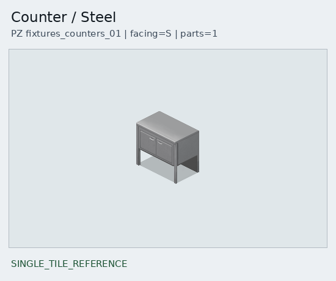

**PZwiki 원문 대응 이미지 (2행, 타일 ID 후보)**

[PZW-0289 · Metal Counter](https://pzwiki.net/wiki/Steel_Counter)

타일 키: fixtures_counters_01/37 · 운반부담: 20.0 · 타일 크기: 1

[PZW-0343 · Metal Counter](https://pzwiki.net/wiki/Steel_Counter)

타일 키: fixtures_counters_01/37 · 운반부담: 20.0 · 타일 크기: 1

---

### 018 · Modern Counter

**원본 좀보이드 완성형 참고 이미지**

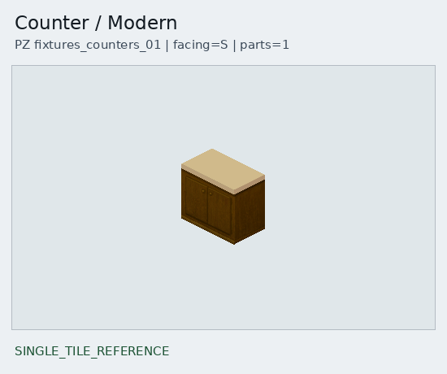

**PZwiki 원문 대응 이미지 (2행, 타일 ID 후보)**

[PZW-0282 · Modern Counter](https://pzwiki.net/wiki/Modern_Counter)

타일 키: fixtures_counters_01/5 · 운반부담: 10.0 · 타일 크기: 1

[PZW-0336 · Modern Counter](https://pzwiki.net/wiki/Modern_Counter)

타일 키: fixtures_counters_01/5 · 운반부담: 10.0 · 타일 크기: 1

---

### 020 · Birchwood Counter

**원본 좀보이드 완성형 참고 이미지**

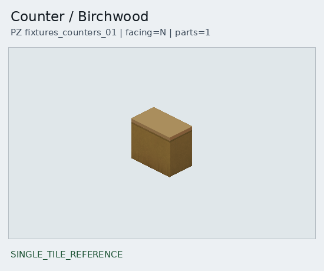

**PZwiki 원문 대응 이미지 (2행, 타일 ID 후보)**

[PZW-0291 · Cedar Counter](https://pzwiki.net/wiki/Birchwood_Counter)

타일 키: fixtures_counters_01/45 · 운반부담: 10.0 · 타일 크기: 1

[PZW-0345 · Cedar Counter](https://pzwiki.net/wiki/Birchwood_Counter)

타일 키: fixtures_counters_01/45 · 운반부담: 10.0 · 타일 크기: 1

---

### 025 · White Counter

**원본 좀보이드 완성형 참고 이미지**

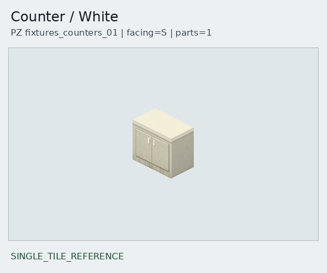

**PZwiki 원문 대응 이미지 (2행, 타일 ID 후보)**

[PZW-0299 · White Counter](https://pzwiki.net/wiki/White_Counter)

타일 키: fixtures_counters_01/77 · 운반부담: 10.0 · 타일 크기: 1

[PZW-0353 · White Counter](https://pzwiki.net/wiki/White_Counter)

타일 키: fixtures_counters_01/77 · 운반부담: 10.0 · 타일 크기: 1

---

### 027 · Oak Counter

**원본 좀보이드 완성형 참고 이미지**

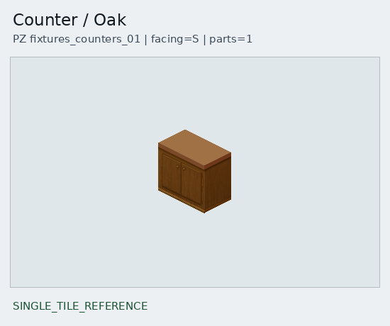

**PZwiki 원문 대응 이미지 (2행, 타일 ID 후보)**

[PZW-0293 · Red Oak Counter](https://pzwiki.net/wiki/Oak_Counter)

타일 키: fixtures_counters_01/53 · 운반부담: 10.0 · 타일 크기: 1

[PZW-0347 · Red Oak Counter](https://pzwiki.net/wiki/Oak_Counter)

타일 키: fixtures_counters_01/53 · 운반부담: 10.0 · 타일 크기: 1

---

### 031 · Wooden Counter

**원본 좀보이드 완성형 참고 이미지**

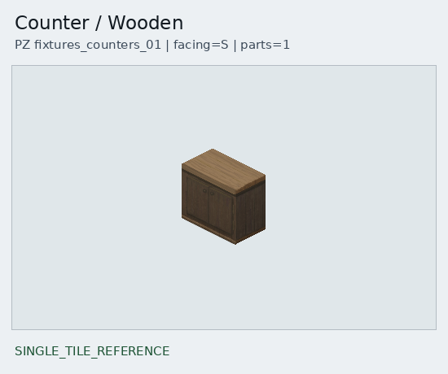

**PZwiki 원문 대응 이미지 (2행, 타일 ID 후보)**

[PZW-0284 · Wooden Counter](https://pzwiki.net/wiki/Wooden_Counter)

타일 키: fixtures_counters_01/13 · 운반부담: 10.0 · 타일 크기: 1

[PZW-0338 · Wooden Counter](https://pzwiki.net/wiki/Wooden_Counter)

타일 키: fixtures_counters_01/13 · 운반부담: 10.0 · 타일 크기: 1

---

### 064 · Steel Corner Counter

**원본 좀보이드 완성형 참고 이미지**

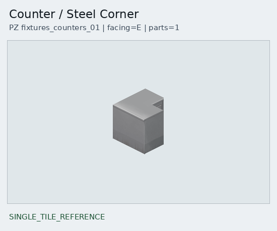

**PZwiki 원문 대응 이미지 (2행, 타일 ID 후보)**

[PZW-0288 · Metal Counter Corner](https://pzwiki.net/wiki/Steel_Corner_Counter)

타일 키: fixtures_counters_01/36 · 운반부담: 20.0 · 타일 크기: 1

[PZW-0342 · Metal Counter Corner](https://pzwiki.net/wiki/Steel_Corner_Counter)

타일 키: fixtures_counters_01/36 · 운반부담: 20.0 · 타일 크기: 1

---

### 078 · Wooden Corner Counter

**원본 좀보이드 완성형 참고 이미지**

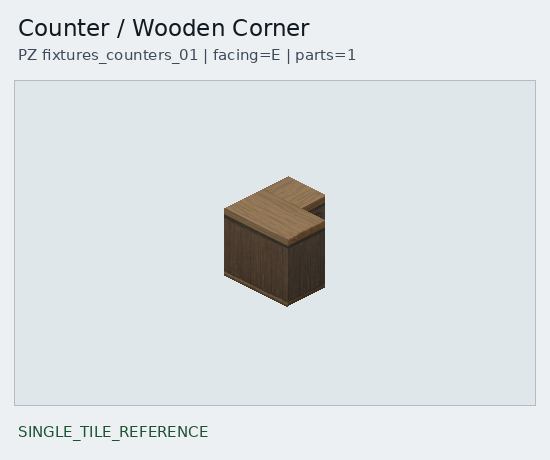

**PZwiki 원문 대응 이미지 (2행, 타일 ID 후보)**

[PZW-0283 · Rough Wooden Corner Counter](https://pzwiki.net/wiki/Wooden_Corner_Counter)

타일 키: fixtures_counters_01/12 · 운반부담: 10.0 · 타일 크기: 1

[PZW-0337 · Rough Wooden Corner Counter](https://pzwiki.net/wiki/Wooden_Corner_Counter)

타일 키: fixtures_counters_01/12 · 운반부담: 10.0 · 타일 크기: 1

---

### 079 · Trailer Counter

**원본 좀보이드 완성형 참고 이미지**

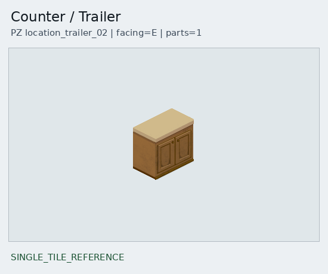

**PZwiki 원문 대응 이미지 (2행, 타일 ID 후보)**

[PZW-0326 · Trailer Counter](https://pzwiki.net/wiki/Trailer_Counter)

타일 키: location_trailer_02/18 · 운반부담: 10.0 · 타일 크기: 1

[PZW-0380 · Trailer Counter](https://pzwiki.net/wiki/Trailer_Counter)

타일 키: location_trailer_02/18 · 운반부담: 10.0 · 타일 크기: 1

---

### 084 · Birchwood Corner Counter

**원본 좀보이드 완성형 참고 이미지**

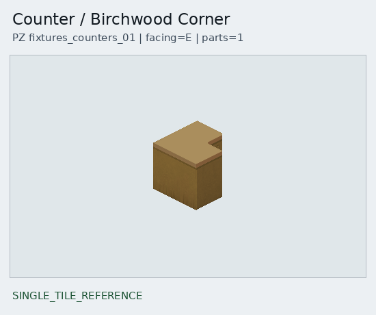

**PZwiki 원문 대응 이미지 (2행, 타일 ID 후보)**

[PZW-0290 · Cedar Corner Counter](https://pzwiki.net/wiki/Birchwood_Corner_Counter)

타일 키: fixtures_counters_01/44 · 운반부담: 10.0 · 타일 크기: 1

[PZW-0344 · Cedar Corner Counter](https://pzwiki.net/wiki/Birchwood_Corner_Counter)

타일 키: fixtures_counters_01/44 · 운반부담: 10.0 · 타일 크기: 1

---

### 092 · Generic Shop Counter

**원본 좀보이드 완성형 참고 이미지**

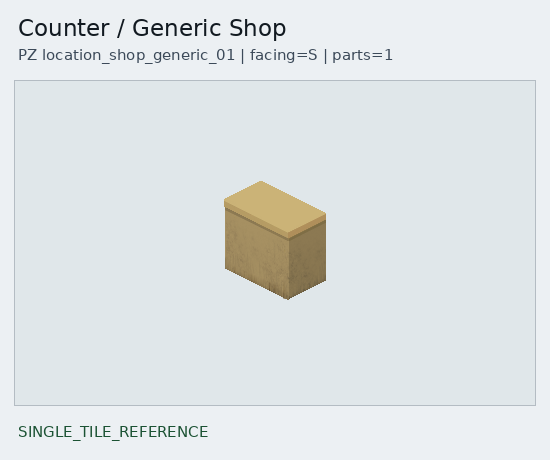

**PZwiki 원문 대응 이미지 (1행, 타일 ID 후보)**

[PZW-0394 · Generic Shop Counter](https://pzwiki.net/wiki/Generic_Shop_Counter)

타일 키: location_shop_generic_01/21 · 운반부담: 10.0 · 타일 크기: 1

---

### 103 · Shop Display Counter

**원본 좀보이드 완성형 참고 이미지**

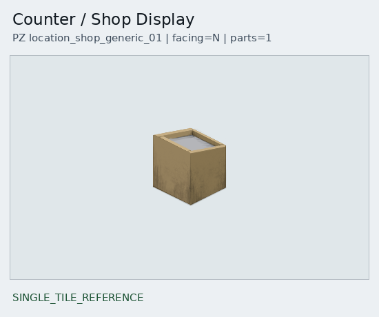

**PZwiki 원문 대응 이미지 (1행, 타일 ID 후보)**

[PZW-0397 · Store Display Counter](https://pzwiki.net/wiki/Shop_Display_Counter)

타일 키: location_shop_generic_01/88 · 운반부담: 10.0 · 타일 크기: 1

---

### 120 · Modern Corner Counter

**원본 좀보이드 완성형 참고 이미지**

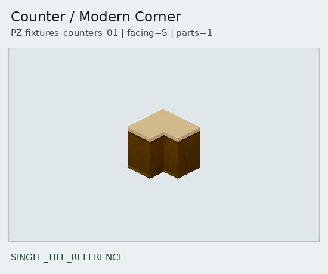

**PZwiki 원문 대응 이미지 (2행, 타일 ID 후보)**

[PZW-0281 · Modern Corner Counter](https://pzwiki.net/wiki/Modern_Corner_Counter)

타일 키: fixtures_counters_01/4 · 운반부담: 10.0 · 타일 크기: 1

[PZW-0335 · Modern Corner Counter](https://pzwiki.net/wiki/Modern_Corner_Counter)

타일 키: fixtures_counters_01/4 · 운반부담: 10.0 · 타일 크기: 1

---

### 122 · Bar Counter

**원본 좀보이드 완성형 참고 이미지**

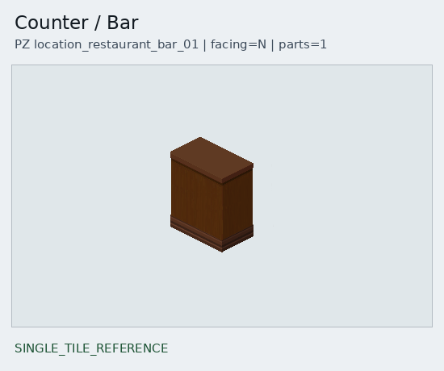

**PZwiki 원문 대응 이미지 (2행, 타일 ID 후보)**

[PZW-0306 · Bar Counter](https://pzwiki.net/wiki/Bar_Counter)

타일 키: location_restaurant_bar_01/5 · 운반부담: 10.0 · 타일 크기: 1

[PZW-0360 · Bar Counter](https://pzwiki.net/wiki/Bar_Counter)

타일 키: location_restaurant_bar_01/5 · 운반부담: 10.0 · 타일 크기: 1

---

### 127 · Oak Corner Counter

**원본 좀보이드 완성형 참고 이미지**

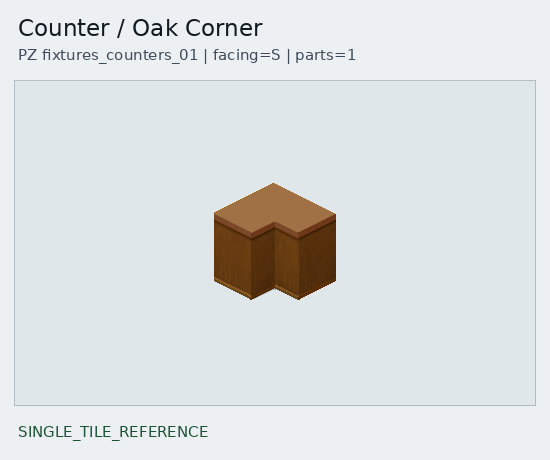

**PZwiki 원문 대응 이미지 (2행, 타일 ID 후보)**

[PZW-0292 · Red Oak Corner Counter](https://pzwiki.net/wiki/Oak_Corner_Counter)

타일 키: fixtures_counters_01/52 · 운반부담: 10.0 · 타일 크기: 1

[PZW-0346 · Red Oak Corner Counter](https://pzwiki.net/wiki/Oak_Corner_Counter)

타일 키: fixtures_counters_01/52 · 운반부담: 10.0 · 타일 크기: 1

---

### 128 · White Corner Counter

**원본 좀보이드 완성형 참고 이미지**

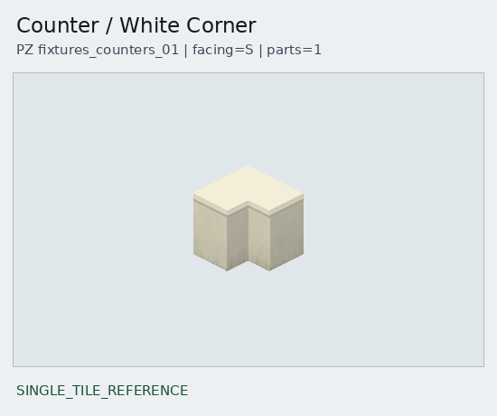

**PZwiki 원문 대응 이미지 (2행, 타일 ID 후보)**

[PZW-0298 · White Corner Counter](https://pzwiki.net/wiki/White_Corner_Counter)

타일 키: fixtures_counters_01/76 · 운반부담: 10.0 · 타일 크기: 1

[PZW-0352 · White Corner Counter](https://pzwiki.net/wiki/White_Corner_Counter)

타일 키: fixtures_counters_01/76 · 운반부담: 10.0 · 타일 크기: 1

---

### 139 · Floating Trailer Counter

**원본 좀보이드 완성형 참고 이미지**

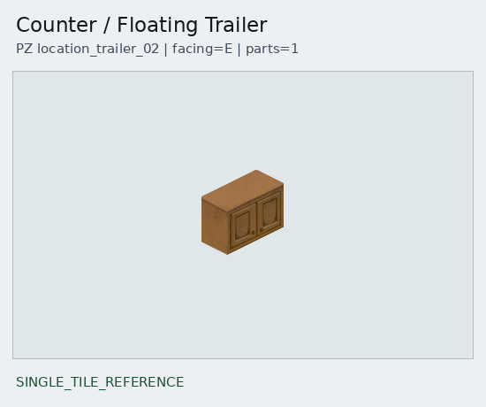

**PZwiki 이미지 ID 직접 연결 없음.** 원본에 가구가 없다는 뜻은 아님.

---

### 142 · Green Counter

**원본 좀보이드 완성형 참고 이미지**

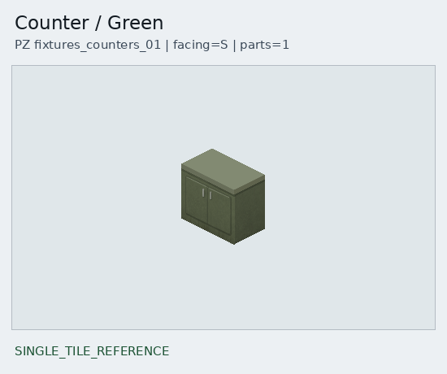

**PZwiki 원문 대응 이미지 (2행, 타일 ID 후보)**

[PZW-0297 · Green Counter](https://pzwiki.net/wiki/Green_Counter)

타일 키: fixtures_counters_01/69 · 운반부담: 10.0 · 타일 크기: 1

[PZW-0351 · Green Counter](https://pzwiki.net/wiki/Green_Counter)

타일 키: fixtures_counters_01/69 · 운반부담: 10.0 · 타일 크기: 1

---

### 145 · Low Motel Counter

**원본 좀보이드 완성형 참고 이미지**

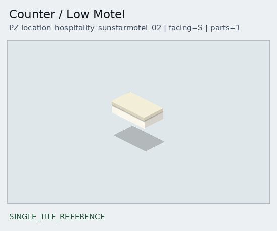

**PZwiki 원문 대응 이미지 (1행, 타일 ID 후보)**

[PZW-0385 · Low Motel Counter](https://pzwiki.net/wiki/Low_Motel_Counter)

타일 키: location_hospitality_sunstarmotel_02/22 · 운반부담: 2.0 · 타일 크기: 1

---

### 155 · White Floating Counter

**원본 좀보이드 완성형 참고 이미지**

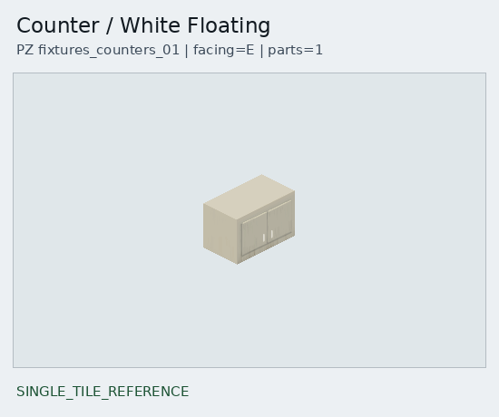

**PZwiki 이미지 ID 직접 연결 없음.** 원본에 가구가 없다는 뜻은 아님.

---

### 176 · Generic Shop Corner Counter

**원본 좀보이드 완성형 참고 이미지**

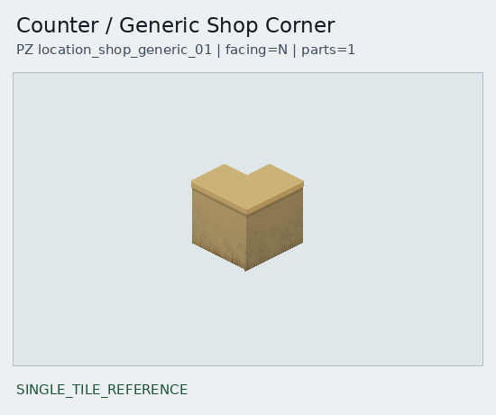

**PZwiki 원문 대응 이미지 (1행, 타일 ID 후보)**

[PZW-0393 · Generic Shop Corner Counter](https://pzwiki.net/wiki/Generic_Shop_Corner_Counter)

타일 키: location_shop_generic_01/20 · 운반부담: 10.0 · 타일 크기: 1

---

### 177 · Dark Counter

**원본 좀보이드 완성형 참고 이미지**

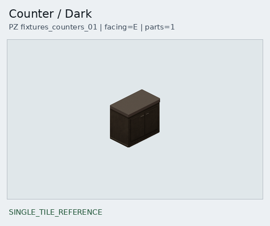

**PZwiki 원문 대응 이미지 (2행, 타일 ID 후보)**

[PZW-0295 · Dark Counter](https://pzwiki.net/wiki/Dark_Counter)

타일 키: fixtures_counters_01/61 · 운반부담: 10.0 · 타일 크기: 1

[PZW-0349 · Dark Counter](https://pzwiki.net/wiki/Dark_Counter)

타일 키: fixtures_counters_01/61 · 운반부담: 10.0 · 타일 크기: 1

---

### 180 · Birchwood Floating Counter

**원본 좀보이드 완성형 참고 이미지**

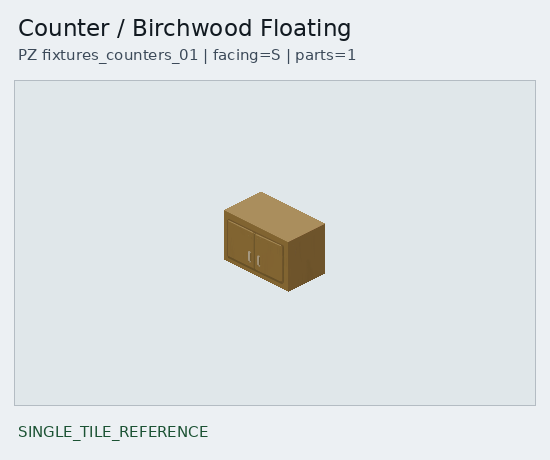

**PZwiki 원문 대응 이미지 (2행, 타일 ID 후보)**

[PZW-0287 · Birch Floating Counter](https://pzwiki.net/wiki/Birchwood_Floating_Counter)

타일 키: fixtures_counters_01/26 · 운반부담: 10.0 · 타일 크기: 1

[PZW-0341 · Birch Floating Counter](https://pzwiki.net/wiki/Birchwood_Floating_Counter)

타일 키: fixtures_counters_01/26 · 운반부담: 10.0 · 타일 크기: 1

---

### 182 · Bar Corner Counter

**원본 좀보이드 완성형 참고 이미지**

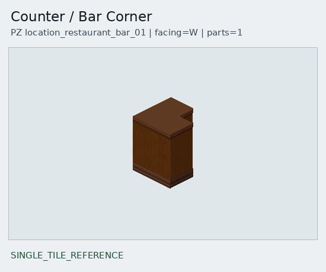

**PZwiki 원문 대응 이미지 (2행, 타일 ID 후보)**

[PZW-0305 · Bar Corner Counter](https://pzwiki.net/wiki/Bar_Corner_Counter)

타일 키: location_restaurant_bar_01/4 · 운반부담: 10.0 · 타일 크기: 1

[PZW-0359 · Bar Corner Counter](https://pzwiki.net/wiki/Bar_Corner_Counter)

타일 키: location_restaurant_bar_01/4 · 운반부담: 10.0 · 타일 크기: 1

---

### 183 · Cantina Food Counter

**원본 좀보이드 완성형 참고 이미지**

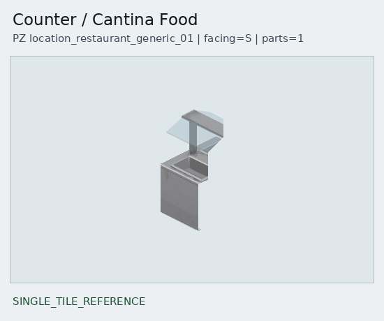

**PZwiki 이미지 ID 직접 연결 없음.** 원본에 가구가 없다는 뜻은 아님.

---

### 185 · Oakwood Floating Counter

**원본 좀보이드 완성형 참고 이미지**

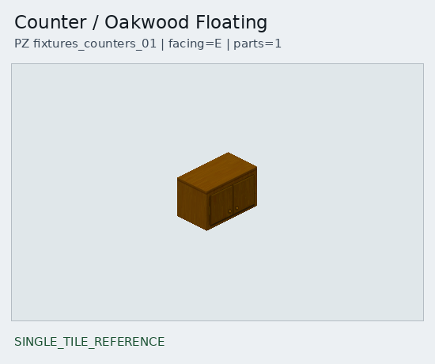

**PZwiki 이미지 ID 직접 연결 없음.** 원본에 가구가 없다는 뜻은 아님.

---

### 190 · Spiffos Counter

**원본 좀보이드 완성형 참고 이미지**

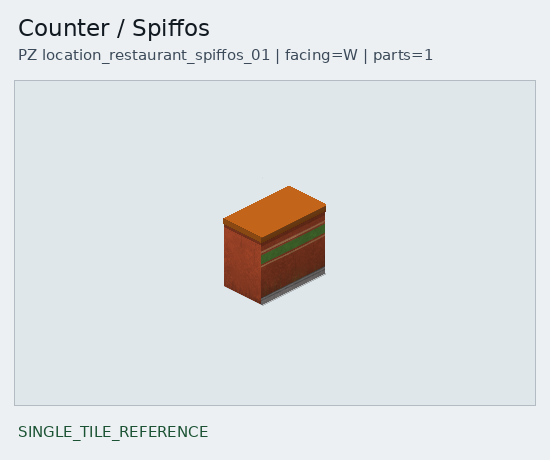

**PZwiki 원문 대응 이미지 (2행, 타일 ID 후보)**

[PZW-0316 · Spiffos Counter](https://pzwiki.net/wiki/Spiffo%27s_Counter)

타일 키: location_restaurant_spiffos_01/61 · 운반부담: 10.0 · 타일 크기: 1

[PZW-0370 · Spiffos Counter](https://pzwiki.net/wiki/Spiffo%27s_Counter)

타일 키: location_restaurant_spiffos_01/61 · 운반부담: 10.0 · 타일 크기: 1

---

### 192 · Steel Floating Counter

**원본 좀보이드 완성형 참고 이미지**

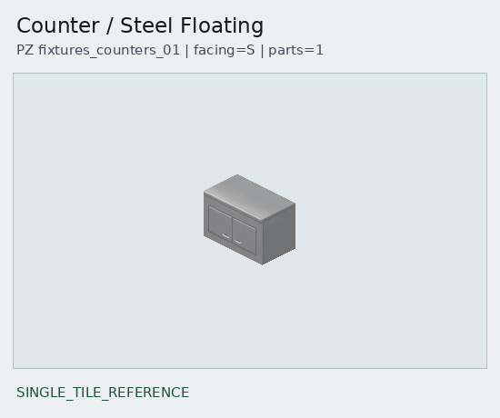

**PZwiki 이미지 ID 직접 연결 없음.** 원본에 가구가 없다는 뜻은 아님.

---

### 195 · Motel Counter

**원본 좀보이드 완성형 참고 이미지**

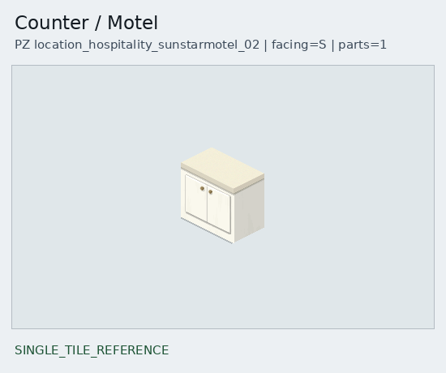

**PZwiki 원문 대응 이미지 (2행, 타일 ID 후보)**

[PZW-0304 · Motel Counter](https://pzwiki.net/wiki/Motel_Counter)

타일 키: location_hospitality_sunstarmotel_02/14 · 운반부담: 10.0 · 타일 크기: 1

[PZW-0358 · Motel Counter](https://pzwiki.net/wiki/Motel_Counter)

타일 키: location_hospitality_sunstarmotel_02/14 · 운반부담: 10.0 · 타일 크기: 1

---

### 210 · Dark Corner Counter

**원본 좀보이드 완성형 참고 이미지**

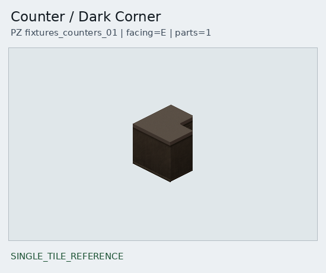

**PZwiki 원문 대응 이미지 (2행, 타일 ID 후보)**

[PZW-0294 · Dark Corner Counter](https://pzwiki.net/wiki/Dark_Corner_Counter)

타일 키: fixtures_counters_01/60 · 운반부담: 10.0 · 타일 크기: 1

[PZW-0348 · Dark Corner Counter](https://pzwiki.net/wiki/Dark_Corner_Counter)

타일 키: fixtures_counters_01/60 · 운반부담: 10.0 · 타일 크기: 1

---

### 217 · Glass Display Counter

**원본 좀보이드 완성형 참고 이미지**

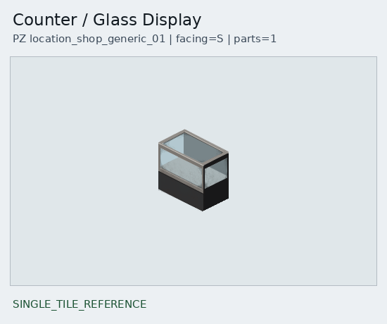

**PZwiki 원문 대응 이미지 (1행, 타일 ID 후보)**

[PZW-0399 · Glass Display Counter](https://pzwiki.net/wiki/Glass_Display_Counter)

타일 키: location_shop_generic_01/97 · 운반부담: 10.0 · 타일 크기: 1

---

### 225 · Green Corner Counter

**원본 좀보이드 완성형 참고 이미지**

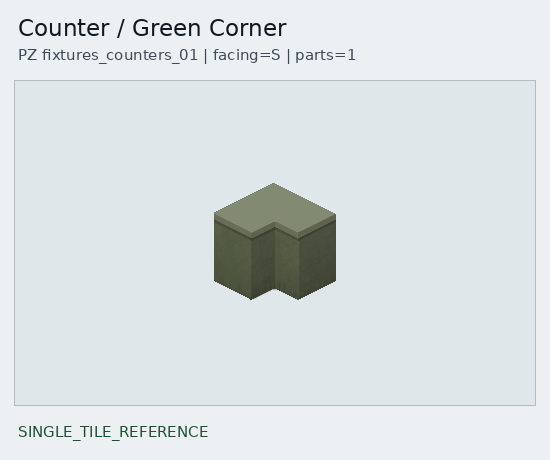

**PZwiki 원문 대응 이미지 (2행, 타일 ID 후보)**

[PZW-0296 · Green Corner Counter](https://pzwiki.net/wiki/Green_Corner_Counter)

타일 키: fixtures_counters_01/68 · 운반부담: 10.0 · 타일 크기: 1

[PZW-0350 · Green Corner Counter](https://pzwiki.net/wiki/Green_Corner_Counter)

타일 키: fixtures_counters_01/68 · 운반부담: 10.0 · 타일 크기: 1

---

### 226 · Hardwood Floating Counter

**원본 좀보이드 완성형 참고 이미지**

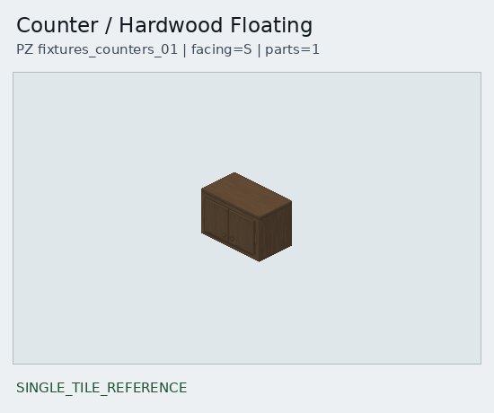

**PZwiki 이미지 ID 직접 연결 없음.** 원본에 가구가 없다는 뜻은 아님.

---

### 232 · Oak Floating Counter

**원본 좀보이드 완성형 참고 이미지**

**PZwiki 이미지 ID 직접 연결 없음.** 원본에 가구가 없다는 뜻은 아님.

---

### 236 · Pie Store Counter

**원본 좀보이드 완성형 참고 이미지**

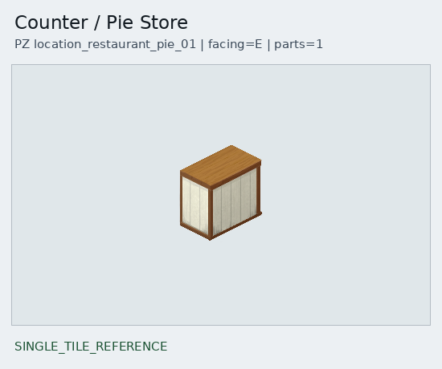

**PZwiki 원문 대응 이미지 (2행, 타일 ID 후보)**

[PZW-0312 · Pie Store Counter](https://pzwiki.net/wiki/White_Striped_Counter)

타일 키: location_restaurant_pie_01/45 · 운반부담: 10.0 · 타일 크기: 1

[PZW-0366 · Pie Store Counter](https://pzwiki.net/wiki/White_Striped_Counter)

타일 키: location_restaurant_pie_01/45 · 운반부담: 10.0 · 타일 크기: 1

---

### 251 · Birchwood Floating Corner Counter

**원본 좀보이드 완성형 참고 이미지**

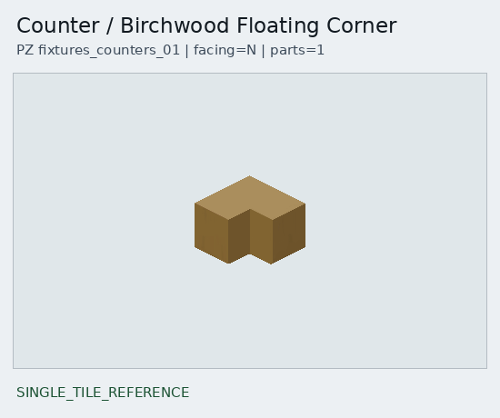

**PZwiki 이미지 ID 직접 연결 없음.** 원본에 가구가 없다는 뜻은 아님.

---

### 257 · Oak Bar Counter

**원본 좀보이드 완성형 참고 이미지**

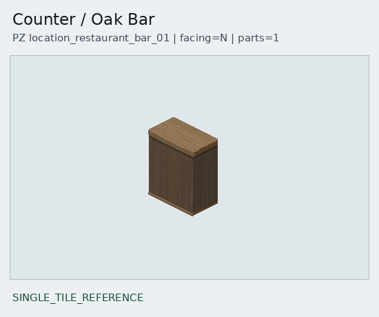

**PZwiki 이미지 ID 직접 연결 없음.** 원본에 가구가 없다는 뜻은 아님.

---

### 258 · Zippee Counter

**원본 좀보이드 완성형 참고 이미지**

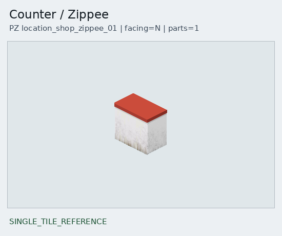

**PZwiki 이미지 ID 직접 연결 없음.** 원본에 가구가 없다는 뜻은 아님.

---

### 264 · Dark Bar Counter

**원본 좀보이드 완성형 참고 이미지**

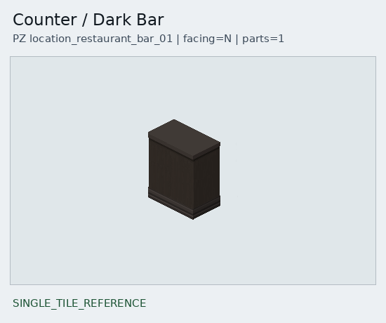

**PZwiki 이미지 ID 직접 연결 없음.** 원본에 가구가 없다는 뜻은 아님.

---

### 265 · White Display Counter

**원본 좀보이드 완성형 참고 이미지**

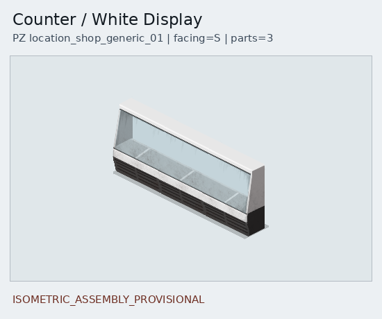

**PZwiki 원문 대응 이미지 (2행, 타일 ID 후보)**

[PZW-0060 · White Display Counter](https://pzwiki.net/wiki/White_Display_Counter)

타일 키: location_shop_generic_01/80|location_shop_generic_01/81|location_shop_generic_01/82 · 운반부담: 10.0 · 타일 크기: 3

[PZW-0396 · White Display Counter](https://pzwiki.net/wiki/White_Display_Counter)

타일 키: location_shop_generic_01/80|location_shop_generic_01/81|location_shop_generic_01/82 · 운반부담: 10.0 · 타일 크기: 3

---

### 268 · Green Floating Counter

**원본 좀보이드 완성형 참고 이미지**

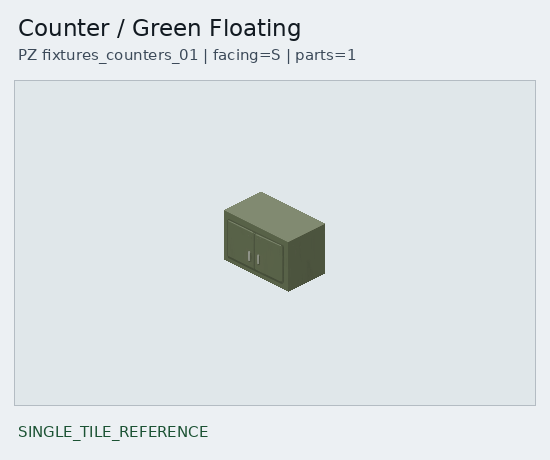

**PZwiki 이미지 ID 직접 연결 없음.** 원본에 가구가 없다는 뜻은 아님.

---

### 278 · Middle Counter

**원본 좀보이드 완성형 참고 이미지**

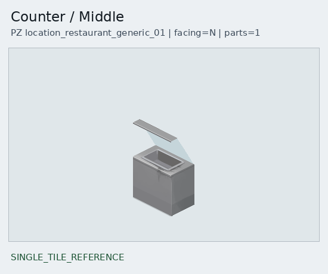

**PZwiki 이미지 ID 직접 연결 없음.** 원본에 가구가 없다는 뜻은 아님.

---

### 279 · Mobile Tool Counter

**원본 좀보이드 완성형 참고 이미지**

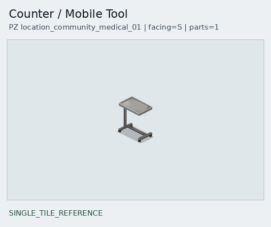

**PZwiki 이미지 ID 직접 연결 없음.** 원본에 가구가 없다는 뜻은 아님.

---

### 280 · Oak Employee Bank Counter

**원본 좀보이드 완성형 참고 이미지**

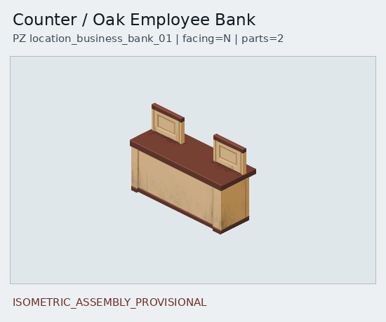

**PZwiki 이미지 ID 직접 연결 없음.** 원본에 가구가 없다는 뜻은 아님.

---

### 281 · Pizzawhirled Counter

**원본 좀보이드 완성형 참고 이미지**

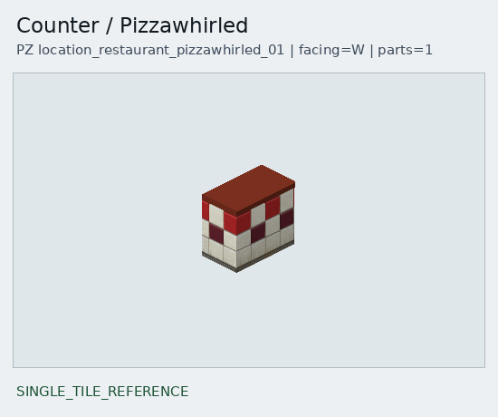

**PZwiki 이미지 ID 직접 연결 없음.** 원본에 가구가 없다는 뜻은 아님.

---

### 282 · Quality Crafted Counter

**원본 좀보이드 완성형 참고 이미지**

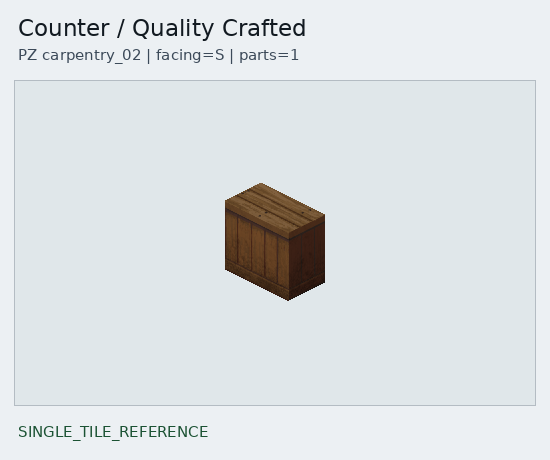

**PZwiki 원문 대응 이미지 (2행, 타일 ID 후보)**

[PZW-0274 · Wooden Counter](https://pzwiki.net/wiki/Quality_Crafted_Counter)

타일 키: carpentry_02/21 · 운반부담: 10.0 · 타일 크기: 1

[PZW-0328 · Wooden Counter](https://pzwiki.net/wiki/Quality_Crafted_Counter)

타일 키: carpentry_02/21 · 운반부담: 10.0 · 타일 크기: 1

---

### 283 · Rounded Glass Display Counter

**원본 좀보이드 완성형 참고 이미지**

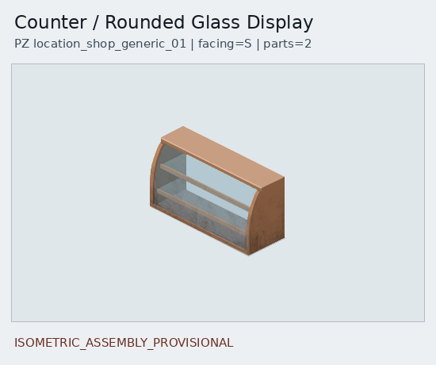

**PZwiki 원문 대응 이미지 (1행, 타일 ID 후보)**

[PZW-0395 · Rounded Glass Display Counter](https://pzwiki.net/wiki/Rounded_Glass_Display_Counter)

타일 키: location_shop_generic_01/34|location_shop_generic_01/35 · 운반부담: 10.0 · 타일 크기: 2

---

### 284 · Theater Counter

**원본 좀보이드 완성형 참고 이미지**

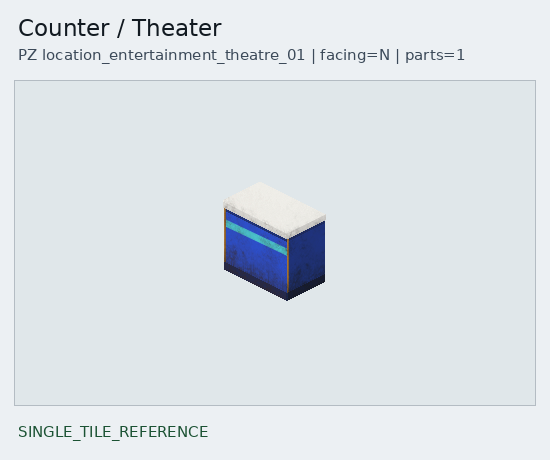

**PZwiki 이미지 ID 직접 연결 없음.** 원본에 가구가 없다는 뜻은 아님.

---

### 298 · Corner A Counter

**원본 좀보이드 완성형 참고 이미지**

**PZwiki 이미지 ID 직접 연결 없음.** 원본에 가구가 없다는 뜻은 아님.

---

### 299 · Corner B Counter

**원본 좀보이드 완성형 참고 이미지**

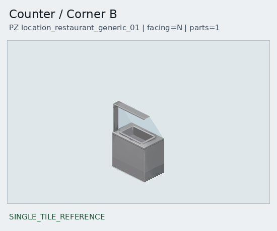

**PZwiki 이미지 ID 직접 연결 없음.** 원본에 가구가 없다는 뜻은 아님.

---

### 300 · Fossoil Counter

**원본 좀보이드 완성형 참고 이미지**

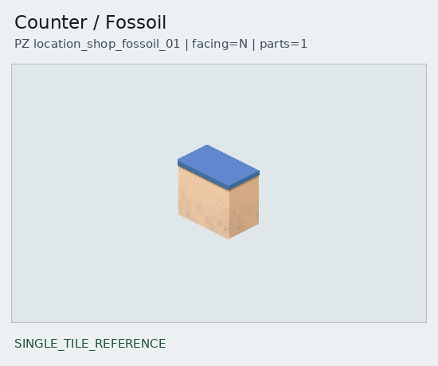

**PZwiki 이미지 ID 직접 연결 없음.** 원본에 가구가 없다는 뜻은 아님.

---

### 301 · Glass Corner Display Counter

**원본 좀보이드 완성형 참고 이미지**

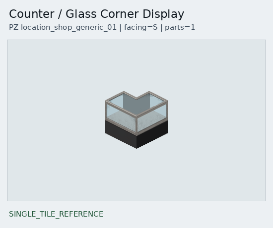

**PZwiki 원문 대응 이미지 (1행, 타일 ID 후보)**

[PZW-0398 · Glass Corner Display Counter](https://pzwiki.net/wiki/Glass_Corner_Display_Counter)

타일 키: location_shop_generic_01/96 · 운반부담: 10.0 · 타일 크기: 1

---

### 302 · Glass Theater Counter

**원본 좀보이드 완성형 참고 이미지**

**PZwiki 이미지 ID 직접 연결 없음.** 원본에 가구가 없다는 뜻은 아님.

---

### 303 · Pie Store Corner Counter

**원본 좀보이드 완성형 참고 이미지**

**PZwiki 이미지 ID 직접 연결 없음.** 원본에 가구가 없다는 뜻은 아님.

---

### 304 · Seahorse Coffee Counter

**원본 좀보이드 완성형 참고 이미지**

**PZwiki 원문 대응 이미지 (2행, 타일 ID 후보)**

[PZW-0314 · Seahorse Coffee Counter](https://pzwiki.net/wiki/Seahorse_Coffee_Counter)

타일 키: location_restaurant_seahorse_01/45 · 운반부담: 10.0 · 타일 크기: 1

[PZW-0368 · Seahorse Coffee Counter](https://pzwiki.net/wiki/Seahorse_Coffee_Counter)

타일 키: location_restaurant_seahorse_01/45 · 운반부담: 10.0 · 타일 크기: 1

---

### 313 · Darkwood Floating Corner Counter

**원본 좀보이드 완성형 참고 이미지**

**PZwiki 이미지 ID 직접 연결 없음.** 원본에 가구가 없다는 뜻은 아님.

---

### 324 · Crafted Counter

**원본 좀보이드 완성형 참고 이미지**

**PZwiki 원문 대응 이미지 (2행, 타일 ID 후보)**

[PZW-0276 · Wooden Counter](https://pzwiki.net/wiki/Crafted_Counter)

타일 키: carpentry_02/29 · 운반부담: 10.0 · 타일 크기: 1

[PZW-0330 · Wooden Counter](https://pzwiki.net/wiki/Crafted_Counter)

타일 키: carpentry_02/29 · 운반부담: 10.0 · 타일 크기: 1

---

### 325 · Dark Bar Corner Counter

**원본 좀보이드 완성형 참고 이미지**

**PZwiki 이미지 ID 직접 연결 없음.** 원본에 가구가 없다는 뜻은 아님.

---

### 326 · Motel Corner Counter

**원본 좀보이드 완성형 참고 이미지**

**PZwiki 이미지 ID 직접 연결 없음.** 원본에 가구가 없다는 뜻은 아님.

---

### 327 · Zippee Corner Counter

**원본 좀보이드 완성형 참고 이미지**

**PZwiki 이미지 ID 직접 연결 없음.** 원본에 가구가 없다는 뜻은 아님.

---

### 328 · Zippee Display Counter

**원본 좀보이드 완성형 참고 이미지**

**PZwiki 이미지 ID 직접 연결 없음.** 원본에 가구가 없다는 뜻은 아님.

---

### 339 · Oakwood Floating Corner Counter

**원본 좀보이드 완성형 참고 이미지**

**PZwiki 이미지 ID 직접 연결 없음.** 원본에 가구가 없다는 뜻은 아님.

---

### 340 · Steel Floating Corner Counter

**원본 좀보이드 완성형 참고 이미지**

**PZwiki 이미지 ID 직접 연결 없음.** 원본에 가구가 없다는 뜻은 아님.

---

### 341 · White Floating Corner Counter

**원본 좀보이드 완성형 참고 이미지**

**PZwiki 이미지 ID 직접 연결 없음.** 원본에 가구가 없다는 뜻은 아님.

---

### 352 · Crafter Corner Counter

**원본 좀보이드 완성형 참고 이미지**

**PZwiki 원문 대응 이미지 (2행, 타일 ID 후보)**

[PZW-0275 · Crafter Corner Counter](https://pzwiki.net/w/index.php?title=Crafter_Corner_Counter&action=edit&redlink=1)

타일 키: carpentry_02/28 · 운반부담: 10.0 · 타일 크기: 1

[PZW-0329 · Crafter Corner Counter](https://pzwiki.net/w/index.php?title=Crafter_Corner_Counter&action=edit&redlink=1)

타일 키: carpentry_02/28 · 운반부담: 10.0 · 타일 크기: 1

---

### 353 · Oak Corner Bar Counter

**원본 좀보이드 완성형 참고 이미지**

**PZwiki 이미지 ID 직접 연결 없음.** 원본에 가구가 없다는 뜻은 아님.

---

### 354 · Pizzawhirled Corner Counter

**원본 좀보이드 완성형 참고 이미지**

**PZwiki 이미지 ID 직접 연결 없음.** 원본에 가구가 없다는 뜻은 아님.

---

### 355 · Seahorse Coffee Corner Counter

**원본 좀보이드 완성형 참고 이미지**

**PZwiki 이미지 ID 직접 연결 없음.** 원본에 가구가 없다는 뜻은 아님.

---

### 356 · Spiffos Corner Counter

**원본 좀보이드 완성형 참고 이미지**

**PZwiki 이미지 ID 직접 연결 없음.** 원본에 가구가 없다는 뜻은 아님.

---

## Chair (42개 스타일)

### 001 · Grey Chair

**원본 좀보이드 완성형 참고 이미지**

**PZwiki 이미지 ID 직접 연결 없음.** 원본에 가구가 없다는 뜻은 아님.

---

### 004 · Folding Chair

**원본 좀보이드 완성형 참고 이미지**

**PZwiki 원문 대응 이미지 (1행, 타일 ID 후보)**

[PZW-0151 · Folding Chair](https://pzwiki.net/wiki/Folding_Chair)

타일 키: furniture_seating_indoor_01/60 · 운반부담: 7.5 · 타일 크기: 1

---

### 006 · Green Dinner Chair

**원본 좀보이드 완성형 참고 이미지**

**PZwiki 원문 대응 이미지 (1행, 타일 ID 후보)**

[PZW-0150 · Green Dinner Chair](https://pzwiki.net/wiki/Green_Wooden_Chair)

타일 키: furniture_seating_indoor_01/57 · 운반부담: 7.5 · 타일 크기: 1

---

### 009 · Wooden Chair

**원본 좀보이드 완성형 참고 이미지**

**PZwiki 원문 대응 이미지 (1행, 타일 ID 후보)**

[PZW-0153 · Wooden Chair](https://pzwiki.net/wiki/Wooden_Chair)

타일 키: furniture_seating_indoor_02/5 · 운반부담: 7.5 · 타일 크기: 1

---

### 012 · Dark Wooden Chair

**원본 좀보이드 완성형 참고 이미지**

**PZwiki 원문 대응 이미지 (1행, 타일 ID 후보)**

[PZW-0152 · Mahogany Chair](https://pzwiki.net/wiki/Dark_Wooden_Chair)

타일 키: furniture_seating_indoor_02/0 · 운반부담: 7.5 · 타일 크기: 1

---

### 013 · Black Office Chair

**원본 좀보이드 완성형 참고 이미지**

**PZwiki 원문 대응 이미지 (1행, 타일 ID 후보)**

[PZW-0149 · Black Office Chair](https://pzwiki.net/wiki/Black_Office_Chair)

타일 키: furniture_seating_indoor_01/50 · 운반부담: 7.5 · 타일 크기: 1

---

### 017 · Plastic Chair

**원본 좀보이드 완성형 참고 이미지**

**PZwiki 원문 대응 이미지 (1행, 타일 ID 후보)**

[PZW-0175 · Plastic Chair](https://pzwiki.net/wiki/Plastic_Chair)

타일 키: furniture_seating_outdoor_01/17 · 운반부담: 5.0 · 타일 크기: 1

---

### 030 · Blue Plastic Chair

**원본 좀보이드 완성형 참고 이미지**

**PZwiki 원문 대응 이미지 (1행, 타일 ID 후보)**

[PZW-0155 · Blue Plastic Chair](https://pzwiki.net/wiki/Blue_Plastic_Chair)

타일 키: furniture_seating_indoor_02/13 · 운반부담: 7.5 · 타일 크기: 1

---

### 034 · Fancy Wooden Chair

**원본 좀보이드 완성형 참고 이미지**

**PZwiki 원문 대응 이미지 (1행, 타일 ID 후보)**

[PZW-0164 · Fancy Wooden Chair](https://pzwiki.net/wiki/Purple_Wooden_Chair)

타일 키: furniture_seating_indoor_03/45 · 운반부담: 7.5 · 타일 크기: 1

---

### 037 · White Wooden Chair

**원본 좀보이드 완성형 참고 이미지**

**PZwiki 원문 대응 이미지 (1행, 타일 ID 후보)**

[PZW-0159 · White Wooden Chair](https://pzwiki.net/wiki/White_Wooden_Chair)

타일 키: furniture_seating_indoor_02/56 · 운반부담: 7.5 · 타일 크기: 1

---

### 058 · Grey Plastic Chair

**원본 좀보이드 완성형 참고 이미지**

**PZwiki 원문 대응 이미지 (1행, 타일 ID 후보)**

[PZW-0167 · Grey Plastic Chair](https://pzwiki.net/wiki/Grey_Plastic_Chair)

타일 키: furniture_seating_indoor_03/69 · 운반부담: 7.5 · 타일 크기: 1

---

### 062 · Blue Rattan Chair

**원본 좀보이드 완성형 참고 이미지**

**PZwiki 원문 대응 이미지 (1행, 타일 ID 후보)**

[PZW-0157 · Blue Rattan Chair](https://pzwiki.net/wiki/Blue_Rattan_Chair)

타일 키: furniture_seating_indoor_02/41 · 운반부담: 7.5 · 타일 크기: 1

---

### 068 · Red Wooden Chair

**원본 좀보이드 완성형 참고 이미지**

**PZwiki 원문 대응 이미지 (1행, 타일 ID 후보)**

[PZW-0154 · Red Wooden Chair](https://pzwiki.net/wiki/Red_Wooden_Chair)

타일 키: furniture_seating_indoor_02/9 · 운반부담: 7.5 · 타일 크기: 1

---

### 072 · White Simple Chair

**원본 좀보이드 완성형 참고 이미지**

**PZwiki 원문 대응 이미지 (1행, 타일 ID 후보)**

[PZW-0166 · Pale Simple Chair](https://pzwiki.net/wiki/White_Simple_Chair)

타일 키: furniture_seating_indoor_03/57 · 운반부담: 7.5 · 타일 크기: 1

---

### 099 · Pile o' Crepe Chair

**원본 좀보이드 완성형 참고 이미지**

**PZwiki 원문 대응 이미지 (1행, 타일 ID 후보)**

[PZW-0179 · Pile o' Crepe Chair](https://pzwiki.net/wiki/Pile_o%27_Crepe_Chair)

타일 키: location_restaurant_pileocrepe_01/41 · 운반부담: 5.0 · 타일 크기: 1

---

### 107 · Brown Lazy Chair

**원본 좀보이드 완성형 참고 이미지**

**PZwiki 원문 대응 이미지 (1행, 타일 ID 후보)**

[PZW-0158 · Brown Lazy Chair](https://pzwiki.net/wiki/Brown_Lazy_Chair)

타일 키: furniture_seating_indoor_02/44 · 운반부담: 7.5 · 타일 크기: 1

---

### 123 · Fancy White Chair

**원본 좀보이드 완성형 참고 이미지**

**PZwiki 원문 대응 이미지 (1행, 타일 ID 후보)**

[PZW-0146 · Fancy White Chair](https://pzwiki.net/wiki/White_Fancy_Chair)

타일 키: furniture_seating_indoor_01/37 · 운반부담: 7.5 · 타일 크기: 1

---

### 125 · Beach Chair

**원본 좀보이드 완성형 참고 이미지**

**PZwiki 원문 대응 이미지 (1행, 타일 ID 후보)**

[PZW-0176 · Beach Chair](https://pzwiki.net/wiki/Beach_Chair)

타일 키: furniture_seating_outdoor_01/25|furniture_seating_outdoor_01/24 · 운반부담: 15.0 · 타일 크기: 2

---

### 126 · Green Comfy Chair

**원본 좀보이드 완성형 참고 이미지**

**PZwiki 원문 대응 이미지 (1행, 타일 ID 후보)**

[PZW-0143 · Green Comfy Chair](https://pzwiki.net/wiki/Green_Comfy_Chair)

타일 키: furniture_seating_indoor_01/9 · 운반부담: 7.5 · 타일 크기: 1

---

### 129 · Light Blue Chair

**원본 좀보이드 완성형 참고 이미지**

**PZwiki 원문 대응 이미지 (1행, 타일 ID 후보)**

[PZW-0160 · Light Blue Chair](https://pzwiki.net/wiki/Grey_Lazy_Chair)

타일 키: furniture_seating_indoor_03/4 · 운반부담: 7.5 · 타일 크기: 1

---

### 133 · Black Fancy Chair

**원본 좀보이드 완성형 참고 이미지**

**PZwiki 원문 대응 이미지 (1행, 타일 ID 후보)**

[PZW-0163 · Black Fancy Chair](https://pzwiki.net/wiki/Black_Fancy_Chair)

타일 키: furniture_seating_indoor_03/41 · 운반부담: 7.5 · 타일 크기: 1

---

### 137 · White Lazy Chair

**원본 좀보이드 완성형 참고 이미지**

**PZwiki 원문 대응 이미지 (1행, 타일 ID 후보)**

[PZW-0156 · White Lazy Chair](https://pzwiki.net/wiki/White_Lazy_Chair)

타일 키: furniture_seating_indoor_02/20 · 운반부담: 7.5 · 타일 크기: 1

---

### 146 · Blue Comfy Chair

**원본 좀보이드 완성형 참고 이미지**

**PZwiki 원문 대응 이미지 (1행, 타일 ID 후보)**

[PZW-0161 · Blue Comfy Chair](https://pzwiki.net/wiki/Blue_Comfy_Chair)

타일 키: furniture_seating_indoor_03/25 · 운반부담: 7.5 · 타일 크기: 1

---

### 173 · Spiffos Dinner Chair

**원본 좀보이드 완성형 참고 이미지**

**PZwiki 원문 대응 이미지 (1행, 타일 ID 후보)**

[PZW-0180 · Spiffos Dinner Chair](https://pzwiki.net/wiki/Spiffo%27s_Dinner_Chair)

타일 키: location_restaurant_spiffos_02/24 · 운반부담: 5.0 · 타일 크기: 1

---

### 178 · Red Theatre Chair

**원본 좀보이드 완성형 참고 이미지**

**PZwiki 이미지 ID 직접 연결 없음.** 원본에 가구가 없다는 뜻은 아님.

---

### 194 · Modern White Chair

**원본 좀보이드 완성형 참고 이미지**

**PZwiki 원문 대응 이미지 (1행, 타일 ID 후보)**

[PZW-0148 · Modern White Chair](https://pzwiki.net/wiki/White_Chair)

타일 키: furniture_seating_indoor_01/45 · 운반부담: 7.5 · 타일 크기: 1

---

### 204 · Makeshift Chair

**원본 좀보이드 완성형 참고 이미지**

**PZwiki 원문 대응 이미지 (1행, 타일 ID 후보)**

[PZW-0140 · Makeshift Chair](https://pzwiki.net/w/index.php?title=Makeshift_Chair&action=edit&redlink=1)

타일 키: carpentry_01/36 · 운반부담: 7.5 · 타일 크기: 1

---

### 208 · Modern Red Chair

**원본 좀보이드 완성형 참고 이미지**

**PZwiki 원문 대응 이미지 (1행, 타일 ID 후보)**

[PZW-0147 · Modern Red Chair](https://pzwiki.net/wiki/Red_Chair)

타일 키: furniture_seating_indoor_01/41 · 운반부담: 7.5 · 타일 크기: 1

---

### 209 · Yellow Modern Chair

**원본 좀보이드 완성형 참고 이미지**

**PZwiki 원문 대응 이미지 (1행, 타일 ID 후보)**

[PZW-0162 · Yellow Square Armchair](https://pzwiki.net/wiki/Yellow_Modern_Chair)

타일 키: furniture_seating_indoor_03/28 · 운반부담: 7.5 · 타일 크기: 1

---

### 221 · Purple Rattan Chair

**원본 좀보이드 완성형 참고 이미지**

**PZwiki 원문 대응 이미지 (1행, 타일 ID 후보)**

[PZW-0145 · Purple Rattan Chair](https://pzwiki.net/wiki/Purple_Rattan_Chair)

타일 키: furniture_seating_indoor_01/33 · 운반부담: 7.5 · 타일 크기: 1

---

### 222 · Red Comfy Chair

**원본 좀보이드 완성형 참고 이미지**

**PZwiki 원문 대응 이미지 (1행, 타일 ID 후보)**

[PZW-0144 · Red Comfy Chair](https://pzwiki.net/wiki/Orange_Modern_Chair)

타일 키: furniture_seating_indoor_01/12 · 운반부담: 7.5 · 타일 크기: 1

---

### 230 · Darkblue Modern Chair

**원본 좀보이드 완성형 참고 이미지**

**PZwiki 이미지 ID 직접 연결 없음.** 원본에 가구가 없다는 뜻은 아님.

---

### 239 · Rocking Chair

**원본 좀보이드 완성형 참고 이미지**

**PZwiki 이미지 ID 직접 연결 없음.** 원본에 가구가 없다는 뜻은 아님.

**추가 불확실 연결:** PZW-0174 (별도 검토)

---

### 247 · Salon Chair

**원본 좀보이드 완성형 참고 이미지**

**PZwiki 원문 대응 이미지 (1행, 타일 ID 후보)**

[PZW-0181 · Salon Chair](https://pzwiki.net/wiki/Salon_Chair)

타일 키: location_services_beauty_01/2 · 운반부담: 5.0 · 타일 크기: 1

---

### 250 · Victorian 5 Chair

**원본 좀보이드 완성형 참고 이미지**

**PZwiki 원문 대응 이미지 (1행, 타일 ID 후보)**

[PZW-0172 · Victorian 5 Chair](https://pzwiki.net/wiki/Victorian_5_Chair)

타일 키: furniture_seating_indoor_03/121 · 운반부담: 7.5 · 타일 크기: 1

---

### 262 · Victorian 3 Chair

**원본 좀보이드 완성형 참고 이미지**

**PZwiki 원문 대응 이미지 (1행, 타일 ID 후보)**

[PZW-0170 · Victorian 3 Chair](https://pzwiki.net/wiki/Victorian_3_Chair)

타일 키: furniture_seating_indoor_03/97 · 운반부담: 7.5 · 타일 크기: 1

---

### 263 · Victorian 4 Chair

**원본 좀보이드 완성형 참고 이미지**

**PZwiki 이미지 ID 직접 연결 없음.** 원본에 가구가 없다는 뜻은 아님.

---

### 277 · Patient Chair

**원본 좀보이드 완성형 참고 이미지**

**PZwiki 이미지 ID 직접 연결 없음.** 원본에 가구가 없다는 뜻은 아님.

---

### 297 · Exceptionally crafted Chair

**원본 좀보이드 완성형 참고 이미지**

**PZwiki 원문 대응 이미지 (1행, 타일 ID 후보)**

[PZW-0142 · Exceptionally crafted Chair](https://pzwiki.net/w/index.php?title=Exceptionally_crafted_Chair&action=edit&redlink=1)

타일 키: carpentry_01/44 · 운반부담: 7.5 · 타일 크기: 1

---

### 310 · Rocking 2 Chair

**원본 좀보이드 완성형 참고 이미지**

**PZwiki 이미지 ID 직접 연결 없음.** 원본에 가구가 없다는 뜻은 아님.

---

### 311 · Victorian 6 Chair

**원본 좀보이드 완성형 참고 이미지**

**PZwiki 원문 대응 이미지 (1행, 타일 ID 후보)**

[PZW-0173 · Victorian 6 Chair](https://pzwiki.net/wiki/Victorian_6_Chair)

타일 키: furniture_seating_indoor_03/125 · 운반부담: 7.5 · 타일 크기: 1

---

### 351 · Dentist Patient Chair

**원본 좀보이드 완성형 참고 이미지**

**PZwiki 이미지 ID 직접 연결 없음.** 원본에 가구가 없다는 뜻은 아님.

---

## Shelves (32개 스타일)

### 007 · Oakwood Shelves

**원본 좀보이드 완성형 참고 이미지**

**PZwiki 원문 대응 이미지 (1행, 타일 ID 후보)**

[PZW-0421 · Red Oak Shelves](https://pzwiki.net/wiki/Oakwood_Shelves)

타일 키: furniture_shelving_01/40 · 운반부담: 20.0 · 타일 크기: 1

---

### 008 · Large Metal Shelves

**원본 좀보이드 완성형 참고 이미지**

**PZwiki 원문 대응 이미지 (1행, 타일 ID 후보)**

[PZW-0416 · Large Metal Shelves](https://pzwiki.net/wiki/Large_Metal_Shelves)

타일 키: furniture_shelving_01/26|furniture_shelving_01/27 · 운반부담: 20.0 · 타일 크기: 2

---

### 026 · Low Shelves

**원본 좀보이드 완성형 참고 이미지**

**PZwiki 원문 대응 이미지 (1행, 타일 ID 후보)**

[PZW-0409 · Low Shelves (variant 2)](https://pzwiki.net/wiki/Large_Low_Shelves)

타일 키: furniture_shelving_01/19 · 운반부담: 10.0 · 타일 크기: 1

---

### 038 · White Fancy Shelves

**원본 좀보이드 완성형 참고 이미지**

**PZwiki 원문 대응 이미지 (1행, 타일 ID 후보)**

[PZW-0422 · White Fancy Shelves](https://pzwiki.net/wiki/White_Fancy_Shelves)

타일 키: furniture_shelving_01/44 · 운반부담: 20.0 · 타일 크기: 1

---

### 046 · Large Shop Shelves

**원본 좀보이드 완성형 참고 이미지**

**PZwiki 원문 대응 이미지 (1행, 타일 ID 후보)**

[PZW-0443 · Large Shop Shelves](https://pzwiki.net/wiki/Large_Shop_Shelves)

타일 키: location_shop_generic_01/72|location_shop_generic_01/73 · 운반부담: 10.0 · 타일 크기: 2

---

### 050 · Metal Wall Shelves

**원본 좀보이드 완성형 참고 이미지**

**PZwiki 원문 대응 이미지 (1행, 타일 ID 후보)**

[PZW-0417 · Metal Wall Shelves](https://pzwiki.net/wiki/Metal_Wall_Shelves)

타일 키: furniture_shelving_01/28 · 운반부담: 7.5 · 타일 크기: 1

---

### 065 · Big Wall Shelves

**원본 좀보이드 완성형 참고 이미지**

**PZwiki 원문 대응 이미지 (1행, 타일 ID 후보)**

[PZW-0412 · Big Wall Shelves](https://pzwiki.net/wiki/Big_Wall_Shelves)

타일 키: furniture_shelving_01/9 · 운반부담: 7.5 · 타일 크기: 1

---

### 110 · Hardwood Wall Shelves

**원본 좀보이드 완성형 참고 이미지**

**PZwiki 원문 대응 이미지 (1행, 타일 ID 후보)**

[PZW-0410 · Hardwood Wall Shelves](https://pzwiki.net/wiki/Double_Shelves)

타일 키: furniture_shelving_01/1 · 운반부담: 7.5 · 타일 크기: 1

---

### 149 · Lightwood Wall Shelves

**원본 좀보이드 완성형 참고 이미지**

**PZwiki 원문 대응 이미지 (1행, 타일 ID 후보)**

[PZW-0418 · Lightwood Wall Shelves](https://pzwiki.net/wiki/Lightwood_Wall_Shelves)

타일 키: furniture_shelving_01/33 · 운반부담: 7.5 · 타일 크기: 1

---

### 153 · Beige Rack Shop Shelves

**원본 좀보이드 완성형 참고 이미지**

**PZwiki 원문 대응 이미지 (1행, 타일 ID 후보)**

[PZW-0435 · Beige Rack Shop Shelves](https://pzwiki.net/wiki/Beige_Rack_Shop_Shelves)

타일 키: location_shop_generic_01/8|location_shop_generic_01/9|location_shop_generic_01/10|location_shop_generic_01/11 · 운반부담: 7.5 · 타일 크기: 4

---

### 156 · Corner A Shelves

**원본 좀보이드 완성형 참고 이미지**

**PZwiki 원문 대응 이미지 (1행, 타일 ID 후보)**

[PZW-0413 · Corner A Shelves](https://pzwiki.net/wiki/Corner_A_Shelves)

타일 키: furniture_shelving_01/16 · 운반부담: 7.5 · 타일 크기: 1

---

### 157 · Corner B Shelves

**원본 좀보이드 완성형 참고 이미지**

**PZwiki 원문 대응 이미지 (1행, 타일 ID 후보)**

[PZW-0415 · Corner B Shelves](https://pzwiki.net/wiki/Corner_B_Shelves)

타일 키: furniture_shelving_01/18 · 운반부담: 7.5 · 타일 크기: 1

---

### 158 · Middle Shelves

**원본 좀보이드 완성형 참고 이미지**

**PZwiki 원문 대응 이미지 (1행, 타일 ID 후보)**

[PZW-0414 · Middle Shelves](https://pzwiki.net/wiki/Middle_Shelves)

타일 키: furniture_shelving_01/17 · 운반부담: 7.5 · 타일 크기: 1

---

### 187 · Generic Cooled Shelves

**원본 좀보이드 완성형 참고 이미지**

**PZwiki 원문 대응 이미지 (2행, 타일 ID 후보)**

[PZW-0056 · Generic Cooled Shelves](https://pzwiki.net/wiki/Generic_Cooled_Shelves)

타일 키: location_shop_generic_01/64|location_shop_generic_01/65|location_shop_generic_01/66 · 운반부담: 10.0 · 타일 크기: 3

[PZW-0450 · Generic Cooled Shelves](https://pzwiki.net/wiki/Generic_Cooled_Shelves)

타일 키: location_shop_generic_01/64|location_shop_generic_01/65|location_shop_generic_01/66 · 운반부담: 10.0 · 타일 크기: 3

---

### 196 · Trapzoid Shop Shelves

**원본 좀보이드 완성형 참고 이미지**

**PZwiki 원문 대응 이미지 (1행, 타일 ID 후보)**

[PZW-0451 · Trapzoid Shop Shelves](https://pzwiki.net/wiki/Trapezoid_Shop_Shelves)

타일 키: location_shop_generic_01/92 · 운반부담: 7.5 · 타일 크기: 1

---

### 199 · Large Rental Shelves

**원본 좀보이드 완성형 참고 이미지**

**PZwiki 원문 대응 이미지 (1행, 타일 ID 후보)**

[PZW-0424 · Large Rental Shelves](https://pzwiki.net/wiki/Large_Rental_Shelves)

타일 키: location_entertainment_theatre_01/120|location_entertainment_theatre_01/121 · 운반부담: 20.0 · 타일 크기: 2

---

### 205 · Zippee Wall Shelves

**원본 좀보이드 완성형 참고 이미지**

**PZwiki 원문 대응 이미지 (1행, 타일 ID 후보)**

[PZW-0446 · Zippee Wall Shelves](https://pzwiki.net/wiki/Zippee_Wall_Shelves)

타일 키: location_shop_zippee_01/2 · 운반부담: 5.0 · 타일 크기: 1

---

### 218 · Comics Shop Shelves

**원본 좀보이드 완성형 참고 이미지**

**PZwiki 원문 대응 이미지 (1행, 타일 ID 후보)**

[PZW-0433 · Comics Shop Shelves](https://pzwiki.net/wiki/Comics_Shop_Shelves)

타일 키: location_shop_generic_01/1 · 운반부담: 7.5 · 타일 크기: 1

---

### 219 · Long Shelves

**원본 좀보이드 완성형 참고 이미지**

**PZwiki 원문 대응 이미지 (1행, 타일 ID 후보)**

[PZW-0449 · Long Shelves](https://pzwiki.net/wiki/Long_Shelves)

타일 키: location_shop_generic_01/40|location_shop_generic_01/41|location_shop_generic_01/42|location_shop_generic_01/43 · 운반부담: 10.0 · 타일 크기: 4

---

### 227 · White Wall Shelves

**원본 좀보이드 완성형 참고 이미지**

**PZwiki 원문 대응 이미지 (1행, 타일 ID 후보)**

[PZW-0420 · White Wall Shelves](https://pzwiki.net/wiki/White_Wall_Shelves)

타일 키: furniture_shelving_01/37 · 운반부담: 7.5 · 타일 크기: 1

---

### 249 · Fancy Wooden Shop Shelves

**원본 좀보이드 완성형 참고 이미지**

**PZwiki 원문 대응 이미지 (1행, 타일 ID 후보)**

[PZW-0444 · Fancy Wooden Shop Shelves](https://pzwiki.net/wiki/Fancy_Wooden_Shop_Shelves)

타일 키: location_shop_generic_01/86 · 운반부담: 7.5 · 타일 크기: 1

---

### 259 · Small Rental Shelves

**원본 좀보이드 완성형 참고 이미지**

**PZwiki 이미지 ID 직접 연결 없음.** 원본에 가구가 없다는 뜻은 아님.

---

### 274 · Dark Wall Shelves

**원본 좀보이드 완성형 참고 이미지**

**PZwiki 원문 대응 이미지 (1행, 타일 ID 후보)**

[PZW-0419 · Dark Wall Shelves](https://pzwiki.net/wiki/Dark_Wall_Shelves)

타일 키: furniture_shelving_01/35 · 운반부담: 7.5 · 타일 크기: 1

---

### 293 · Big Wall Corner Shelves

**원본 좀보이드 완성형 참고 이미지**

**PZwiki 원문 대응 이미지 (1행, 타일 ID 후보)**

[PZW-0411 · Big Wall Corner Shelves](https://pzwiki.net/wiki/Big_Wall_Corner_Shelves)

타일 키: furniture_shelving_01/8 · 운반부담: 7.5 · 타일 크기: 1

---

### 305 · Wooden Shop Shelves

**원본 좀보이드 완성형 참고 이미지**

**PZwiki 이미지 ID 직접 연결 없음.** 원본에 가구가 없다는 뜻은 아님.

---

### 306 · Zippee Low Wall Shelves

**원본 좀보이드 완성형 참고 이미지**

**PZwiki 원문 대응 이미지 (1행, 타일 ID 후보)**

[PZW-0447 · Zippee Low Wall Shelves](https://pzwiki.net/wiki/Zippee_Low_Wall_Shelves)

타일 키: location_shop_zippee_01/4 · 운반부담: 5.0 · 타일 크기: 1

---

### 329 · Clothing Shop Shelves

**원본 좀보이드 완성형 참고 이미지**

**PZwiki 원문 대응 이미지 (1행, 타일 ID 후보)**

[PZW-0440 · Clothing Shop Shelves](https://pzwiki.net/wiki/Clothing_Shop_Shelves)

타일 키: location_shop_generic_01/54 · 운반부담: 7.5 · 타일 크기: 1

---

### 330 · Crafted Wooden Shelves

**원본 좀보이드 완성형 참고 이미지**

**PZwiki 원문 대응 이미지 (1행, 타일 ID 후보)**

[PZW-0402 · Wooden Shelf](https://pzwiki.net/wiki/Crafted_Wooden_Shelves)

타일 키: carpentry_02/64 · 운반부담: 20.0 · 타일 크기: 1

---

### 331 · Fossoil Low Shelves

**원본 좀보이드 완성형 참고 이미지**

**PZwiki 원문 대응 이미지 (2행, 타일 ID 후보)**

[PZW-0319 · Fossoil Low Shelves](https://pzwiki.net/wiki/Fossoil_Low_Shelves)

타일 키: location_shop_fossoil_01/70 · 운반부담: 10.0 · 타일 크기: 1

[PZW-0373 · Fossoil Low Shelves](https://pzwiki.net/wiki/Fossoil_Low_Shelves)

타일 키: location_shop_fossoil_01/70 · 운반부담: 10.0 · 타일 크기: 1

---

### 332 · Generic Shop Low Shelves

**원본 좀보이드 완성형 참고 이미지**

**PZwiki 이미지 ID 직접 연결 없음.** 원본에 가구가 없다는 뜻은 아님.

---

### 333 · Greene's Grocery Shelves

**원본 좀보이드 완성형 참고 이미지**

**PZwiki 원문 대응 이미지 (1행, 타일 ID 후보)**

[PZW-0445 · Greene's Grocery Shelves](https://pzwiki.net/wiki/Greene%27s_Grocery_Shelves)

타일 키: location_shop_greenes_01/56|location_shop_greenes_01/57|location_shop_greenes_01/58|location_shop_greenes_01/59 · 운반부담: 10.0 · 타일 크기: 4

---

### 348 · Hardwood Wall Corner Shelves

**원본 좀보이드 완성형 참고 이미지**

**PZwiki 이미지 ID 직접 연결 없음.** 원본에 가구가 없다는 뜻은 아님.

---

## Table (30개 스타일)

### 024 · Large Oak Table

**원본 좀보이드 완성형 참고 이미지**

**PZwiki 원문 대응 이미지 (1행, 타일 ID 후보)**

[PZW-0247 · Large Oak Table](https://pzwiki.net/wiki/Large_Oak_Table)

타일 키: furniture_tables_high_01/34|furniture_tables_high_01/35 · 운반부담: 10.0 · 타일 크기: 2

---

### 040 · Small Table

**원본 좀보이드 완성형 참고 이미지**

**PZwiki 원문 대응 이미지 (1행, 타일 ID 후보)**

[PZW-0235 · Small Wooden Table](https://pzwiki.net/wiki/Small_Table)

타일 키: furniture_storage_01/52 · 운반부담: 5.0 · 타일 크기: 1

---

### 052 · Large Simple Table

**원본 좀보이드 완성형 참고 이미지**

**PZwiki 원문 대응 이미지 (1행, 타일 ID 후보)**

[PZW-0252 · Large Simple Table](https://pzwiki.net/wiki/Large_Simple_Table)

타일 키: furniture_tables_high_01/52|furniture_tables_high_01/53 · 운반부담: 10.0 · 타일 크기: 2

---

### 069 · Large Light Oak Table

**원본 좀보이드 완성형 참고 이미지**

**PZwiki 원문 대응 이미지 (1행, 타일 ID 후보)**

[PZW-0254 · Large Light Oak Table](https://pzwiki.net/wiki/Large_Light_Oak_Table)

타일 키: furniture_tables_high_01/60|furniture_tables_high_01/61 · 운반부담: 10.0 · 타일 크기: 2

---

### 071 · Light Wood Restaurant Table

**원본 좀보이드 완성형 참고 이미지**

**PZwiki 원문 대응 이미지 (1행, 타일 ID 후보)**

[PZW-0267 · Light Wood Restaurant Table](https://pzwiki.net/wiki/Light_Wood_Restaurant_Table)

타일 키: location_restaurant_pileocrepe_01/36 · 운반부담: 5.0 · 타일 크기: 1

---

### 081 · Fancy Low Glass Table

**원본 좀보이드 완성형 참고 이미지**

**PZwiki 원문 대응 이미지 (1행, 타일 ID 후보)**

[PZW-0258 · Fancy Low Glass Table](https://pzwiki.net/wiki/Fancy_Low_Glass_Table)

타일 키: furniture_tables_low_01/8|furniture_tables_low_01/9 · 운반부담: 10.0 · 타일 크기: 2

---

### 085 · Large Brown Table

**원본 좀보이드 완성형 참고 이미지**

**PZwiki 원문 대응 이미지 (1행, 타일 ID 후보)**

[PZW-0239 · Large Brown Table](https://pzwiki.net/wiki/Large_Brown_Table)

타일 키: furniture_tables_high_01/8|furniture_tables_high_01/9 · 운반부담: 10.0 · 타일 크기: 2

---

### 087 · Large Smooth Table

**원본 좀보이드 완성형 참고 이미지**

**PZwiki 원문 대응 이미지 (1행, 타일 ID 후보)**

[PZW-0251 · Large Smooth Table](https://pzwiki.net/wiki/Large_Smooth_Table)

타일 키: furniture_tables_high_01/50|furniture_tables_high_01/51 · 운반부담: 10.0 · 타일 크기: 2

---

### 100 · Picknic Table

**원본 좀보이드 완성형 참고 이미지**

**PZwiki 원문 대응 이미지 (1행, 타일 ID 후보)**

[PZW-0224 · Picknic Table](https://pzwiki.net/wiki/Picnic_Table)

타일 키: camping_01/9|camping_01/8|camping_01/11|camping_01/10 · 운반부담: 20.0 · 타일 크기: 4

---

### 105 · Large Plastic Table

**원본 좀보이드 완성형 참고 이미지**

**PZwiki 원문 대응 이미지 (1행, 타일 ID 후보)**

[PZW-0253 · Large Plastic Table](https://pzwiki.net/wiki/Large_Plastic_Table)

타일 키: furniture_tables_high_01/56|furniture_tables_high_01/57 · 운반부담: 10.0 · 타일 크기: 2

---

### 116 · Large Dark Oak Table

**원본 좀보이드 완성형 참고 이미지**

**PZwiki 이미지 ID 직접 연결 없음.** 원본에 가구가 없다는 뜻은 아님.

---

### 159 · Large Dark Wooden Table

**원본 좀보이드 완성형 참고 이미지**

**PZwiki 원문 대응 이미지 (1행, 타일 ID 후보)**

[PZW-0249 · Large Dark Wooden Table](https://pzwiki.net/wiki/Large_Dark_Wooden_Table)

타일 키: furniture_tables_high_01/40|furniture_tables_high_01/41 · 운반부담: 10.0 · 타일 크기: 2

---

### 160 · Pool Table

**원본 좀보이드 완성형 참고 이미지**

**PZwiki 원문 대응 이미지 (1행, 타일 ID 후보)**

[PZW-0272 · Pool Table](https://pzwiki.net/wiki/Pool_Table)

타일 키: recreational_01/2|recreational_01/3 · 운반부담: 40.0 · 타일 크기: 2

---

### 203 · Large Dark Table

**원본 좀보이드 완성형 참고 이미지**

**PZwiki 원문 대응 이미지 (1행, 타일 ID 후보)**

[PZW-0244 · Large Dark Table](https://pzwiki.net/wiki/Large_Dark_Table)

타일 키: furniture_tables_high_01/19|furniture_tables_high_01/20 · 운반부담: 10.0 · 타일 크기: 2

---

### 206 · Lightwood Trailer Table

**원본 좀보이드 완성형 참고 이미지**

**PZwiki 원문 대응 이미지 (1행, 타일 ID 후보)**

[PZW-0271 · Lightwood Trailer Table](https://pzwiki.net/wiki/Lightwood_Trailer_Table)

타일 키: location_trailer_02/15|location_trailer_02/14 · 운반부담: 10.0 · 타일 크기: 2

---

### 215 · Long Table

**원본 좀보이드 완성형 참고 이미지**

**PZwiki 원문 대응 이미지 (1행, 타일 ID 후보)**

[PZW-0236 · Narrow Mahogany Table](https://pzwiki.net/wiki/Long_Table)

타일 키: furniture_tables_high_01/4 · 운반부담: 10.0 · 타일 크기: 1

---

### 216 · Long Dark Table

**원본 좀보이드 완성형 참고 이미지**

**PZwiki 원문 대응 이미지 (1행, 타일 ID 후보)**

[PZW-0245 · Long Dark Table](https://pzwiki.net/wiki/Long_Dark_Table)

타일 키: furniture_tables_high_01/21 · 운반부담: 10.0 · 타일 크기: 1

---

### 228 · Black Low Modern Table

**원본 좀보이드 완성형 참고 이미지**

**PZwiki 원문 대응 이미지 (1행, 타일 ID 후보)**

[PZW-0261 · Black Low Modern Table](https://pzwiki.net/wiki/Black_Low_Modern_Table)

타일 키: furniture_tables_low_01/19 · 운반부담: 5.0 · 타일 크기: 1

---

### 235 · Long Oak Table

**원본 좀보이드 완성형 참고 이미지**

**PZwiki 이미지 ID 직접 연결 없음.** 원본에 가구가 없다는 뜻은 아님.

---

### 246 · Long Dark Oak Table

**원본 좀보이드 완성형 참고 이미지**

**PZwiki 이미지 ID 직접 연결 없음.** 원본에 가구가 없다는 뜻은 아님.

---

### 260 · Spiffos Type A Table

**원본 좀보이드 완성형 참고 이미지**

**PZwiki 원문 대응 이미지 (1행, 타일 ID 후보)**

[PZW-0270 · Spiffos Type A Table](https://pzwiki.net/wiki/Spiffo%27s_Type_A_Table)

타일 키: location_restaurant_spiffos_02/37|location_restaurant_spiffos_02/36 · 운반부담: 10.0 · 타일 크기: 2

---

### 266 · Spiffos Type B Table

**원본 좀보이드 완성형 참고 이미지**

**PZwiki 이미지 ID 직접 연결 없음.** 원본에 가구가 없다는 뜻은 아님.

---

### 276 · Long Light Table

**원본 좀보이드 완성형 참고 이미지**

**PZwiki 원문 대응 이미지 (1행, 타일 ID 후보)**

[PZW-0240 · Long Light Table](https://pzwiki.net/wiki/Long_Light_Table)

타일 키: furniture_tables_high_01/13 · 운반부담: 10.0 · 타일 크기: 1

---

### 286 · Large Bleached Table

**원본 좀보이드 완성형 참고 이미지**

**PZwiki 이미지 ID 직접 연결 없음.** 원본에 가구가 없다는 뜻은 아님.

---

### 287 · Pizza Dinner Table

**원본 좀보이드 완성형 참고 이미지**

**PZwiki 원문 대응 이미지 (1행, 타일 ID 후보)**

[PZW-0268 · Pizza Dinner Table](https://pzwiki.net/wiki/Pizza_Whirled_Table)

타일 키: location_restaurant_pizzawhirled_01/50|location_restaurant_pizzawhirled_01/51 · 운반부담: 15.0 · 타일 크기: 2

---

### 307 · Exceptional Large Table

**원본 좀보이드 완성형 참고 이미지**

**PZwiki 원문 대응 이미지 (1행, 타일 ID 후보)**

[PZW-0227 · Exceptional Large Table](https://pzwiki.net/w/index.php?title=Exceptional_Large_Table&action=edit&redlink=1)

타일 키: carpentry_01/32|carpentry_01/33 · 운반부담: 15.0 · 타일 크기: 2

---

### 320 · Large Light Table

**원본 좀보이드 완성형 참고 이미지**

**PZwiki 이미지 ID 직접 연결 없음.** 원본에 가구가 없다는 뜻은 아님.

---

### 321 · Long White Table

**원본 좀보이드 완성형 참고 이미지**

**PZwiki 이미지 ID 직접 연결 없음.** 원본에 가구가 없다는 뜻은 아님.

---

### 335 · Morgue Table

**원본 좀보이드 완성형 참고 이미지**

**PZwiki 이미지 ID 직접 연결 없음.** 원본에 가구가 없다는 뜻은 아님.

---

### 357 · Quality Table

**원본 좀보이드 완성형 참고 이미지**

**PZwiki 이미지 ID 직접 연결 없음.** 원본에 가구가 없다는 뜻은 아님.

---

## Couch (13개 스타일)

### 043 · Blue Rattan Couch

**원본 좀보이드 완성형 참고 이미지**

**PZwiki 원문 대응 이미지 (1행, 타일 ID 후보)**

[PZW-0129 · Blue Rattan Couch](https://pzwiki.net/wiki/Blue_Rattan_Couch)

타일 키: furniture_seating_indoor_02/34|furniture_seating_indoor_02/35 · 운반부담: 15.0 · 타일 크기: 2

---

### 104 · Brown Lazy Couch

**원본 좀보이드 완성형 참고 이미지**

**PZwiki 원문 대응 이미지 (1행, 타일 ID 후보)**

[PZW-0130 · Brown Lazy Couch](https://pzwiki.net/wiki/Brown_Lazy_Couch)

타일 키: furniture_seating_indoor_02/48|furniture_seating_indoor_02/49 · 운반부담: 15.0 · 타일 크기: 2

---

### 130 · Light Blue Couch

**원본 좀보이드 완성형 참고 이미지**

**PZwiki 원문 대응 이미지 (1행, 타일 ID 후보)**

[PZW-0131 · Light Blue Couch](https://pzwiki.net/wiki/Grey_Lazy_Couch)

타일 키: furniture_seating_indoor_03/8|furniture_seating_indoor_03/9 · 운반부담: 15.0 · 타일 크기: 2

---

### 140 · Blue Comfy Couch

**원본 좀보이드 완성형 참고 이미지**

**PZwiki 원문 대응 이미지 (1행, 타일 ID 후보)**

[PZW-0133 · Blue Comfy Couch](https://pzwiki.net/wiki/Blue_Comfy_Couch)

타일 키: furniture_seating_indoor_03/33|furniture_seating_indoor_03/32 · 운반부담: 15.0 · 타일 크기: 2

---

### 141 · White Lazy Couch

**원본 좀보이드 완성형 참고 이미지**

**PZwiki 원문 대응 이미지 (1행, 타일 ID 후보)**

[PZW-0128 · White Lazy Couch](https://pzwiki.net/wiki/White_Lazy_Couch)

타일 키: furniture_seating_indoor_02/24|furniture_seating_indoor_02/25 · 운반부담: 15.0 · 타일 크기: 2

---

### 147 · Green Comfy Couch

**원본 좀보이드 완성형 참고 이미지**

**PZwiki 원문 대응 이미지 (1행, 타일 ID 후보)**

[PZW-0126 · Green Comfy Couch](https://pzwiki.net/wiki/Green_Comfy_Couch)

타일 키: furniture_seating_indoor_01/17|furniture_seating_indoor_01/16 · 운반부담: 15.0 · 타일 크기: 2

---

### 223 · Purple Rattan Couch

**원본 좀보이드 완성형 참고 이미지**

**PZwiki 원문 대응 이미지 (1행, 타일 ID 후보)**

[PZW-0127 · Purple Rattan Couch](https://pzwiki.net/wiki/Purple_Rattan_Couch)

타일 키: furniture_seating_indoor_01/26|furniture_seating_indoor_01/27 · 운반부담: 15.0 · 타일 크기: 2

---

### 224 · Yellow Modern Couch

**원본 좀보이드 완성형 참고 이미지**

**PZwiki 이미지 ID 직접 연결 없음.** 원본에 가구가 없다는 뜻은 아님.

---

### 231 · Red Comfy Couch

**원본 좀보이드 완성형 참고 이미지**

**PZwiki 원문 대응 이미지 (1행, 타일 ID 후보)**

[PZW-0125 · Red Comfy Couch](https://pzwiki.net/wiki/Orange_Modern_Couch)

타일 키: furniture_seating_indoor_01/0|furniture_seating_indoor_01/1 · 운반부담: 15.0 · 타일 크기: 2

---

### 240 · Victorian C5 Couch

**원본 좀보이드 완성형 참고 이미지**

**PZwiki 원문 대응 이미지 (1행, 타일 ID 후보)**

[PZW-0138 · Victorian C5 Couch](https://pzwiki.net/wiki/Victorian_C5_Couch)

타일 키: furniture_seating_indoor_03/130|furniture_seating_indoor_03/131 · 운반부담: 15.0 · 타일 크기: 2

---

### 312 · Victorian C4 Couch

**원본 좀보이드 완성형 참고 이미지**

**PZwiki 원문 대응 이미지 (1행, 타일 ID 후보)**

[PZW-0137 · Victorian C4 Couch](https://pzwiki.net/wiki/Victorian_C4_Couch)

타일 키: furniture_seating_indoor_03/114|furniture_seating_indoor_03/115 · 운반부담: 15.0 · 타일 크기: 2

---

### 337 · Victorian C3 Couch

**원본 좀보이드 완성형 참고 이미지**

**PZwiki 이미지 ID 직접 연결 없음.** 원본에 가구가 없다는 뜻은 아님.

---

### 338 · Victorian C6 Couch

**원본 좀보이드 완성형 참고 이미지**

**PZwiki 이미지 ID 직접 연결 없음.** 원본에 가구가 없다는 뜻은 아님.

---

## Fridge (11개 스타일)

### 112 · Mini Fridge

**원본 좀보이드 완성형 참고 이미지**

**PZwiki 원문 대응 이미지 (1행, 타일 ID 후보)**

[PZW-0052 · Mini Fridge](https://pzwiki.net/wiki/Mini_Fridge)

타일 키: appliances_refrigeration_01/25 · 운반부담: 10.0 · 타일 크기: 1

---

### 117 · Industrial Fridge

**원본 좀보이드 완성형 참고 이미지**

**PZwiki 원문 대응 이미지 (1행, 타일 ID 후보)**

[PZW-0051 · Industrial Fridge](https://pzwiki.net/wiki/Industrial_Fridge)

타일 키: appliances_refrigeration_01/22 · 운반부담: 40.0 · 타일 크기: 1

---

### 118 · White Industrial Fridge

**원본 좀보이드 완성형 참고 이미지**

**PZwiki 원문 대응 이미지 (1행, 타일 ID 후보)**

[PZW-0055 · White Industrial Fridge](https://pzwiki.net/wiki/White_Industrial_Fridge)

타일 키: appliances_refrigeration_01/40 · 운반부담: 40.0 · 타일 크기: 1

---

### 121 · Steel Fridge

**원본 좀보이드 완성형 참고 이미지**

**PZwiki 원문 대응 이미지 (1행, 타일 ID 후보)**

[PZW-0048 · Chrome Fridge](https://pzwiki.net/wiki/Steel_Fridge)

타일 키: appliances_refrigeration_01/8 · 운반부담: 40.0 · 타일 크기: 1

---

### 124 · White Fridge

**원본 좀보이드 완성형 참고 이미지**

**PZwiki 원문 대응 이미지 (1행, 타일 ID 후보)**

[PZW-0046 · White Fridge](https://pzwiki.net/wiki/White_Fridge)

타일 키: appliances_refrigeration_01/0 · 운반부담: 40.0 · 타일 크기: 1

---

### 132 · Build-in Trailer Fridge

**원본 좀보이드 완성형 참고 이미지**

**PZwiki 원문 대응 이미지 (1행, 타일 ID 후보)**

[PZW-0057 · Built-in Trailer Fridge](https://pzwiki.net/wiki/Build-in_Trailer_Fridge)

타일 키: location_trailer_02/16 · 운반부담: 10.0 · 타일 크기: 1

---

### 144 · Plain Fridge

**원본 좀보이드 완성형 참고 이미지**

**PZwiki 원문 대응 이미지 (1행, 타일 ID 후보)**

[PZW-0053 · Plain Fridge](https://pzwiki.net/wiki/Plain_Fridge)

타일 키: appliances_refrigeration_01/28 · 운반부담: 40.0 · 타일 크기: 1

---

### 169 · Green Fridge

**원본 좀보이드 완성형 참고 이미지**

**PZwiki 원문 대응 이미지 (1행, 타일 ID 후보)**

[PZW-0049 · Green Fridge](https://pzwiki.net/wiki/Green_Fridge)

타일 키: appliances_refrigeration_01/12 · 운반부담: 40.0 · 타일 크기: 1

---

### 213 · Large Fridge

**원본 좀보이드 완성형 참고 이미지**

**PZwiki 원문 대응 이미지 (1행, 타일 ID 후보)**

[PZW-0050 · Large Fridge](https://pzwiki.net/wiki/Large_Fridge)

타일 키: appliances_refrigeration_01/18|appliances_refrigeration_01/19 · 운반부담: 40.0 · 타일 크기: 2

---

### 253 · Blue Fridge

**원본 좀보이드 완성형 참고 이미지**

**PZwiki 원문 대응 이미지 (1행, 타일 ID 후보)**

[PZW-0047 · Blue Fridge](https://pzwiki.net/wiki/Blue_Fridge)

타일 키: appliances_refrigeration_01/4 · 운반부담: 40.0 · 타일 크기: 1

---

### 254 · Red Fridge

**원본 좀보이드 완성형 참고 이미지**

**PZwiki 원문 대응 이미지 (1행, 타일 ID 후보)**

[PZW-0054 · Red Fridge](https://pzwiki.net/wiki/Red_Fridge)

타일 키: appliances_refrigeration_01/32 · 운반부담: 40.0 · 타일 크기: 1

---

## Bed (10개 스타일)

### 055 · Large Oak Bed

**원본 좀보이드 완성형 참고 이미지**

**PZwiki 원문 대응 이미지 (1행, 타일 ID 후보)**

[PZW-0122 · Large Oak Bed](https://pzwiki.net/wiki/Large_Oak_Bed)

타일 키: furniture_bedding_01/45|furniture_bedding_01/44|furniture_bedding_01/47|furniture_bedding_01/46 · 운반부담: 20.0 · 타일 크기: 4

---

### 090 · Large Modern Bed

**원본 좀보이드 완성형 참고 이미지**

**PZwiki 원문 대응 이미지 (1행, 타일 ID 후보)**

[PZW-0119 · Large Modern Bed](https://pzwiki.net/wiki/Large_Modern_Bed)

타일 키: furniture_bedding_01/25|furniture_bedding_01/24|furniture_bedding_01/27|furniture_bedding_01/26 · 운반부담: 20.0 · 타일 크기: 4

---

### 093 · Fancy Bed

**원본 좀보이드 완성형 참고 이미지**

**PZwiki 원문 대응 이미지 (1행, 타일 ID 후보)**

[PZW-0116 · Fancy Bed](https://pzwiki.net/wiki/Fancy_Bed)

타일 키: furniture_bedding_01/1|furniture_bedding_01/0 · 운반부담: 20.0 · 타일 크기: 2

---

### 111 · Large Fancy Bed

**원본 좀보이드 완성형 참고 이미지**

**PZwiki 원문 대응 이미지 (1행, 타일 ID 후보)**

[PZW-0117 · Large Fancy Bed](https://pzwiki.net/wiki/Large_Fancy_Bed)

타일 키: furniture_bedding_01/5|furniture_bedding_01/4|furniture_bedding_01/7|furniture_bedding_01/6 · 운반부담: 20.0 · 타일 크기: 4

---

### 135 · Simple Bed

**원본 좀보이드 완성형 참고 이미지**

**PZwiki 원문 대응 이미지 (1행, 타일 ID 후보)**

[PZW-0120 · Simple Bed](https://pzwiki.net/wiki/Simple_Bed)

타일 키: furniture_bedding_01/35|furniture_bedding_01/34 · 운반부담: 20.0 · 타일 크기: 2

---

### 168 · Blue Bed

**원본 좀보이드 완성형 참고 이미지**

**PZwiki 원문 대응 이미지 (1행, 타일 ID 후보)**

[PZW-0118 · Blue Bed](https://pzwiki.net/wiki/Blue_Bed)

타일 키: furniture_bedding_01/9|furniture_bedding_01/8 · 운반부담: 20.0 · 타일 크기: 2

---

### 237 · Hospital Bed

**원본 좀보이드 완성형 참고 이미지**

**PZwiki 이미지 ID 직접 연결 없음.** 원본에 가구가 없다는 뜻은 아님.

---

### 267 · Light Wood Bed

**원본 좀보이드 완성형 참고 이미지**

**PZwiki 이미지 ID 직접 연결 없음.** 원본에 가구가 없다는 뜻은 아님.

---

### 336 · Oak Bed

**원본 좀보이드 완성형 참고 이미지**

**PZwiki 이미지 ID 직접 연결 없음.** 원본에 가구가 없다는 뜻은 아님.

---

### 350 · Crafted Bed

**원본 좀보이드 완성형 참고 이미지**

**PZwiki 원문 대응 이미지 (1행, 타일 ID 후보)**

[PZW-1152 · Wooden Bed](https://pzwiki.net/wiki/Crafted_Bed)

타일 키: carpentry_02/75|carpentry_02/74 · 운반부담: 7.5 · 타일 크기: 2

---

## Sink (9개 스타일)

### 019 · White Standing Sink

**원본 좀보이드 완성형 참고 이미지**

**PZwiki 원문 대응 이미지 (1행, 타일 ID 후보)**

[PZW-0088 · White Standing Sink](https://pzwiki.net/wiki/White_Standing_Sink)

타일 키: fixtures_sinks_01/12 · 운반부담: 5.0 · 타일 크기: 1

---

### 029 · Industrial Sink

**원본 좀보이드 완성형 참고 이미지**

**PZwiki 원문 대응 이미지 (1행, 타일 ID 후보)**

[PZW-0086 · Industrial Sink](https://pzwiki.net/wiki/Industrial_Sink)

타일 키: fixtures_sinks_01/5 · 운반부담: 5.0 · 타일 크기: 1

---

### 033 · Chrome Sink

**원본 좀보이드 완성형 참고 이미지**

**PZwiki 원문 대응 이미지 (1행, 타일 ID 후보)**

[PZW-0087 · Chrome Sink](https://pzwiki.net/wiki/Chrome_Sink)

타일 키: fixtures_sinks_01/9 · 운반부담: 5.0 · 타일 크기: 1

---

### 041 · White Hanging Sink

**원본 좀보이드 완성형 참고 이미지**

**PZwiki 원문 대응 이미지 (1행, 타일 ID 후보)**

[PZW-0089 · White Hanging Sink](https://pzwiki.net/wiki/White_Hanging_Sink)

타일 키: fixtures_sinks_01/14 · 운반부담: 5.0 · 타일 크기: 1

---

### 044 · White Sink

**원본 좀보이드 완성형 참고 이미지**

**PZwiki 원문 대응 이미지 (1행, 타일 ID 후보)**

[PZW-0085 · White Sink](https://pzwiki.net/wiki/White_Sink)

타일 키: fixtures_sinks_01/2 · 운반부담: 5.0 · 타일 크기: 1

---

### 047 · Dark Industrial Sink

**원본 좀보이드 완성형 참고 이미지**

**PZwiki 원문 대응 이미지 (1행, 타일 ID 후보)**

[PZW-0090 · Chrome Industrial Sink](https://pzwiki.net/wiki/Dark_Industrial_Sink)

타일 키: fixtures_sinks_01/17 · 운반부담: 5.0 · 타일 크기: 1

---

### 166 · Large Industrial Sink

**원본 좀보이드 완성형 참고 이미지**

**PZwiki 원문 대응 이미지 (1행, 타일 ID 후보)**

[PZW-0093 · Large Industrial Sink](https://pzwiki.net/wiki/Large_Industrial_Sink)

타일 키: fixtures_sinks_01/33 · 운반부담: 20.0 · 타일 크기: 1

---

### 234 · Fancy Hanging Sink

**원본 좀보이드 완성형 참고 이미지**

**PZwiki 원문 대응 이미지 (1행, 타일 ID 후보)**

[PZW-0092 · Fancy Hanging Sink](https://pzwiki.net/wiki/Fancy_Hanging_Sink)

타일 키: fixtures_sinks_01/24 · 운반부담: 5.0 · 타일 크기: 1

---

### 245 · Beige Sink

**원본 좀보이드 완성형 참고 이미지**

**PZwiki 원문 대응 이미지 (1행, 타일 ID 후보)**

[PZW-0091 · Beige Sink](https://pzwiki.net/wiki/Beige_Sink)

타일 키: fixtures_sinks_01/22 · 운반부담: 5.0 · 타일 크기: 1

---

## Bench (8개 스타일)

### 035 · Oakwood Bench

**원본 좀보이드 완성형 참고 이미지**

**PZwiki 원문 대응 이미지 (1행, 타일 ID 후보)**

[PZW-0191 · Oakwood Bench](https://pzwiki.net/wiki/Oakwood_Bench)

타일 키: furniture_seating_outdoor_01/20|furniture_seating_outdoor_01/21 · 운반부담: 15.0 · 타일 크기: 2

---

### 059 · Park Bench

**원본 좀보이드 완성형 참고 이미지**

**PZwiki 원문 대응 이미지 (1행, 타일 ID 후보)**

[PZW-0185 · Park Bench](https://pzwiki.net/wiki/Park_Bench)

타일 키: furniture_seating_outdoor_01/0|furniture_seating_outdoor_01/1 · 운반부담: 15.0 · 타일 크기: 2

---

### 066 · Fancy Outdoors Bench

**원본 좀보이드 완성형 참고 이미지**

**PZwiki 원문 대응 이미지 (1행, 타일 ID 후보)**

[PZW-0190 · Fancy Outdoors Bench](https://pzwiki.net/wiki/Fancy_Outdoors_Bench)

타일 키: furniture_seating_outdoor_01/11|furniture_seating_outdoor_01/10 · 운반부담: 15.0 · 타일 크기: 2

---

### 136 · Birchwood Bench

**원본 좀보이드 완성형 참고 이미지**

**PZwiki 원문 대응 이미지 (1행, 타일 ID 후보)**

[PZW-0192 · Birchwood Bench](https://pzwiki.net/wiki/Birchwood_Bench)

타일 키: furniture_seating_outdoor_01/32|furniture_seating_outdoor_01/33 · 운반부담: 15.0 · 타일 크기: 2

---

### 163 · Sturdy Bench

**원본 좀보이드 완성형 참고 이미지**

**PZwiki 원문 대응 이미지 (1행, 타일 ID 후보)**

[PZW-0187 · Sturdy Bench](https://pzwiki.net/wiki/Sturdy_Bench)

타일 키: furniture_seating_indoor_02/18|furniture_seating_indoor_02/19 · 운반부담: 15.0 · 타일 크기: 2

---

### 164 · Foot Bench

**원본 좀보이드 완성형 참고 이미지**

**PZwiki 이미지 ID 직접 연결 없음.** 원본에 가구가 없다는 뜻은 아님.

---

### 200 · Sports Bench

**원본 좀보이드 완성형 참고 이미지**

**PZwiki 원문 대응 이미지 (1행, 타일 ID 후보)**

[PZW-0189 · Sports Bench](https://pzwiki.net/wiki/Sports_Bench)

타일 키: furniture_seating_indoor_03/0|furniture_seating_indoor_03/1 · 운반부담: 15.0 · 타일 크기: 2

---

### 238 · Long Wooden Bench

**원본 좀보이드 완성형 참고 이미지**

**PZwiki 원문 대응 이미지 (1행, 타일 ID 후보)**

[PZW-0188 · Long Wooden Bench](https://pzwiki.net/wiki/Long_Wooden_Bench)

타일 키: furniture_seating_indoor_02/60|furniture_seating_indoor_02/61 · 운반부담: 7.5 · 타일 크기: 2

---

## Drawers (8개 스타일)

### 023 · Fancy Oak Drawers

**원본 좀보이드 완성형 참고 이미지**

**PZwiki 원문 대응 이미지 (1행, 타일 ID 후보)**

[PZW-0479 · Mahogany Drawers](https://pzwiki.net/wiki/Fancy_Oak_Drawers)

타일 키: furniture_storage_01/13 · 운반부담: 10.0 · 타일 크기: 1

---

### 039 · Bedroom Drawers

**원본 좀보이드 완성형 참고 이미지**

**PZwiki 원문 대응 이미지 (1행, 타일 ID 후보)**

[PZW-0489 · Small Maple Cabinet](https://pzwiki.net/wiki/Bedroom_Drawers)

타일 키: furniture_storage_01/48 · 운반부담: 10.0 · 타일 크기: 1

---

### 060 · Fancy Drawers

**원본 좀보이드 완성형 참고 이미지**

**PZwiki 원문 대응 이미지 (1행, 타일 ID 후보)**

[PZW-0478 · White Drawers](https://pzwiki.net/wiki/Fancy_Drawers)

타일 키: furniture_storage_01/9 · 운반부담: 10.0 · 타일 크기: 1

---

### 063 · Light Wood Drawers

**원본 좀보이드 완성형 참고 이미지**

**PZwiki 원문 대응 이미지 (1행, 타일 ID 후보)**

[PZW-0482 · Maple Drawers](https://pzwiki.net/wiki/Light_Wood_Drawers)

타일 키: furniture_storage_01/47 · 운반부담: 10.0 · 타일 크기: 1

---

### 096 · Mirror And Drawers

**원본 좀보이드 완성형 참고 이미지**

**PZwiki 이미지 ID 직접 연결 없음.** 원본에 가구가 없다는 뜻은 아님.

**추가 불확실 연결:** PZW-0481 (별도 검토)

---

### 115 · Dark Fancy Drawers

**원본 좀보이드 완성형 참고 이미지**

**PZwiki 원문 대응 이미지 (1행, 타일 ID 후보)**

[PZW-0480 · Black Drawers](https://pzwiki.net/wiki/Dark_Fancy_Drawers)

타일 키: furniture_storage_01/33 · 운반부담: 10.0 · 타일 크기: 1

---

### 179 · Pale Drawers

**원본 좀보이드 완성형 참고 이미지**

**PZwiki 이미지 ID 직접 연결 없음.** 원본에 가구가 없다는 뜻은 아님.

---

### 252 · Lit Mirror And Drawers

**원본 좀보이드 완성형 참고 이미지**

**PZwiki 이미지 ID 직접 연결 없음.** 원본에 가구가 없다는 뜻은 아님.

**추가 불확실 연결:** PZW-0481 (별도 검토)

---

## Oven (7개 스타일)

### 056 · Modern Oven

**원본 좀보이드 완성형 참고 이미지**

**PZwiki 원문 대응 이미지 (1행, 타일 ID 후보)**

[PZW-0019 · Modern Oven](https://pzwiki.net/wiki/Modern_Oven)

타일 키: appliances_cooking_01/13 · 운반부담: 20.0 · 타일 크기: 1

---

### 080 · Grey Oven

**원본 좀보이드 완성형 참고 이미지**

**PZwiki 이미지 ID 직접 연결 없음.** 원본에 가구가 없다는 뜻은 아님.

---

### 134 · Green Oven

**원본 좀보이드 완성형 참고 이미지**

**PZwiki 원문 대응 이미지 (1행, 타일 ID 후보)**

[PZW-0017 · Green Oven](https://pzwiki.net/wiki/Green_Oven)

타일 키: appliances_cooking_01/1 · 운반부담: 20.0 · 타일 크기: 1

---

### 171 · Red Oven

**원본 좀보이드 완성형 참고 이미지**

**PZwiki 원문 대응 이미지 (1행, 타일 ID 후보)**

[PZW-0018 · Red Oven](https://pzwiki.net/wiki/Red_Oven)

타일 키: appliances_cooking_01/9 · 운반부담: 20.0 · 타일 크기: 1

---

### 175 · Industrial Oven

**원본 좀보이드 완성형 참고 이미지**

**PZwiki 원문 대응 이미지 (1행, 타일 ID 후보)**

[PZW-0020 · Industrial Oven](https://pzwiki.net/wiki/Industrial_Oven)

타일 키: appliances_cooking_01/21 · 운반부담: 25.0 · 타일 크기: 1

---

### 202 · Large Modern Oven

**원본 좀보이드 완성형 참고 이미지**

**PZwiki 원문 대응 이미지 (1행, 타일 ID 후보)**

[PZW-0024 · Large Modern Oven](https://pzwiki.net/wiki/Large_Modern_Oven)

타일 키: appliances_cooking_01/42|appliances_cooking_01/43 · 운반부담: 20.0 · 타일 크기: 2

---

### 292 · Antique Oven

**원본 좀보이드 완성형 참고 이미지**

**PZwiki 이미지 ID 직접 연결 없음.** 원본에 가구가 없다는 뜻은 아님.

---

## Wardrobe (7개 스타일)

### 061 · Oak Wardrobe

**원본 좀보이드 완성형 참고 이미지**

**PZwiki 원문 대응 이미지 (1행, 타일 ID 후보)**

[PZW-0486 · Large Wardrobe](https://pzwiki.net/wiki/Large_Wardrobe)

타일 키: furniture_storage_01/38|furniture_storage_01/39 · 운반부담: 20.0 · 타일 크기: 2

---

### 083 · Light Wood Wardrobe

**원본 좀보이드 완성형 참고 이미지**

**PZwiki 원문 대응 이미지 (1행, 타일 ID 후보)**

[PZW-0487 · Light Wood Wardrobe](https://pzwiki.net/wiki/Light_Wood_Wardrobe)

타일 키: furniture_storage_01/58|furniture_storage_01/59 · 운반부담: 20.0 · 타일 크기: 2

---

### 101 · Fancy Oak Wardrobe

**원본 좀보이드 완성형 참고 이미지**

**PZwiki 원문 대응 이미지 (1행, 타일 ID 후보)**

[PZW-0484 · Fancy Oak Wardrobe](https://pzwiki.net/wiki/Fancy_Oak_Wardrobe)

타일 키: furniture_storage_01/18|furniture_storage_01/19 · 운반부담: 20.0 · 타일 크기: 2

---

### 150 · Fancy White Wardrobe

**원본 좀보이드 완성형 참고 이미지**

**PZwiki 원문 대응 이미지 (1행, 타일 ID 후보)**

[PZW-0483 · Fancy White Wardrobe](https://pzwiki.net/wiki/Fancy_White_Wardrobe)

타일 키: furniture_storage_01/2|furniture_storage_01/3 · 운반부담: 20.0 · 타일 크기: 2

---

### 172 · White Wardrobe

**원본 좀보이드 완성형 참고 이미지**

**PZwiki 원문 대응 이미지 (1행, 타일 ID 후보)**

[PZW-0488 · White Wardrobe](https://pzwiki.net/wiki/White_Wardrobe)

타일 키: furniture_storage_02/42|furniture_storage_02/43 · 운반부담: 20.0 · 타일 크기: 2

---

### 189 · Dark Fancy Wardrobe

**원본 좀보이드 완성형 참고 이미지**

**PZwiki 원문 대응 이미지 (1행, 타일 ID 후보)**

[PZW-0485 · Dark Fancy Wardrobe](https://pzwiki.net/wiki/Dark_Fancy_Wardrobe)

타일 키: furniture_storage_01/26|furniture_storage_01/27 · 운반부담: 20.0 · 타일 크기: 2

---

### 288 · Open Wardrobe

**원본 좀보이드 완성형 참고 이미지**

**PZwiki 원문 대응 이미지 (1행, 타일 ID 후보)**

[PZW-0441 · Open Wardrobe](https://pzwiki.net/wiki/Open_Wardrobe)

타일 키: location_shop_generic_01/59|location_shop_generic_01/60|location_shop_generic_01/61 · 운반부담: 10.0 · 타일 크기: 3

---

## Cabinet (6개 스타일)

### 015 · White File Cabinet

**원본 좀보이드 완성형 참고 이미지**

**PZwiki 원문 대응 이미지 (1행, 타일 ID 후보)**

[PZW-0468 · White File Cabinet](https://pzwiki.net/wiki/White_File_Cabinet)

타일 키: location_business_office_generic_01/32 · 운반부담: 12.0 · 타일 크기: 1

---

### 022 · Medicine Cabinet

**원본 좀보이드 완성형 참고 이미지**

**PZwiki 원문 대응 이미지 (1행, 타일 ID 후보)**

[PZW-0464 · Medicine Cabinet](https://pzwiki.net/wiki/Medicine_Cabinet)

타일 키: fixtures_bathroom_01/28 · 운반부담: 10.0 · 타일 크기: 1

---

### 073 · First Aid Cabinet

**원본 좀보이드 완성형 참고 이미지**

**PZwiki 이미지 ID 직접 연결 없음.** 원본에 가구가 없다는 뜻은 아님.

---

### 102 · Grey File Cabinet

**원본 좀보이드 완성형 참고 이미지**

**PZwiki 원문 대응 이미지 (1행, 타일 ID 후보)**

[PZW-0467 · Grey File Cabinet](https://pzwiki.net/wiki/Gray_File_Cabinet)

타일 키: location_business_office_generic_01/16 · 운반부담: 10.0 · 타일 크기: 1

---

### 184 · China Cabinet

**원본 좀보이드 완성형 참고 이미지**

**PZwiki 원문 대응 이미지 (1행, 타일 ID 후보)**

[PZW-0465 · China Cabinet](https://pzwiki.net/wiki/China_Cabinet)

타일 키: furniture_storage_02/34|furniture_storage_02/35 · 운반부담: 20.0 · 타일 크기: 2

---

### 323 · Wide Medical Cabinet

**원본 좀보이드 완성형 참고 이미지**

**PZwiki 이미지 ID 직접 연결 없음.** 원본에 가구가 없다는 뜻은 아님.

---

## Low Table (6개 스타일)

### 045 · Light Low Table

**원본 좀보이드 완성형 참고 이미지**

**PZwiki 원문 대응 이미지 (1행, 타일 ID 후보)**

[PZW-0260 · Light Low Table](https://pzwiki.net/wiki/Light_Low_Table)

타일 키: furniture_tables_low_01/17 · 운반부담: 5.0 · 타일 크기: 1

---

### 053 · Fancy Low Table

**원본 좀보이드 완성형 참고 이미지**

**PZwiki 원문 대응 이미지 (1행, 타일 ID 후보)**

[PZW-0256 · Low Mahogany Table](https://pzwiki.net/wiki/Fancy_Low_Table)

타일 키: furniture_tables_low_01/3 · 운반부담: 5.0 · 타일 크기: 1

---

### 067 · Brown Low Table

**원본 좀보이드 완성형 참고 이미지**

**PZwiki 원문 대응 이미지 (1행, 타일 ID 후보)**

[PZW-0259 · Brown Low Table](https://pzwiki.net/wiki/Brown_Low_Table)

타일 키: furniture_tables_low_01/13 · 운반부담: 5.0 · 타일 크기: 1

---

### 097 · White Low Table

**원본 좀보이드 완성형 참고 이미지**

**PZwiki 원문 대응 이미지 (1행, 타일 ID 후보)**

[PZW-0262 · White Low Table](https://pzwiki.net/wiki/Low_Plastic_Table)

타일 키: furniture_tables_low_01/20 · 운반부담: 5.0 · 타일 크기: 1

---

### 148 · Long Low Table

**원본 좀보이드 완성형 참고 이미지**

**PZwiki 원문 대응 이미지 (1행, 타일 ID 후보)**

[PZW-0255 · Long Low Table](https://pzwiki.net/wiki/Long_Low_Table)

타일 키: furniture_tables_low_01/14|furniture_tables_low_01/15 · 운반부담: 10.0 · 타일 크기: 2

---

### 255 · Long Fancy Low Table

**원본 좀보이드 완성형 참고 이미지**

**PZwiki 원문 대응 이미지 (1행, 타일 ID 후보)**

[PZW-0257 · Long Fancy Low Table](https://pzwiki.net/wiki/Long_Fancy_Low_Table)

타일 키: furniture_tables_low_01/4|furniture_tables_low_01/5 · 운반부담: 5.0 · 타일 크기: 2

---

## Locker (5개 스타일)

### 011 · Metal Locker

**원본 좀보이드 완성형 참고 이미지**

**PZwiki 원문 대응 이미지 (1행, 타일 ID 후보)**

[PZW-0423 · Big Metal Locker](https://pzwiki.net/wiki/Metal_Locker)

타일 키: furniture_storage_02/0 · 운반부담: 25.0 · 타일 크기: 1

---

### 049 · Yellow Wall Locker

**원본 좀보이드 완성형 참고 이미지**

**PZwiki 원문 대응 이미지 (1행, 타일 ID 후보)**

[PZW-0494 · Yellow Wall Locker](https://pzwiki.net/wiki/Yellow_Wall_Locker)

타일 키: furniture_storage_02/13 · 운반부담: 20.0 · 타일 크기: 1

---

### 162 · Blue Wall Locker

**원본 좀보이드 완성형 참고 이미지**

**PZwiki 원문 대응 이미지 (1행, 타일 ID 후보)**

[PZW-0492 · Blue Wall Locker](https://pzwiki.net/wiki/Blue_Wall_Locker)

타일 키: furniture_storage_02/5 · 운반부담: 20.0 · 타일 크기: 1

---

### 186 · Green Wall Locker

**원본 좀보이드 완성형 참고 이미지**

**PZwiki 원문 대응 이미지 (1행, 타일 ID 후보)**

[PZW-0493 · Small Metal Locker](https://pzwiki.net/wiki/Green_Wall_Locker)

타일 키: furniture_storage_02/8 · 운반부담: 15.0 · 타일 크기: 1

---

### 285 · Military Locker

**원본 좀보이드 완성형 참고 이미지**

**PZwiki 원문 대응 이미지 (1행, 타일 ID 후보)**

[PZW-0495 · Military Locker](https://pzwiki.net/wiki/Military_Locker)

타일 키: location_military_generic_01/22 · 운반부담: 20.0 · 타일 크기: 1

---

## Barbecue (3개 스타일)

### 154 · Charcoal Barbecue

**원본 좀보이드 완성형 참고 이미지**

**PZwiki 원문 대응 이미지 (1행, 타일 ID 후보)**

[PZW-0038 · Charcoal Barbecue](https://pzwiki.net/wiki/Barbecue)

타일 키: appliances_cooking_01/35 · 운반부담: 10.0 · 타일 크기: 1

---

### 207 · Jorge Foreguy Barbecue

**원본 좀보이드 완성형 참고 이미지**

**PZwiki 원문 대응 이미지 (1행, 타일 ID 후보)**

[PZW-0040 · Hector Lopez Barbecue](https://pzwiki.net/wiki/Jorge_Foreguy_Barbecue)

타일 키: appliances_cooking_01/44 · 운반부담: 15.0 · 타일 크기: 1

---

### 220 · Full Jorge Foreguy Barbecue

**원본 좀보이드 완성형 참고 이미지**

**PZwiki 원문 대응 이미지 (1행, 타일 ID 후보)**

[PZW-0039 · Full Jorge Foreguy Barbecue](https://pzwiki.net/wiki/Jorge_Foreguy_Barbecue)

타일 키: appliances_cooking_01/36 · 운반부담: 15.0 · 타일 크기: 1

---

## Bin (3개 스타일)

### 057 · Wheelie Bin

**원본 좀보이드 완성형 참고 이미지**

**PZwiki 원문 대응 이미지 (1행, 타일 ID 후보)**

[PZW-0550 · Wheelie Bin](https://pzwiki.net/wiki/Wheelie_Bin)

타일 키: trashcontainers_01/0 · 운반부담: 10.0 · 타일 크기: 1

---

### 074 · Grey Garbage Bin

**원본 좀보이드 완성형 참고 이미지**

**PZwiki 원문 대응 이미지 (1행, 타일 ID 후보)**

[PZW-0555 · Grey Garbage Bin](https://pzwiki.net/wiki/Gray_Garbage_Bin)

타일 키: trashcontainers_01/18 · 운반부담: 5.0 · 타일 크기: 1

---

### 113 · Washing Bin

**원본 좀보이드 완성형 참고 이미지**

**PZwiki 원문 대응 이미지 (1행, 타일 ID 후보)**

[PZW-1148 · Laundry Cart](https://pzwiki.net/wiki/Washing_Bin)

타일 키: appliances_laundry_01/25 · 운반부담: N/A · 타일 크기: 1

---

## CustomName (3개 스타일)

### 342 · Premium Technologies Ham CustomName

**원본 좀보이드 완성형 참고 이미지**

**PZwiki 이미지 ID 직접 연결 없음.** 원본에 가구가 없다는 뜻은 아님.

---

### 343 · US ARMY COMM. Ham CustomName

**원본 좀보이드 완성형 참고 이미지**

**PZwiki 이미지 ID 직접 연결 없음.** 원본에 가구가 없다는 뜻은 아님.

---

### 344 · ValuTech CustomName

**원본 좀보이드 완성형 참고 이미지**

**PZwiki 이미지 ID 직접 연결 없음.** 원본에 가구가 없다는 뜻은 아님.

---

## Desk (3개 스타일)

### 165 · Lightwood Desk

**원본 좀보이드 완성형 참고 이미지**

**PZwiki 원문 대응 이미지 (1행, 타일 ID 후보)**

[PZW-1187 · Lightwood Desk](https://pzwiki.net/wiki/Lightwood_Desk)

타일 키: furniture_tables_high_01/26|furniture_tables_high_01/27 · 운반부담: 10.0 · 타일 크기: 2

---

### 191 · Medical Desk

**원본 좀보이드 완성형 참고 이미지**

**PZwiki 이미지 ID 직접 연결 없음.** 원본에 가구가 없다는 뜻은 아님.

---

### 248 · Office 2 Desk

**원본 좀보이드 완성형 참고 이미지**

**PZwiki 이미지 ID 직접 연결 없음.** 원본에 가구가 없다는 뜻은 아님.

---

## Drum (3개 스타일)

### 269 · Kick Drum

**원본 좀보이드 완성형 참고 이미지**

**PZwiki 원문 대응 이미지 (1행, 타일 ID 후보)**

[PZW-1248 · Kick Drum](https://pzwiki.net/wiki/Kick_Drum)

타일 키: recreational_01/64 · 운반부담: 10.0 · 타일 크기: 1

---

### 270 · Snare Drum

**원본 좀보이드 완성형 참고 이미지**

**PZwiki 원문 대응 이미지 (1행, 타일 ID 후보)**

[PZW-1250 · Snare Drum](https://pzwiki.net/wiki/Snare_Drum)

타일 키: recreational_01/69 · 운반부담: 5.0 · 타일 크기: 1

---

### 271 · Tom Drum

**원본 좀보이드 완성형 참고 이미지**

**PZwiki 원문 대응 이미지 (1행, 타일 ID 후보)**

[PZW-1249 · Tom Drum](https://pzwiki.net/wiki/Tom_Drum)

타일 키: recreational_01/65 · 운반부담: 5.0 · 타일 크기: 1

---

## Machine (3개 스타일)

### 272 · Kaboom Arcade Machine

**원본 좀보이드 완성형 참고 이미지**

**PZwiki 이미지 ID 직접 연결 없음.** 원본에 가구가 없다는 뜻은 아님.

---

### 315 · Dr. Oids Arcade Machine

**원본 좀보이드 완성형 참고 이미지**

**PZwiki 이미지 ID 직접 연결 없음.** 원본에 가구가 없다는 뜻은 아님.

---

### 316 · PAWS Pinball Machine

**원본 좀보이드 완성형 참고 이미지**

**PZwiki 이미지 ID 직접 연결 없음.** 원본에 가구가 없다는 뜻은 아님.

---

## Mirror (3개 스타일)

### 243 · Middle Mirror

**원본 좀보이드 완성형 참고 이미지**

**PZwiki 원문 대응 이미지 (1행, 타일 ID 후보)**

[PZW-0800 · Middle Mirror](https://pzwiki.net/wiki/Middle_Mirror)

타일 키: recreational_sports_01/76 · 운반부담: 2.0 · 타일 크기: 1

---

### 317 · Corner A Mirror

**원본 좀보이드 완성형 참고 이미지**

**PZwiki 원문 대응 이미지 (1행, 타일 ID 후보)**

[PZW-0798 · Corner A Mirror](https://pzwiki.net/wiki/Corner_A_Mirror)

타일 키: recreational_sports_01/74 · 운반부담: 2.0 · 타일 크기: 1

---

### 318 · Corner B Mirror

**원본 좀보이드 완성형 참고 이미지**

**PZwiki 원문 대응 이미지 (1행, 타일 ID 후보)**

[PZW-0799 · Corner B Mirror](https://pzwiki.net/wiki/Corner_B_Mirror)

타일 키: recreational_sports_01/75 · 운반부담: 2.0 · 타일 크기: 1

---

## Radio (3개 스타일)

### 151 · ValuTech Radio

**원본 좀보이드 완성형 참고 이미지**

**PZwiki 원문 대응 이미지 (1행, 타일 ID 후보)**

[PZW-0004 · ValuTech Radio](https://pzwiki.net/wiki/ValuTech_Radio)

타일 키: appliances_radio_01/0 · 운반부담: 5.0 · 타일 크기: 1

---

### 244 · Premium Technologies Ham Radio

**원본 좀보이드 완성형 참고 이미지**

**PZwiki 이미지 ID 직접 연결 없음.** 원본에 가구가 없다는 뜻은 아님.

---

### 273 · Premium Technologies Radio

**원본 좀보이드 완성형 참고 이미지**

**PZwiki 원문 대응 이미지 (1행, 타일 ID 후보)**

[PZW-0005 · Premium Technologies Radio](https://pzwiki.net/wiki/Premium_Technologies_Radio)

타일 키: appliances_radio_01/8 · 운반부담: 5.0 · 타일 크기: 1

---

## Stool (3개 스타일)

### 167 · Piano Stool

**원본 좀보이드 완성형 참고 이미지**

**PZwiki 원문 대응 이미지 (1행, 타일 ID 후보)**

[PZW-0202 · Piano Stool](https://pzwiki.net/wiki/Piano_Stool)

타일 키: recreational_01/10|recreational_01/11 · 운반부담: 7.5 · 타일 크기: 2

---

### 275 · Drum Stool

**원본 좀보이드 완성형 참고 이미지**

**PZwiki 원문 대응 이미지 (1행, 타일 ID 후보)**

[PZW-0203 · Drum Stool](https://pzwiki.net/wiki/Drum_Stool)

타일 키: recreational_01/62 · 운반부담: 5.0 · 타일 크기: 1

---

### 334 · Organs Stool

**원본 좀보이드 완성형 참고 이미지**

**PZwiki 이미지 ID 직접 연결 없음.** 원본에 가구가 없다는 뜻은 아님.

---

## Television (3개 스타일)

### 042 · ValuTech Television

**원본 좀보이드 완성형 참고 이미지**

**PZwiki 원문 대응 이미지 (1행, 타일 ID 후보)**

[PZW-0014 · ValuTech Television](https://pzwiki.net/wiki/ValuTech_Television)

타일 키: appliances_television_01/4 · 운반부담: 10.0 · 타일 크기: 1

---

### 091 · Antique Television

**원본 좀보이드 완성형 참고 이미지**

**PZwiki 원문 대응 이미지 (1행, 타일 ID 후보)**

[PZW-0015 · Old Television](https://pzwiki.net/wiki/Old_Television)

타일 키: appliances_television_01/9 · 운반부담: 10.0 · 타일 크기: 1

---

### 119 · Premium Technologies Television

**원본 좀보이드 완성형 참고 이미지**

**PZwiki 원문 대응 이미지 (1행, 타일 ID 후보)**

[PZW-0013 · Premium Technologies Television](https://pzwiki.net/wiki/Premium_Technologies_Television)

타일 키: appliances_television_01/1 · 운반부담: 10.0 · 타일 크기: 1

---

## Toilet (3개 스타일)

### 002 · Fancy Toilet

**원본 좀보이드 완성형 참고 이미지**

**PZwiki 원문 대응 이미지 (1행, 타일 ID 후보)**

[PZW-0097 · White Toilet](https://pzwiki.net/wiki/Fancy_Toilet)

타일 키: fixtures_bathroom_01/0 · 운반부담: 10.0 · 타일 크기: 1

---

### 070 · Hanging Toilet

**원본 좀보이드 완성형 참고 이미지**

**PZwiki 원문 대응 이미지 (1행, 타일 ID 후보)**

[PZW-0099 · White Urinal](https://pzwiki.net/wiki/Hanging_Toilet)

타일 키: fixtures_bathroom_01/8 · 운반부담: 10.0 · 타일 크기: 1

---

### 138 · Low Toilet

**원본 좀보이드 완성형 참고 이미지**

**PZwiki 원문 대응 이미지 (1행, 타일 ID 후보)**

[PZW-0098 · Low Toilet](https://pzwiki.net/wiki/Low_Toilet)

타일 키: fixtures_bathroom_01/4 · 운반부담: 10.0 · 타일 크기: 1

---

## Beds (2개 스타일)

### 229 · Twin Beds

**원본 좀보이드 완성형 참고 이미지**

**PZwiki 원문 대응 이미지 (1행, 타일 ID 후보)**

[PZW-0121 · Twin Beds](https://pzwiki.net/wiki/Twin_Beds)

타일 키: furniture_bedding_01/39|furniture_bedding_01/38 · 운반부담: 20.0 · 타일 크기: 2

---

### 261 · Bunk Beds

**원본 좀보이드 완성형 참고 이미지**

**PZwiki 원문 대응 이미지 (1행, 타일 ID 후보)**

[PZW-0124 · Bunk Beds](https://pzwiki.net/wiki/Bunk_Beds)

타일 키: furniture_bedding_01/85|furniture_bedding_01/84 · 운반부담: 20.0 · 타일 크기: 2

---

## Box (2개 스타일)

### 054 · Battered Cartboard Box

**원본 좀보이드 완성형 참고 이미지**

**PZwiki 원문 대응 이미지 (1행, 타일 ID 후보)**

[PZW-0522 · Battered Cartboard Box](https://pzwiki.net/wiki/Battered_Cardboard_Box)

타일 키: trashcontainers_01/26 · 운반부담: 2.0 · 타일 크기: 1

---

### 114 · Cartboard Box

**원본 좀보이드 완성형 참고 이미지**

**PZwiki 원문 대응 이미지 (1행, 타일 ID 후보)**

[PZW-0521 · Cartboard Box](https://pzwiki.net/wiki/Cardboard_Box)

타일 키: trashcontainers_01/24 · 운반부담: 2.0 · 타일 크기: 1

---

## Dishwasher (2개 스타일)

### 290 · Brown Dishwasher

**원본 좀보이드 완성형 참고 이미지**

**PZwiki 이미지 ID 직접 연결 없음.** 원본에 가구가 없다는 뜻은 아님.

---

### 314 · Metal Dishwasher

**원본 좀보이드 완성형 참고 이미지**

**PZwiki 이미지 ID 직접 연결 없음.** 원본에 가구가 없다는 뜻은 아님.

---

## Dumpster (2개 스타일)

### 075 · Orange Dumpster

**원본 좀보이드 완성형 참고 이미지**

**PZwiki 원문 대응 이미지 (1행, 타일 ID 후보)**

[PZW-0552 · Orange Dumpster](https://pzwiki.net/wiki/Orange_Dumpster)

타일 키: trashcontainers_01/14|trashcontainers_01/15 · 운반부담: 30.0 · 타일 크기: 2

---

### 143 · Blue Dumpster

**원본 좀보이드 완성형 참고 이미지**

**PZwiki 원문 대응 이미지 (1행, 타일 ID 후보)**

[PZW-0551 · Blue Dumpster](https://pzwiki.net/wiki/Blue_Dumpster)

타일 키: trashcontainers_01/10|trashcontainers_01/11 · 운반부담: 30.0 · 타일 크기: 2

---

## Freezer (2개 스타일)

### 131 · Chest Freezer

**원본 좀보이드 완성형 참고 이미지**

**PZwiki 원문 대응 이미지 (1행, 타일 ID 후보)**

[PZW-0059 · Chest Freezer](https://pzwiki.net/wiki/Chest_Freezer)

타일 키: appliances_refrigeration_01/48 · 운반부담: 20.0 · 타일 크기: 1

---

### 212 · Popsicle Freezer

**원본 좀보이드 완성형 참고 이미지**

**PZwiki 원문 대응 이미지 (1행, 타일 ID 후보)**

[PZW-0058 · Popsicle Freezer](https://pzwiki.net/wiki/Popsicle_Fridge)

타일 키: appliances_refrigeration_01/38|appliances_refrigeration_01/39 · 운반부담: 40.0 · 타일 크기: 2

---

## Microwave (2개 스타일)

### 077 · Chrome Microwave

**원본 좀보이드 완성형 참고 이미지**

**PZwiki 원문 대응 이미지 (1행, 타일 ID 후보)**

[PZW-0022 · Chrome Microwave](https://pzwiki.net/wiki/Chrome_Microwave)

타일 키: appliances_cooking_01/28 · 운반부담: 10.0 · 타일 크기: 1

---

### 108 · White Microwave

**원본 좀보이드 완성형 참고 이미지**

**PZwiki 원문 대응 이미지 (1행, 타일 ID 후보)**

[PZW-0021 · White Microwave](https://pzwiki.net/wiki/White_Microwave)

타일 키: appliances_cooking_01/25 · 운반부담: 10.0 · 타일 크기: 1

---

## Shower (2개 스타일)

### 152 · Deluxe Shower

**원본 좀보이드 완성형 참고 이미지**

**PZwiki 원문 대응 이미지 (1행, 타일 ID 후보)**

[PZW-0096 · Deluxe Shower](https://pzwiki.net/wiki/Deluxe_Shower)

타일 키: fixtures_bathroom_01/32 · 운반부담: 20.0 · 타일 크기: 1

---

### 188 · Wall Shower

**원본 좀보이드 완성형 참고 이미지**

**PZwiki 원문 대응 이미지 (1행, 타일 ID 후보)**

[PZW-0094 · Wall Shower](https://pzwiki.net/wiki/Wall_Shower)

타일 키: fixtures_bathroom_01/30 · 운반부담: 5.0 · 타일 크기: 1

---

## Speaker Cabinet (2개 스타일)

### 294 · Guitar Speaker Cabinet

**원본 좀보이드 완성형 참고 이미지**

**PZwiki 원문 대응 이미지 (1행, 타일 ID 후보)**

[PZW-0470 · Guitar Speaker Cabinet](https://pzwiki.net/wiki/Guitar_Speaker_Cabinet)

타일 키: recreational_01/80 · 운반부담: 20.0 · 타일 크기: 1

---

### 295 · Wood Speaker Cabinet

**원본 좀보이드 완성형 참고 이미지**

**PZwiki 이미지 ID 직접 연결 없음.** 원본에 가구가 없다는 뜻은 아님.

---

## Amplifier (1개 스타일)

### 289 · Guitar Amplifier

**원본 좀보이드 완성형 참고 이미지**

**PZwiki 원문 대응 이미지 (1행, 타일 ID 후보)**

[PZW-1251 · Guitar Amplifier](https://pzwiki.net/wiki/Guitar_Amplifier)

타일 키: recreational_01/72 · 운반부담: 10.0 · 타일 크기: 1

---

## Antenna (1개 스타일)

### 089 · Old TV Antenna

**원본 좀보이드 완성형 참고 이미지**

**PZwiki 이미지 ID 직접 연결 없음.** 원본에 가구가 없다는 뜻은 아님.

---

## Bath (1개 스타일)

### 021 · Large Deluxe Bath

**원본 좀보이드 완성형 참고 이미지**

**PZwiki 원문 대응 이미지 (1행, 타일 ID 후보)**

[PZW-0095 · Large Deluxe Bath](https://pzwiki.net/wiki/Large_Deluxe_Bath)

타일 키: fixtures_bathroom_01/25|fixtures_bathroom_01/24 · 운반부담: 10.0 · 타일 크기: 2

---

## Blower (1개 스타일)

### 036 · Air Blower

**원본 좀보이드 완성형 참고 이미지**

**PZwiki 원문 대응 이미지 (1행, 타일 ID 후보)**

[PZW-1184 · Air Blower](https://pzwiki.net/wiki/Paper-towel_Dispenser)

타일 키: fixtures_bathroom_01/16 · 운반부담: 5.0 · 타일 크기: 1

---

## Bowling Machine (1개 스타일)

### 308 · Bowling Machine

**원본 좀보이드 완성형 참고 이미지**

**PZwiki 원문 대응 이미지 (1행, 타일 ID 후보)**

[PZW-1256 · Bowling Machine](https://pzwiki.net/wiki/Bowling_Machine)

타일 키: recreational_sports_01/62 · 운반부담: 5.0 · 타일 크기: 1

---

## Bowling Rack (1개 스타일)

### 309 · Bowling Rack

**원본 좀보이드 완성형 참고 이미지**

**PZwiki 원문 대응 이미지 (1행, 타일 ID 후보)**

[PZW-0461 · Bowling Rack](https://pzwiki.net/wiki/Bowling_Rack)

타일 키: recreational_sports_01/61 · 운반부담: 5.0 · 타일 크기: 1

---

## Cartbox (1개 스타일)

### 003 · Cartbox

**원본 좀보이드 완성형 참고 이미지**

**PZwiki 원문 대응 이미지 (8행, 타일 ID 후보)**

[PZW-0500 · Cartbox](https://pzwiki.net/wiki/Large_Cardboard_Box)

타일 키: furniture_storage_02/16 · 운반부담: 2.0 · 타일 크기: 1

[PZW-0501 · Cartbox (variant 2)](https://pzwiki.net/wiki/Large_Cardboard_Box)

타일 키: furniture_storage_02/17 · 운반부담: 2.0 · 타일 크기: 1

[PZW-0502 · Cartbox (variant 3)](https://pzwiki.net/wiki/Large_Cardboard_Box)

타일 키: furniture_storage_02/18 · 운반부담: 2.0 · 타일 크기: 1

[PZW-0503 · Cartbox (variant 4)](https://pzwiki.net/wiki/Large_Cardboard_Box)

타일 키: furniture_storage_02/19 · 운반부담: 2.0 · 타일 크기: 1

[PZW-0504 · Cartbox (variant 5)](https://pzwiki.net/wiki/Large_Cardboard_Box)

타일 키: furniture_storage_02/24 · 운반부담: 2.0 · 타일 크기: 1

[PZW-0505 · Cartbox (variant 6)](https://pzwiki.net/wiki/Large_Cardboard_Box)

타일 키: furniture_storage_02/25 · 운반부담: 2.0 · 타일 크기: 1

[PZW-0506 · Cartbox (variant 7)](https://pzwiki.net/wiki/Large_Cardboard_Box)

타일 키: furniture_storage_02/26 · 운반부담: 2.0 · 타일 크기: 1

[PZW-0507 · Cartbox (variant 8)](https://pzwiki.net/wiki/Large_Cardboard_Box)

타일 키: furniture_storage_02/27 · 운반부담: 2.0 · 타일 크기: 1

---

## Chest (1개 스타일)

### 076 · Small Chest

**원본 좀보이드 완성형 참고 이미지**

**PZwiki 원문 대응 이미지 (1행, 타일 ID 후보)**

[PZW-0565 · Small Chest](https://pzwiki.net/wiki/Small_Chest)

타일 키: furniture_storage_02/28 · 운반부담: 3.0 · 타일 크기: 1

---

## Clothing Dryer (1개 스타일)

### 174 · White Clothing Dryer

**원본 좀보이드 완성형 참고 이미지**

**PZwiki 원문 대응 이미지 (1행, 타일 ID 후보)**

[PZW-0061 · Clothes Dryer](https://pzwiki.net/wiki/White_Clothing_Dryer)

타일 키: appliances_laundry_01/12 · 운반부담: 20.0 · 타일 크기: 1

---

## Combo Washer Dryer (1개 스타일)

### 088 · Blue Combo Washer Dryer

**원본 좀보이드 완성형 참고 이미지**

**PZwiki 원문 대응 이미지 (2행, 타일 ID 후보)**

[PZW-0063 · Blue Combo Washer Dryer](https://pzwiki.net/wiki/Blue_Combo_Washer_Dryer)

타일 키: appliances_laundry_01/0 · 운반부담: 20.0 · 타일 크기: 1

[PZW-0102 · Blue Combo Washer Dryer](https://pzwiki.net/wiki/Blue_Combo_Washer_Dryer)

타일 키: appliances_laundry_01/0 · 운반부담: 20.0 · 타일 크기: 1

---

## Computer (1개 스타일)

### 048 · Desktop Computer

**원본 좀보이드 완성형 참고 이미지**

**PZwiki 원문 대응 이미지 (1행, 타일 ID 후보)**

[PZW-0016 · Desktop Computer](https://pzwiki.net/wiki/Desktop_Computer)

타일 키: appliances_com_01/72 · 운반부담: 10.0 · 타일 크기: 1

---

## Contraption (1개 스타일)

### 197 · Fitness Contraption

**원본 좀보이드 완성형 참고 이미지**

**PZwiki 원문 대응 이미지 (1행, 타일 ID 후보)**

[PZW-1254 · Fitness Contraption](https://pzwiki.net/wiki/Fitness_Contraption)

타일 키: recreational_sports_01/41|recreational_sports_01/40 · 운반부담: 20.0 · 타일 크기: 2

---

## Dark Round Table (1개 스타일)

### 051 · Dark Round Table

**원본 좀보이드 완성형 참고 이미지**

**PZwiki 원문 대응 이미지 (1행, 타일 ID 후보)**

[PZW-0246 · Dark Round Table](https://pzwiki.net/wiki/Dark_Round_Table)

타일 키: furniture_tables_high_01/23 · 운반부담: 10.0 · 타일 크기: 1

---

## Deluxe (1개 스타일)

### 181 · Espresso Deluxe

**원본 좀보이드 완성형 참고 이미지**

**PZwiki 원문 대응 이미지 (1행, 타일 ID 후보)**

[PZW-0027 · Espresso Deluxe](https://pzwiki.net/wiki/Espresso_Deluxe)

타일 키: appliances_cooking_01/61 · 운반부담: 6.0 · 타일 크기: 1

---

## Dish (1개 스타일)

### 211 · Satellite Dish

**원본 좀보이드 완성형 참고 이미지**

**PZwiki 원문 대응 이미지 (1행, 타일 ID 후보)**

[PZW-0070 · Satellite Dish](https://pzwiki.net/wiki/Satellite_Dish)

타일 키: appliances_com_01/20 · 운반부담: 20.0 · 타일 크기: 1

---

## Fancy Dark Table (1개 스타일)

### 241 · Fancy Dark Table

**원본 좀보이드 완성형 참고 이미지**

**PZwiki 원문 대응 이미지 (1행, 타일 ID 후보)**

[PZW-0243 · Square Dark Table](https://pzwiki.net/wiki/Fancy_Dark_Table)

타일 키: furniture_tables_high_01/16 · 운반부담: 10.0 · 타일 크기: 1

---

## Fancy Table (1개 스타일)

### 086 · Fancy Table

**원본 좀보이드 완성형 참고 이미지**

**PZwiki 원문 대응 이미지 (1행, 타일 ID 후보)**

[PZW-0242 · Bordered Square Table](https://pzwiki.net/wiki/Fancy_Table)

타일 키: furniture_tables_high_01/15 · 운반부담: 10.0 · 타일 크기: 1

---

## Fireplace (1개 스타일)

### 201 · Fireplace

**원본 좀보이드 완성형 참고 이미지**

**PZwiki 이미지 ID 직접 연결 없음.** 원본에 가구가 없다는 뜻은 아님.

---

## Generator (1개 스타일)

### 345 · Old Generator

**원본 좀보이드 완성형 참고 이미지**

**PZwiki 이미지 ID 직접 연결 없음.** 원본에 가구가 없다는 뜻은 아님.

---

## Grand Piano (1개 스타일)

### 346 · Black Grand Piano

**원본 좀보이드 완성형 참고 이미지**

**PZwiki 원문 대응 이미지 (1행, 타일 ID 후보)**

[PZW-1247 · Black Grand Piano](https://pzwiki.net/wiki/Black_Grand_Piano)

타일 키: recreational_01/45|recreational_01/44|recreational_01/40|recreational_01/43|recreational_01/42|recreational_01/41 · 운반부담: 40.0 · 타일 크기: 6

---

## Green Garbage Bin (1개 스타일)

### 028 · Green Garbage Bin

**원본 좀보이드 완성형 참고 이미지**

**PZwiki 원문 대응 이미지 (1행, 타일 ID 후보)**

[PZW-0554 · Green Garbage Bin](https://pzwiki.net/wiki/Green_Garbage_Bin)

타일 키: trashcontainers_01/17 · 운반부담: 10.0 · 타일 크기: 1

---

## Hamster Wheel (1개 스타일)

### 161 · Human Hamster Wheel

**원본 좀보이드 완성형 참고 이미지**

**PZwiki 원문 대응 이미지 (1행, 타일 ID 후보)**

[PZW-1252 · Human Hamster Wheel](https://pzwiki.net/wiki/Human_Hamster_Wheel)

타일 키: recreational_sports_01/39|recreational_sports_01/38 · 운반부담: 20.0 · 타일 크기: 2

---

## HK533p (1개 스타일)

### 347 · Imekagi HK533p

**원본 좀보이드 완성형 참고 이미지**

**PZwiki 이미지 ID 직접 연결 없음.** 원본에 가구가 없다는 뜻은 아님.

---

## Hood (1개 스타일)

### 016 · Extractor Hood

**원본 좀보이드 완성형 참고 이미지**

**PZwiki 원문 대응 이미지 (1행, 타일 ID 후보)**

[PZW-0066 · Extractor Hood](https://pzwiki.net/wiki/Extractor_Hood)

타일 키: appliances_cooking_01/69 · 운반부담: N/A · 타일 크기: 1

---

## Industrial (1개 스타일)

### 242 · Bake-O-Matic Industrial

**원본 좀보이드 완성형 참고 이미지**

**PZwiki 원문 대응 이미지 (1행, 타일 ID 후보)**

[PZW-0028 · Bake-O-Matic Industrial](https://pzwiki.net/wiki/Bake-O-Matic_Industrial)

타일 키: appliances_cooking_01/65 · 운반부담: 40.0 · 타일 크기: 1

---

## Industrial 2000 (1개 스타일)

### 170 · Fryers Club Industrial 2000

**원본 좀보이드 완성형 참고 이미지**

**PZwiki 원문 대응 이미지 (1행, 타일 ID 후보)**

[PZW-0025 · Fryers Club Industrial 2000](https://pzwiki.net/wiki/Fryers_Club_Industrial_2000)

타일 키: appliances_cooking_01/53 · 운반부담: 30.0 · 타일 크기: 1

---

## Jukebox (1개 스타일)

### 193 · Oldies Jukebox

**원본 좀보이드 완성형 참고 이미지**

**PZwiki 원문 대응 이미지 (1행, 타일 ID 후보)**

[PZW-1244 · Oldies Jukebox](https://pzwiki.net/wiki/Oldies_Jukebox)

타일 키: recreational_01/1 · 운반부담: 20.0 · 타일 크기: 1

---

## Lamp (1개 스타일)

### 233 · Fancy Green Lamp

**원본 좀보이드 완성형 참고 이미지**

**PZwiki 이미지 ID 직접 연결 없음.** 원본에 가구가 없다는 뜻은 아님.

---

## Light Round Table (1개 스타일)

### 094 · Light Round Table

**원본 좀보이드 완성형 참고 이미지**

**PZwiki 원문 대응 이미지 (1행, 타일 ID 후보)**

[PZW-0238 · Maple Round Table](https://pzwiki.net/wiki/Light_Round_Table)

타일 키: furniture_tables_high_01/7 · 운반부담: 10.0 · 타일 크기: 1

---

## Microphone (1개 스타일)

### 214 · Standing Microphone

**원본 좀보이드 완성형 참고 이미지**

**PZwiki 원문 대응 이미지 (2행, 타일 ID 후보)**

[PZW-0065 · Standing Microphone](https://pzwiki.net/wiki/Standing_Microphone)

타일 키: appliances_com_01/69 · 운반부담: 5.0 · 타일 크기: 1

[PZW-0920 · Standing Microphone](https://pzwiki.net/wiki/Standing_Microphone)

타일 키: appliances_com_01/69 · 운반부담: 5.0 · 타일 크기: 1

---

## Oak Round Table (1개 스타일)

### 082 · Oak Round Table

**원본 좀보이드 완성형 참고 이미지**

**PZwiki 원문 대응 이미지 (1행, 타일 ID 후보)**

[PZW-0237 · Red Oak Round Table](https://pzwiki.net/wiki/Oak_Round_Table)

타일 키: furniture_tables_high_01/6 · 운반부담: 10.0 · 타일 크기: 1

---

## Ottoman (1개 스타일)

### 291 · Orange Ottoman

**원본 좀보이드 완성형 참고 이미지**

**PZwiki 원문 대응 이미지 (1행, 타일 ID 후보)**

[PZW-0223 · Orange Ottoman](https://pzwiki.net/wiki/Orange_Futon)

타일 키: furniture_seating_indoor_01/46 · 운반부담: 7.5 · 타일 크기: 1

---

## Piano (1개 스타일)

### 109 · Western Piano

**원본 좀보이드 완성형 참고 이미지**

**PZwiki 원문 대응 이미지 (1행, 타일 ID 후보)**

[PZW-1246 · Western Piano](https://pzwiki.net/wiki/Western_Piano)

타일 키: recreational_01/8|recreational_01/9 · 운반부담: 40.0 · 타일 크기: 2

---

## Projector (1개 스타일)

### 319 · Cinema Projector

**원본 좀보이드 완성형 참고 이미지**

**PZwiki 이미지 ID 직접 연결 없음.** 원본에 가구가 없다는 뜻은 아님.

---

## Public Garbage Bin (1개 스타일)

### 106 · Public Garbage Bin

**원본 좀보이드 완성형 참고 이미지**

**PZwiki 원문 대응 이미지 (1행, 타일 ID 후보)**

[PZW-0557 · Public Garbage Bin](https://pzwiki.net/wiki/Public_Garbage_Bin)

타일 키: trashcontainers_01/21 · 운반부담: 5.0 · 타일 크기: 1

---

## Recycle Bin (1개 스타일)

### 014 · Recycle Bin

**원본 좀보이드 완성형 참고 이미지**

**PZwiki 원문 대응 이미지 (1행, 타일 ID 후보)**

[PZW-0553 · Recycle Bin](https://pzwiki.net/wiki/Recycle_Bin)

타일 키: trashcontainers_01/16 · 운반부담: 5.0 · 타일 크기: 1

---

## Round Bin (1개 스타일)

### 005 · Round Bin

**원본 좀보이드 완성형 참고 이미지**

**PZwiki 원문 대응 이미지 (1행, 타일 ID 후보)**

[PZW-0556 · Round Bin](https://pzwiki.net/wiki/Round_Bin)

타일 키: trashcontainers_01/20 · 운반부담: 5.0 · 타일 크기: 1

---

## Round Table (1개 스타일)

### 095 · Round Table

**원본 좀보이드 완성형 참고 이미지**

**PZwiki 원문 대응 이미지 (1행, 타일 ID 후보)**

[PZW-0241 · Cedar Round Table](https://pzwiki.net/wiki/Round_Table)

타일 키: furniture_tables_high_01/14 · 운반부담: 10.0 · 타일 크기: 1

---

## Sign (1개 스타일)

### 349 · Laundromat Sign

**원본 좀보이드 완성형 참고 이미지**

**PZwiki 원문 대응 이미지 (1행, 타일 ID 후보)**

[PZW-0936 · Laundromat Sign](https://pzwiki.net/wiki/Laundromat_Sign)

타일 키: appliances_laundry_01/16|appliances_laundry_01/17|appliances_laundry_01/18|appliances_laundry_01/19 · 운반부담: 6.0 · 타일 크기: 4

---

## Stand (1개 스타일)

### 198 · Pool Cue Stand

**원본 좀보이드 완성형 참고 이미지**

**PZwiki 원문 대응 이미지 (1행, 타일 ID 후보)**

[PZW-1245 · Pool Cue Stand](https://pzwiki.net/wiki/Pool_Cue_Stand)

타일 키: recreational_01/5 · 운반부담: 5.0 · 타일 크기: 1

---

## Terminal (1개 스타일)

### 296 · CeroSec Terminal

**원본 좀보이드 완성형 참고 이미지**

**PZwiki 원문 대응 이미지 (1행, 타일 ID 후보)**

[PZW-0067 · CeroSec Terminal](https://pzwiki.net/wiki/CeroSec_Terminal)

타일 키: appliances_com_01/52 · 운반부담: 35.0 · 타일 크기: 1

---

## Toaster (1개 스타일)

### 098 · Small Chrome Toaster

**원본 좀보이드 완성형 참고 이미지**

**PZwiki 원문 대응 이미지 (1행, 타일 ID 후보)**

[PZW-0023 · Chrome Toaster](https://pzwiki.net/wiki/Small_Chrome_Toaster)

타일 키: appliances_cooking_01/33 · 운반부담: 5.0 · 타일 크기: 1

---

## Walkie Talkie (1개 스타일)

### 322 · Toys-R-Mine Walkie Talkie

**원본 좀보이드 완성형 참고 이미지**

**PZwiki 이미지 ID 직접 연결 없음.** 원본에 가구가 없다는 뜻은 아님.

---

## Washing Machine (1개 스타일)

### 256 · White Washing Machine

**원본 좀보이드 완성형 참고 이미지**

**PZwiki 이미지 ID 직접 연결 없음.** 원본에 가구가 없다는 뜻은 아님.

---

## X-press (1개 스타일)

### 032 · Coffee X-press

**원본 좀보이드 완성형 참고 이미지**

**PZwiki 원문 대응 이미지 (1행, 타일 ID 후보)**

[PZW-0026 · Coffee X-press](https://pzwiki.net/wiki/Coffee_X-Press)

타일 키: appliances_cooking_01/56 · 운반부담: 4.0 · 타일 크기: 1

---

