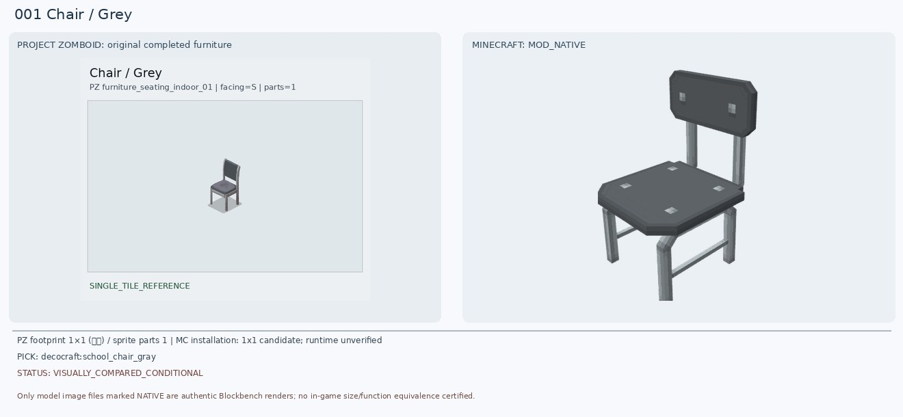
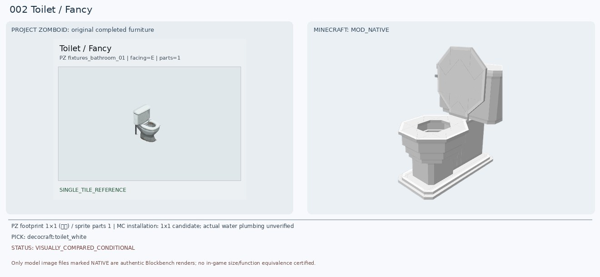
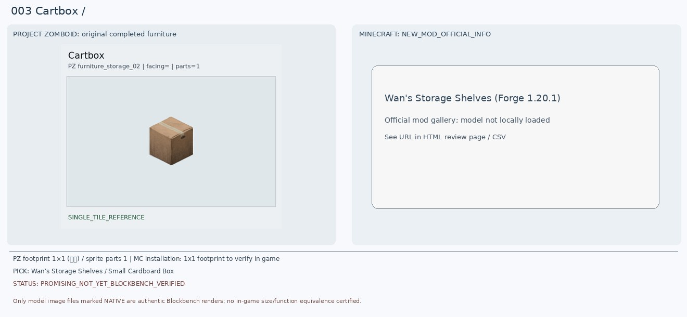
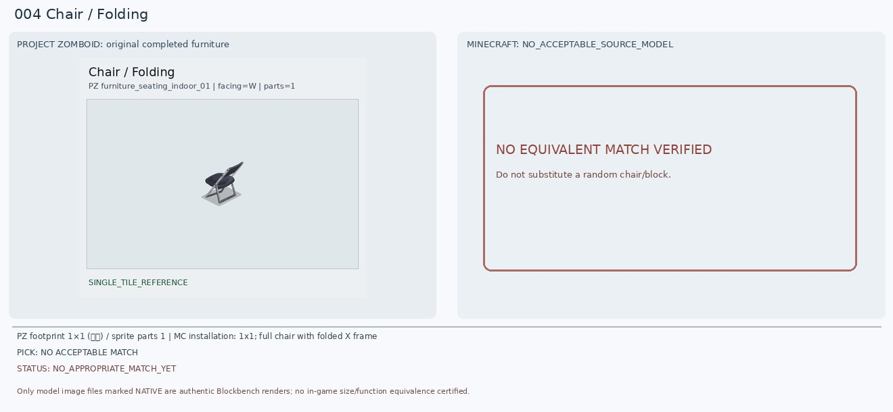
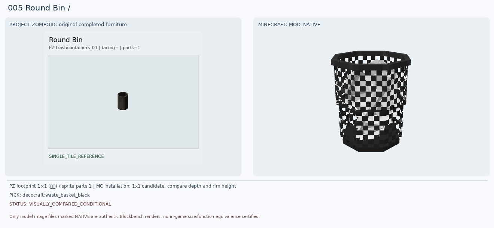
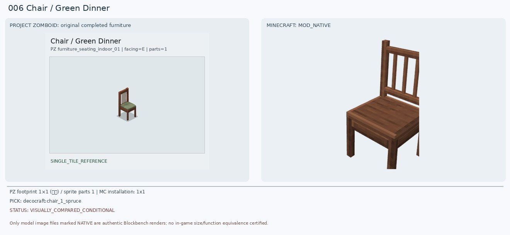
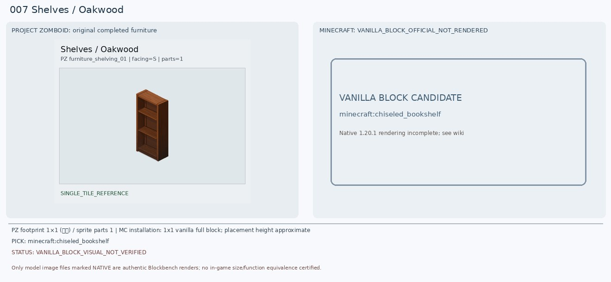
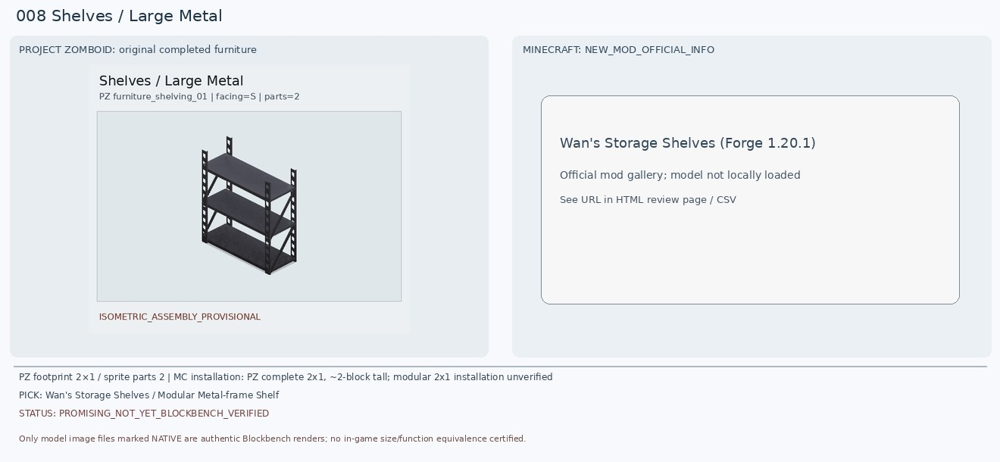
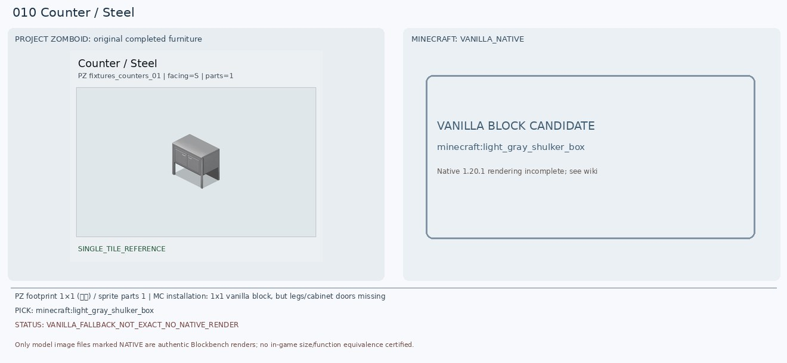

# 프로젝트 좀보이드 ↔ 마인크래프트 가구 357종 이미지 대조목록

> **357/357 시각 검수 기록** · 조건부 후보 68종 · 재탐색 보류 289종 · 게임 내 1:1 확정 0종 (2026-11-02 QA 기준)

기존 36개 독립 작업 브랜치의 **실제 비교 JPG를 손실 재인코딩하지 않고 동일 Git 이미지 객체(SHA)를 재사용**한 갤러리야. 각 JPG는 왼쪽 PZ 완성 가구와 오른쪽 기존 MC 후보 또는 미매칭 표시를 담아. 사진에 보이는 후보가 실제로 적합하다고 보장되는 것은 아니야.

[전체 원본 QA 보고서](../FINAL_QA_357_20261102/FINAL_QA_REPORT_KO.md) · [전체 판정 CSV](../FINAL_QA_357_20261102/MASTER_INDEX_001_357.csv)

## 36개 구간 바로가기

| 가구 번호 | 조건부 | 보류 | 비교 이미지 |
|---|---:|---:|---|
| 001–010 | 5 | 5 | [이미지 10장](batches/BATCH_001_010.md) |
| 011–020 | 7 | 3 | [이미지 10장](batches/BATCH_011_020.md) |
| 021–030 | 6 | 4 | [이미지 10장](batches/BATCH_021_030.md) |
| 031–040 | 5 | 5 | [이미지 10장](batches/BATCH_031_040.md) |
| 041–050 | 6 | 4 | [이미지 10장](batches/BATCH_041_050.md) |
| 051–060 | 4 | 6 | [이미지 10장](batches/BATCH_051_060.md) |
| 061–070 | 1 | 9 | [이미지 10장](batches/BATCH_061_070.md) |
| 071–080 | 3 | 7 | [이미지 10장](batches/BATCH_071_080.md) |
| 081–090 | 1 | 9 | [이미지 10장](batches/BATCH_081_090.md) |
| 091–100 | 5 | 5 | [이미지 10장](batches/BATCH_091_100.md) |
| 101–110 | 5 | 5 | [이미지 10장](batches/BATCH_101_110.md) |
| 111–120 | 2 | 8 | [이미지 10장](batches/BATCH_111_120.md) |
| 121–130 | 2 | 8 | [이미지 10장](batches/BATCH_121_130.md) |
| 131–140 | 2 | 8 | [이미지 10장](batches/BATCH_131_140.md) |
| 141–150 | 1 | 9 | [이미지 10장](batches/BATCH_141_150.md) |
| 151–160 | 1 | 9 | [이미지 10장](batches/BATCH_151_160.md) |
| 161–170 | 2 | 8 | [이미지 10장](batches/BATCH_161_170.md) |
| 171–180 | 0 | 10 | [이미지 10장](batches/BATCH_171_180.md) |
| 181–190 | 0 | 10 | [이미지 10장](batches/BATCH_181_190.md) |
| 191–200 | 1 | 9 | [이미지 10장](batches/BATCH_191_200.md) |
| 201–210 | 1 | 9 | [이미지 10장](batches/BATCH_201_210.md) |
| 211–220 | 1 | 9 | [이미지 10장](batches/BATCH_211_220.md) |
| 221–230 | 1 | 9 | [이미지 10장](batches/BATCH_221_230.md) |
| 231–240 | 0 | 10 | [이미지 10장](batches/BATCH_231_240.md) |
| 241–250 | 0 | 10 | [이미지 10장](batches/BATCH_241_250.md) |
| 251–260 | 2 | 8 | [이미지 10장](batches/BATCH_251_260.md) |
| 261–270 | 0 | 10 | [이미지 10장](batches/BATCH_261_270.md) |
| 271–280 | 0 | 10 | [이미지 10장](batches/BATCH_271_280.md) |
| 281–290 | 1 | 9 | [이미지 10장](batches/BATCH_281_290.md) |
| 291–300 | 0 | 10 | [이미지 10장](batches/BATCH_291_300.md) |
| 301–310 | 0 | 10 | [이미지 10장](batches/BATCH_301_310.md) |
| 311–320 | 1 | 9 | [이미지 10장](batches/BATCH_311_320.md) |
| 321–330 | 0 | 10 | [이미지 10장](batches/BATCH_321_330.md) |
| 331–340 | 1 | 9 | [이미지 10장](batches/BATCH_331_340.md) |
| 341–350 | 1 | 9 | [이미지 10장](batches/BATCH_341_350.md) |
| 351–357 | 0 | 7 | [이미지 7장](batches/BATCH_351_357.md) |

## 전체 이미지 목록

**[357종 이미지를 모두 펼쳐 볼 수 있는 페이지](ALL_357_VISUAL_COMPARISONS.md)** · [검색·조건부/보류 필터가 있는 오프라인 HTML](INDEX.html) (HTML과 이미지를 함께 내려받으면 정상 표시)

## 미리 보기 · 001~010

**001 · Chair Grey — 조건부**

**002 · Toilet Fancy — 조건부**

**003 · Cartbox  — 보류**

**004 · Chair Folding — 보류**

**005 · Round Bin  — 조건부**

**006 · Chair Green Dinner — 조건부**

**007 · Shelves Oakwood — 보류**

**008 · Shelves Large Metal — 보류**

**009 · Chair Wooden — 조건부**

**010 · Counter Steel — 보류**

