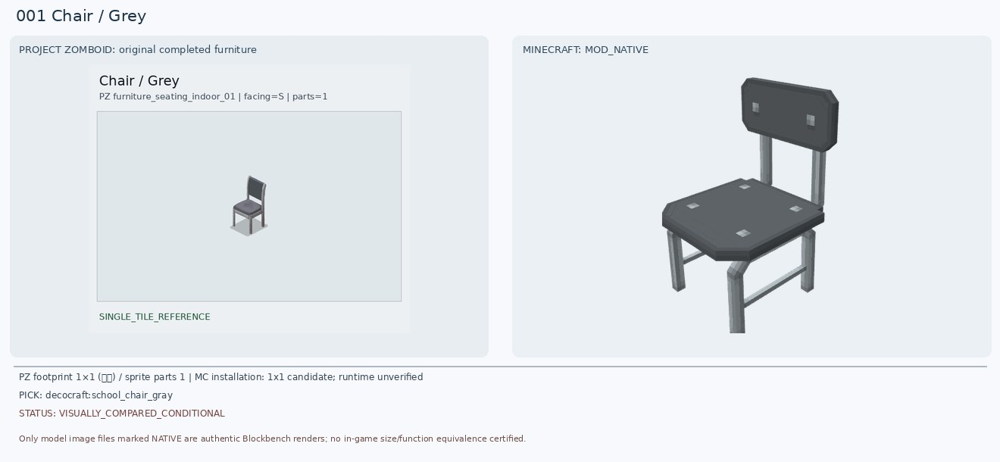
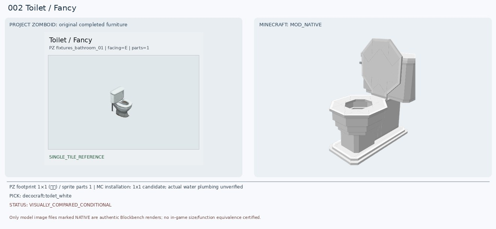
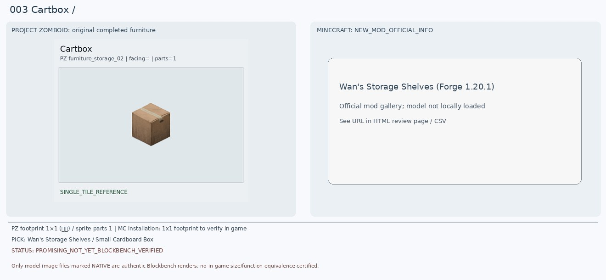
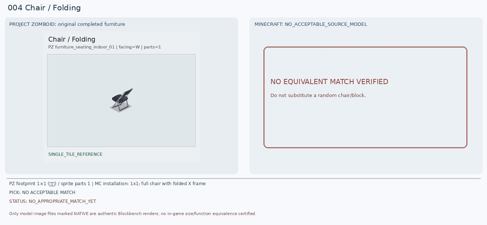
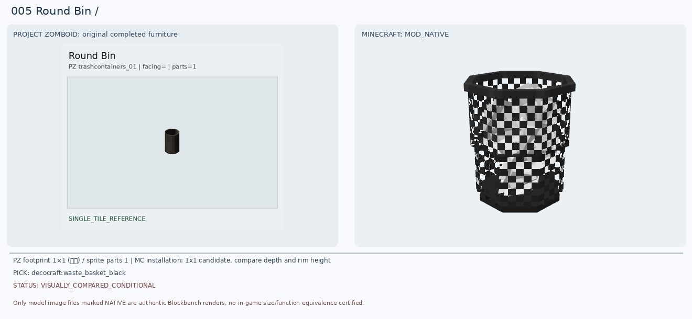
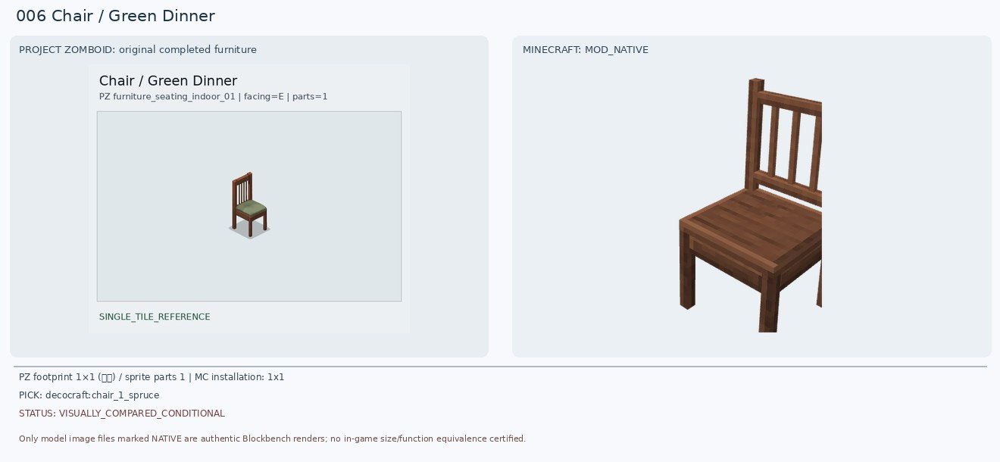
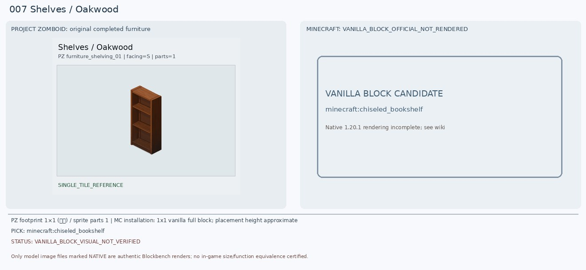
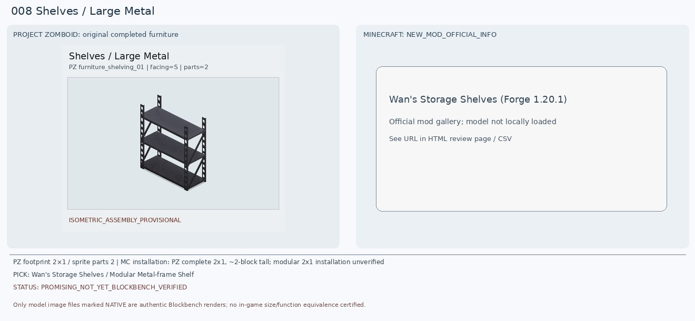
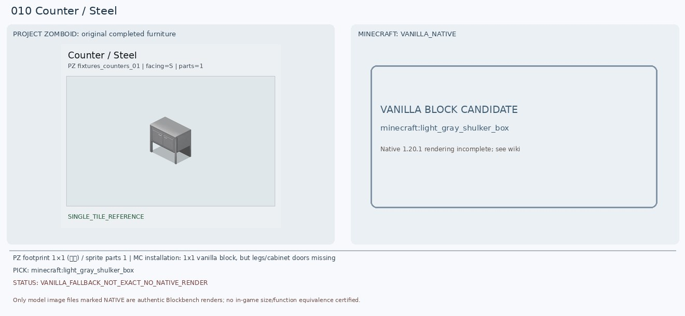

# 로즈우드 가구 001–010 대조 이미지

[전체 목록](../README.md) · [원본 검수 PR #241](https://github.com/sanato-nb/PZ_Tile_Analysis/pull/241)

> 오른쪽 마크 후보는 확정된 1:1 모델이 아니야. 보류(DEFER)는 대응 모델이 없거나 부적합함을 뜻해.

## 001 · Chair / Grey

**조건부 후보** · [기존 상세 검수](https://github.com/sanato-nb/PZ_Tile_Analysis/pull/241)

금속 다리·등받이·어두운 시트라는 특징은 공통이지만 원본 등받이와 좌면 두께·지지대 모양이 다름. 이전 school chair도 무조건 확정하지 않음.

---

## 002 · Toilet / Fancy

**조건부 후보** · [기존 상세 검수](https://github.com/sanato-nb/PZ_Tile_Analysis/pull/241)

흰 도기·뒤 물탱크·둥근 변기 볼 구조를 재확인. 이전 Paladin 모드는 일부 부품만 렌더됐으며 Decocraft 흰 변기는 실제 완성 모델을 로드. 뚜껑/탱크 비율이 다름.

---

## 003 · Cartbox / 기본

**보류 · 재탐색** · [기존 상세 검수](https://github.com/sanato-nb/PZ_Tile_Analysis/pull/241)

기존 크레용 상자는 완전히 부적합. Wan 모드의 작은 종이상자는 마크 1.20.1 Forge 지원 및 25칸 수납이 공식 소개로 확인됨; PZ 원본도 ContainerCapacity 25. 상자 단독 바닥 배치와 모델 블록 ID는 추가 검증해야 함. 바닐라 갈색 셜커 상자는 27칸으로 기능 대안이지만 테이프 표현은 없음.

---

## 004 · Chair / Folding

**보류 · 재탐색** · [기존 상세 검수](https://github.com/sanato-nb/PZ_Tile_Analysis/pull/241)

기존 가죽 안락의자는 접이식 의자와 형태·용도가 다름. Blockables - Chairs의 folding stool은 등받이가 없어 동일하지 않음. 제시한 모드 및 바닐라 블록 조합만으로 1x1 안에 X자 금속 프레임/좌석/등받이를 정확 재현한 후보는 미검증. 별도 모드 탐색 또는 Blockbench 커스텀 필요.

---

## 005 · Round Bin / 기본

**조건부 후보** · [기존 상세 검수](https://github.com/sanato-nb/PZ_Tile_Analysis/pull/241)

PZ는 검은색 원통형 솔리드 쓰레기통. 새 Decocraft 검정 원통형 쓰레기바구니는 실물 형태 유사하나 그물망 격자가 보여 재질 불일치; 바닐라 가마솥은 입구가 열려 있지만 네모 형태라 차선책.

---

## 006 · Chair / Green Dinner

**조건부 후보** · [기존 상세 검수](https://github.com/sanato-nb/PZ_Tile_Analysis/pull/241)

Green Dinner는 목재 프레임·세로 등받이 살·녹색 방석. 기존 초록 안락의자는 기각. Spruce 의자는 목재 프레임과 등받이가 비슷하지만 녹색 방석이 없고, diner_chair_green은 방석 색상은 비슷하나 금속 프레임이어서 최종 승인 보류.

---

## 007 · Shelves / Oakwood

**보류 · 재탐색** · [기존 상세 검수](https://github.com/sanato-nb/PZ_Tile_Analysis/pull/241)

기존 Handcrafted acacia_shelf는 렌더가 막힌 진열장처럼 보여 원본의 빈 3단 목제 개방형 선반과 다름. 바닐라 빈 조각된 책장은 2열x3행 슬롯을 제공해 선반 구획·재질이 더 가까우나 PZ는 가로로 긴 3개 층이고 임의 물품 수납 기능도 다름. 새 모드의 오크 선반 모델 재검증 가능.

---

## 008 · Shelves / Large Metal

**보류 · 재탐색** · [기존 상세 검수](https://github.com/sanato-nb/PZ_Tile_Analysis/pull/241)

원본은 두 스프라이트로 조립된 폭 2칸, 높이 약 2칸 금속 3단랙. Wan 공식 이미지에는 검정/남색 금속 프레임과 3단 선반이 있어 기존 빈칸보다는 좋은 후보. 다만 나무판 재질·모듈의 실제 연결 폭은 달라서 2칸 배치/적재 가능 여부 확인 전 최종 확정 금지. 바닐라 철 덫문+쇠창살 조합은 같은 블록공간을 공유하기 어려워 외형 대안 검증 전.

---

## 009 · Chair / Wooden

**조건부 후보** · [기존 상세 검수](https://github.com/sanato-nb/PZ_Tile_Analysis/pull/241)

기존 Paladin oak_chair_classic_black은 좌석/등받이 등 일부가 사라진 부품 불완전 렌더라 반려. Decocraft spruce 실제 Blockbench 완성 모델은 어두운 갈색 나무의자 4다리지만 PZ는 상단 가로판 위주인 간단한 등받이여서 유사도 미완벽.

---

## 010 · Counter / Steel

**보류 · 재탐색** · [기존 상세 검수](https://github.com/sanato-nb/PZ_Tile_Analysis/pull/241)

PZ는 낮은 철제 2도어 카운터와 4개의 다리, 하부 공간. 기존 적합 후보 미발견. 실버/라이트그레이 셜커 상자는 금속 느낌·1x1 크기·수납이라는 점에서 실용적 임시대체지만 정면 문 두 개와 다리를 표현하지 못함. Decocraft 하부장은 목재 상판이라 재질 차이가 큼. 정확 외형 유지하려면 별도 철제 카운터 모델 탐색/제작.

---

