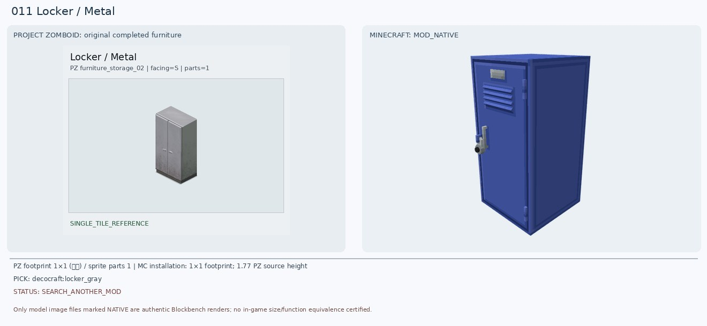
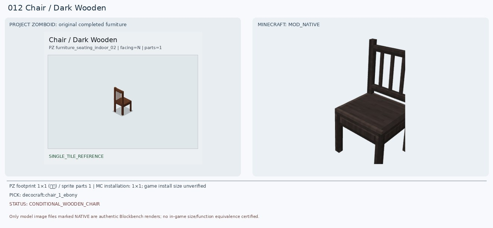
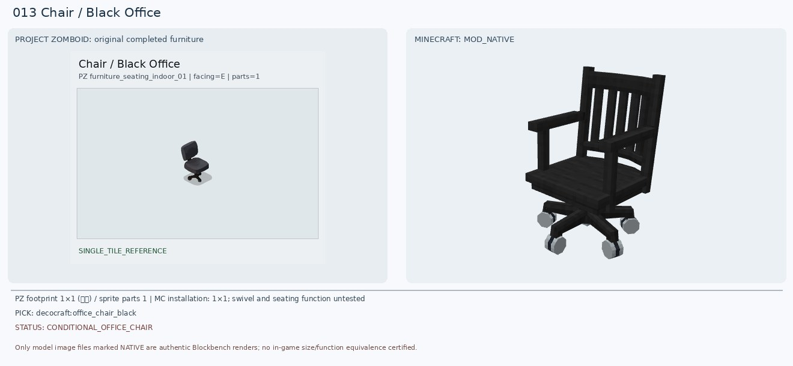
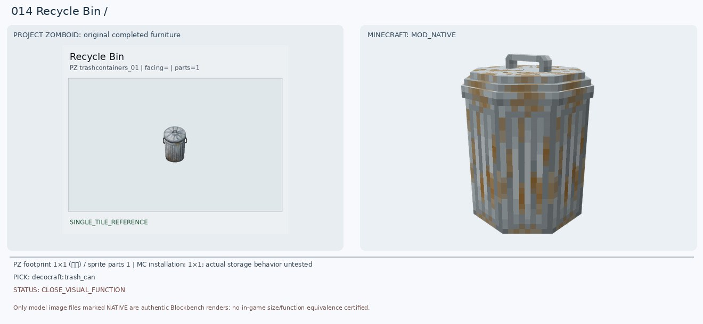
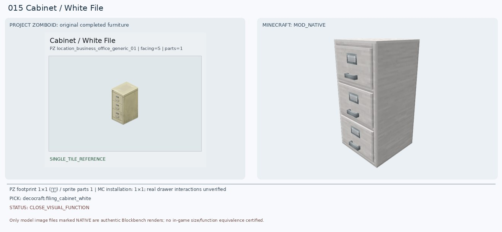
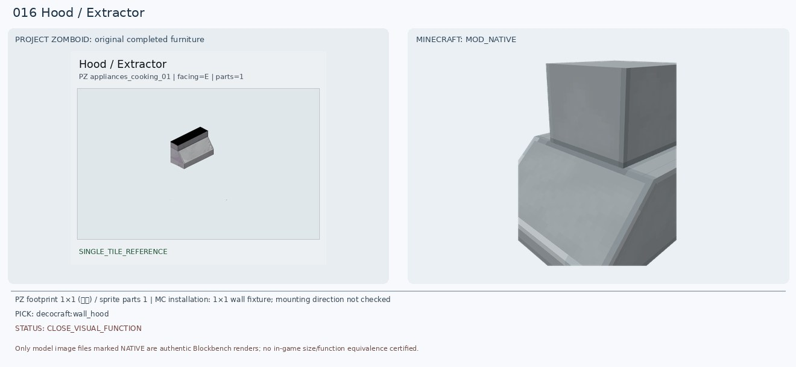
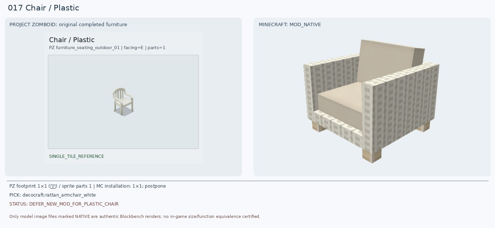
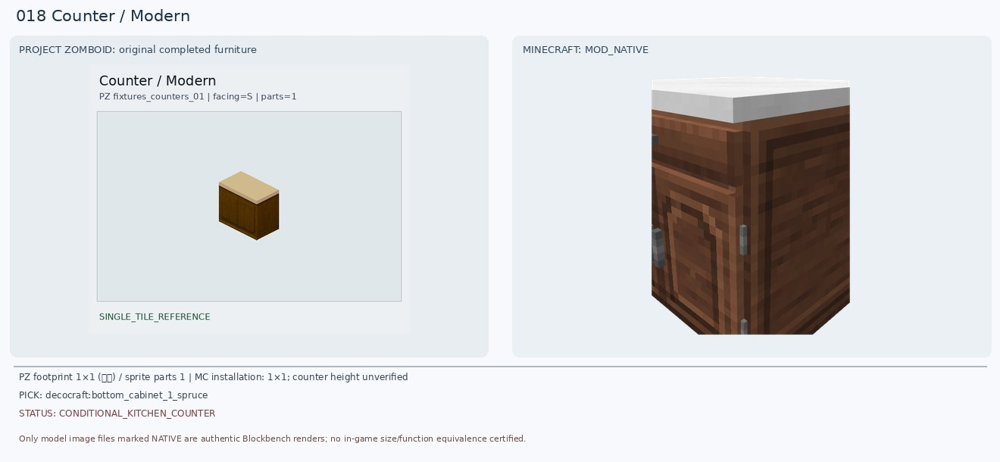
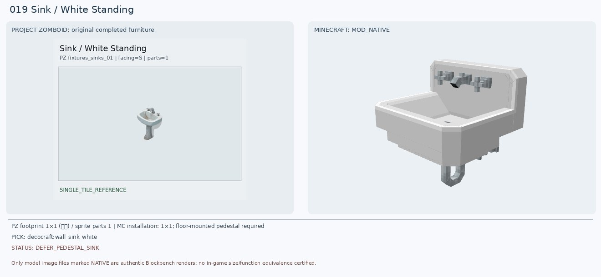
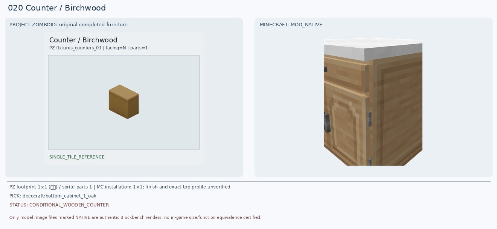

# 011–020 · 로즈우드 가구 이미지 대조

[전체 357종 목록](../README.md) · [원본 검수 PR #242](https://github.com/sanato-nb/PZ_Tile_Analysis/pull/242)

오른쪽 후보는 게임 적용이 확정된 모델이 아니야. **보류**는 추가 탐색 대상이야.

## 011 · Locker / Metal

**보류 · 재탐색** · [원본 PR #242](https://github.com/sanato-nb/PZ_Tile_Analysis/pull/242)

원본은 회색 금속 양문형 락커, Decocraft는 단문 루버 도어이고 실제 렌더에서 파란색으로 나와 색상/문 수가 다름. 최종 치환 보류. 다른 모드에서 양문형 회색 1칸 락커 검색.

---

## 012 · Chair / Dark Wooden

**조건부 후보** · [원본 PR #242](https://github.com/sanato-nb/PZ_Tile_Analysis/pull/242)

원본은 짙은 갈색 네 다리 세로살 등받이 목재 의자. Decocraft Ebony 실모델은 다리와 등받이 구조가 근접하나 검정에 가까운 더 어두운 색임. 기존 Paladin 모델은 부품 누락이라 반려.

---

## 013 · Chair / Black Office

**조건부 후보** · [원본 PR #242](https://github.com/sanato-nb/PZ_Tile_Analysis/pull/242)

바퀴·회전식 베이스는 원본과 같지만 새 Office Chair는 목재 슬랫 등받이와 팔걸이가 있고 PZ는 팔걸이가 없는 단순 패드형. 게임 의자는 과장된 고등받이라 차선.

---

## 014 · Recycle Bin / 기본

**조건부 후보** · [원본 PR #242](https://github.com/sanato-nb/PZ_Tile_Analysis/pull/242)

원본은 리브 무늬와 둥근 뚜껑이 있는 은회색 금속 쓰레기통. Decocraft Trash Can은 실제 렌더에서 둥근 통, 세로 주름, 윗뚜껑이 가까워 기존 불완전 Refurbished 렌더보다 낫지만 녹·손잡이 세부가 다름.

---

## 015 · Cabinet / White File

**조건부 후보** · [원본 PR #242](https://github.com/sanato-nb/PZ_Tile_Analysis/pull/242)

원본은 아이보리색 금속 세 서랍 파일 캐비닛. Decocraft Filing Cabinet White는 정확히 세 서랍과 정면 손잡이 형태를 갖췄음. 아이보리 색상/낡은 정도와 손잡이 간격은 다름. 기존 주방 수납장 반려.

---

## 016 · Hood / Extractor

**조건부 후보** · [원본 PR #242](https://github.com/sanato-nb/PZ_Tile_Analysis/pull/242)

원본의 은색 비스듬한 배기후드에 가까운 벽걸이 모델을 확보. 다만 새 Wall Hood는 상부 덕트가 더 높고 원본의 검은 상단 띠와 구조가 다름. 이전 Refurbished 렌더는 일부 큐브만 보였음.

---

## 017 · Chair / Plastic

**보류 · 재탐색** · [원본 PR #242](https://github.com/sanato-nb/PZ_Tile_Analysis/pull/242)

PZ는 하나로 성형된 흰 플라스틱 야외 의자로 곡선 등받이와 일체형 팔걸이. 새 라탄 의자는 직조+두꺼운 방석이고 Beach Chair는 캔버스형. 둘 다 재질/구조가 달라 최종 매칭 보류. Skniro 등에서 플라스틱 성형 의자 추후 탐색.

---

## 018 · Counter / Modern

**조건부 후보** · [원본 PR #242](https://github.com/sanato-nb/PZ_Tile_Analysis/pull/242)

원본은 어두운 목재 2도어 하부장과 밝은 베이지색 상판. 새 Spruce 하부장은 갈색 본체+밝은 상판으로 접근하지만 위쪽 서랍 한 개와 아래 문 한 개로 원본 2도어 구조와 다르고 높이도 달라 설치 비교 필요.

---

## 019 · Sink / White Standing

**보류 · 재탐색** · [원본 PR #242](https://github.com/sanato-nb/PZ_Tile_Analysis/pull/242)

PZ는 독립형 하얀 도기 세면대로 긴 받침 기둥을 가진다. 새 Wall Sink White는 수전과 물받이만 유사하며 벽에 설치되어 페데스털이 없음. Round Sink Silver도 상판 거치형. Skniro/욕실 가구 모드에서 받침 기둥 포함 모델 탐색 보류.

---

## 020 · Counter / Birchwood

**조건부 후보** · [원본 PR #242](https://github.com/sanato-nb/PZ_Tile_Analysis/pull/242)

원본은 꿀빛 갈색 단정한 장식 없는 카운터. 새 Oak 하부장은 따뜻한 나무색은 가까우나 흰 상판, 장식 문짝/서랍이 추가됨. 기존 Macaw Birch Counter는 회색 몸통이라 더 먼 후보. 바닐라 배럴/각목 블록도 추후 비교 가능.

---

