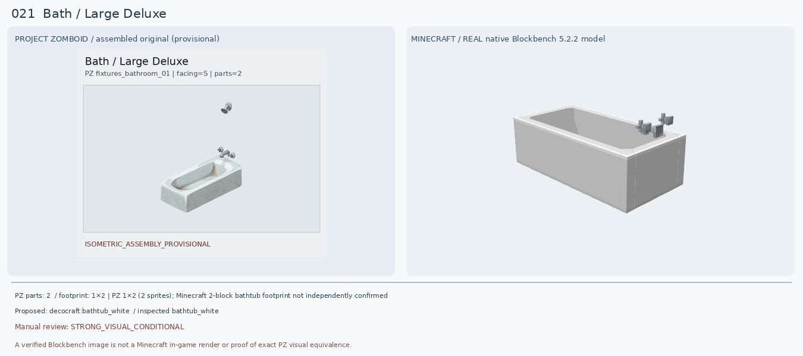
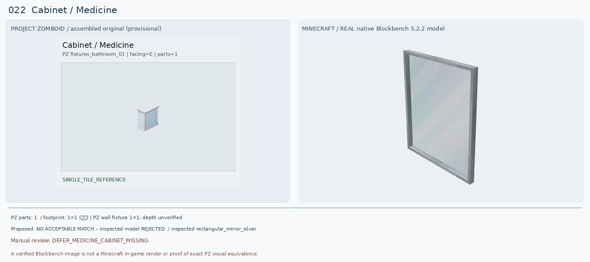
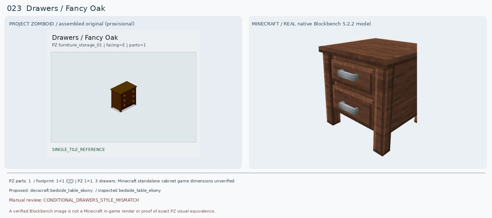
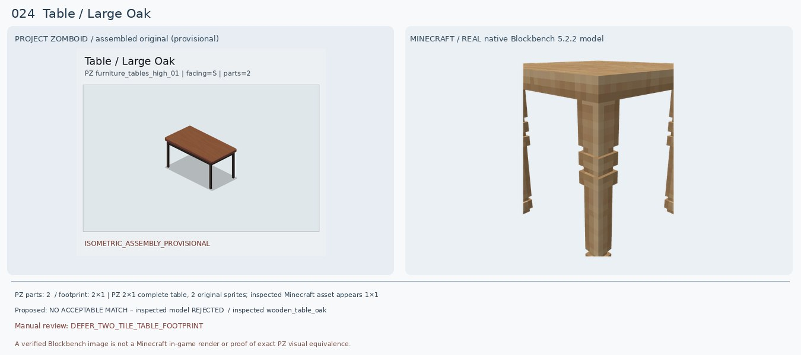
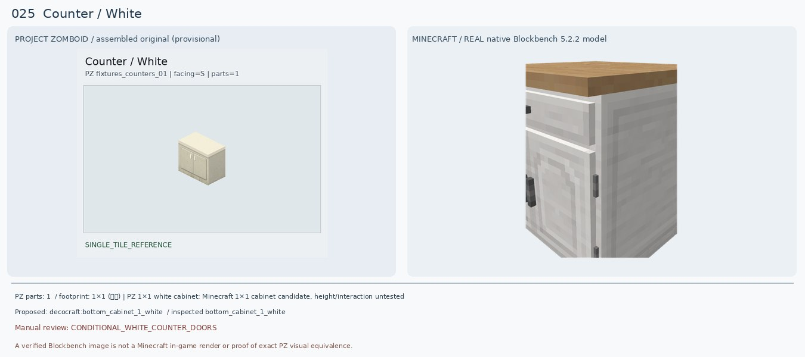
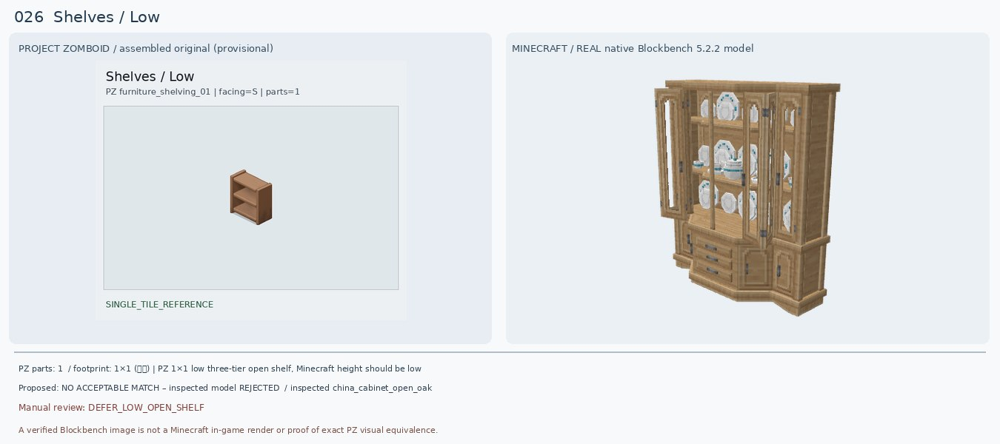
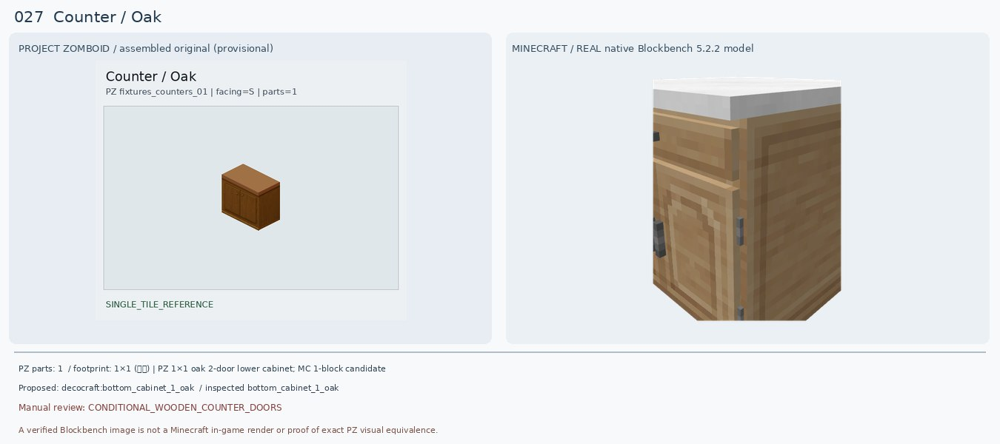
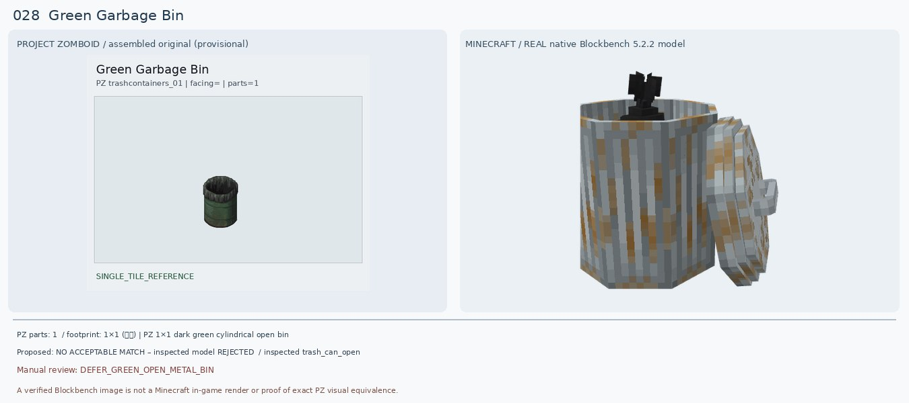
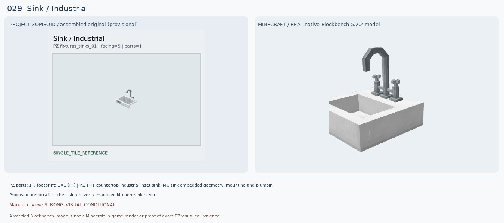
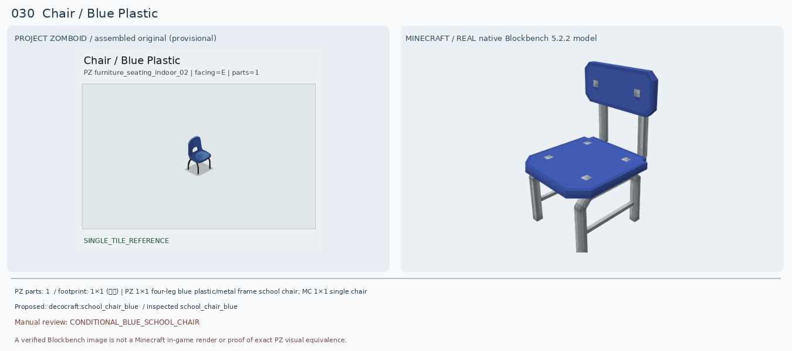

# 021–030 · 로즈우드 가구 이미지 대조

[전체 357종 목록](../README.md) · [원본 검수 PR #243](https://github.com/sanato-nb/PZ_Tile_Analysis/pull/243)

오른쪽 후보는 게임 적용이 확정된 모델이 아니야. **보류**는 추가 탐색 대상이야.

## 021 · Bath / Large Deluxe

**조건부 후보** · [원본 PR #243](https://github.com/sanato-nb/PZ_Tile_Analysis/pull/243)

원본 PZ는 두 타일로 구성되는 긴 흰색 욕조. Decocraft Bathtub White는 하얀 사각 욕조·내부 공간·끝 수전 모양이 매우 가깝다. 단 PZ 조립 프리뷰에 떨어져 보이는 수도꼭지 한 조각은 조립 미확정이므로 시각 검수 전 수정 필요. MC 실제 배치 면적과 연결 기능은 미확인.

---

## 022 · Cabinet / Medicine

**보류 · 재탐색** · [원본 PR #243](https://github.com/sanato-nb/PZ_Tile_Analysis/pull/243)

PZ는 옆면 깊이와 작은 문/손잡이가 있는 벽걸이 약품장. 실제 Decocraft Rectangular Mirror Silver는 거울뿐이라 수납 몸체가 없다. Middle Cabinet White는 몸체만 있고 거울이 없다. 둘 모두 원본의 문+거울+수납 기능을 동시에 갖추지 못하므로 기존 Macaw 주방장 매칭도 반려하고 보류.

---

## 023 · Drawers / Fancy Oak

**조건부 후보** · [원본 PR #243](https://github.com/sanato-nb/PZ_Tile_Analysis/pull/243)

원본은 진갈색 캐비닛형 3단 서랍장과 황동 원형 손잡이. Bedside Table Ebony는 2단 서랍장으로 어두운 갈색 톤·4다리는 비슷하지만 서랍 개수, 손잡이 모양, 가구 높이가 다르다. Modular Desk Drawers Oak도 2단에 색상이 밝아 대안으로만 기록.

---

## 024 · Table / Large Oak

**보류 · 재탐색** · [원본 PR #243](https://github.com/sanato-nb/PZ_Tile_Analysis/pull/243)

원본 완성형 테이블은 2개 타일로 연결된 길쭉한 직사각 탁자이며 가느다란 검은 다리 네 개가 있다. Decocraft Wooden Table Oak는 목재 단색 1×1 정사각 탁자에 굵고 장식적인 다리라 비율·재질·부피가 다르다. Kitchen Table Oak도 흰 상판이므로 부적합. 기존 Macaw Oak Table의 큐브형 렌더 역시 원본과 불일치.

---

## 025 · Counter / White

**조건부 후보** · [원본 PR #243](https://github.com/sanato-nb/PZ_Tile_Analysis/pull/243)

원본은 크림색 두 문짜리 카운터. Decocraft Bottom Cabinet 1 White는 흰색 몸체가 가깝지만 위 한 서랍+아래 한 문, 상판 목재색이라 2도어 크림색 원본과 차이. Bottom Cabinet 2 White는 서랍 4개라 더 나쁨. 기존 1 White를 조건부 후보로만 유지.

---

## 026 · Shelves / Low

**보류 · 재탐색** · [원본 PR #243](https://github.com/sanato-nb/PZ_Tile_Analysis/pull/243)

원본은 높이가 낮은 개방형 목재 3단 선반. Decocraft China Cabinet Open Oak는 거대한 유리문/접시/서랍이 붙은 장식장이라 종류가 다르다. 기존 Handcrafted Acacia Shelf는 실제 렌더가 원본과 달리 전면이 막힌 진열장 형태로 나와 승인 불가.

---

## 027 · Counter / Oak

**조건부 후보** · [원본 PR #243](https://github.com/sanato-nb/PZ_Tile_Analysis/pull/243)

원본은 중간 갈색 오크 2도어 캐비닛과 갈색 목제 상판. Bottom Cabinet 1 Oak는 목재 색감은 가깝지만 상판 흰색, 상단 서랍+하부 단문 구성이며 Bottom Cabinet 2 Oak는 4단 서랍이라 더 부적합. 기존 Macaw Dark Oak Counter는 어두운 직육면체라 더 멀어 조건부 1 Oak로 교체 제안.

---

## 028 · Green Garbage Bin / 기본

**보류 · 재탐색** · [원본 PR #243](https://github.com/sanato-nb/PZ_Tile_Analysis/pull/243)

PZ 원본은 짙은 초록색 원통 몸체와 검정 테두리 비닐이 있는 개방 쓰레기통. Decocraft Trash Can Open은 회색 골판형 큰 쓰레기통으로 뚜껑이 옆에 떨어져 있으며 검정 격자 바구니는 철망형이라 외형이 달라. 기존 Paladin Mesh Trashcan도 격자·초록 배경이 뒤엉킨 부분 렌더로 승인 불가.

---

## 029 · Sink / Industrial

**조건부 후보** · [원본 PR #243](https://github.com/sanato-nb/PZ_Tile_Analysis/pull/243)

PZ 원본은 얕은 네모 물받이와 높게 굽은 금속 수도꼭지. Decocraft Kitchen Sink Silver 모델은 사각 물받이·높은 호스형 수전·금속 색상이 꽤 닮았다. Square Sink Silver도 유사하지만 베이슨 형태가 다르므로 전자를 우선. 원본은 독립 받침 없는 인셋형이라 싱크 하부 조합 공간이 맞는지 필요.

---

## 030 · Chair / Blue Plastic

**조건부 후보** · [원본 PR #243](https://github.com/sanato-nb/PZ_Tile_Analysis/pull/243)

PZ는 등받이 중앙에 손잡이 구멍이 뚫린 파란 플라스틱 의자와 검정 가는 금속 다리. School Chair Blue는 파란 시트·등받이·금속 다리 구성이 맞지만 등받이가 네모이고 손잡이 대신 회색 박음점, 좌석이 직사각이라 상당한 차이. Diner Chair Blue는 흰 줄무늬가 있어 더 멀다. 조건부만.

---

