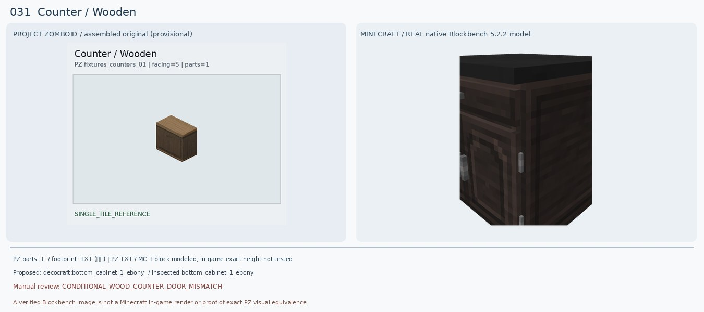
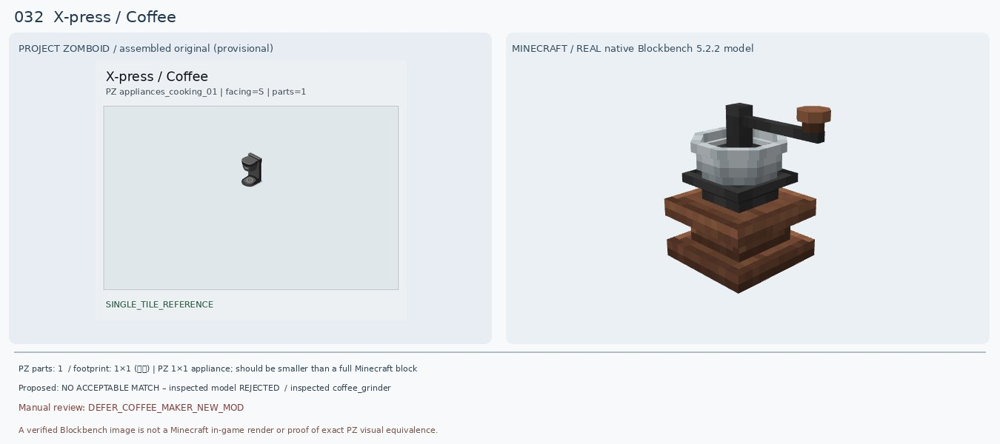
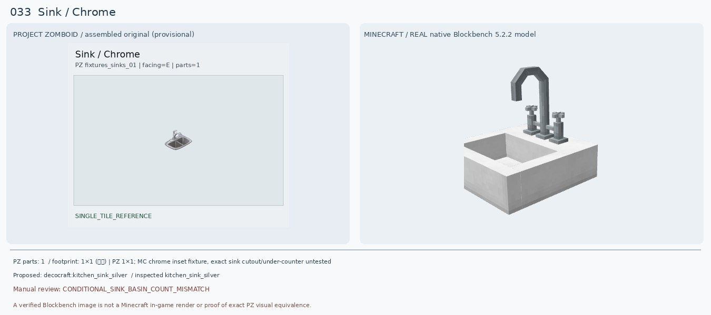
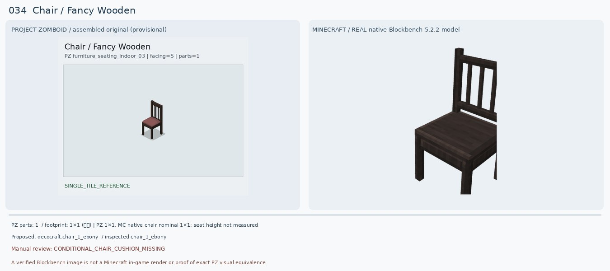
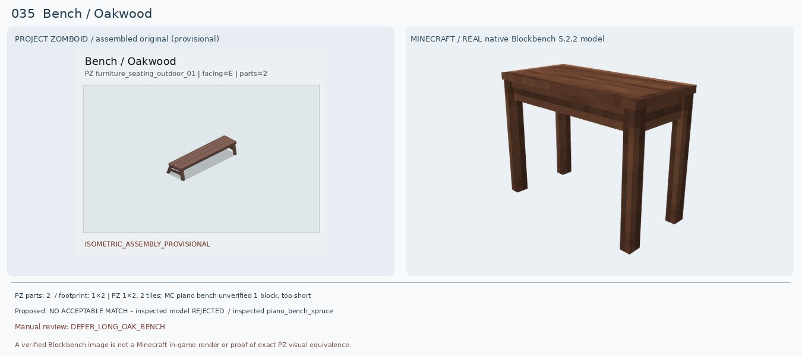
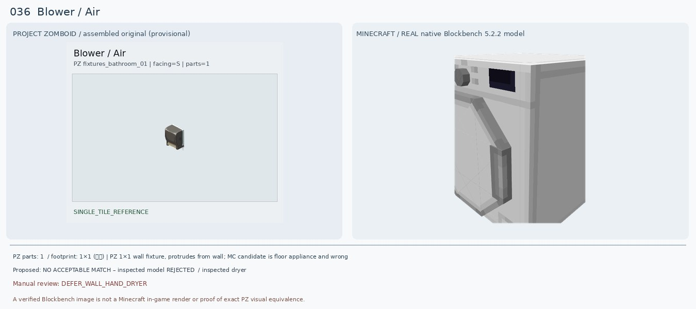
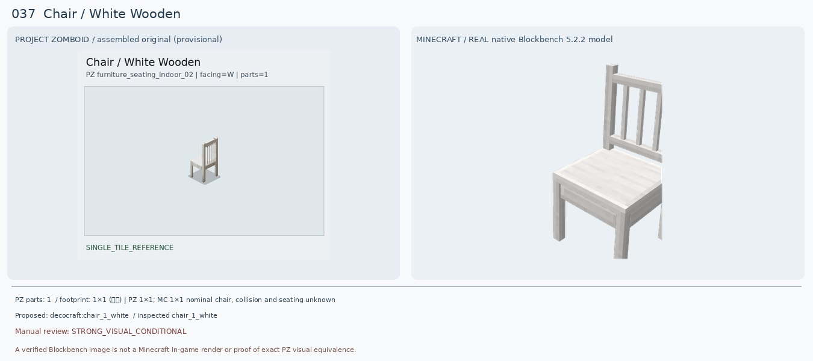
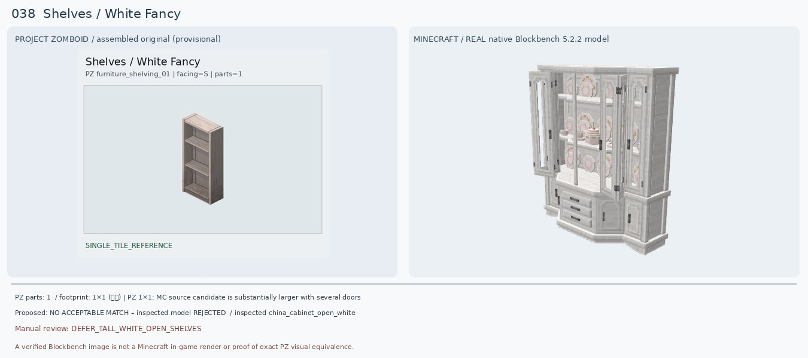
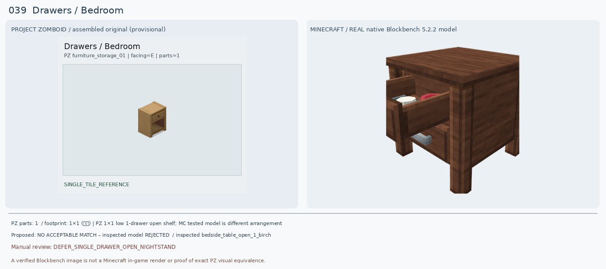
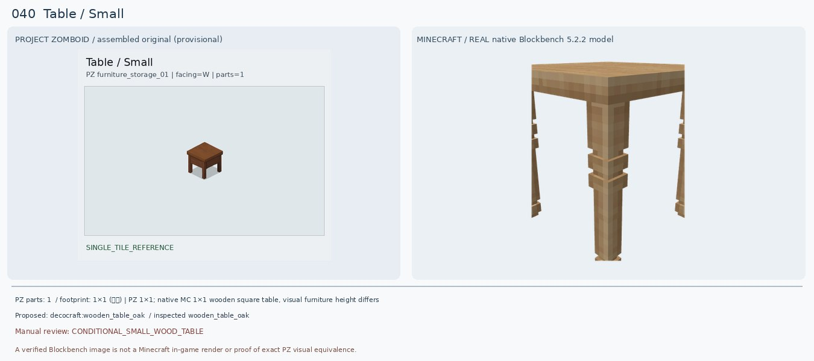

# 031–040 · 로즈우드 가구 이미지 대조

[전체 357종 목록](../README.md) · [원본 검수 PR #244](https://github.com/sanato-nb/PZ_Tile_Analysis/pull/244)

오른쪽 후보는 게임 적용이 확정된 모델이 아니야. **보류**는 추가 탐색 대상이야.

## 031 · Counter / Wooden

**조건부 후보** · [원본 PR #244](https://github.com/sanato-nb/PZ_Tile_Analysis/pull/244)

PZ는 어두운 갈색 나무의 양문 하부장과 목재 상판. 새 Decocraft Ebony는 어두운 목제 전체 형태는 비슷하지만 실제 원본은 서랍+단문(또는 한 장 문), 검정 상판이라 양문 구조가 다름. Spruce는 목재 갈색이 약간 밝고 흰 상판이어서 대안으로만. 기존 Macaw Dark Oak Counter는 통짜 블록 렌더라 거부.

---

## 032 · X-press / Coffee

**보류 · 재탐색** · [원본 PR #244](https://github.com/sanato-nb/PZ_Tile_Analysis/pull/244)

기존 대나무 원탁 매칭은 가구 종류 자체가 틀려 폐기. 추가 확인한 Decocraft Coffee Grinder는 나무 손잡이 수동 분쇄기라 전기 드립 커피메이커가 아님. Minecraft 1.20.1 Forge CoffeeCraft 모드에 커피메이커 블록이 있다는 공개 자료는 확인했으나, 구체적인 블록 ID와 원본 모델 외형은 직접 렌더하지 못해서 보류.

---

## 033 · Sink / Chrome

**조건부 후보** · [원본 PR #244](https://github.com/sanato-nb/PZ_Tile_Analysis/pull/244)

PZ 원본은 은색 좌우 2조 볼과 높은 곡선 수전. 새 Kitchen Sink Silver는 은색 재질·수전과 설치 용도는 가깝지만 단일 볼 형태라 쌍볼 구조를 잃음. 기존 Paladin Basic Sink는 일부 평판만 렌더돼 무효. 쌍볼 모드 모델을 계속 검색하며 이번 후보는 조건부만.

---

## 034 · Chair / Fancy Wooden

**조건부 후보** · [원본 PR #244](https://github.com/sanato-nb/PZ_Tile_Analysis/pull/244)

기존 Paladin Oak Chair Classic Black은 모형 좌석과 등받이가 빠진 부분 렌더로 무효. 새 Decocraft Chair 1 Ebony는 진한 나무 프레임, 네 다리, 등받이 세로살 구성이 비슷하지만 분홍·보랏빛 방석이 없고 색상 자체도 더 검정. Cherry는 프레임이 너무 연분홍. 미세한 좌석 색상은 커스텀 리텍스처 없이는 불일치.

---

## 035 · Bench / Oakwood

**보류 · 재탐색** · [원본 PR #244](https://github.com/sanato-nb/PZ_Tile_Analysis/pull/244)

PZ는 2타일을 합친 긴 갈색 야외 등받이 없는 벤치. 이전 Decocraft Gym Bench는 운동기구로 부적합. 새 Decocraft Decobench는 실제 목공 작업대라 전혀 다른 물건. Piano Bench Spruce는 긴 좌석 형태를 일부 갖추나 실물 길이가 짧고 피아노용 단일 스툴에 가까워 거절. Handcrafted Oak Bench는 소스 블록 ID가 존재하지만 현재 비교 렌더 미확인.

---

## 036 · Blower / Air

**보류 · 재탐색** · [원본 PR #244](https://github.com/sanato-nb/PZ_Tile_Analysis/pull/244)

PZ 원본은 작은 검정 벽걸이 공기 건조기. 기존 `decocraft:dryer`는 커다란 세탁 건조기이며 원본 `.bbmodel`이 정상 표시돼도 종류가 완전히 다르므로 반려. 확인된 Decocraft JAR에는 정확한 hand dryer 모델이 없음.

---

## 037 · Chair / White Wooden

**조건부 후보** · [원본 PR #244](https://github.com/sanato-nb/PZ_Tile_Analysis/pull/244)

PZ의 흰색 나무 의자는 곧은 4다리와 세로살 등받이·평평한 좌석. Decocraft Chair 1 White는 실제 원본 20큐브 모델에서 흰 목재·세로살 4다리 형태가 상당히 닮아 기존 Paladin 반쪽 렌더보다 적합. Chair 2 White는 X등받이여서 더 다르다. 곡면·등받이 비례는 차이.

---

## 038 · Shelves / White Fancy

**보류 · 재탐색** · [원본 PR #244](https://github.com/sanato-nb/PZ_Tile_Analysis/pull/244)

원본은 빈 3단 선반이 보이는 날렵한 흰 목재 책장. 기존 Decocraft Dish Rack White는 접시걸이로 틀렸고, 새 Decocraft China Cabinet Open White는 유리문·장식품·하부 서랍이 있는 거대한 찬장이어서 다른 가구. Modular Desk Storage White도 가로형 책상 장식품이다. Macaw's Stripped Birch Bookshelf는 후보 ID만 확인되어 완성 렌더 비교 전으로 보류.

---

## 039 · Drawers / Bedroom

**보류 · 재탐색** · [원본 PR #244](https://github.com/sanato-nb/PZ_Tile_Analysis/pull/244)

원본은 연한 갈색 1단 서랍과 아래가 빈 오픈칸 1개. Decocraft Bedside Table Open 1 Oak/Birch는 위 서랍이 열린 상태이며 아래에 또 손잡이/서랍이 있어 원본 오픈 선반과 구조가 다름. Open 2는 아랫서랍만 열린 2단 서랍장이어서 더 나쁨. 기존 Macaw acacia bookshelf drawer는 판 한 장만 표시된 불완전 렌더라 무효.

---

## 040 · Table / Small

**조건부 후보** · [원본 PR #244](https://github.com/sanato-nb/PZ_Tile_Analysis/pull/244)

PZ는 진갈색 상판과 굵은 직선 네 다리를 가진 작은 정사각 나무 탁자. Decocraft Wooden Table Oak는 네 다리/상판/탁자 역할은 같지만 상판이 밝은 베이지색이고 다리에 장식 링이 많으며 실제 높이·두께도 다름. Cherry는 분홍색이라 더 다름. 기존 Wrought Iron Small Black은 원형 금속 다리라 형태가 틀림.

---

