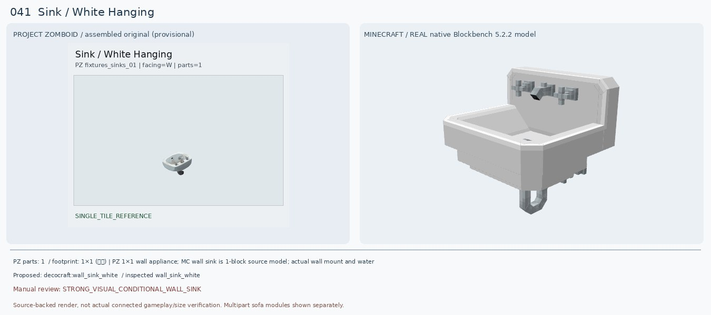
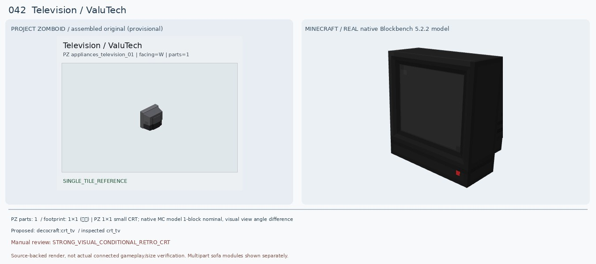
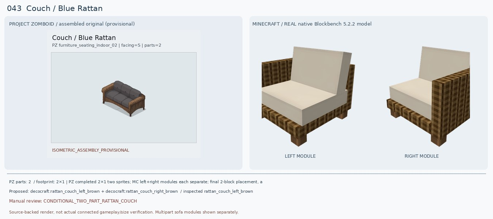
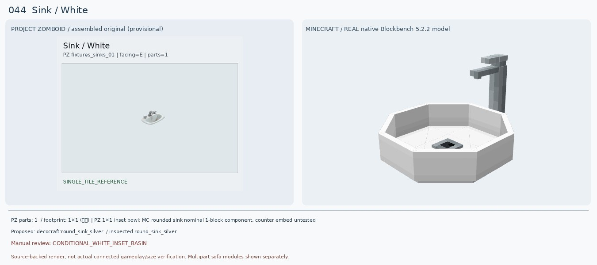
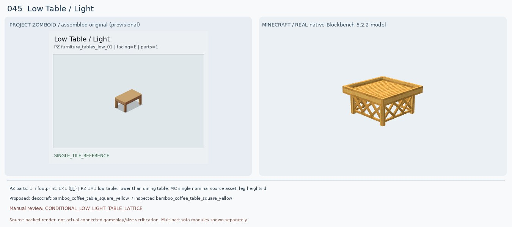
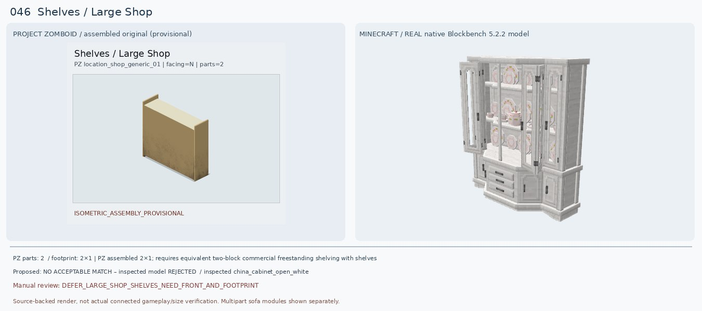
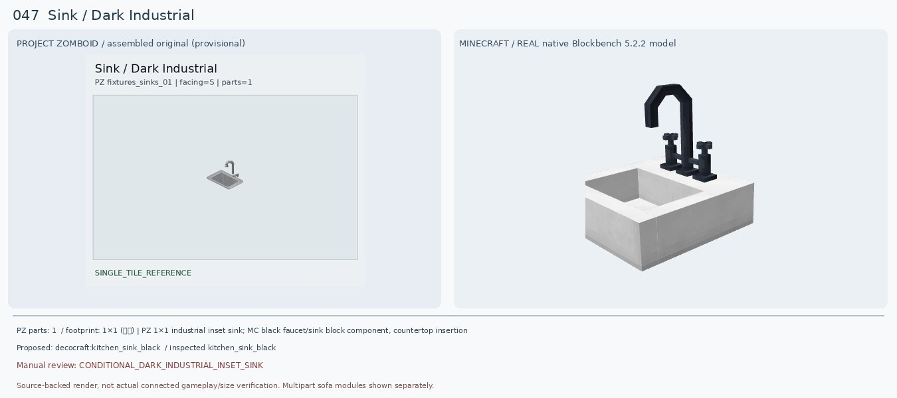
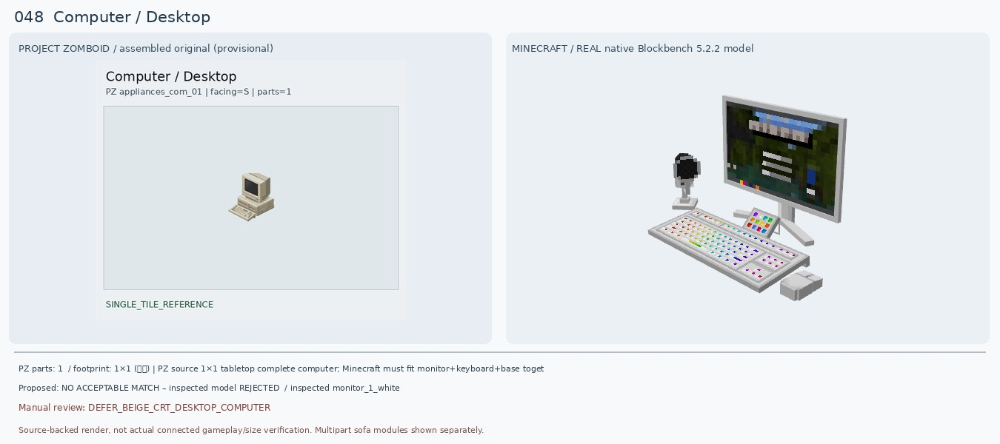
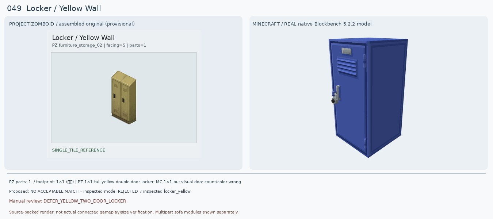
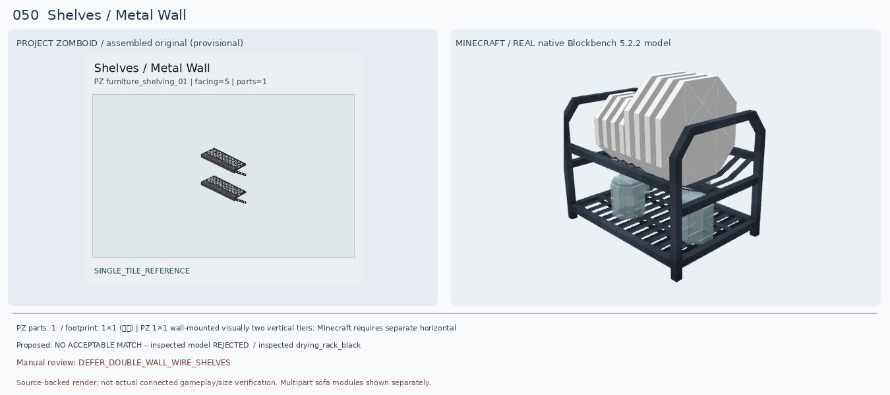

# 041–050 · 로즈우드 가구 이미지 대조

[전체 357종 목록](../README.md) · [원본 검수 PR #245](https://github.com/sanato-nb/PZ_Tile_Analysis/pull/245)

오른쪽 후보는 게임 적용이 확정된 모델이 아니야. **보류**는 추가 탐색 대상이야.

## 041 · Sink / White Hanging

**조건부 후보** · [원본 PR #245](https://github.com/sanato-nb/PZ_Tile_Analysis/pull/245)

좀보이드 원본은 흰색 벽걸이 세면대, 금속 수전 둘, 아래 배수구가 보임. 새 Decocraft Wall Sink White 실제 모델은 흰색 몸체/수전/아래 배수 파이프가 갖춰져 기존 Refurbished 분홍색 단일 평판보다 매우 적합. 다만 정사각형 볼과 높은 뒷판은 원본 둥근 도기와 비율 차이.

---

## 042 · Television / ValuTech

**조건부 후보** · [원본 PR #245](https://github.com/sanato-nb/PZ_Tile_Analysis/pull/245)

원본 ValuTech TV는 두껍고 뒤로 튀어나온 검정/회색 브라운관 TV(원본 좌우 비교는 뒷면 시점). 새 Decocraft CRT TV는 검은색 두꺼운 박스형 모니터와 전면 화면을 갖추어 기존 Refurbished의 큐브형 그래픽보다 명확히 낫다. Tv Old는 나무 외장·안테나가 달려 시대와 외형이 다름.

---

## 043 · Couch / Blue Rattan

**조건부 후보** · [원본 PR #245](https://github.com/sanato-nb/PZ_Tile_Analysis/pull/245)

기존 Macaw Blue Couch는 파란색 단일 블록/좌석이며 갈색 라탄 질감이 없어 전혀 맞지 않는다. 새 Decocraft Rattan Couch Brown 왼쪽·오른쪽 모델은 실제 원본 소스에서 등받이·라탄 옆면·다리·좌석을 각각 확인한 완전형 모듈이다. 하지만 쿠션은 크림색으로 원본의 짙은 회색과 색상이 어긋나며, 두 블록으로 붙인 조립 완성형은 아직 게임에서 확인하지 않았다. 카드에는 좌우 단독 모듈을 각각 보여준다.

---

## 044 · Sink / White

**조건부 후보** · [원본 PR #245](https://github.com/sanato-nb/PZ_Tile_Analysis/pull/245)

원본은 얕고 둥근 흰색 매입형 도기 세면대에 짧은 금속 수도꼭지들이 있다. 새 Decocraft Round Sink Silver는 흰 둥근 물받이·수전이 비슷하지만 팔각형 볼, 긴 한 개 수전, 큰 받침/배수구가 달라 모양이 정확히 같지는 않다. 기존 Refurbished는 평판만 나온 불완전 모델이므로 교체.

---

## 045 · Low Table / Light

**조건부 후보** · [원본 PR #245](https://github.com/sanato-nb/PZ_Tile_Analysis/pull/245)

원본은 밝은 황갈색 매끈한 낮은 탁자와 굵은 네 다리. 새 Decocraft Bamboo Square Yellow는 비슷한 밝은 목재 상판·낮은 크기를 갖지만 옆면이 X자 라탄 격자라 원본의 열린 네 다리 구조와 다름. Cottage Coffee Table은 다리는 간결하지만 색상이 매우 어두워 보조 대안. 기존 Macaw는 회색 매끈한 석판처럼 나타나 부적합.

---

## 046 · Shelves / Large Shop

**보류 · 재탐색** · [원본 PR #245](https://github.com/sanato-nb/PZ_Tile_Analysis/pull/245)

원본 2개 타일을 합친 상점 진열대인데 현재 그림은 넓고 매끈한 뒷판이 강조되어 실제 상품 진열 선반 쪽 전면이 불분명하다. 기존 Handcrafted Acacia Shelf는 폭 1칸 짜리 닫힌 목제 상자 같아 비율과 종류가 다름. 추가 Decocraft China Cabinet White도 문·접시·서랍이 있는 가정용 찬장으로 상점 전용 2칸 선반과 불일치. 원본 반대 시점 확인 전 확정 불가.

---

## 047 · Sink / Dark Industrial

**조건부 후보** · [원본 PR #245](https://github.com/sanato-nb/PZ_Tile_Analysis/pull/245)

원본 Dark Industrial Sink는 진회색 은색 철제 사각 볼, 높은 꺾인 수도꼭지. 새 Kitchen Sink Black은 사각 볼·높은 호형 수전·어두운 손잡이로 기존 Paladin 평판 모델보다 좋다. 다만 모델의 바닥 몸체가 흰색이며 수전 전체가 검게 바뀌어서 원본 금속 광택과 상충. Silver 변형과 색상 재비교 필요.

---

## 048 · Computer / Desktop

**보류 · 재탐색** · [원본 PR #245](https://github.com/sanato-nb/PZ_Tile_Analysis/pull/245)

PZ는 오래된 베이지색 CRT 모니터, 수평 케이스, 키보드가 모두 있는 완성 데스크톱. 기존 Refurbished Computer는 금색 큰 정육면체 한 부품만 렌더링되어 매칭 불가능. 새 Decocraft Monitor 1 White는 모니터와 키보드 형태가 있지만 화면이 얇은 현대식 LCD, 화려한 방송용 조작패널, 별도 CRT 몸체가 없어 원본과 크게 다르다. 다른 전자기기 모드를 조사해야 한다.

---

## 049 · Locker / Yellow Wall

**보류 · 재탐색** · [원본 PR #245](https://github.com/sanato-nb/PZ_Tile_Analysis/pull/245)

원본은 두 개의 문과 가운데 손잡이 두 개가 있는 노란색 금속 사물함. Decocraft Locker Yellow와 Gray의 실모델을 모두 렌더했지만 노란색이 적용되지 않고 파란색 단일 루버 도어로 나왔으며 문 개수·힌지/손잡이가 원본과 달라. 색상 레이어 로더 문제 가능성을 배제할 수 없지만 단순히 노란색이라고 ID가 붙었다고 승인하면 안 됨.

---

## 050 · Shelves / Metal Wall

**보류 · 재탐색** · [원본 PR #245](https://github.com/sanato-nb/PZ_Tile_Analysis/pull/245)

PZ 원본은 벽에 매달린 2단 금속 격자형 얕은 바구니 선반이다. 기존 Handcrafted Acacia Shelf는 문 있는 나무 수납장처럼 나와 부적합. 새 Decocraft Drying Rack Black은 건조 접시와 바닥 받침대가 있는 독립형이라 다른 가구이고 Spice Rack White는 흰 통조림 양념장이라 철망과 달라. 바닐라 철 덫문/쇠창살로 선반을 근사할 수는 있으나 한 블록 내부 중첩·벽 부착 방식이 아직 검증되지 않았다.

---

