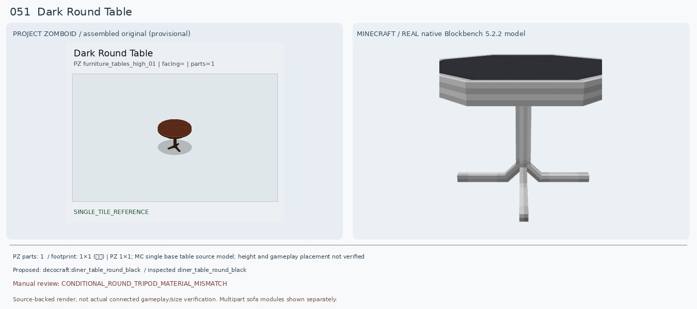
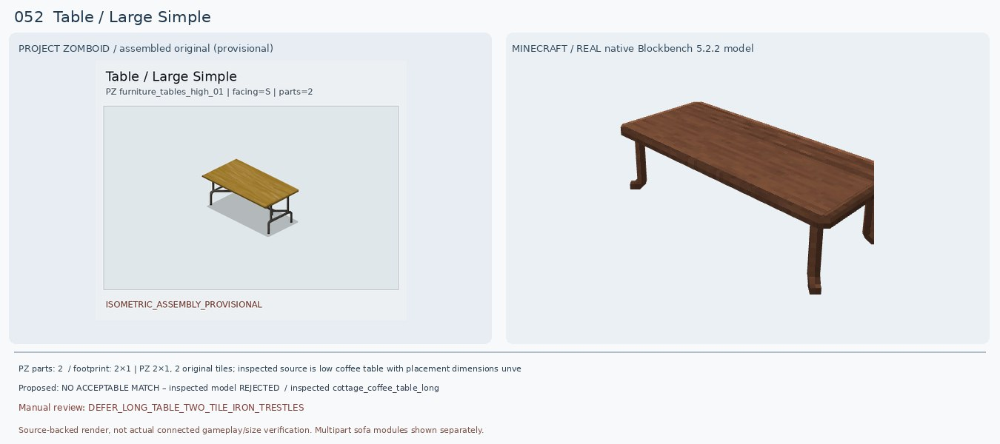
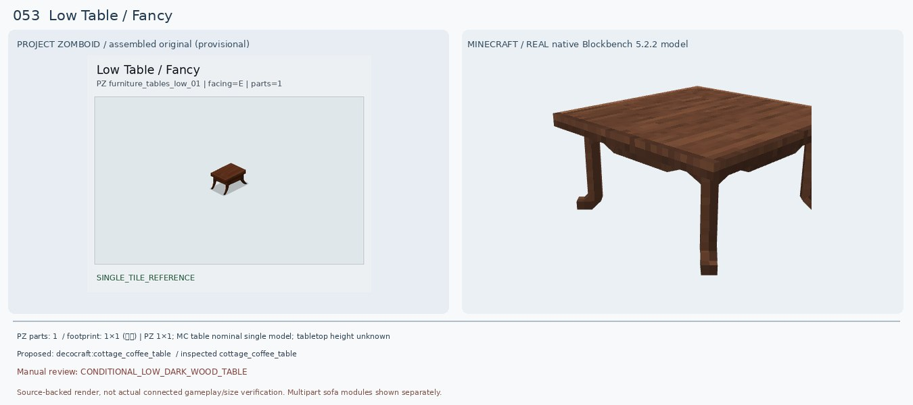
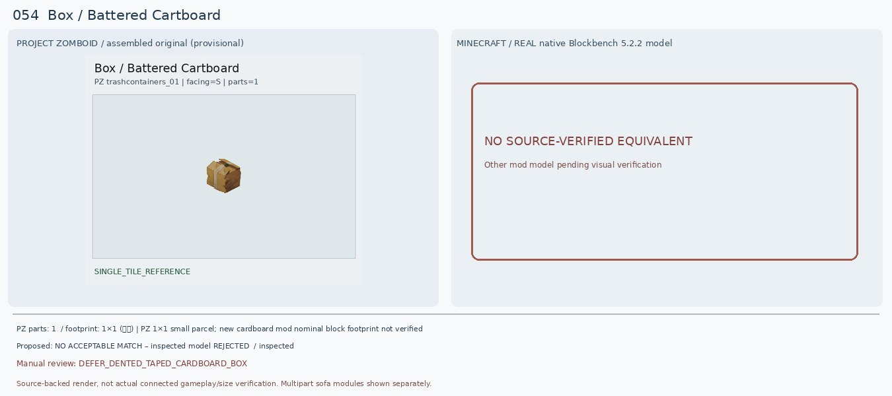
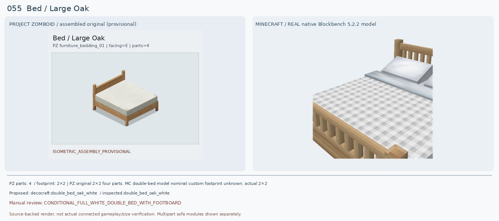
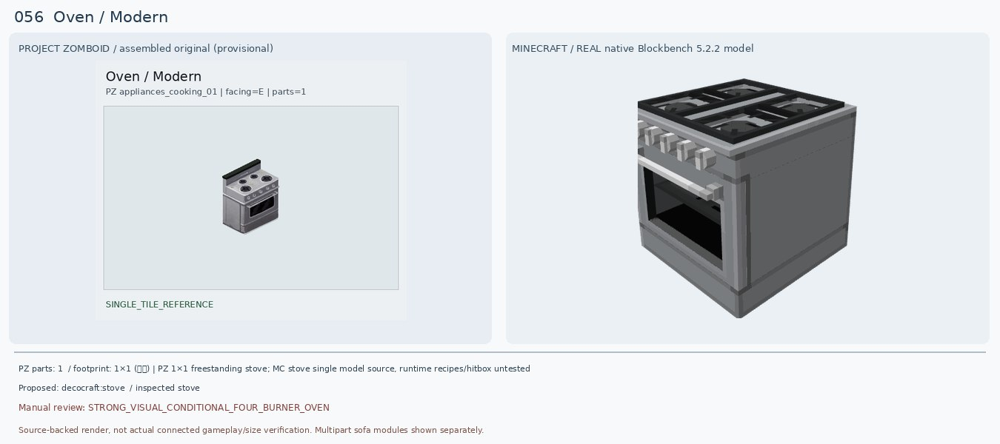
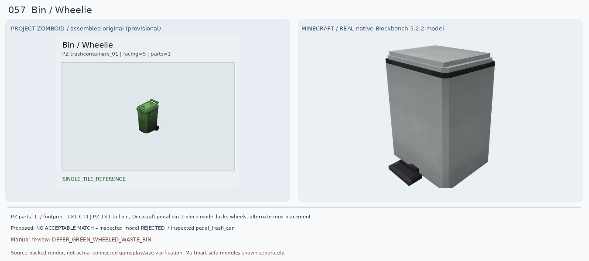
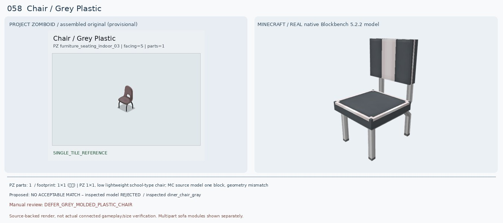
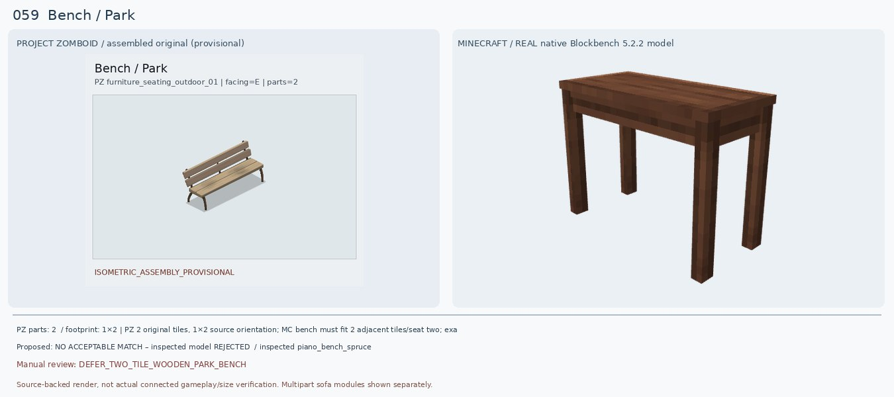
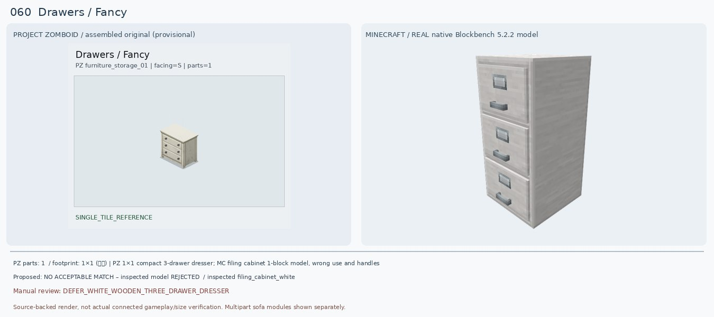

# 051–060 · 로즈우드 가구 이미지 대조

[전체 357종 목록](../README.md) · [원본 검수 PR #246](https://github.com/sanato-nb/PZ_Tile_Analysis/pull/246)

오른쪽 후보는 게임 적용이 확정된 모델이 아니야. **보류**는 추가 탐색 대상이야.

## 051 · Dark Round Table / 기본

**조건부 후보** · [원본 PR #246](https://github.com/sanato-nb/PZ_Tile_Analysis/pull/246)

PZ는 진갈색 목제 원형 상판+중앙 기둥과 갈라진 다리다. 실제 Decocraft Diner Table Round Black(21 cubes)은 원형/중앙 기둥/삼발이 구조가 비슷하지만 검정 상판·회색 금속 지지대여서 목재 재질은 불일치. Bamboo Round Yellow는 노란 4다리 격자라 하부형태가 더 멀다. 기존 Macaw 모델은 정사각 두꺼운 석판처럼 렌더되어 반려.

---

## 052 · Table / Large Simple

**보류 · 재탐색** · [원본 PR #246](https://github.com/sanato-nb/PZ_Tile_Analysis/pull/246)

PZ는 길이 2칸 밝은 나무 높은 테이블, 철제 검정 접이식 가대형 다리이다. 새 Cottage Coffee Table Long은 단색 어두운 갈색이고 높이가 낮고 얇은 나무다리라 형태/재질/높이가 전부 달라 정답으로 승인하지 않는다. 기존 Decocraft Table Setting Double은 아예 접시·컵 세트였으므로 완전 반려.

---

## 053 · Low Table / Fancy

**조건부 후보** · [원본 PR #246](https://github.com/sanato-nb/PZ_Tile_Analysis/pull/246)

PZ는 어두운 갈색 모서리 가공 상판과 바깥으로 휘는 네 다리가 있는 작은 낮은 탁자. 새 Cottage Coffee Table 실제 원본 33 cubes 모델은 목재 색감·낮은 상판·네 다리 형태가 유사해 기존 Macaw 회색 두꺼운 석판보다 낫다. 다만 원본은 더 작고 다리는 더 장식적이므로 정확한 일치가 아니다.

---

## 054 · Box / Battered Cartboard

**보류 · 재탐색** · [원본 PR #246](https://github.com/sanato-nb/PZ_Tile_Analysis/pull/246)

PZ는 찌그러진 옅은 갈색 종이박스로, 테이프와 찢어지거나 구겨진 윗부분이 중요하다. 기존 Refurbished Mail Box는 불완전한 큰 목제 기둥 형태로 아예 종류가 틀리다. 실제 Decocraft 25개 후보 목록에는 닮은 종이상자가 없어서 우측에 없는 모델의 가상 렌더를 만들지 않는다. Forge 1.20.1 호환 Cardboard box 모드와 Shipping은 배포처 확인까지만 했다.

---

## 055 · Bed / Large Oak

**조건부 후보** · [원본 PR #246](https://github.com/sanato-nb/PZ_Tile_Analysis/pull/246)

PZ 원본은 큰 연한 참나무 침대 틀에 연속된 흰 침구, 등받이는 넓은 수평 나무판, 발치에는 낮은 나무 프레임. Decocraft Oak White는 36 cubes로 정상 렌더되며 원목 프레임·흰 침구는 가까우나 흰 회색 체크 패턴, 분리된 베개, 세로살 머리판·발치 난간이 원본과 명확히 다르다. 기존 매칭은 조건부였으나 외형을 재평가해 조건부 유지.

---

## 056 · Oven / Modern

**조건부 후보** · [원본 PR #246](https://github.com/sanato-nb/PZ_Tile_Analysis/pull/246)

PZ는 4개의 검은 둥근 화구·은회색 오븐 본체·전면 제어 노브·검정 오븐창·높은 검정 뒷판을 가진다. Decocraft Stove 실제 98큐브 모델은 4구 상판·노브·은회색 전면/검정 창을 모두 갖춰 기존 Paladin Gray Stove의 단일 막대 누락 모델보다 훨씬 정확하다. 다만 화구는 사각 격자, 검정 뒷판 생략, 손잡이/도어 높이 차이. 게임에서 요리 기능은 별도로 확인해야 한다.

---

## 057 · Bin / Wheelie

**보류 · 재탐색** · [원본 PR #246](https://github.com/sanato-nb/PZ_Tile_Analysis/pull/246)

PZ는 초록색 긴 본체, 상단 양쪽 덮개, 뒤쪽 손잡이와 밑바퀴 2개가 있는 이동식 쓰레기통. 기존 Refurbished recycle bin은 회색 일반 통으로 뚜껑/바퀴가 없고 부품도 불완전하다. 새 Decocraft Pedal Trash Can은 직육면체에 덮개는 있으나 회색이며 작은 바닥 페달뿐이어서 колес wheelie bin과 전혀 다름. Skart's Decorations 0.3 1.20.1 Forge에 Wheelie Bins 추가 이력이 있으나 모델 ID/초록 변형 실제 렌더 필요.

---

## 058 · Chair / Grey Plastic

**보류 · 재탐색** · [원본 PR #246](https://github.com/sanato-nb/PZ_Tile_Analysis/pull/246)

PZ는 한 몸체로 굽어진 회보라 플라스틱 좌석과 등받이, 가운데 손잡이 구멍, 검정 얇은 금속 다리. 새 Diner Chair Gray는 색상과 금속다리가 비슷하나 등받이가 납작한 사각판에 굵은 흰 줄무늬가 있고 구멍이 없다. School Chair Gray도 판형 등받이와 금속 직선다리라 동일한 성형 의자가 아니다. 기존 PFM Gray Arm Chair는 안락의자 블록 형태로 구조 불일치.

---

## 059 · Bench / Park

**보류 · 재탐색** · [원본 PR #246](https://github.com/sanato-nb/PZ_Tile_Analysis/pull/246)

PZ는 목제 2줄 등받이+긴 이중 나무판 좌석+얇은 갈색 철제 받침다리로 구성되는 길쭉한 공원 벤치다. 기존 Decocraft Gym Bench는 헬스장 운동 기구였고 새 Piano Bench Spruce는 등받이도 없고 폭도 1칸인 피아노 의자라 둘 다 불합격. Just Outdoor Stuffs는 1.20.1 Forge 지원과 2인 벤치 기능까지 공식 소개에서 확인됐지만 실제 모델과 PZ처럼 2칸인지 아직 확인하지 않았다.

---

## 060 · Drawers / Fancy

**보류 · 재탐색** · [원본 PR #246](https://github.com/sanato-nb/PZ_Tile_Analysis/pull/246)

PZ는 크림 흰색 목제 3단 서랍장이며 서랍마다 검정 동그란 손잡이 2개(총 6개). 새로운 Decocraft Filing Cabinet White는 실제 렌더에서 3단이긴 하나 흰 철제 문서 보관함으로 각 서랍마다 긴 금속 손잡이와 라벨 칸이 있다. Modular Desk Drawers White는 흰색 목제에 가깝지만 2단만 있어 둘 다 완성형으로는 맞지 않는다. 기존 Macaw BookShelf Drawer 렌더는 초록 판 한 장이라 무효.

---

