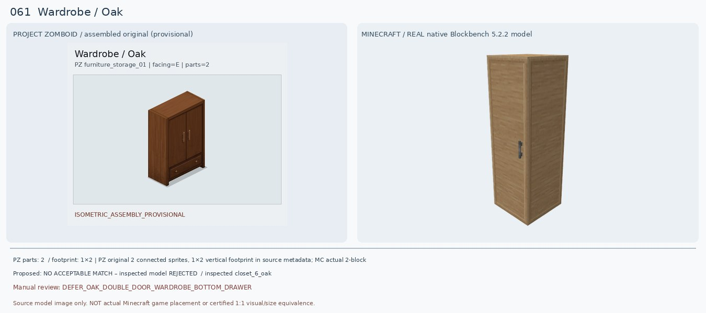
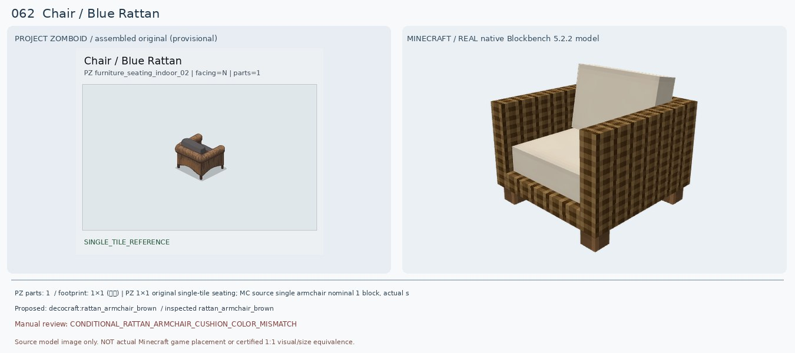
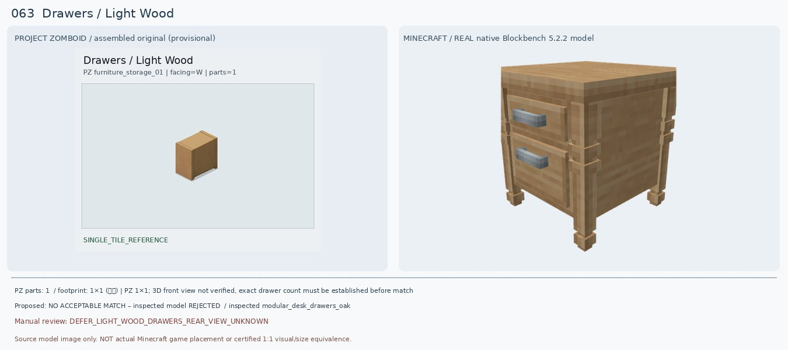
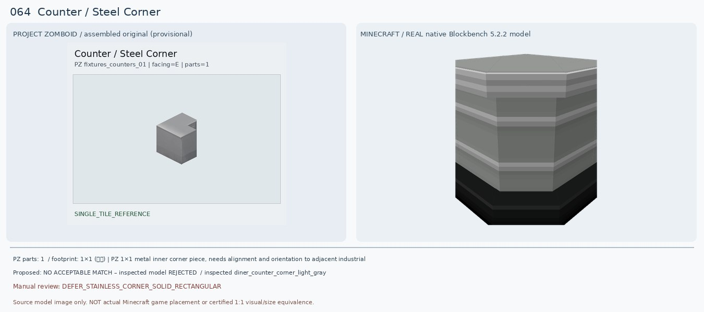
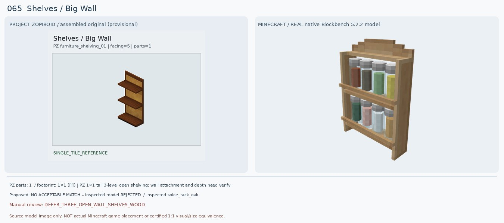
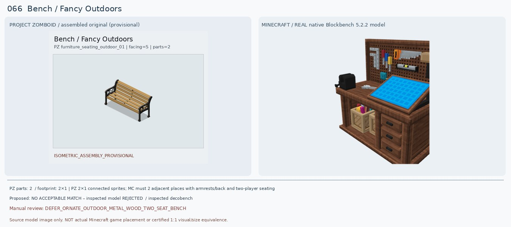
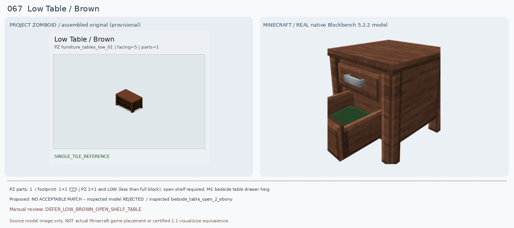
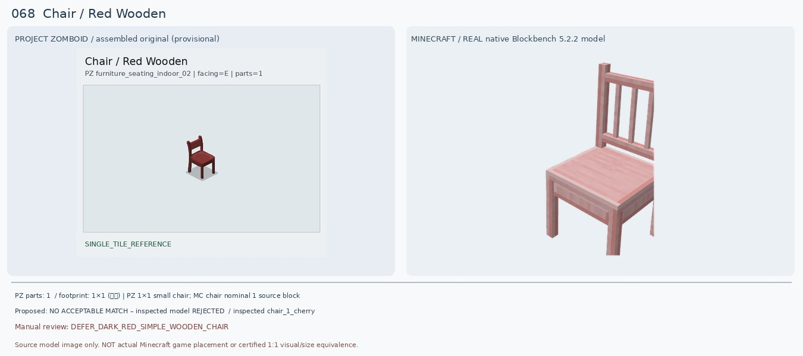
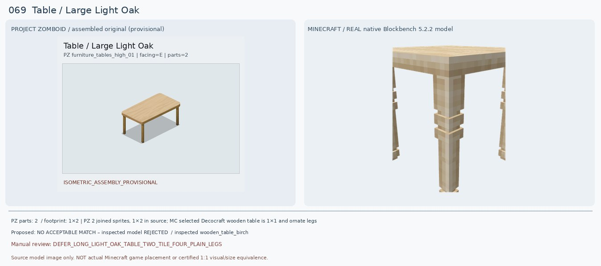
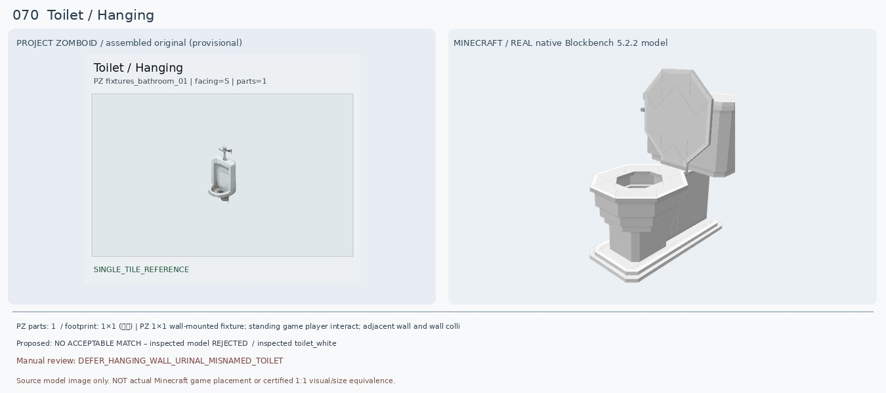

# 061–070 · 로즈우드 가구 이미지 대조

[전체 357종 목록](../README.md) · [원본 검수 PR #247](https://github.com/sanato-nb/PZ_Tile_Analysis/pull/247)

오른쪽 후보는 게임 적용이 확정된 모델이 아니야. **보류**는 추가 탐색 대상이야.

## 061 · Wardrobe / Oak

**보류 · 재탐색** · [원본 PR #247](https://github.com/sanato-nb/PZ_Tile_Analysis/pull/247)

PZ 전체는 짙은 오크색 양문형 옷장+하단 긴 한 칸 서랍, 가로폭 2칸으로 완성된다. Decocraft Closet 6 Oak는 밝은 오크 단문형으로 바닥 서랍과 두 손잡이가 없고, Closet 3 Oak는 3단 서랍장, Closet 5 Oak는 열린 의류칸이므로 모두 다른 물건이다. 기존 Macaw oak_double_wardrobe의 소스 렌더도 실제 문/하단 서랍을 보여주지 못한다. 다른 모드 검증 전 최종 선택 불가.

---

## 062 · Chair / Blue Rattan

**조건부 후보** · [원본 PR #247](https://github.com/sanato-nb/PZ_Tile_Analysis/pull/247)

PZ는 갈색 라탄을 둘러 엮은 양 팔걸이와 짙은 회색 직물 등받이/좌석 쿠션의 1인 소파이다. 새 Decocraft Rattan Armchair Brown 원본 10큐브 모델은 갈색 라탄 직조 프레임·양쪽 팔걸이·좌석 쿠션 형태가 가까워 기존 PFM Blue Arm Chair(파란 직육면체 렌더)보다 훨씬 낫다. 다만 실제 MC는 쿠션이 흰색으로 차이가 크고 등받이가 직각 평판이라 원본의 둥근 등받이와 다름.

---

## 063 · Drawers / Light Wood

**보류 · 재탐색** · [원본 PR #247](https://github.com/sanato-nb/PZ_Tile_Analysis/pull/247)

PZ 원본 사진에 연갈색 뒷판만 보여 전면 서랍의 개수·손잡이 배치가 확인되지 않았다. 과거 Macaw Bookshelf Drawer의 렌더는 초록색 얇은 판이라 가구의 전면과 무관. Decocraft Modular Desk Drawers Oak는 2단 서랍과 은색 손잡이로 실모델은 완성됐지만 원본의 전면이 확인되지 않아 닮았다고 승인할 근거가 없다.

---

## 064 · Counter / Steel Corner

**보류 · 재탐색** · [원본 PR #247](https://github.com/sanato-nb/PZ_Tile_Analysis/pull/247)

PZ 원본은 은색 균일 금속 상판에 직각으로 꺾인 L자 코너 홈이 있고 측면은 매끈한 회색 금속 함체. 새 Decocraft Diner Counter Corner Light Gray는 45도처럼 둥글게 모서리가 잘린 카페 카운터이며 수평 줄무늬와 검정 바닥이 있어 직각 스테인리스 주방 코너와 불일치. 기존 Black variant는 더 색이 달라 승인 불가.

---

## 065 · Shelves / Big Wall

**보류 · 재탐색** · [원본 PR #247](https://github.com/sanato-nb/PZ_Tile_Analysis/pull/247)

PZ는 벽 쪽 베이지 나무 뒷판에 돌출된 갈색 넓은 수평 선반 3칸이 비어 있는 구조다. 기존 Handcrafted Acacia Shelf는 불투명 상자처럼 렌더돼 전면이 제대로 보이지 않는다. 새 Decocraft China Cabinet Open Oak는 유리 찬장, 접시/서랍/문까지 있어 수납 종류가 다르고, Spice Rack Oak는 매우 작은 양념병 2단이라 선반 수·크기·비품 내용이 모두 어긋난다.

---

## 066 · Bench / Fancy Outdoors

**보류 · 재탐색** · [원본 PR #247](https://github.com/sanato-nb/PZ_Tile_Analysis/pull/247)

원본은 2칸 긴 목재 가로살 좌석·등받이와 검정 금속 곡선 양 팔걸이/다리로 꾸민 공원 벤치다. 예전 Decocraft Gym Bench는 역기 운동 장비, 이번 Decocraft Decobench 실제 모델은 이름과 다르게 작업 도구/파란 제작판이 달린 실내 작업대(!)이므로 또 잘못된 종류. Rattan Couch Left도 1인 실내 라탄 좌석이며 야외 벤치가 아님.

---

## 067 · Low Table / Brown

**보류 · 재탐색** · [원본 PR #247](https://github.com/sanato-nb/PZ_Tile_Analysis/pull/247)

PZ는 낮고 짙은 갈색 상판 아래 전면이 열려 있는 2단 선반형 커피테이블/TV장. 기존 Decocraft Rattan Coffee Table은 밝은 회색 상판과 라탄 외벽으로 열린 앞면이 보이지 않아 불합격. 새 Bedside Table Open 2 Ebony는 뚜껑 열려 나온 서랍 2개와 커다란 높이의 협탁으로 실제로는 '개방형 선반'이 아니며 PZ의 낮은 높이도 맞지 않는다.

---

## 068 · Chair / Red Wooden

**보류 · 재탐색** · [원본 PR #247](https://github.com/sanato-nb/PZ_Tile_Analysis/pull/247)

PZ는 짙은 와인색 붉은 목제 의자, 등받이에는 한 개의 짧은 수평대만 있고 아래가 뚫린 단순한 형태. 기존 PFM Oak Chair Classic Red는 좌석/등받이가 아닌 일부 목재 다리/네온 색 선분만 표시된 부품 불완전 렌더. 새 Decocraft Chair 1 Cherry는 연분홍 벚나무색에 많은 세로살 등받이가 있고, Chair 2 Cherry는 X자 교차살, School Chair Red는 금속다리 플라스틱 소재라 모두 원본 색·등받이 구조 불일치.

---

## 069 · Table / Large Light Oak

**보류 · 재탐색** · [원본 PR #247](https://github.com/sanato-nb/PZ_Tile_Analysis/pull/247)

PZ 완성형은 2칸 긴 크림색 나무 상판과 각 모서리의 가는 직선 목제 다리 4개다. 기존 Macaw Dark Oak Glass Table은 유리판 한 장만 로드됐고 목재 색부터 다름. 새 Decocraft Wooden Table Birch는 나무재질과 상판 색은 가깝지만 1칸 정사각형에 굵고 장식적인 다리 4개이고 두 개를 나란히 두면 중앙 이음매·다리가 중복될 수 있어 PZ 완성형 2칸 식탁 대체로 인증할 수 없다.

---

## 070 · Toilet / Hanging

**보류 · 재탐색** · [원본 PR #247](https://github.com/sanato-nb/PZ_Tile_Analysis/pull/247)

중요: PZ 이름 'Toilet/Hanging'이지만 원본 이미지는 바닥에 설치하는 변기가 아니라 벽에 매다는 흰색 남성 소변기다. 기존 PFM Basic Toilet은 앉는 일반 양변기라 오매칭이고 이번 Decocraft Toilet White 실모델(93 cubes)도 뚜껑·좌석·물통 있는 일반 변기다. 다른 1.20.1 Forge Toilet Real과 Toilet Remake는 소변기 설치를 제공하지만 공식 모델/벽걸이 형태의 JAR 렌더는 확인하지 못했기에 아직 승인하지 않는다.

---

