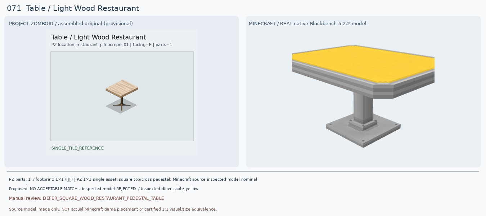
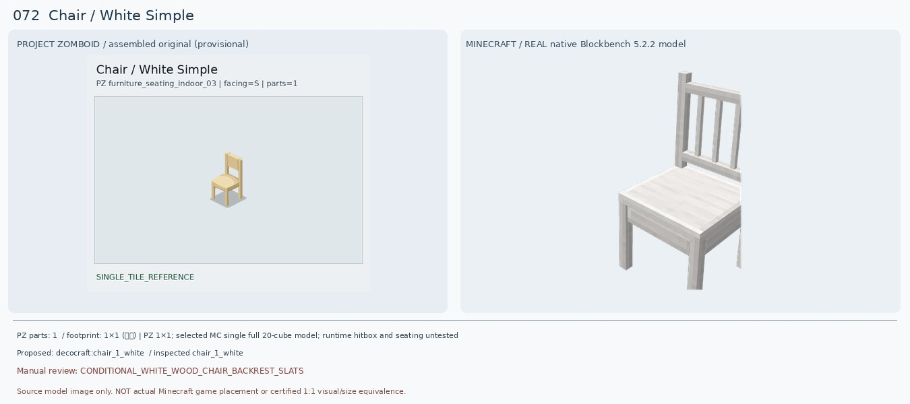
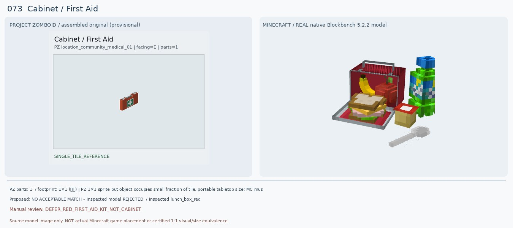
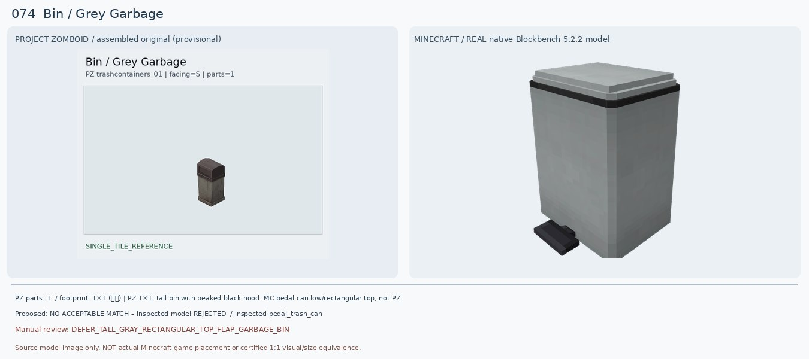
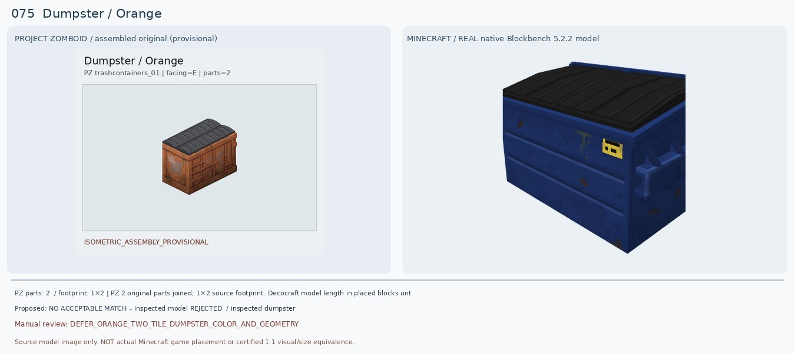
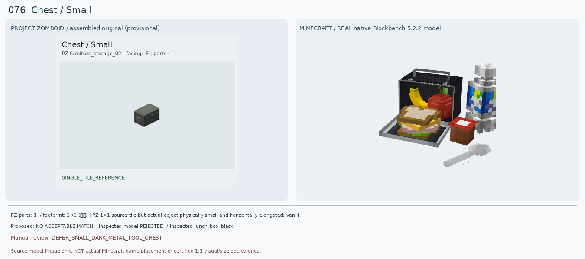
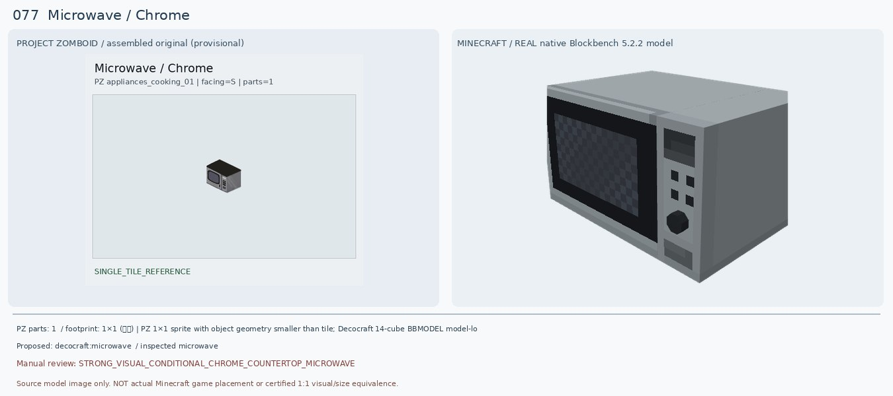
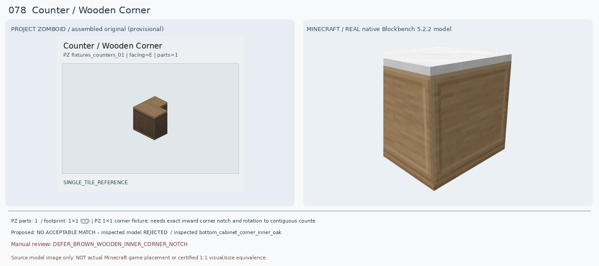
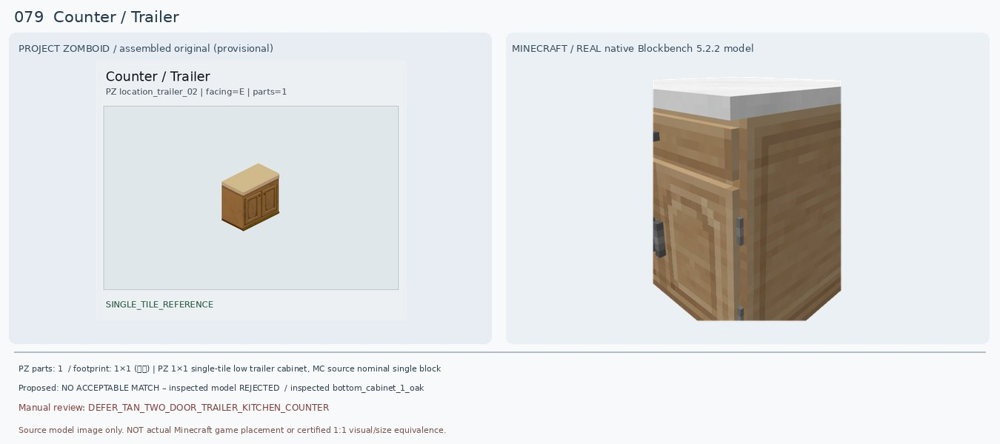
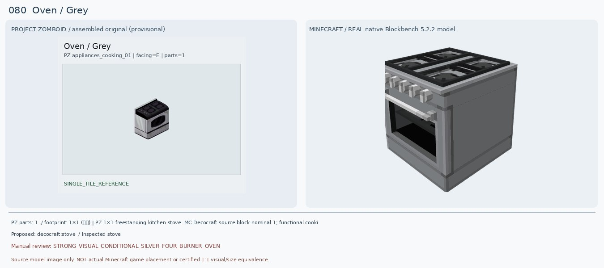

# 071–080 · 로즈우드 가구 이미지 대조

[전체 357종 목록](../README.md) · [원본 검수 PR #248](https://github.com/sanato-nb/PZ_Tile_Analysis/pull/248)

오른쪽 후보는 게임 적용이 확정된 모델이 아니야. **보류**는 추가 탐색 대상이야.

## 071 · Table / Light Wood Restaurant

**보류 · 재탐색** · [원본 PR #248](https://github.com/sanato-nb/PZ_Tile_Analysis/pull/248)

PZ 원본은 밝은 원목 정사각 상판에 갈색 가는 한 기둥과 십자 다리의 카페용 탁자다. 기존 Macaw glass table은 상판 평판 한 조각만 나타나 전혀 검증되지 않는다. 실제 Decocraft Diner Table Yellow/Light Gray는 정사각 상판과 중앙 기둥은 비슷하지만 상판이 노란 플라스틱/회색 금속이고, 넓은 사각 금속 바닥판이라 원본의 나무색/십자 발과 구조가 다르다. Round variant는 상판이 원형으로 더 어긋난다.

---

## 072 · Chair / White Simple

**조건부 후보** · [원본 PR #248](https://github.com/sanato-nb/PZ_Tile_Analysis/pull/248)

PZ는 연한 크림색의 얇은 네 다리 목제 의자로 등받이에 하나의 넓은 사각 틈이 있다. 기존 PFM Oak Chair Classic White는 다리 몇 개와 붉은 막대만 나온 불완전 모델이다. 새 Decocraft Chair 1 White를 직접 렌더해 흰 목제 4다리·좌석·등받이가 모두 구현된 것을 확인했다. 다만 등받이에 세로살 여러 개가 있어 PZ의 단일 큰 사각 틈과 다르며 화이트 색감도 더 밝다. Chair 2 White는 X자라 더 멀다.

---

## 073 · Cabinet / First Aid

**보류 · 재탐색** · [원본 PR #248](https://github.com/sanato-nb/PZ_Tile_Analysis/pull/248)

PZ는 빨간 사각 휴대용 구급상자에 위 손잡이, 녹색 바탕 흰 십자가 표지, 잠금쇠가 있다. 이전 Macaw Double Kitchen Cabinet은 큰 주방 수납장이어서 가구 종류 자체가 틀리다. 새 Decocraft Lunch Box Red BBMODEL도 열어 보니 음식/음료를 펼쳐 놓은 도시락 장면이라 구급상자와 전혀 다른 물건이다. Hospitals Forge 1.20.1에는 Small/Large First Aid Kit가 있지만 모델·블록 설치 가능 여부를 아직 렌더링하지 않아 매칭 확정 불가.

---

## 074 · Bin / Grey Garbage

**보류 · 재탐색** · [원본 PR #248](https://github.com/sanato-nb/PZ_Tile_Analysis/pull/248)

PZ는 키 큰 회색 각형 쓰레기통이고 위는 짙은 회흑색 경사진 돔형/투입구 덮개다. 기존 Refurbished Recycle Bin은 하얀 상판+세로 홈의 낮은 통형 블록 일부만 보였다. 실제 Decocraft Pedal Trash Can 모델은 회색 네모 통이지만 윗면이 평평하고 바닥 페달이 노출되며 검정 높다란 쓰레기통 덮개가 없다. Decocraft Trash Can은 손잡이 원통형이라 더 다르다.

---

## 075 · Dumpster / Orange

**보류 · 재탐색** · [원본 PR #248](https://github.com/sanato-nb/PZ_Tile_Analysis/pull/248)

원본은 2타일 길이의 녹슨 주황색 대형 쓰레기통과 검정 굽은 이중 뚜껑이다. Decocraft Dumpster는 실제 BBMODEL 40큐브로 대형 몸체·검정 뚜껑이 존재하여 종류/전체 비율은 비슷하지만 실제 게임용 원본 텍스처는 파란색이고 뚜껑도 검정 평판 하나처럼 보인다. 주황색 변형이나 2블록 설치 규칙은 검증되지 않았으므로 배색과 크기를 인정하지 않고 보류한다. 새 조합 텍스처를 직접 만들어 재배포하지 않는다.

---

## 076 · Chest / Small

**보류 · 재탐색** · [원본 PR #248](https://github.com/sanato-nb/PZ_Tile_Analysis/pull/248)

PZ 원본은 손잡이와 잠금쇠가 있는 어두운 철제 소형 장방형 보관상자다. 기존 매칭은 실제 모델이 없는 상태였다. 새 Decocraft Lunch Box Black/Gray 역시 실제로는 도시락을 펼쳐 놓고 샌드위치·과자·음료가 바닥에 놓인 모양이므로 단순 금속 상자로 사용할 수 없다. 1.20.1 Forge Iron Chests에는 철제 보관함이 있지만 거기엔 이 원본과 같은 작은 휴대형 2:1 길이/양옆 손잡이가 있는지는 미확인.

---

## 077 · Microwave / Chrome

**조건부 후보** · [원본 PR #248](https://github.com/sanato-nb/PZ_Tile_Analysis/pull/248)

PZ는 검은 상판, 은회색 금속 본체, 왼쪽 어두운 창/사각 테두리, 오른쪽 버튼과 손잡이가 있는 전자레인지다. 기존 PFM Iron Microwave 렌더는 이상한 보라색 그림/분리된 큰 평판 때문에 완성형으로 볼 수 없다. 새 Decocraft Microwave는 실제 14큐브 원본 모델과 원본 텍스처를 모두 로드하여 앞 유리창·오른쪽 버튼·금속 하우징이 한 덩어리로 확인됨. 다만 MC 윗면은 밝은 회색이고 전면 조절부 비율이 다르며 게임 내 조리 기능은 검증되지 않았다.

---

## 078 · Counter / Wooden Corner

**보류 · 재탐색** · [원본 PR #248](https://github.com/sanato-nb/PZ_Tile_Analysis/pull/248)

PZ는 전체 갈색 나무로 된 카운터에 안쪽 직각으로 도려낸 L자 코너 홈이 있다. 기존 Decocraft Diner Counter Corner Black은 검정/흰색 줄무늬 금속·45도 절단 바닥이라 종류가 틀리다. 새 Decocraft Bottom Cabinet Corner Inner Oak는 목재 몸체로 개선되지만 흰색 상판이고 렌더에 PZ 같은 안쪽 직각 홈이 확인되지 않는다. Outer 1/2 모델도 흰 상판/문 패널과 일부 보이지 않는 면 때문에 코너의 정확한 맞물림을 확인할 수 없다.

---

## 079 · Counter / Trailer

**보류 · 재탐색** · [원본 PR #248](https://github.com/sanato-nb/PZ_Tile_Analysis/pull/248)

PZ는 밝은 나무톤 본체와 연베이지 상판을 가진 전면 양문형 하부장이다. 기존 Macaw Acacia Counter는 검은·붉은 큰 블록처럼 렌더되어 문 두 개가 전혀 확인되지 않는다. 새 Decocraft Bottom Cabinet 1 Oak는 색감은 근접하지만 위 서랍 1개+아래 문 1개이고 흰색 상판이라 원본의 두 문·베이지 상판과 다르다. Island Oak도 동일한 문제. 장치의 문 구조가 핵심이므로 승인하지 않는다.

---

## 080 · Oven / Grey

**조건부 후보** · [원본 PR #248](https://github.com/sanato-nb/PZ_Tile_Analysis/pull/248)

PZ는 회색 은색 몸체, 검정 상판 위 둥근 화구 4개, 뒤쪽 금속 튐방지판, 검정 유리 오븐문을 가진다. 기존 PFM Gray Stove는 길쭉한 막대 1개만 나와 오븐이 아니었다. 새 Decocraft Stove 실제 98큐브 모델은 전체 은회색 바디, 사각격자형 검정 화구 4개, 전면 조절 노브, 검정 유리 오븐창으로 외형과 종류가 상당히 비슷하다. 하지만 PZ의 동그란 화구 모양·높은 백스플래시·오븐창 곡률은 다르다.

---

