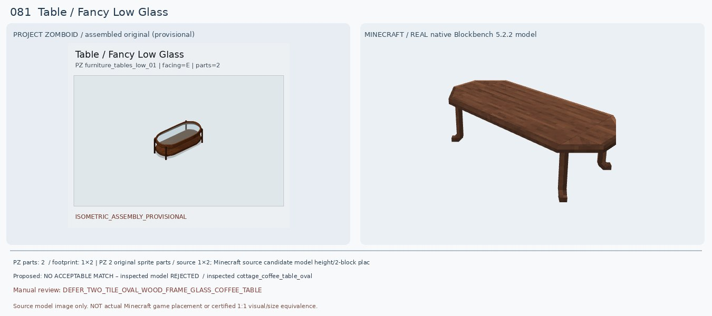
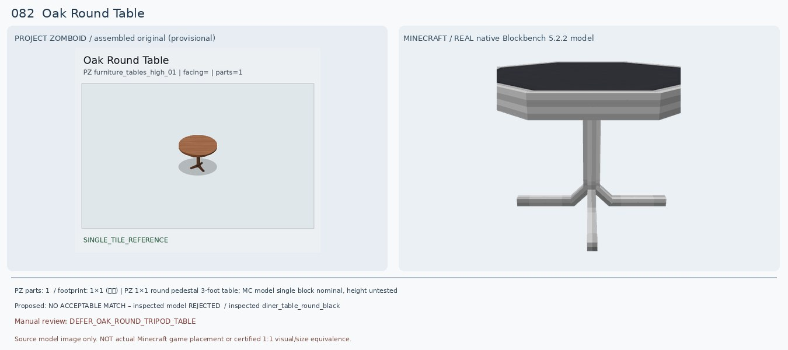
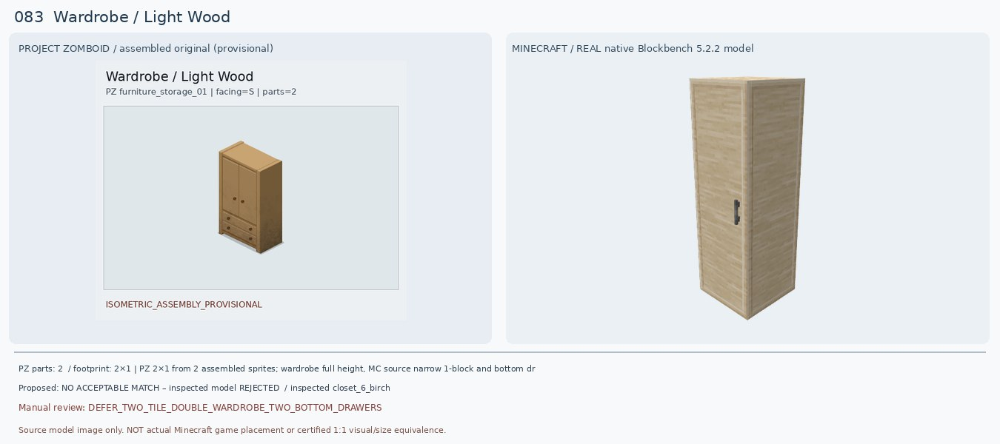
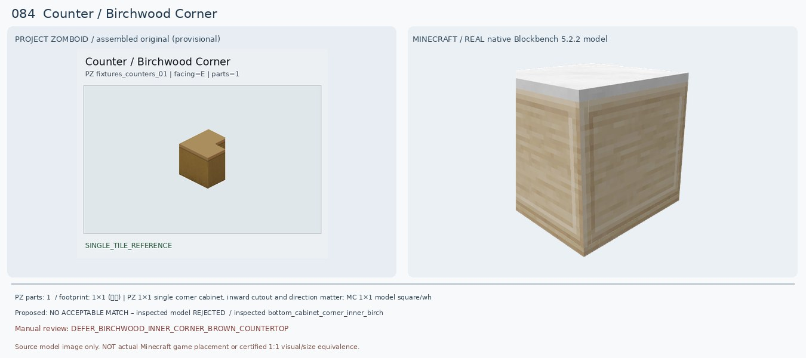
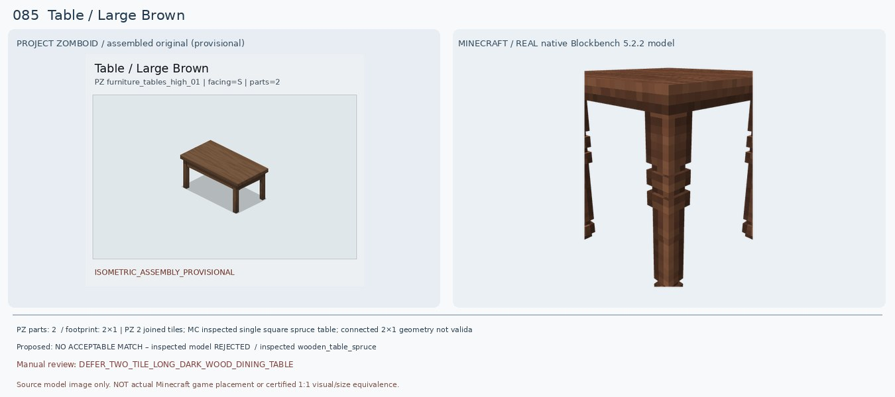
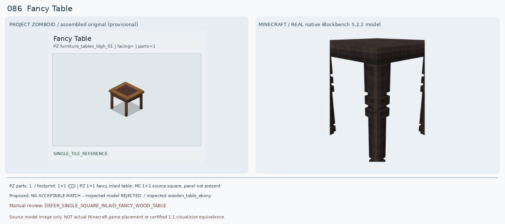
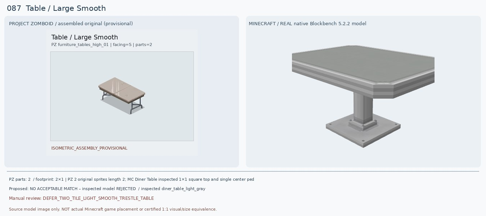
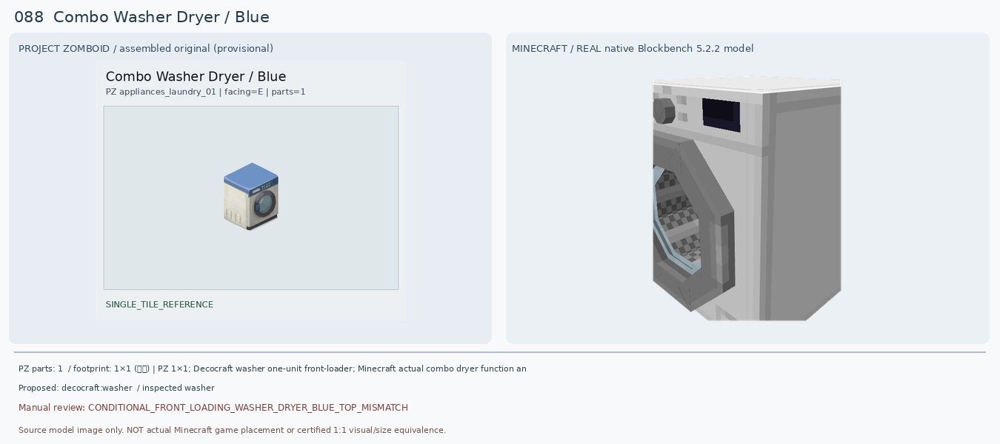
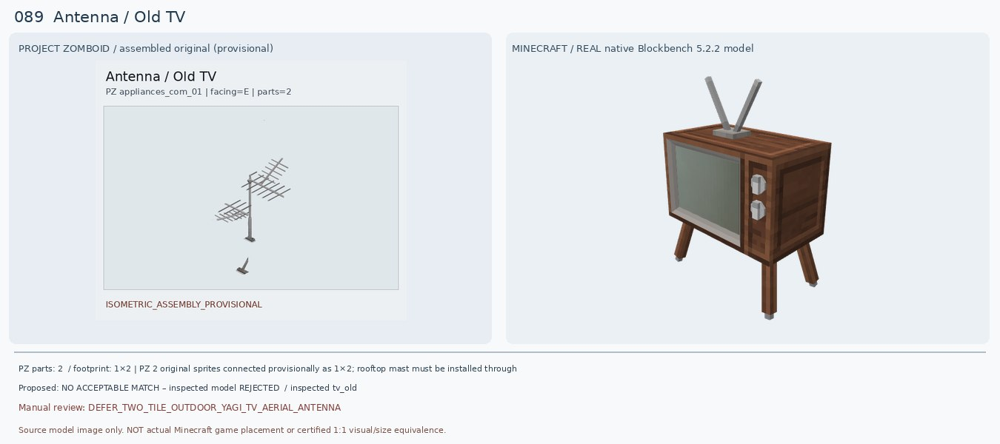
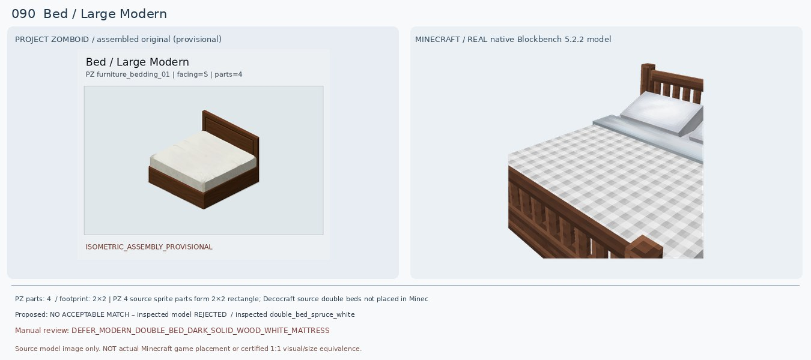

# 081–090 · 로즈우드 가구 이미지 대조

[전체 357종 목록](../README.md) · [원본 검수 PR #249](https://github.com/sanato-nb/PZ_Tile_Analysis/pull/249)

오른쪽 후보는 게임 적용이 확정된 모델이 아니야. **보류**는 추가 탐색 대상이야.

## 081 · Table / Fancy Low Glass

**보류 · 재탐색** · [원본 PR #249](https://github.com/sanato-nb/PZ_Tile_Analysis/pull/249)

PZ 완성형은 긴 타원형·가장자리가 둥글게 이어진 진갈색 목재 프레임과 투명 유리 상판을 지닌 낮은 2타일 테이블이다. 이전 Macaw Glass Table은 상판 평판 한 장만 남아 실제 장식 프레임과 다리 부분을 전혀 확인할 수 없다. 새 Cottage Coffee Table Oval의 19큐브 BBMODEL은 길쭉한 갈색 목재 낮은 테이블이지만 상판 전체가 불투명 목재이며 타원형 유리 인셋·곡선 테두리·하단 선반이 없어서 완성형과 다르다. Rattan Coffee Table도 직조 사각 상자라 불합격.

---

## 082 · Oak Round Table / 기본

**보류 · 재탐색** · [원본 PR #249](https://github.com/sanato-nb/PZ_Tile_Analysis/pull/249)

PZ 원본은 중간 갈색 원목 원형 상판과 갈색 중심 기둥·삼발이 다리다. 예전 Macaw Acacia Coffee Table은 짙은 회색 정사각 돌판처럼 렌더돼 전혀 어울리지 않았다. 새 Diner Table Round Black은 상판 원형과 한 기둥·삼발이 형태는 맞으나 실제 검정 금속 상판/회색 철제 다리로 목제 재질·색상이 반대다. Bamboo Round Yellow는 격자형 4다리라 더 다르다. 외형을 정확하게 유지하려면 목제 삼발이 모델을 찾아야 함.

---

## 083 · Wardrobe / Light Wood

**보류 · 재탐색** · [원본 PR #249](https://github.com/sanato-nb/PZ_Tile_Analysis/pull/249)

PZ는 밝은 갈색 두 문짝과 아래 서랍 2단(각 손잡이 2개)이 함께 있는 2칸 완성형 옷장이다. 기존 Macaw Acacia Double Wardrobe 렌더는 회색 나뭇결과 큰 붉은 문 일부만 나온 비정상 가구였다. 새 Decocraft Closet 6 Birch는 흰 나무색의 길고 가는 단문 옷장이며 하부 서랍이 아예 없다. Closet 2/4 Birch는 문 없이 옷이 걸린 열린 선반이고 Closet 3 Birch는 3단 서랍만 있다. 정확한 양문+2단 서랍 가구 미발견.

---

## 084 · Counter / Birchwood Corner

**보류 · 재탐색** · [원본 PR #249](https://github.com/sanato-nb/PZ_Tile_Analysis/pull/249)

원본은 연갈색/벌꿀색 나무 코너 카운터로 오른쪽 뒤에 직각 홈이 있고 상판과 몸체가 거의 같은 계열의 갈색이다. 이전 Decocraft Diner Counter Corner Black은 줄무늬 검정 금속 카운터라 종류·재질 모두 틀렸다. 새 Bottom Cabinet Corner Inner Birch는 밝은 나무 몸체지만 상판이 새하얀 타일이고 렌더상 안쪽 L홈이 드러나지 않아 원본 같은 연결용 코너라고 확증할 수 없다. Outer 1/2도 동일한 상판·코너 결합 불확실성.

---

## 085 · Table / Large Brown

**보류 · 재탐색** · [원본 PR #249](https://github.com/sanato-nb/PZ_Tile_Analysis/pull/249)

PZ 원본은 2타일 길이의 짙은 갈색 원목 상판과 네 모서리에 곧게 내려가는 두꺼운 나무 다리 네 개뿐이다. 기존 Decocraft Table Setting Double은 테이블이 아니라 접시·컵 세트로 잘못 매칭되었다. 새 Decocraft Wooden Table Spruce는 갈색 나무 재질이 유사하지만 정사각형 1칸이며 다리에 장식 고리가 있고 두 개를 붙이면 중간에 다리가 중복될 가능성이 높다. Cottage Coffee Table Long은 낮은 커피 테이블이라 높은 식탁과 안 맞는다.

---

## 086 · Fancy Table / 기본

**보류 · 재탐색** · [원본 PR #249](https://github.com/sanato-nb/PZ_Tile_Analysis/pull/249)

PZ 원본은 정사각 갈색 목제 프레임 안에 짙은 와인색/진갈색 직사각 인레이 상판이 구분되어 있고 네 다리와 모서리 장식이 보인다. 기존 Macaw Acacia Coffee Table는 회색 두꺼운 직사각 석판만 보여 틀렸다. 새 Decocraft Wooden Table Ebony는 어두운 목제 4다리와 정사각 비율은 있지만 상판이 한 가지 검정 나무색이며 중앙 이중 소재 패널·모서리 장식이 없다. Cottage Coffee Table도 단색 나무판이므로 원본 Fancy 구분 요소를 재현 못한다.

---

## 087 · Table / Large Smooth

**보류 · 재탐색** · [원본 PR #249](https://github.com/sanato-nb/PZ_Tile_Analysis/pull/249)

원본은 가로로 두 타일 합쳐진 크림/밝은 회색 길쭉한 가판 상판과 좌우 양끝의 철제 접이식 T형 받침대가 있는 테이블이다. 기존 Decocraft Table Setting Double는 접시·유리컵 세트일 뿐 테이블이 아니다. 새 Decocraft Diner Table Light Gray는 밝은 상판은 비슷하지만 1×1 정사각이고 중앙에 단 하나 금속 기둥·바닥판이 있어 양끝 T형 2다리 구조가 전혀 다르다. Wooden Table White는 흰 4개의 나무장식 다리로 역시 잘못된 유형이다.

---

## 088 · Combo Washer Dryer / Blue

**조건부 후보** · [원본 PR #249](https://github.com/sanato-nb/PZ_Tile_Analysis/pull/249)

PZ 원본은 파란 상판과 상부 파란 조작부, 아래 흰 네모 본체에 커다란 앞쪽 원형 세탁기 도어가 있는 콤보 세탁건조기다. 기존 Decocraft Washer 렌더는 전체 회색이라 사용자 구별점인 파란색이 사라지고 일부 모델만 보이는 것처럼 보여 원래 반려였다. 이번 실제 Decocraft Washer 30큐브 BBMODEL은 회색/흰 몸체·원형 유리 전면도어·위쪽 검정 조작부를 온전하게 보여 전체 구조가 비슷하다. 하지만 **파란 상판/파란 조작부가 아예 없고**, 게임에서 세탁+건조 둘 다 가능한지 확인하지 않아 조건부로만 유지한다.

---

## 089 · Antenna / Old TV

**보류 · 재탐색** · [원본 PR #249](https://github.com/sanato-nb/PZ_Tile_Analysis/pull/249)

PZ 이름 Antenna/Old TV는 TV 본체가 아니라 야외 지붕용 금속 Yagi형 안테나 두 벌을 하나의 세로 기둥에 단 물체다. 기존에 마크 후보가 없었고, 새 Decocraft TV Old를 직접 렌더해 보니 나무 케이스·화면·토끼귀 2개가 달린 소형 브라운관 TV로 원본의 긴 수십 개 금속 막대와 전혀 다른 물건이다. Simple Radio의 장식용 Antenna 및 J Radio의 여러 antenna tiers는 1.20.1 Forge 공개 설명에서 확인했지만 실제 Yagi 모양인지는 모델을 확보하지 않아 보류.

---

## 090 · Bed / Large Modern

**보류 · 재탐색** · [원본 PR #249](https://github.com/sanato-nb/PZ_Tile_Analysis/pull/249)

PZ 원본은 2×2 큰 현대식 흰색 단색 침대 매트리스와 짙은 적갈색 나무 프레임, 막힌 넓은 목재 머리판과 발판 없는 박스형 침대틀이다. 기존 Decocraft Double Bed Birch Black는 밝은 세로살 나무 침대틀에 검정 체크 침구라 완전히 틀렸다. 새 Spruce White는 나무 프레임 색상과 흰 침구가 더 비슷하나 침구 전체가 회색 체크무늬, 분리된 베개가 돌출되고 머리판·발쪽 난간이 세로살 장식 구조라 가장 중요한 깨끗한 흰색·막힌 플랫 플랫폼 형태와 다르다. Black White/Oak White도 동일한 구조적 문제를 해결하지 못한다.

---

