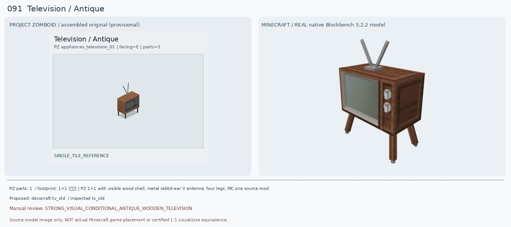
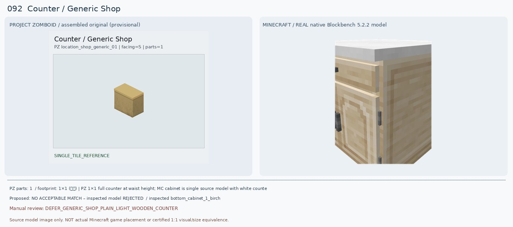
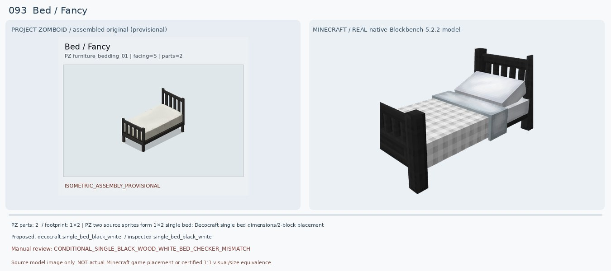
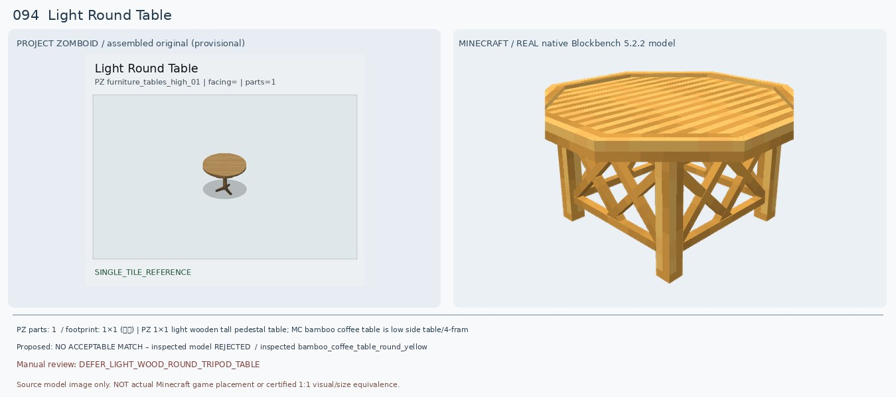
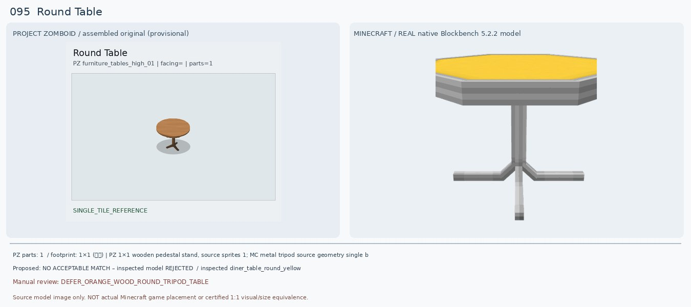
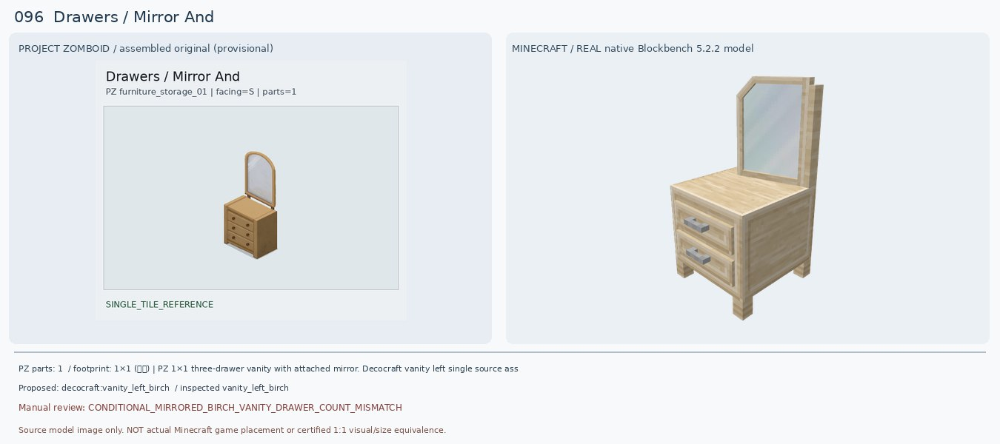
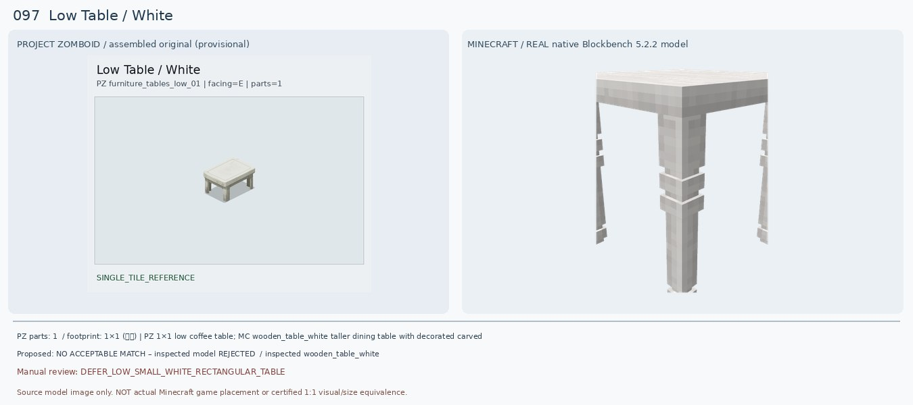
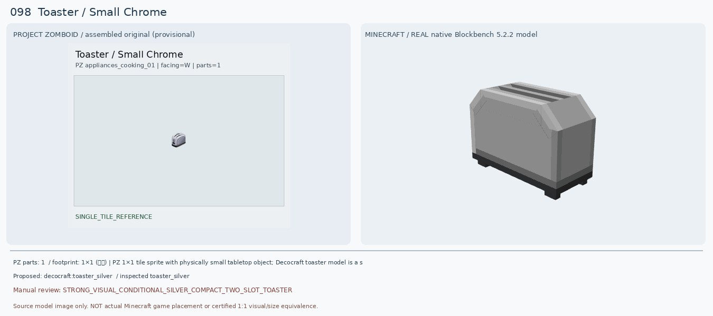
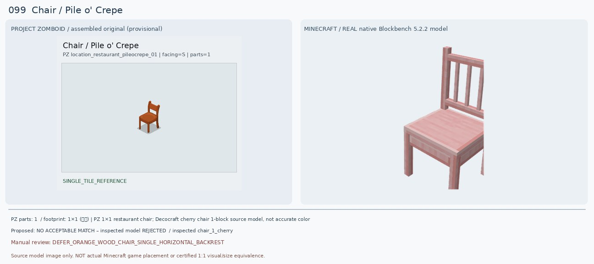
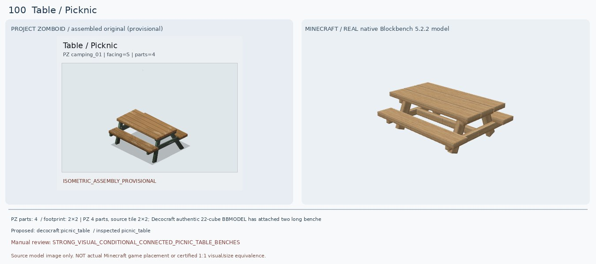

# 091–100 · 로즈우드 가구 이미지 대조

[전체 357종 목록](../README.md) · [원본 검수 PR #250](https://github.com/sanato-nb/PZ_Tile_Analysis/pull/250)

오른쪽 후보는 게임 적용이 확정된 모델이 아니야. **보류**는 추가 탐색 대상이야.

## 091 · Television / Antique

**조건부 후보** · [원본 PR #250](https://github.com/sanato-nb/PZ_Tile_Analysis/pull/250)

PZ 원본은 1960년대 나무 프레임, 다리 네 개, 윗면 V자 토끼귀 안테나, 전면 왼쪽 화면과 오른쪽 세로 조절부가 있는 골동품 TV다. Decocraft TV Old 원본 30큐브 모델을 실제 Blockbench로 열었더니 나무 프레임/다리/V 안테나/측면 전면 조절 노브가 모두 나타나 기존 Decocraft CRT TV(검정 플라스틱 상자)보다 훨씬 정확하다. 다만 원본 화면은 어둡고 버튼은 세로로 더 작고, MC 모델의 나무톤이 조금 더 진하고 안테나 막대 굵기/각도 차이가 있어 최종 1:1은 아니다.

---

## 092 · Counter / Generic Shop

**보류 · 재탐색** · [원본 PR #250](https://github.com/sanato-nb/PZ_Tile_Analysis/pull/250)

PZ는 상판과 몸체 모두 밝은 황갈색이며 앞면에 서랍·문·손잡이가 없는 매끈한 상점용 1칸 카운터다. 기존 Macaw Acacia Counter는 상판만 주황빛, 몸체는 어두운 회색/검정이라 다름. 새 Decocraft Bottom Cabinet 1 Birch/Oak는 목재 몸체는 더 가깝지만 흰 상판과 서랍 1개+손잡이 달린 아래 문이 노출되어 원본 단순한 앞판과 불일치. Diner Counter Yellow는 배포 모델 존재는 확인했지만 이 실행에서 렌더 검증 실패하여 비교 증거로 사용하지 않음.

---

## 093 · Bed / Fancy

**조건부 후보** · [원본 PR #250](https://github.com/sanato-nb/PZ_Tile_Analysis/pull/250)

PZ는 두 개 타일의 검정 금속/목재 세로살 침대 프레임(머리판·발판)과 무늬 없는 크림빛 흰 침구로 구성된다. 기존 Decocraft Birch Black은 밝은 원목 프레임+검정 체크 침구로 색이 거꾸로였다. 새 Single Bed Black White 실제 29큐브 모델은 검정 세로살 머리판·발판, 흰 침구, 좁은 1인 침대 구조가 명확하게 일치하는 방향이다. 하지만 MC 침구가 흰 회색 체크무늬이고 커다란 흰 베개와 접힌 담요가 돌출돼, PZ의 매끈한 단색 매트리스와 차이. 1×2 타일 점유 역시 게임에서 미검증.

---

## 094 · Light Round Table / 기본

**보류 · 재탐색** · [원본 PR #250](https://github.com/sanato-nb/PZ_Tile_Analysis/pull/250)

PZ는 밝은 나무 원형 상판 아래 갈색 중심 기둥 1개와 작게 뻗은 세 발이 있는 테이블. 기존 Macaw Acacia Coffee Table는 회색 사각 두꺼운 상판만 렌더돼 구조가 틀렸다. 새 Decocraft Bamboo Round Yellow는 밝은 노란 원형 상판이지만 높이가 낮고 옆면 십자 격자와 4개의 바깥 다리가 둘러싸기 때문에 기존 삼발이 목재 원형 식탁이 아니다. Diner Round Yellow도 금속 기둥+노란 플라스틱 상판이라 목재색과 다름.

---

## 095 · Round Table / 기본

**보류 · 재탐색** · [원본 PR #250](https://github.com/sanato-nb/PZ_Tile_Analysis/pull/250)

PZ Round Table은 094와 구조가 거의 같지만 상판이 더 오렌지빛 갈색이며 다리도 같은 갈색 나무다. 기존 Macaw 회색 판은 유사성이 없다. 새 Decocraft Diner Table Round Yellow는 원형 상판·세발 받침이라는 기본 실루엣은 유사하지만 판은 노란 플라스틱이고 다리·기둥은 은회색 금속이라 원본 목재 재질과 오렌지톤이 맞지 않는다. 정확히 같은 가구로 승인하면 안 된다.

---

## 096 · Drawers / Mirror And

**조건부 후보** · [원본 PR #250](https://github.com/sanato-nb/PZ_Tile_Analysis/pull/250)

PZ 원본은 나무 서랍장(3단, 서랍당 검정 원형 손잡이 2개) 위에 곡선 상단의 세로 거울이 붙은 한 덩어리 화장대다. 기존 Macaw Bookshelf Drawer는 녹색 벽 판만 나온 부품 누락이고 거울이 없다. 새 Decocraft Vanity Left Birch의 실제 20큐브 원본 모델은 연목색 프레임, 큰 거울, 서랍 본체가 모두 일체형이어서 물건 유형을 올바르게 맞췄다. 다만 2단 서랍에 은색 긴 손잡이 하나씩이라 PZ의 3단/검정 손잡이 6개와 불일치, 거울 상단도 다각형이다. 더 닮은 모델을 찾기 전까지 조건부.

---

## 097 · Low Table / White

**보류 · 재탐색** · [원본 PR #250](https://github.com/sanato-nb/PZ_Tile_Analysis/pull/250)

PZ는 흰색/아이보리 낮은 사각 테이블로 윗판과 짧고 단순한 네 다리만 있다. 이전 Decocraft Bedside Table Open 1 White는 실제 파일에서 갈색 2단 서랍장이 펼쳐진 모습이라 전혀 다른 가구. 새 Decocraft Wooden Table White는 아이보리색 상판/네 다리는 있지만 **높이가 식탁급이고 굵은 장식 다리**가 있어 원본 낮은 테이블과 다르다. Cottage Coffee Table은 낮지만 짙은 갈색, Bamboo Square Yellow는 노랑 라탄 격자라 불일치.

---

## 098 · Toaster / Small Chrome

**조건부 후보** · [원본 PR #250](https://github.com/sanato-nb/PZ_Tile_Analysis/pull/250)

PZ는 손바닥만한 은회색 크롬 빵 토스터이며 윗면에 평행한 2개의 투입 슬롯, 둥근 모서리, 어두운 받침/측면 손잡이가 있다. 기존 Refurbished Dark Toaster의 불완전 검정 상자 렌더보다, 새 Decocraft Toaster Silver의 진짜 14큐브 원본은 은색 몸체·위 2개 슬롯·받침·모서리 깎임이 일치해서 외형이 상당히 근접한다. 그래도 PZ는 전면 좌하단 둥근 패널이 있고 MC는 각진 윗모서리라 완전 1:1은 아니며 설치 위치·음식 굽기 기능 확인 전.

---

## 099 · Chair / Pile o' Crepe

**보류 · 재탐색** · [원본 PR #250](https://github.com/sanato-nb/PZ_Tile_Analysis/pull/250)

PZ 식당 의자는 선명한 주황 갈색 나무 좌석/다리 네 개와 등받이에 하나의 가로 나무대가 걸친 구조다. 기존 PFM Leather Armchair 렌더는 회색 한 판뿐이었고 팔걸이부터 물건 종류가 잘못되었다. Decocraft Chair 1 Cherry는 나무 4다리 형태는 맞지만 전체가 옅은 분홍빛이고 등받이에 여러 세로살이 있어 핵심적인 주황 나무색/가로대 1개와 다르다. School Chair Orange는 색상은 비슷하지만 주황 플라스틱+회색 금속 다리여서 재질이 다르고 Diner Chair Orange는 흰 줄무늬 플라스틱이라 불가.

---

## 100 · Table / Picknic

**조건부 후보** · [원본 PR #250](https://github.com/sanato-nb/PZ_Tile_Analysis/pull/250)

PZ 원본은 2×2 네 개 타일을 합쳐야 하는 나무 피크닉 테이블로 양쪽에 긴 좌석 두 개가 붙고 비스듬한 프레임 다리로 지지된다. 이전 Macaw Glass Table 렌더는 얇은 나무 평판 한 장이라 완전히 틀린 가구였다. 이번 Decocraft Picnic Table **실제 22큐브 BBMODEL을 전체 렌더**했더니 나무 상판+양쪽 2개 벤치+A형 경사 받침대가 함께 나타나 **완성형 전체 구조가 매우 유사**하다. 다만 PZ는 녹색 도색 금속/목재 다리인 데 반해 MC는 전부 밝은 목재이고 상판 판자 수·다리 색이 다르며, 2×2 칸을 차지하는지는 마크 게임에서 아직 검증하지 않았다. Benched 모드에도 2×2 실용 피크닉 벤치가 공식적으로 있으므로 추가 대안으로 남김.

---

