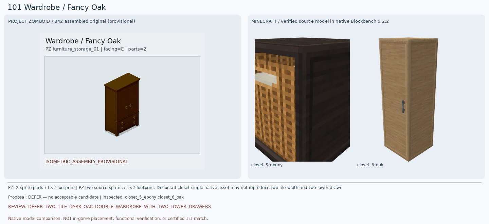
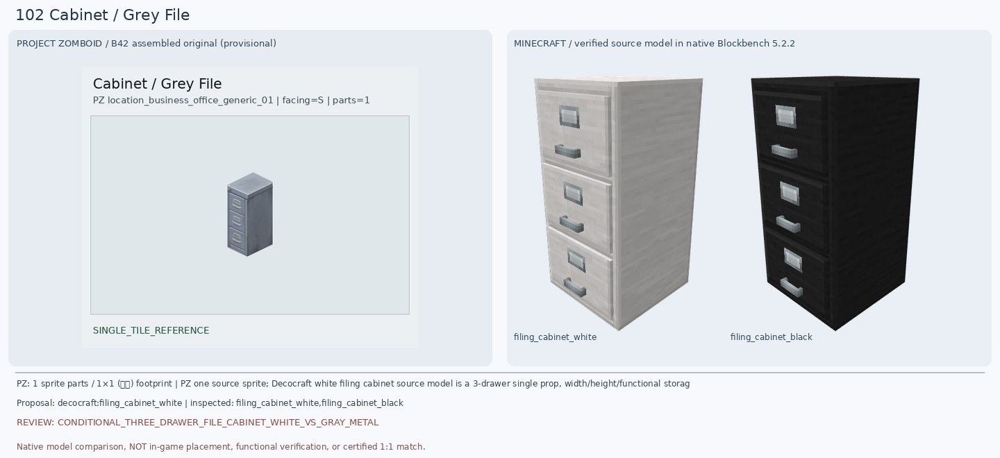
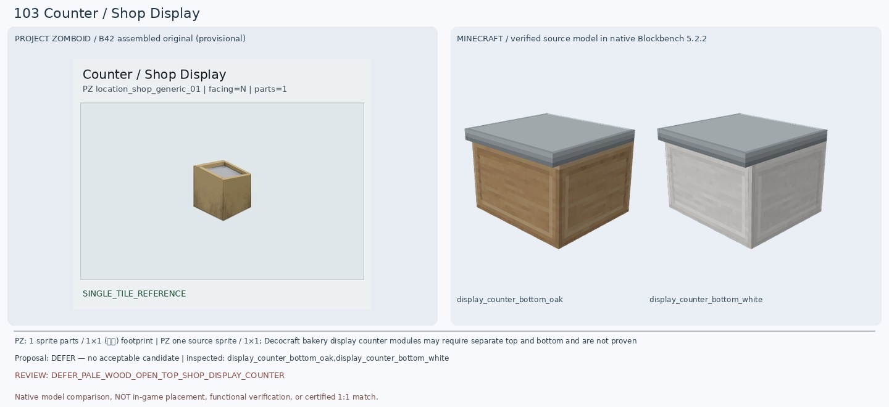
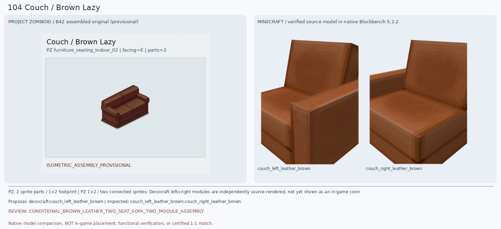
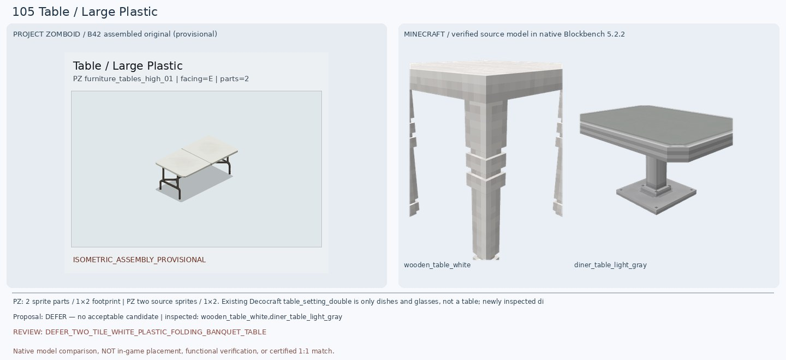
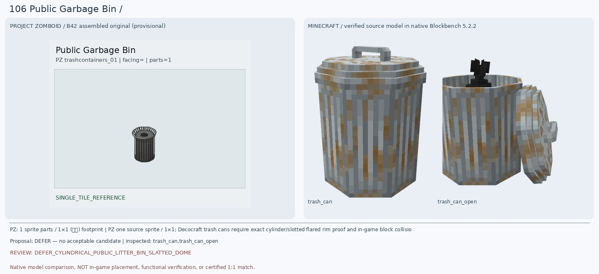
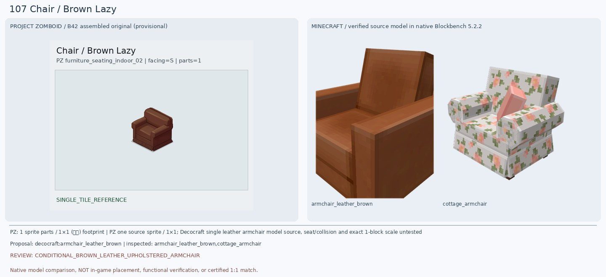
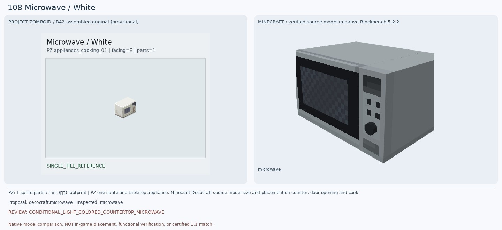
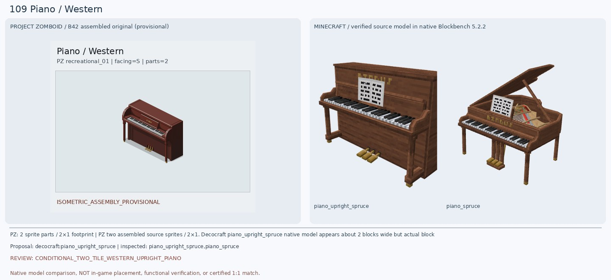
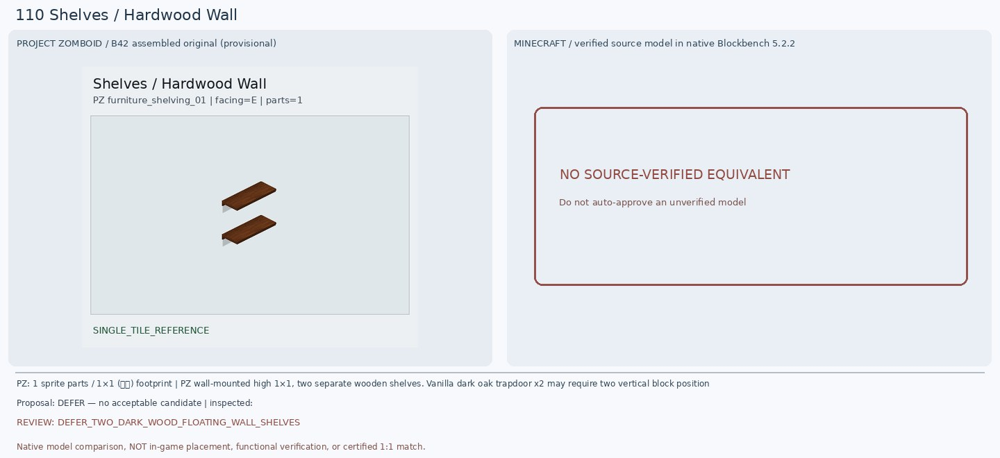

# 101–110 · 로즈우드 가구 이미지 대조

[전체 357종 목록](../README.md) · [원본 검수 PR #251](https://github.com/sanato-nb/PZ_Tile_Analysis/pull/251)

오른쪽 후보는 게임 적용이 확정된 모델이 아니야. **보류**는 추가 탐색 대상이야.

## 101 · Wardrobe / Fancy Oak

**보류 · 재탐색** · [원본 PR #251](https://github.com/sanato-nb/PZ_Tile_Analysis/pull/251)

PZ 원본은 짙은 적갈색 양문 옷장과 아래 서랍 2단(각 금빛 원형 손잡이 2개)을 합친 1×2 가구다. 원본 Decocraft BBMODEL 렌더를 실제 확인하니 Closet 5 Ebony(8큐브)는 정면이 열린 등나무 바구니/선반 형태이며 옷장 문 자체가 없다. Closet 6 Oak(11큐브)는 좁은 단문 밝은 목재 옷장으로 하부 서랍이 전혀 없다. 기존 Macaw Dark Oak Double Wardrobe는 상단 상태 일부만 보였으므로 모두 반려한다.

---

## 102 · Cabinet / Grey File

**조건부 후보** · [원본 PR #251](https://github.com/sanato-nb/PZ_Tile_Analysis/pull/251)

원본은 짙은 회색 철제 세로형 3단 파일 캐비닛이다. 기존 Refurbished 회색 주방 수납장은 전면 서랍이 없는 불완전한 상자여서 반려. Decocraft White Filing Cabinet의 실제 원본 렌더에서는 3개의 서랍, 라벨 틀, 가로 손잡이가 모두 보여 구조가 상당히 가깝지만 표면은 밝은 백색에 가까워 원본의 중간 회색 금속과 차이가 크다. 검정 변형도 회색이 아니므로 조건부다.

---

## 103 · Counter / Shop Display

**보류 · 재탐색** · [원본 PR #251](https://github.com/sanato-nb/PZ_Tile_Analysis/pull/251)

PZ 원본은 밝은 베이지 목재의 1칸 진열대로 윗면에 두꺼운 사각 목재 테두리와 안쪽으로 파인 연회색 진열 공간이 있고 앞·옆면에는 서랍이나 문이 없다. 실제 렌더한 Decocraft Display Counter Bottom Oak(6큐브)는 베이지 목재 몸체는 비슷하지만 상판이 회색 금속/석재의 완전히 평평한 뚜껑으로 덮여 있으며 테두리 안쪽 오목한 공간이 없다. White 변형은 몸체까지 백색이다. 기존 Macaw Acacia Counter의 붉은 상판/검은 몸체도 부적합하므로 보류.

---

## 104 · Couch / Brown Lazy

**조건부 후보** · [원본 PR #251](https://github.com/sanato-nb/PZ_Tile_Analysis/pull/251)

PZ 원본은 짙은 붉은 갈색 가죽의 2인용 소파로 양끝 둥근 팔걸이, 두 좌석 쿠션, 분할된 부드러운 등받이가 있다. 실제 Decocraft Couch Left Leather Brown(6큐브)과 Right Leather Brown(6큐브)은 갈색 가죽 질감과 좌우 각 1개 팔걸이를 가진 별개 모듈이므로 두 개를 붙이면 기본 소파 유형이 맞는다. 그러나 모델은 PZ보다 밝은 주황 갈색, 팔걸이와 등받이가 각진 평판이며 2×1 완성 연결/중간 경계는 게임에서 확인하지 않았다. 기존 Macaw Brown Couch는 한쪽 모듈만 렌더돼 완성형을 재현하지 못했다.

---

## 105 · Table / Large Plastic

**보류 · 재탐색** · [원본 PR #251](https://github.com/sanato-nb/PZ_Tile_Analysis/pull/251)

PZ 원본은 2×1 흰색 플라스틱 접이식 긴 테이블로 중앙 상판 접합선과 어두운 금속 U자형 다리 2쌍/가로 보강대가 보인다. 기존 Decocraft table_setting_double은 접시와 컵만 렌더돼 테이블이 아니다. 새 Wooden Table White(25큐브)는 흰 목재의 굵고 장식된 다리 4개를 가진 일반 식탁이며, Diner Table Light Gray(12큐브)는 회색 판 아래 중앙 금속 기둥 1개가 있는 카페 테이블이다. 모두 원본의 접이식 다리 구조와 2칸 긴 상판을 재현하지 못해 보류한다.

---

## 106 · Public Garbage Bin / 기본

**보류 · 재탐색** · [원본 PR #251](https://github.com/sanato-nb/PZ_Tile_Analysis/pull/251)

PZ 원본은 검은 철제 원통형 공공 쓰레기통으로 세로 철살 몸통과 방사형으로 벌어진 상단 테두리, 중앙의 열린 원형 투입구가 특징이다. Decocraft Trash Can(59큐브)은 녹슨 은회색 아연도금 원통에 손잡이 달린 닫힌 평평한 뚜껑이 있다. Trash Can Open(60큐브)은 뚜껑이 옆으로 젖혀지고 검은 쓰레기봉투가 드러나며, 어느 쪽도 PZ의 방사형 원형 투입구가 아니다. 기존 Paladin Mesh Trashcan은 사각형 그물망과 초록색 윗면으로 완전히 달라 반려한다.

---

## 107 · Chair / Brown Lazy

**조건부 후보** · [원본 PR #251](https://github.com/sanato-nb/PZ_Tile_Analysis/pull/251)

PZ 원본은 104번과 같은 짙은 붉은 갈색 가죽의 1인용 안락의자로 둥근 높은 등받이와 두꺼운 양쪽 팔걸이, 넓은 좌석 쿠션이 있다. Decocraft Armchair Leather Brown의 원본 9큐브 모델을 실제 렌더했으며 두 팔걸이, 좌석, 등받이, 아래 가죽 받침이 모두 완전하게 나타나 의자 유형이 맞는다. 하지만 마크 모델은 더 밝은 주황 갈색이고 각진 직선 등받이/팔걸이로 원본의 둥근 쿠션형 실루엣과 다르다. Cottage Armchair는 꽃무늬 천이라 재질·색 모두 불일치한다.

---

## 108 · Microwave / White

**조건부 후보** · [원본 PR #251](https://github.com/sanato-nb/PZ_Tile_Analysis/pull/251)

PZ 원본은 크림색/백색 소형 전자레인지로 왼쪽 어두운 전면 창, 오른쪽 세로 조작부가 있다. 새 Decocraft Microwave(14큐브) 원본 BBMODEL을 Blockbench로 확인하니 본체·검정 유리문·오른쪽 버튼 격자·아래 다이얼까지 완전하게 나타난다. 이전 Refurbished Dark Microwave의 녹색 기둥 하나짜리 부분 렌더보다 확실히 낫다. 다만 새 모델 몸체는 회색 금속이고 전면 버튼·다이얼이 PZ와 달라 색상/세부 외형은 조건부로 남긴다.

---

## 109 · Piano / Western

**조건부 후보** · [원본 PR #251](https://github.com/sanato-nb/PZ_Tile_Analysis/pull/251)

PZ 원본은 2×1 적갈색 서부풍 업라이트 피아노로 검은색/흰색 건반과 아래 금빛 페달 3개, 둥근 옆판이 있다. 실제 Decocraft Piano Upright Spruce(56큐브)는 가로로 긴 업라이트 목재 본체, 검은/흰 건반, 3개 금빛 페달이 전부 갖춰져 외형이 상당히 유사하다. 하지만 PZ보다 밝은 갈색이며 큰 흰 악보판, 직선적 사각 프레임과 하단 다리가 달라 조건부다. 별도 렌더한 Piano Spruce(245큐브)는 뚜껑을 연 그랜드 피아노이므로 구조상 대체할 수 없다.

---

## 110 · Shelves / Hardwood Wall

**보류 · 재탐색** · [원본 PR #251](https://github.com/sanato-nb/PZ_Tile_Analysis/pull/251)

원본은 진갈색 목재 판자 2개가 벽에 간격을 두고 수평으로 붙은 단순 벽 선반이다. 기존 Handcrafted Acacia Shelf 렌더는 양옆 벽과 뒷판이 있는 두꺼운 책장형 상자여서 구조가 다르다. 현재 확인된 원본 모델 목록에서 같은 높이의 독립된 판자 2개를 한 블록 안에 배치하는 완성형 가구를 찾지 못했다. 마크 다크오크 덫문 2개를 벽에 펼쳐 만드는 방법은 바닐라 재현안일 뿐 실제 한 칸 배치는 미검증이다.

---

