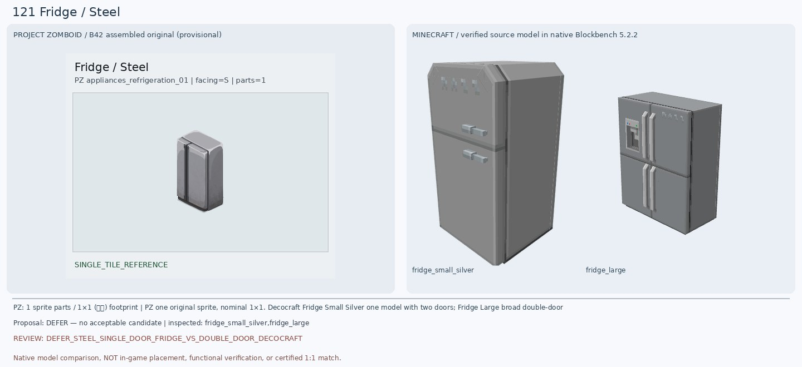
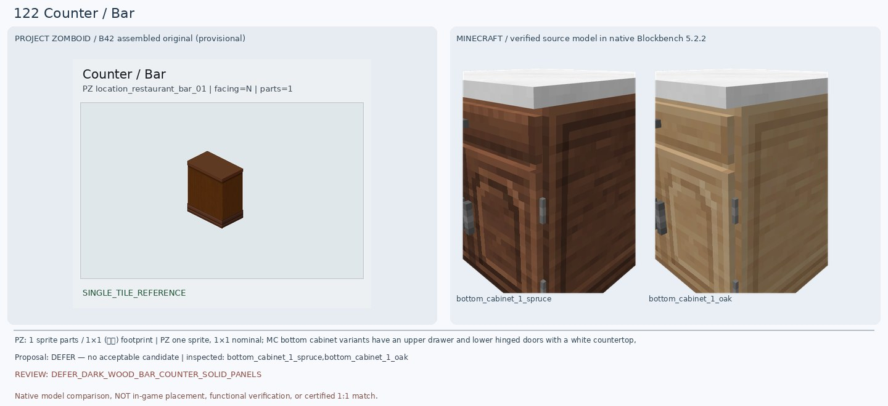
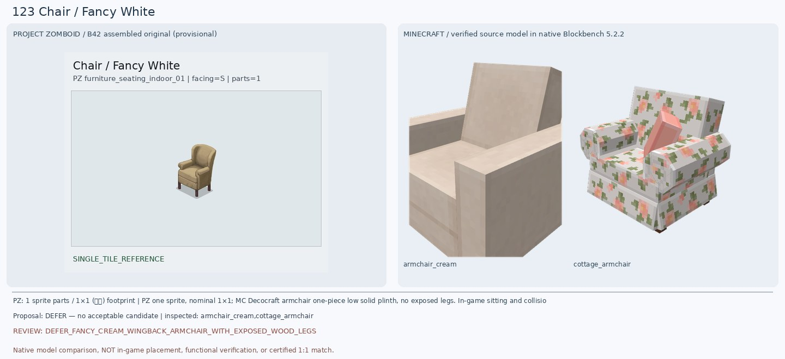
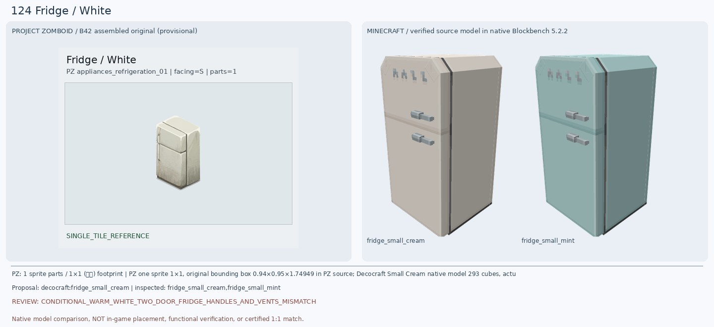
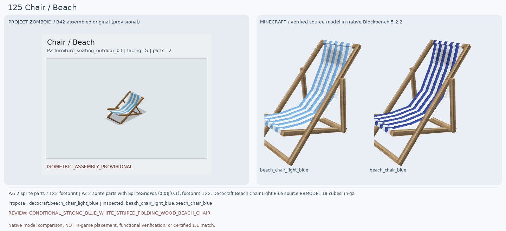
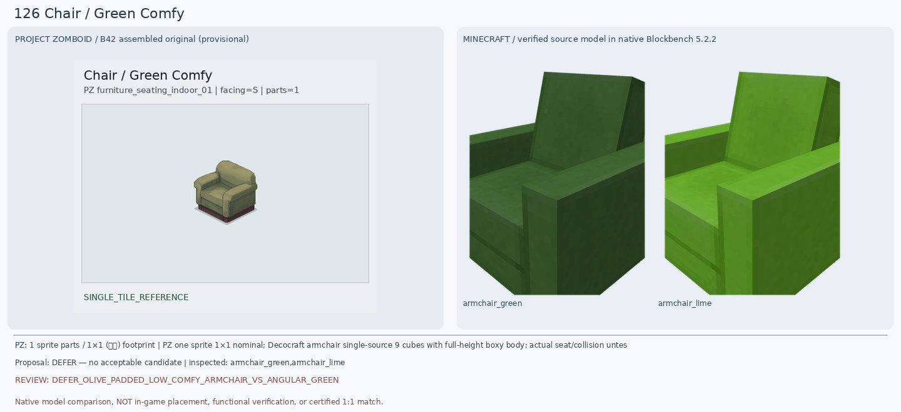
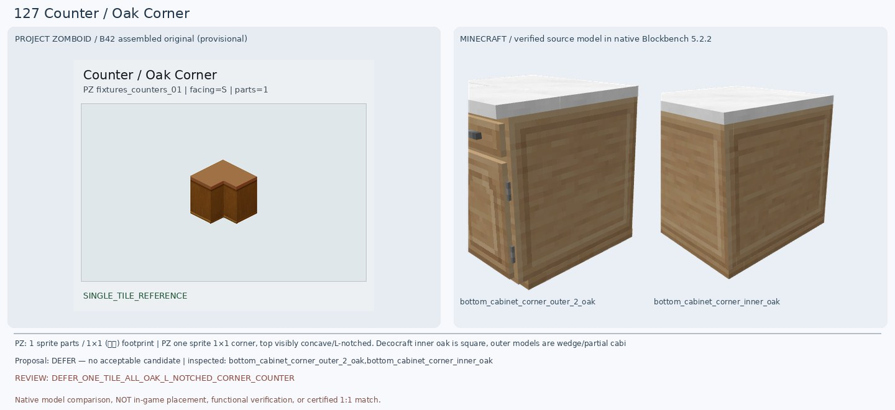
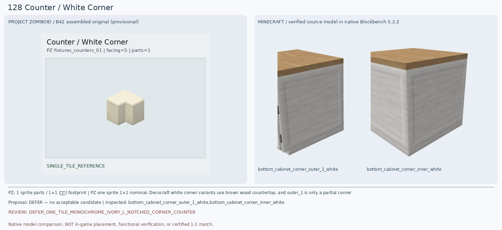
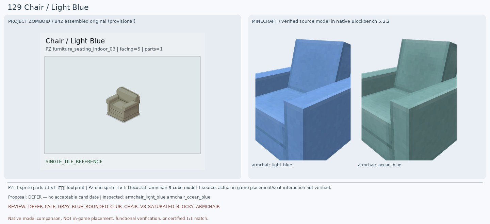
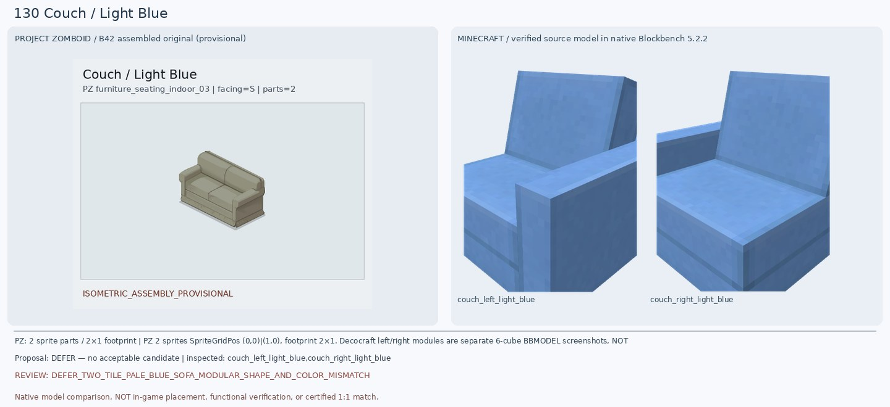

# 121–130 · 로즈우드 가구 이미지 대조

[전체 357종 목록](../README.md) · [원본 검수 PR #253](https://github.com/sanato-nb/PZ_Tile_Analysis/pull/253)

오른쪽 후보는 게임 적용이 확정된 모델이 아니야. **보류**는 추가 탐색 대상이야.

## 121 · Fridge / Steel

**보류 · 재탐색** · [원본 PR #253](https://github.com/sanato-nb/PZ_Tile_Analysis/pull/253)

원본은 은회색 단일 전면판과 왼쪽 검정 세로 경계가 두드러지는 좁은 냉장고다. 실제 Decocraft Fridge Small Silver 원본 293큐브는 위·아래 두 문이 가로선으로 분리되고 전면에 은색 가로 손잡이 두 개와 상부 통풍구가 있어 외형이 다르다. Fridge Large 372큐브는 좌우 양문·디스펜서까지 있는 넓은 최신형이라 더 멀다. 이전 Paladin Iron Fridge는 이 묶음에서 실제 완성 모델 검증을 하지 않았으므로 승인하지 않는다.

---

## 122 · Counter / Bar

**보류 · 재탐색** · [원본 PR #253](https://github.com/sanato-nb/PZ_Tile_Analysis/pull/253)

원본은 상판·몸체·하단 몰딩이 모두 짙은 나무이며 서랍·손잡이·흰 조리대가 없다. 실제 Decocraft Bottom Cabinet 1 Spruce/Oak 13큐브를 열어 보니 두 모델 모두 흰색 두꺼운 상판, 앞쪽 상부 서랍 및 손잡이, 하부 문이 나타나 원본 바 카운터와 다르다. Diner Counter Yellow는 원본 파일이 있지만 이번 실행에서 Blockbench 모델 큐브 3개로 완성 렌더 판정을 받지 못해 비교 증거로 쓰지 않는다.

---

## 123 · Chair / Fancy White

**보류 · 재탐색** · [원본 PR #253](https://github.com/sanato-nb/PZ_Tile_Analysis/pull/253)

원본의 핵심은 위로 둥글게 올라간 전통형 등받이, 부드러운 곡면 팔걸이, 얇게 드러난 어두운 나무 다리 네 개다. 실제 Decocraft Armchair Cream 9큐브는 크림색이 가깝지만 직선 평판 등받이와 네모 팔걸이·바닥까지 막힌 몸체로 구조가 크게 다르다. Cottage Armchair 23큐브는 꽃무늬와 아래 천 스커트가 있어 원본 단색 우아한 의자와 더 다르다. 색만 맞았다는 이유로 승인하지 않는다.

---

## 124 · Fridge / White

**조건부 후보** · [원본 PR #253](https://github.com/sanato-nb/PZ_Tile_Analysis/pull/253)

원본은 위쪽 작은 냉동실과 아래쪽 큰 냉장실로 구분된 따뜻한 아이보리 2도어 냉장고다. Decocraft Fridge Small Cream 실제 293큐브 모델은 크림색 세로 직육면체, 위아래 2도어 분할이라는 중요한 실루엣이 일치한다. 다만 마크 모델에는 앞쪽 수평 은색 손잡이 두 개, 상단 4개 통풍구, 각진 윗모서리가 뚜렷하며 PZ는 옆면 세로 손잡이와 더 매끈한 면이다. 실물 외형은 조건부이며 게임 설치/냉장 기능은 확인하지 않았다.

---

## 125 · Chair / Beach

**조건부 후보** · [원본 PR #253](https://github.com/sanato-nb/PZ_Tile_Analysis/pull/253)

원본은 나무 접이식 프레임과 하늘색·흰색 줄무늬 천이 연결된 낮은 비치 체어다. 실제 Decocraft Beach Chair Light Blue 원본 18큐브를 Blockbench로 렌더하니 흰색/하늘색 세로 줄무늬 천, 비스듬한 목재 등받이, 앞쪽으로 내려오는 좌석, 뒤 지지대가 모두 존재해 이전 Paladin Arm Chair Leather의 회색 세로판보다 훨씬 정확하다. Blue 변형은 줄무늬가 진한 남색이어서 PZ 밝은 파랑보다 멀다. PZ 프레임 각도·다리의 교차 위치·천 굴곡은 일부 다르고 실제 1×2 설치 여부는 미검증이다.

---

## 126 · Chair / Green Comfy

**보류 · 재탐색** · [원본 PR #253](https://github.com/sanato-nb/PZ_Tile_Analysis/pull/253)

PZ는 노란 기가 도는 올리브 천, 낮고 둥근 등받이, 쿠션 굴곡, 아래쪽 짙은 적갈색 받침이 특징이다. Decocraft Armchair Green 실제 9큐브 모델은 진한 녹색 직선 평판 등받이·각진 팔걸이·바닥까지 같은 녹색 몸체이며 둥근 쿠션과 목재 받침이 없다. Lime은 훨씬 선명한 연두라 색상도 다르다. 가구 분류만 같고 핵심 실루엣·재질이 달라 보류한다.

---

## 127 · Counter / Oak Corner

**보류 · 재탐색** · [원본 PR #253](https://github.com/sanato-nb/PZ_Tile_Analysis/pull/253)

원본은 상판에 안쪽으로 파인 직각 ㄱ자 홈이 보이는 한 칸짜리 전체 원목 코너 카운터다. Decocraft Corner Inner Oak 실제 9큐브는 흰 상판을 가진 정사각형 캐비닛으로 홈이 없고, Corner Outer 2 Oak 실제 21큐브는 흰 상판+서랍·손잡이가 붙은 사다리꼴 모서리 부품이다. 둘을 임의로 합쳐 원본 1×1 ㄱ자 가구라고 간주할 근거가 없으므로 보류한다.

---

## 128 · Counter / White Corner

**보류 · 재탐색** · [원본 PR #253](https://github.com/sanato-nb/PZ_Tile_Analysis/pull/253)

원본은 ㄱ자로 안쪽이 파인 상판과 몸체 전체가 아이보리색인 단순한 코너 카운터다. 실제 Decocraft Corner Outer 1 White 23큐브는 상판이 갈색 나무이고 몸체는 얇은 패널 조각이라 한 덩어리 가구가 아니다. Corner Inner White 9큐브도 나무색 정사각 상판에 흰 몸체인 평범한 정육면체로 ㄱ자 홈이 없다. 기존 후보의 색·형상·부품 완결성이 모두 달라 보류한다.

---

## 129 · Chair / Light Blue

**보류 · 재탐색** · [원본 PR #253](https://github.com/sanato-nb/PZ_Tile_Analysis/pull/253)

PZ 이름은 Light Blue지만 실제 완성형 미리보기는 회색에 가까운 아주 옅은 청록빛 천과 둥근 등받이·쿠션을 가진 낮은 안락의자다. 실제 Decocraft Armchair Light Blue 9큐브는 채도 높은 밝은 파랑, Ocean Blue는 더 짙은 청록이며 둘 다 각진 높은 평판 등받이와 직각 팔걸이, 아래 받침이 없는 일체형이다. 이전 Paladin Blue Arm Chair 역시 검푸른 단순 L형 판으로 맞지 않았다. 색과 실루엣 차이가 커 보류한다.

---

## 130 · Couch / Light Blue

**보류 · 재탐색** · [원본 PR #253](https://github.com/sanato-nb/PZ_Tile_Analysis/pull/253)

원본은 회청색 2인 소파가 2×1로 이어지고 둥근 등받이와 좌석 쿠션이 중앙에서 구분된다. Decocraft Couch Left/Right Light Blue 원본을 각각 Blockbench로 열어 보니 좌·우 팔걸이가 있는 모듈은 실제로 존재하지만 마크의 선명한 파랑이 PZ의 회색에 가까운 색보다 진하고, 등받이는 직선 평판이며 원본의 쿠션 굴곡·하단 받침이 없다. 두 소스 모델을 한 게임에서 연결해 확인한 것도 아니므로 완성형 2인 소파로 승인하지 않는다.

---

