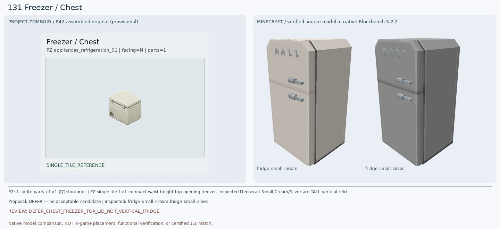
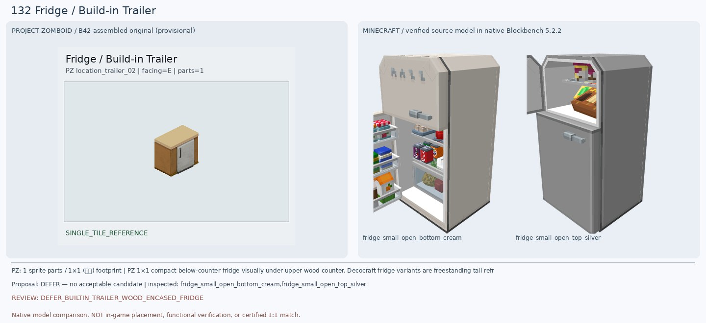
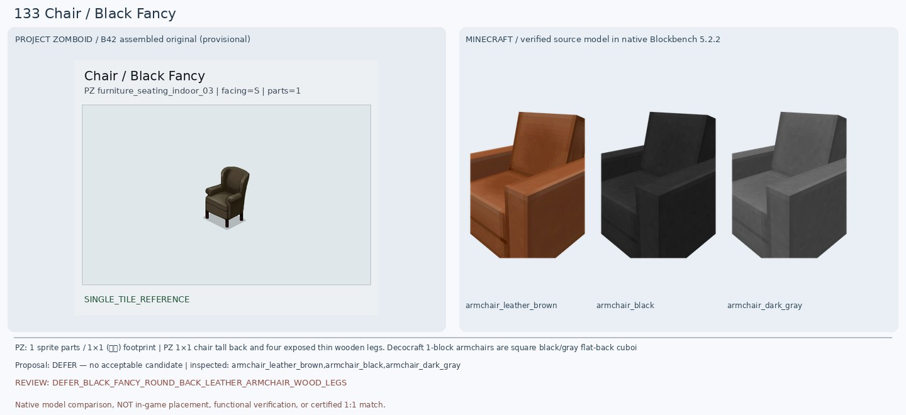
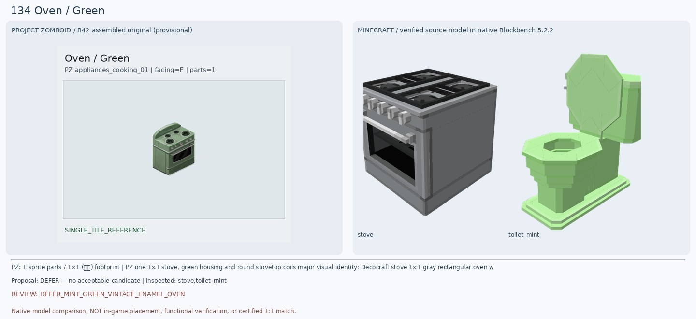
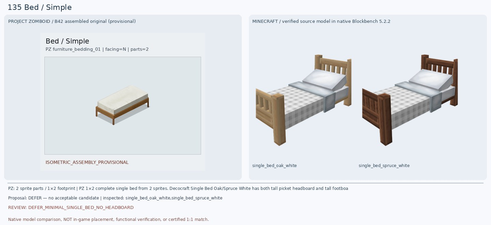
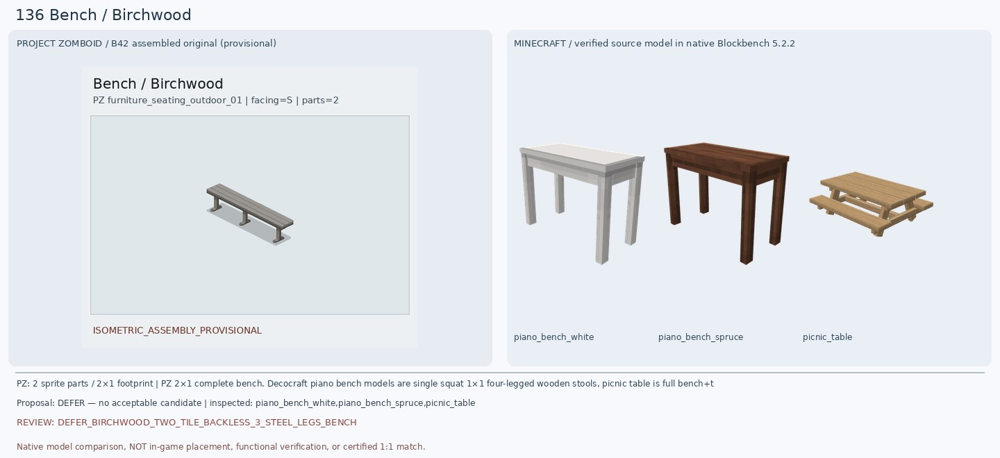
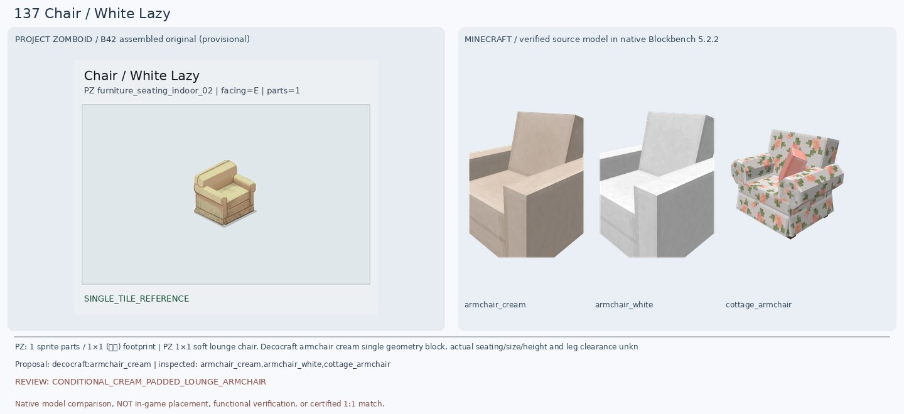
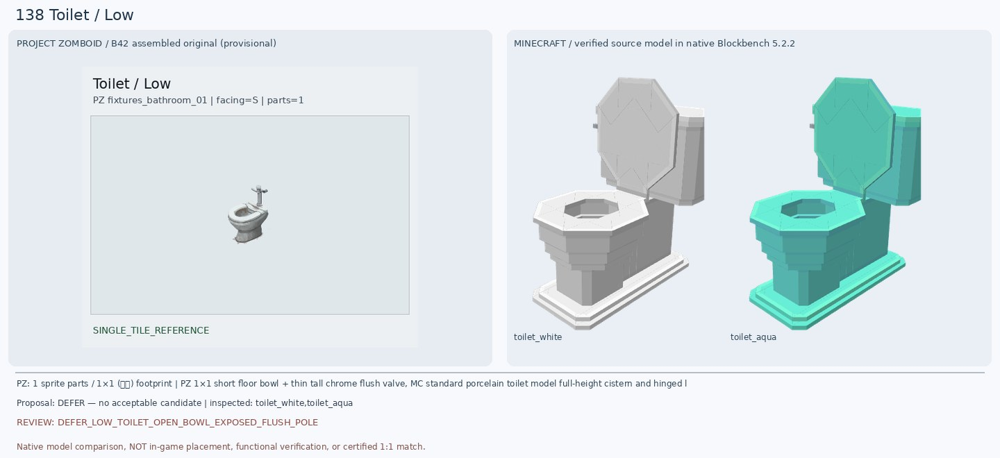
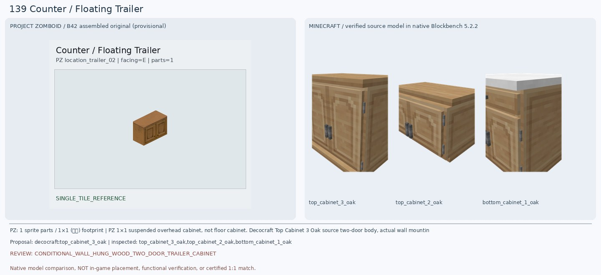
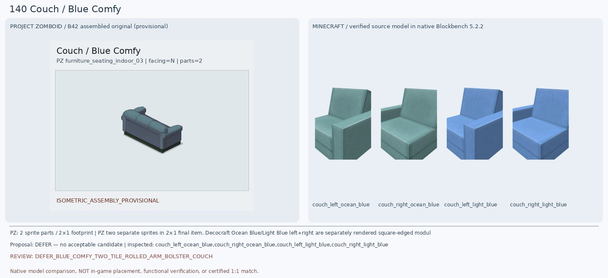

# 131–140 · 로즈우드 가구 이미지 대조

[전체 357종 목록](../README.md) · [원본 검수 PR #254](https://github.com/sanato-nb/PZ_Tile_Analysis/pull/254)

오른쪽 후보는 게임 적용이 확정된 모델이 아니야. **보류**는 추가 탐색 대상이야.

## 131 · Freezer / Chest

**보류 · 재탐색** · [원본 PR #254](https://github.com/sanato-nb/PZ_Tile_Analysis/pull/254)

PZ 원본은 높이가 낮고 위로 열리는 크림색 상자형 냉동고이며 상단 금속 걸쇠와 아래쪽 측면 통풍구가 보인다. 기존 Refurbished Dark Freezer 자동 렌더는 검은 앞면과 목재색 측면의 부품 한 개만 나타나 완성형을 확인할 수 없었다. 이번 Decocraft Fridge Small Cream/Silver 모델은 실제 293큐브 완성형이지만 높이 큰 전면 2도어 냉장고라 구조가 완전히 다르다. 비슷한 색이라는 이유로 채택하지 않는다.

---

## 132 · Fridge / Build-in Trailer

**보류 · 재탐색** · [원본 PR #254](https://github.com/sanato-nb/PZ_Tile_Analysis/pull/254)

PZ 원본은 트레일러 가구와 일체인 작은 은색 냉장고 문 한 장, 양옆 황갈색 목재 프레임, 윗쪽 넓은 나무 상판이다. 기존 Refurbished Dark Fridge 렌더는 분홍색 높은 냉장고의 일부 그래픽으로 원본과 다르다. 이번 Decocraft Small Cream/Silver Open 냉장고는 상하 2도어의 세로형 프리즘이고 내부에 음식이 보이는 열린 상태라 PZ의 낮은 1도어 목재 내장형 가구가 아니다.

---

## 133 · Chair / Black Fancy

**보류 · 재탐색** · [원본 PR #254](https://github.com/sanato-nb/PZ_Tile_Analysis/pull/254)

PZ는 짙은 갈색/검정 천 또는 가죽의 부드러운 높은 곡선 등받이, 둥근 쿠션 팔걸이, 밑으로 노출된 가느다란 갈색 목제 다리 네 개를 갖춘 고전식 안락의자다. 기존 Paladin Black Arm Chair는 검정 직각 의자처럼 보여 원본의 다리·곡선 쿠션이 없다. 새 Decocraft Armchair Black/Dark Gray/Leather Brown 원본 모델을 모두 확인해도 각진 등받이·직선 팔걸이·바닥까지 막힌 함체 구조라 핵심 형태가 달라 보류한다.

---

## 134 · Oven / Green

**보류 · 재탐색** · [원본 PR #254](https://github.com/sanato-nb/PZ_Tile_Analysis/pull/254)

PZ 원본은 녹회색/민트색 에나멜 오븐으로 같은 초록색 굽은 뒷판, 둥근 화구 4개와 전면 조작 노브, 둥근 오븐창이 연결된다. 새 Decocraft Stove는 98큐브 온전한 금속 오븐과 화구는 있으나 완전히 은색/회색이며 위의 화구가 사각형 가스 레인지형이고 초록색 뒷판이 전혀 없다. Decocraft Toilet Mint는 녹색만 비슷하고 변기이므로 가구 종류가 다르다. 실제 같은 녹색 오븐 모델을 찾기 전까지 보류한다.

---

## 135 · Bed / Simple

**보류 · 재탐색** · [원본 PR #254](https://github.com/sanato-nb/PZ_Tile_Analysis/pull/254)

PZ 원본은 나무 4다리와 낮은 평평한 베이스에 무늬 없는 크림색 직사각 매트리스 하나만 얹힌 간단 침대이고, 높은 머리판·발치 울타리가 없다. 이전 Decocraft Bunk Bed Birch Black 렌더는 2층 침대라 명백한 오매칭. 새 Single Bed Oak/Spruce White 실제 BBMODEL은 단층이지만 침대 머리와 발끝에 높은 세로살 목재 울타리와 체크무늬 매트리스/분리 베개가 있어 소박한 원본과 크게 달라; 후보 승인 불가.

---

## 136 · Bench / Birchwood

**보류 · 재탐색** · [원본 PR #254](https://github.com/sanato-nb/PZ_Tile_Analysis/pull/254)

원본은 2타일 길이의 회갈색 노후 목재 판자 3줄과 바닥에 고정되는 회색 철제 T자 지지대 3개를 가진 등받이 없는 공원 벤치다. 기존 Handcrafted Birch Bench는 빨간 등받이 쿠션이 붙은 1인 의자 부품으로 나와 오매칭. 새 Decocraft Piano Bench Spruce/White는 단일 1칸, 목재 다리 4개, 철제 받침 없는 피아노 의자이고 Picnic Table은 탁자까지 있는 구조여서 정확한 가구가 아니다.

---

## 137 · Chair / White Lazy

**조건부 후보** · [원본 PR #254](https://github.com/sanato-nb/PZ_Tile_Analysis/pull/254)

원본은 누런 크림색 천이 있는 통통한 1인 안락의자, 좌우 두꺼운 팔걸이와 두툼한 좌석 쿠션, 바닥까지 내려오는 스커트형 몸체다. Decocraft Armchair Cream 실제 원본 모델은 크림색, 넓은 팔걸이와 낮은 박스형 본체의 구성이 비슷해 기존 Paladin Oak Chair Classic White (의자 다리 두 개와 분홍 막대만 보이던 불완전 렌더)보다 훨씬 낫다. 다만 마크는 등받이가 높은 각진 평판이고 팔걸이도 직선이며 원본의 부드럽고 둥근 쿠션과 층진 스커트가 없다. 조건부 후보만.

---

## 138 · Toilet / Low

**보류 · 재탐색** · [원본 PR #254](https://github.com/sanato-nb/PZ_Tile_Analysis/pull/254)

PZ Low Toilet는 일반 도기 양변기처럼 큰 물통이 없고, 열린 낮은 둥근 변기 볼 뒤쪽으로 긴 금속 수직 봉과 십자 손잡이·배수 장치가 드러나는 구식 화장실 설비다. 기존 Paladin Basic Toilet은 커다란 사각 물통이 있고, 이번 Decocraft Toilet White/Aqua도 물통과 위로 세워진 뚜껑이 있는 보통 양변기다. 낮은 볼+노출 금속 봉의 모양이 빠져 있어 부적합으로 보류.

---

## 139 · Counter / Floating Trailer

**조건부 후보** · [원본 PR #254](https://github.com/sanato-nb/PZ_Tile_Analysis/pull/254)

PZ는 트레일러 내부 벽에 설치된 황갈색 2도어 수납장이고 위에 같은 나무색 상판이 있다. 새 Decocraft Top Cabinet 3 Oak 실모델은 목재 색감, 두 개의 틀 있는 전면 문과 가벼운 낮은 높이, 윗면 나무판이 가까워 기존 Macaw Acacia Counter의 붉은 상판+검은 단색 직육면체 오매칭보다 좋다. 다만 PZ는 각 문에 아래쪽 작은 원형 손잡이가 있고 MC에는 중앙에 긴 은회색 손잡이 하나처럼 보이며 방향/벽 부착·1칸 설치는 검증되지 않았다. 조건부만.

---

## 140 · Couch / Blue Comfy

**보류 · 재탐색** · [원본 PR #254](https://github.com/sanato-nb/PZ_Tile_Analysis/pull/254)

PZ는 탁한 남청색 패브릭 두 칸 소파로 양끝에 둥근 말린 팔걸이가 있고 등받이 위쪽도 긴 원통형 쿠션이 연결되는 형태다. 기존 Macaw Blue Couch는 밝은 파란색 직각 1좌석만 렌더되어 완성형 2칸 근거가 없다. 새 Decocraft Couch Left/Right Ocean Blue와 Light Blue를 실제 BBMODEL로 각각 렌더해 2모듈 구성은 확인했지만 모두 박스형 평평한 등받이, 직선 팔걸이이고 원본 둥근 롤쿠션·어두운 색감이 다르다. 게임에서 실제 접속도 확인되지 않았으므로 보류.

---

