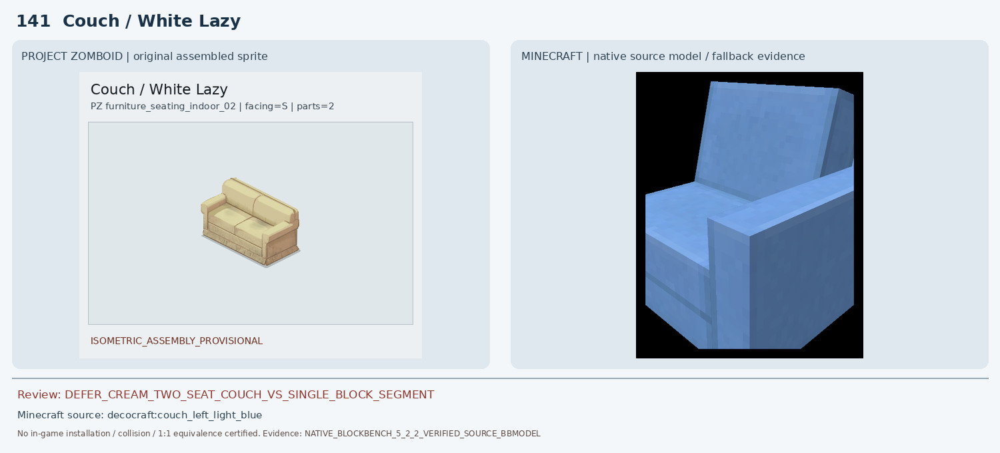
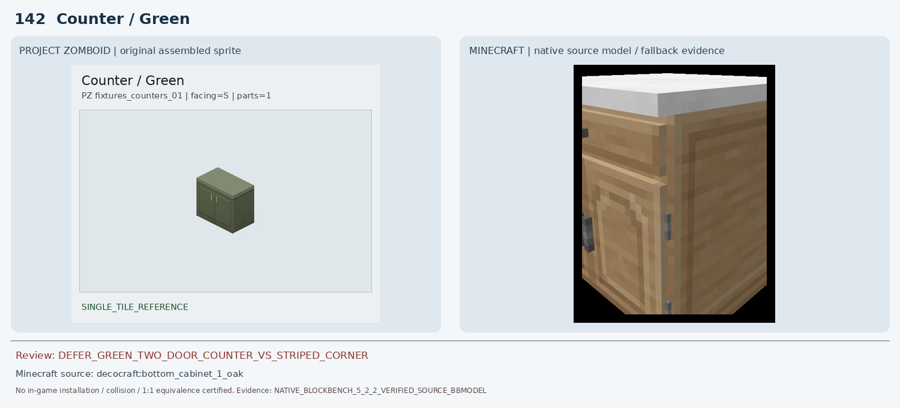
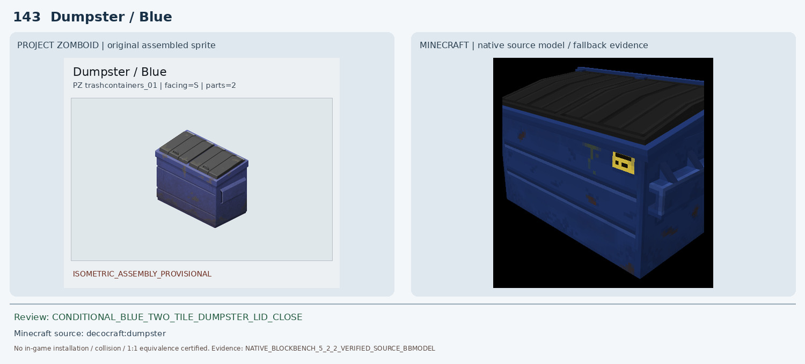
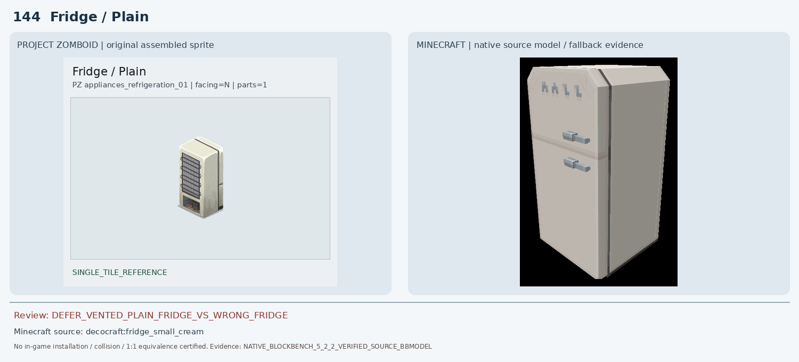
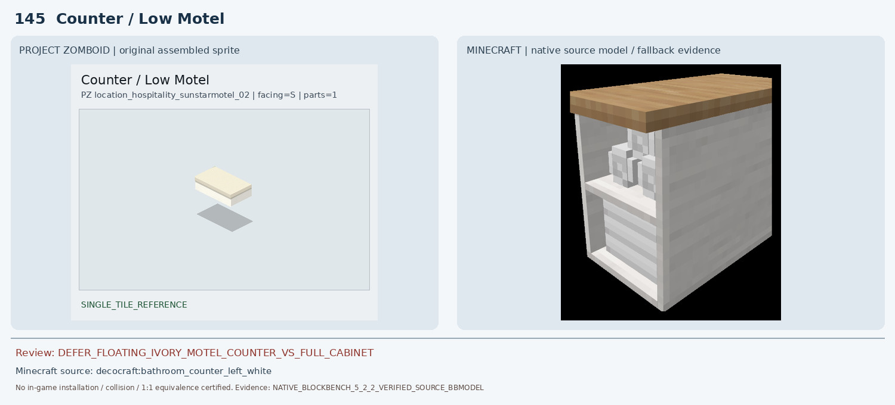
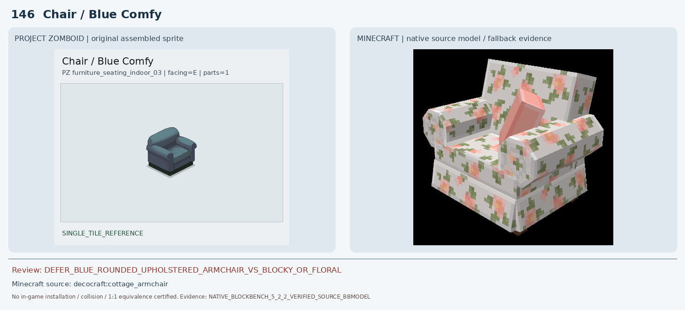
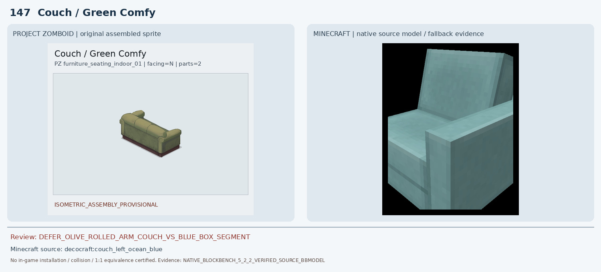
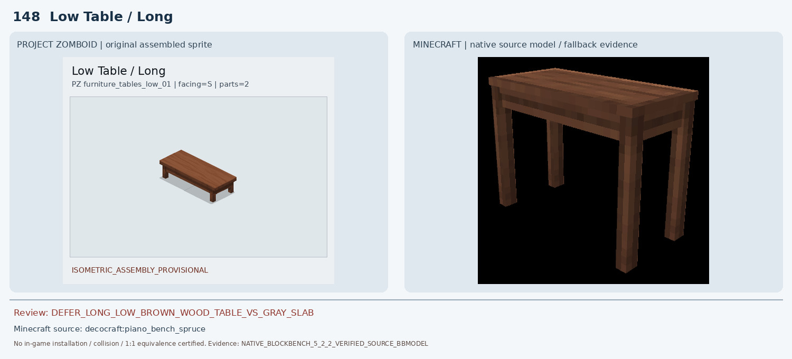
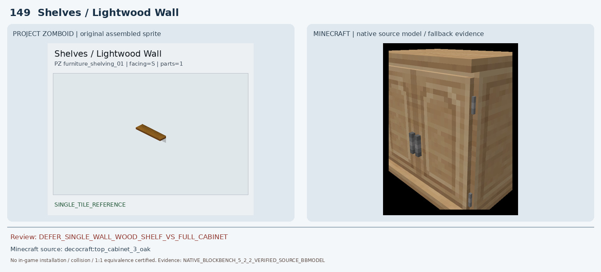
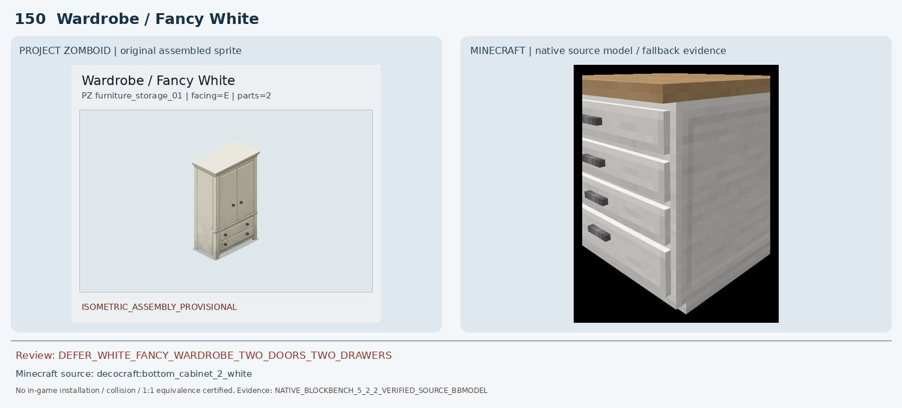

# 141–150 · 로즈우드 가구 이미지 대조

[전체 357종 목록](../README.md) · [원본 검수 PR #257](https://github.com/sanato-nb/PZ_Tile_Analysis/pull/257)

오른쪽 후보는 게임 적용이 확정된 모델이 아니야. **보류**는 추가 탐색 대상이야.

## 141 · Couch / White Lazy

**보류 · 재탐색** · [원본 PR #257](https://github.com/sanato-nb/PZ_Tile_Analysis/pull/257)

기존 Macaw White Couch는 흰 직각형 단일 소파 조각만 렌더되어 2좌석 완성형이 아니며 색·목재 하단 프레임이 없다. Decocraft Couch Left/Right Light Blue 실모델은 연결 가능한 좌우 모듈 형태지만 파란색 단색 직각 쿠션과 직선 팔걸이라 크림색+목재 팔걸이 원본과 다르다. 좌우 게임 내 접속도 미검증.

---

## 142 · Counter / Green

**보류 · 재탐색** · [원본 PR #257](https://github.com/sanato-nb/PZ_Tile_Analysis/pull/257)

기존 Decocraft Diner Counter Corner Green은 초록+흰색 수평 줄무늬가 있는 각진 모서리 바/기둥으로 전면 문 두 개와 손잡이가 없어 오매칭. Decocraft Bottom Cabinet 1 Oak는 수납장 종류는 가깝지만 원목색, 문/서랍 구성과 상판색이 달라 정확한 대체가 아니다.

---

## 143 · Dumpster / Blue

**조건부 후보** · [원본 PR #257](https://github.com/sanato-nb/PZ_Tile_Analysis/pull/257)

기존 Decocraft Rolling Bin Blue는 높고 좁은 1인용 바퀴 달린 수거통이어서 2×1 대형 덤프스터와 종류가 다름. 원본 Decocraft Dumpster BBMODEL의 기존 네이티브 Blockbench 렌더에서 검정 다중 리브 뚜껑, 파란 금속 직사각 몸체, 측면 손잡이와 오염 흔적이 확인되어 훨씬 가깝다. 다만 PZ는 더 보랏빛이며 뚜껑 패널 수/경사, 2×1 설치 범위는 차이가 있고 실제 게임에서 미검증이므로 조건부만.

---

## 144 · Fridge / Plain

**보류 · 재탐색** · [원본 PR #257](https://github.com/sanato-nb/PZ_Tile_Analysis/pull/257)

기존 Refurbished Dark Fridge 부분 렌더는 분홍색 측면과 검정 앞면만 보여 원본의 크림색 전면 통풍 격자/아래 제어칸이 없다. Decocraft Small Cream도 일반 상하 두 문 냉장고로 원본 통풍 전면 구조와 다르다.

---

## 145 · Counter / Low Motel

**보류 · 재탐색** · [원본 PR #257](https://github.com/sanato-nb/PZ_Tile_Analysis/pull/257)

기존 Macaw Acacia Counter는 주황색 상판과 검은 전체 높이의 블록형 받침이 있어 원본의 벽 부착형 얇은 판과 다르다. Decocraft Bathroom Counter Left White도 수납형 전체 가구로 원본의 빈 하부 공간을 재현하지 못한다.

---

## 146 · Chair / Blue Comfy

**보류 · 재탐색** · [원본 PR #257](https://github.com/sanato-nb/PZ_Tile_Analysis/pull/257)

기존 Paladin Blue Arm Chair는 밝은 청색 직각 등받이·한 좌석 블록으로 원본의 둥근 팔걸이/두툼한 쿠션/짙은 색을 재현하지 못한다. Decocraft Cottage Armchair는 곡선형 쿠션과 팔걸이는 가깝지만 꽃무늬 분홍·크림 패턴이라 원본의 단색 회청색과 큰 차이.

---

## 147 · Couch / Green Comfy

**보류 · 재탐색** · [원본 PR #257](https://github.com/sanato-nb/PZ_Tile_Analysis/pull/257)

기존 Macaw Green Couch는 밝은 초록색 직각 1좌석만 보여 2인 완성형과 다르다. Decocraft Couch Left/Right Ocean Blue는 좌우 모듈 구조는 있지만 푸른 색감, 평평한 각진 팔걸이와 등받이로 PZ의 올리브색 롤쿠션·하단 목재 베이스가 없다.

---

## 148 · Low Table / Long

**보류 · 재탐색** · [원본 PR #257](https://github.com/sanato-nb/PZ_Tile_Analysis/pull/257)

기존 Macaw Acacia Coffee Table의 렌더는 회색 낮은 평판만 보여 갈색 나뭇결·다리·2×1 길이가 모두 다름. Decocraft Piano Bench Spruce는 갈색 평판+다리 구조는 있지만 좌판용 좁은 벤치이며 원본 테이블 상판의 폭·길이와 다를 수 있어 검증된 대체가 아님.

---

## 149 · Shelves / Lightwood Wall

**보류 · 재탐색** · [원본 PR #257](https://github.com/sanato-nb/PZ_Tile_Analysis/pull/257)

기존 Handcrafted Acacia Shelf 네이티브 렌더는 전면에 큰 구멍 두 개가 있는 전체 높이 나무 캐비닛 형태로 원본의 얇은 한 장 선반과 다름. Decocraft Top Cabinet 3 Oak도 두 문이 있는 상부 수납장이라 단순 판자 한 장을 대신하지 못한다.

---

## 150 · Wardrobe / Fancy White

**보류 · 재탐색** · [원본 PR #257](https://github.com/sanato-nb/PZ_Tile_Analysis/pull/257)

기존 Macaw Acacia Double Wardrobe는 짙은 회색 목재 몸체와 주황 문 두 개가 있는 직각 옷장으로 흰색 몰딩/하단 두 서랍이 없다. Decocraft Bottom Cabinet 2 White는 흰색 수납장 계열이지만 낮은 주방 하부장이라 높은 옷장과 두 서랍 구성에 부적합.

---

