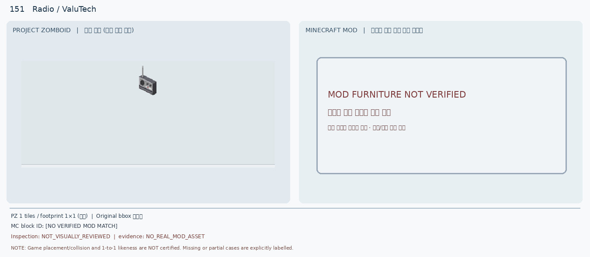
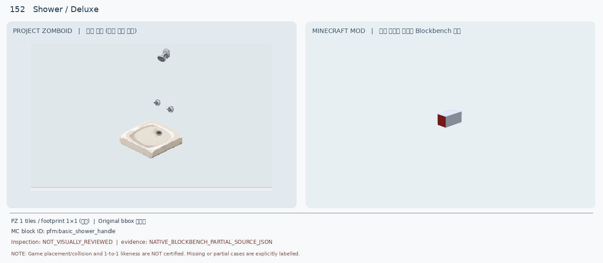
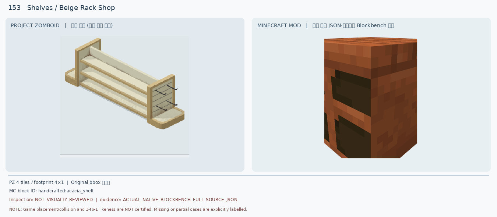
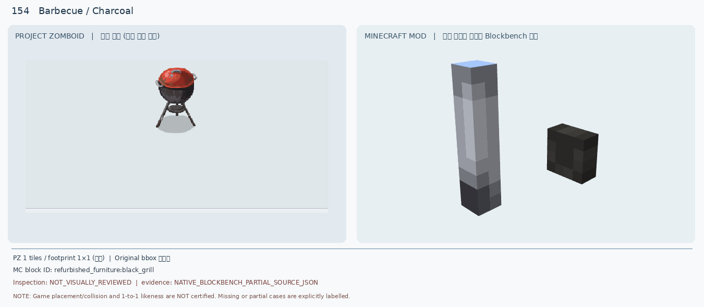
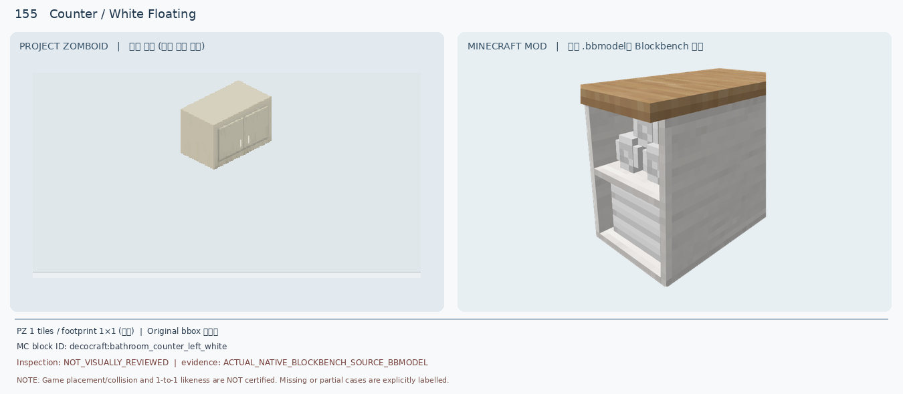
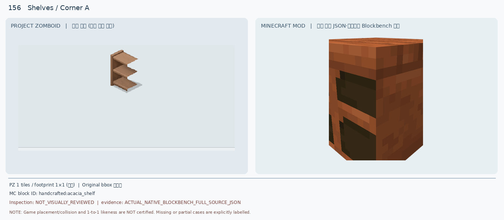
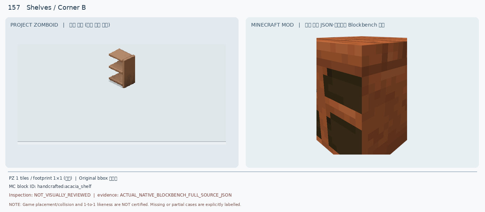
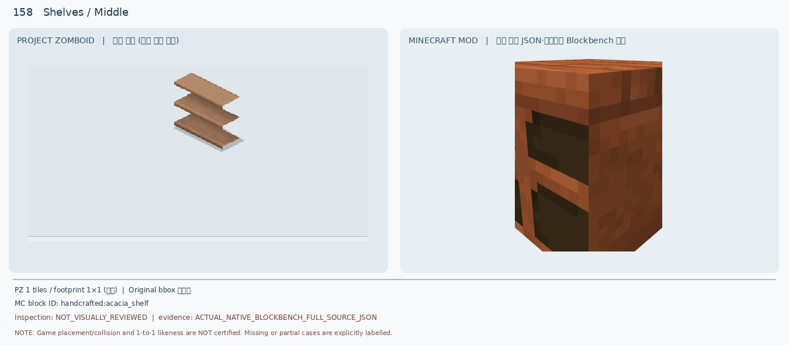
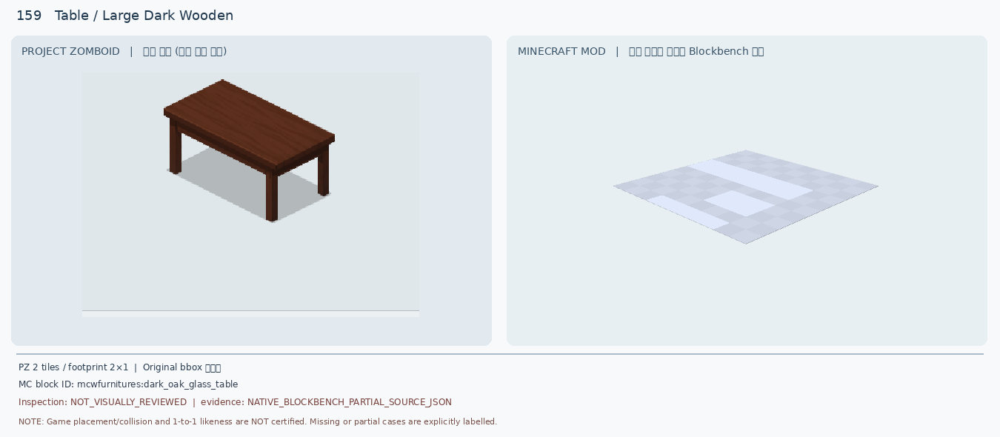
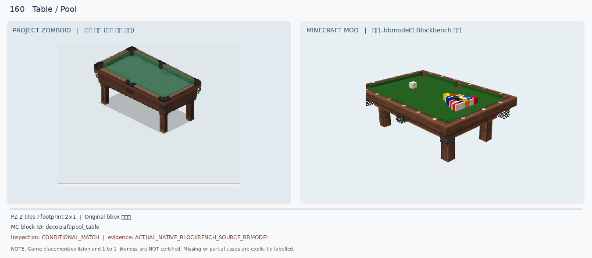

# 151–160 · 로즈우드 가구 이미지 대조

[전체 357종 목록](../README.md) · [원본 검수 PR #258](https://github.com/sanato-nb/PZ_Tile_Analysis/pull/258)

오른쪽 후보는 게임 적용이 확정된 모델이 아니야. **보류**는 추가 탐색 대상이야.

## 151 · Radio / ValuTech

**보류 · 재탐색** · [원본 PR #258](https://github.com/sanato-nb/PZ_Tile_Analysis/pull/258)

No actual MC radio source/model found in existing inspected candidate list; do not invent a radio model

---

## 152 · Shower / Deluxe

**보류 · 재탐색** · [원본 PR #258](https://github.com/sanato-nb/PZ_Tile_Analysis/pull/258)

MC render shows only a small rectangular red/grey handle, not tray, plumbing or shower head

---

## 153 · Shelves / Beige Rack Shop

**보류 · 재탐색** · [원본 PR #258](https://github.com/sanato-nb/PZ_Tile_Analysis/pull/258)

MC single orange/brown blocky shelf has solid sides and no continuous 4x1 open rack geometry

---

## 154 · Barbecue / Charcoal

**보류 · 재탐색** · [원본 PR #258](https://github.com/sanato-nb/PZ_Tile_Analysis/pull/258)

MC partial render is separated tall grey post and black cuboid; no red dome, kettle bowl or tripod

---

## 155 · Counter / White Floating

**보류 · 재탐색** · [원본 PR #258](https://github.com/sanato-nb/PZ_Tile_Analysis/pull/258)

MC model is an open white bathroom counter with wood top and visible shelves/bottles; not a closed hanging cabinet

---

## 156 · Shelves / Corner A

**보류 · 재탐색** · [원본 PR #258](https://github.com/sanato-nb/PZ_Tile_Analysis/pull/258)

MC orange closed boxy cubby is not three open protruding shelves; left/right geometry unverified

---

## 157 · Shelves / Corner B

**보류 · 재탐색** · [원본 PR #258](https://github.com/sanato-nb/PZ_Tile_Analysis/pull/258)

Same MC candidate reused for opposite PZ end; cannot encode both handed variants as shown

---

## 158 · Shelves / Middle

**보류 · 재탐색** · [원본 PR #258](https://github.com/sanato-nb/PZ_Tile_Analysis/pull/258)

MC full orange solid cabinet/shelf body with thick top and sides, not open center piece

---

## 159 · Table / Large Dark Wooden

**보류 · 재탐색** · [원본 PR #258](https://github.com/sanato-nb/PZ_Tile_Analysis/pull/258)

MC proof renders a pale flat glass-textured plane, no dark wooden top or legs; partial model

---

## 160 · Table / Pool

**조건부 후보** · [원본 PR #258](https://github.com/sanato-nb/PZ_Tile_Analysis/pull/258)

MC has recognisable matching felt/wood/legs/pockets but visible coloured racked balls and cue ball; prior MC model bounds ~3x2 blocks versus PZ 2x1

---

