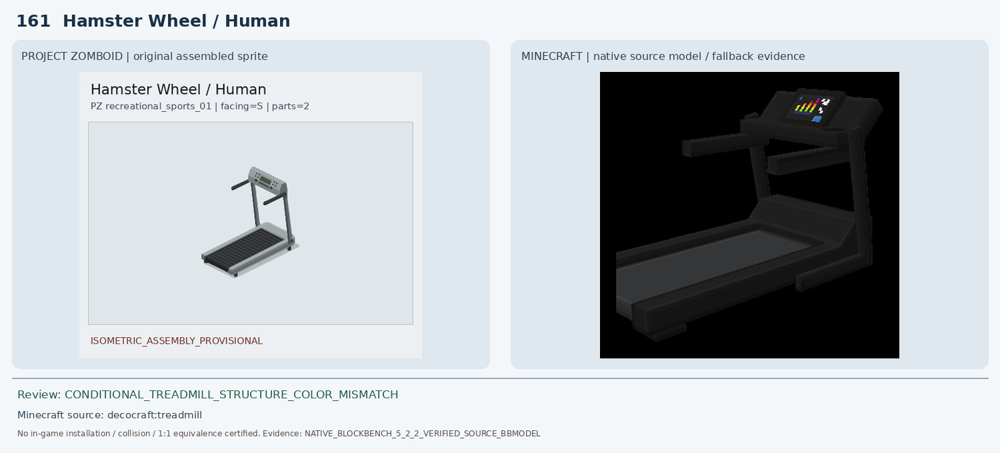
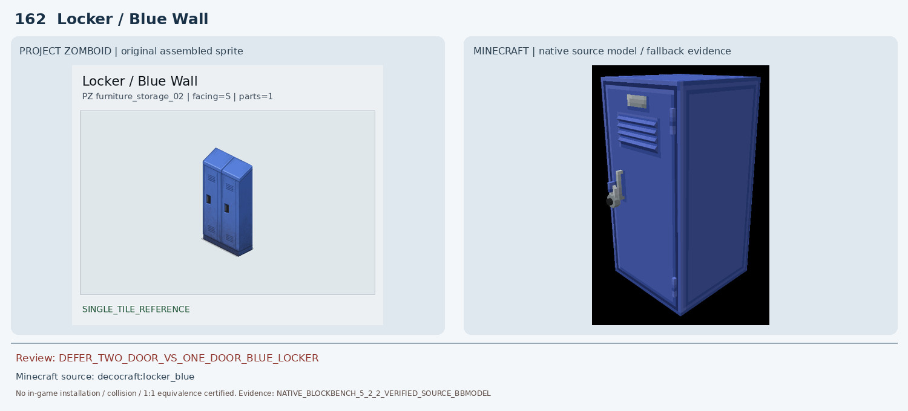
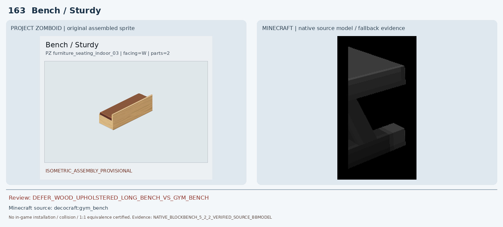
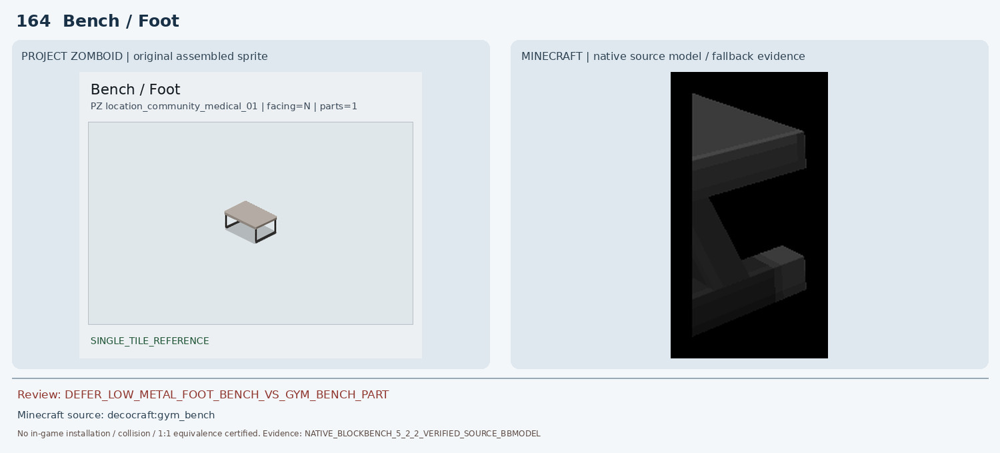
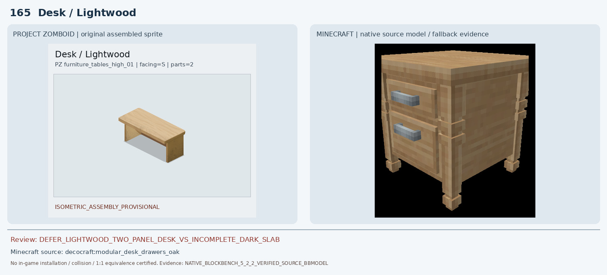
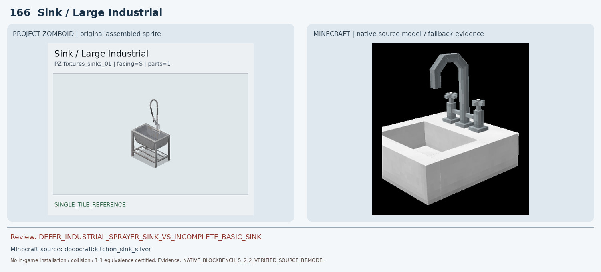
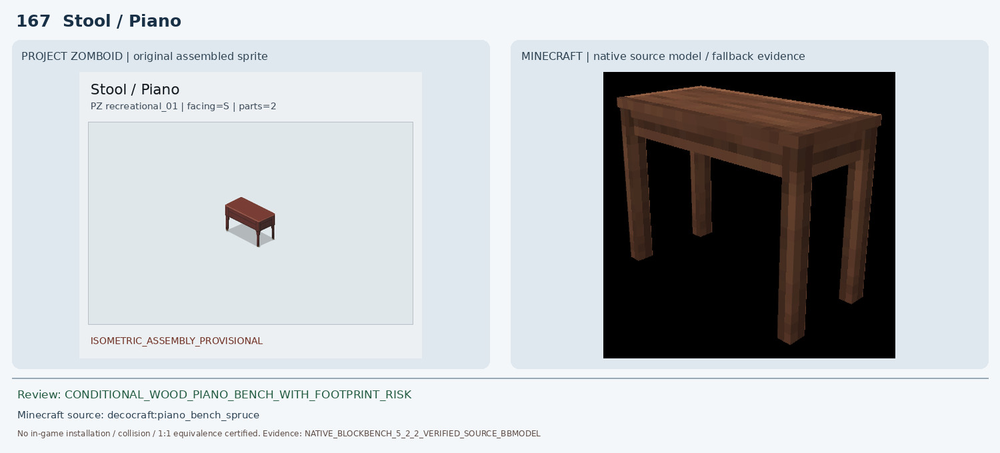
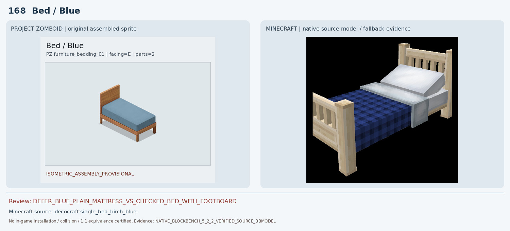
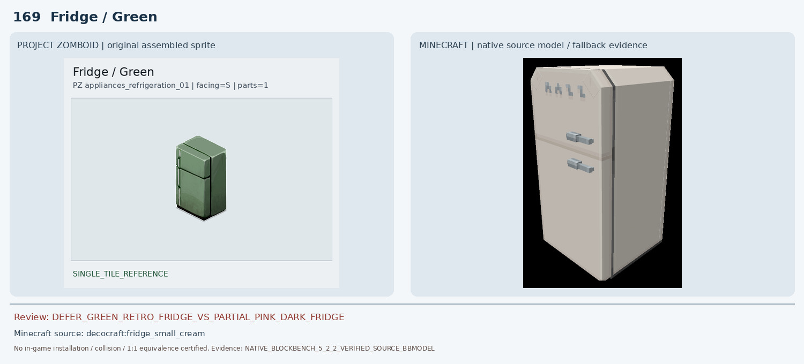
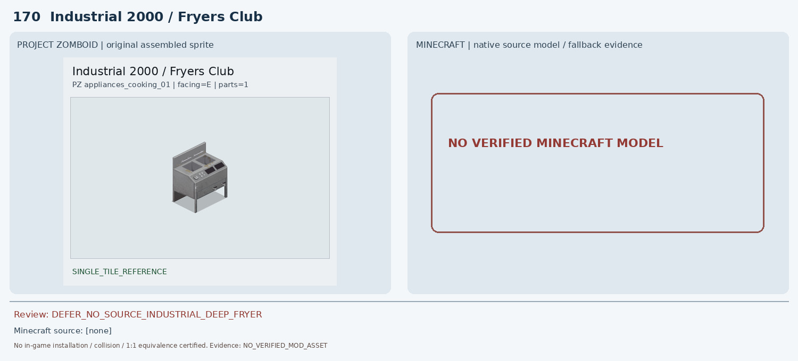

# 161–170 · 로즈우드 가구 이미지 대조

[전체 357종 목록](../README.md) · [원본 검수 PR #256](https://github.com/sanato-nb/PZ_Tile_Analysis/pull/256)

오른쪽 후보는 게임 적용이 확정된 모델이 아니야. **보류**는 추가 탐색 대상이야.

## 161 · Hamster Wheel / Human

**조건부 후보** · [원본 PR #256](https://github.com/sanato-nb/PZ_Tile_Analysis/pull/256)

PZ 완성형과 Decocraft Treadmill 원본 BBMODEL 모두 러닝 벨트·전면 콘솔·좌우 손잡이·지지대가 있는 같은 가구 유형이다. 다만 PZ는 은회색 프레임/검정 벨트, Minecraft는 거의 전체가 검정이고 콘솔과 벨트 비례가 다르다. 기존 Casino Wheel 자동 후보는 가구 종류 자체가 달라 반려한다. 구조가 가까운 조건부 대안만.

---

## 162 · Locker / Blue Wall

**보류 · 재탐색** · [원본 PR #256](https://github.com/sanato-nb/PZ_Tile_Analysis/pull/256)

Decocraft Locker Blue 실제 원본은 색과 금속 캐비닛 높이, 통풍구는 비슷하지만 큰 문 하나, 긴 외부 손잡이 하나, 상단 이름표가 있다. PZ의 두 개 문과 각 매립 손잡이 구조가 빠져 있다. 동일한 1×1 블록에 두 문을 표현할 수 있는지 확인 전까지 보류.

---

## 163 · Bench / Sturdy

**보류 · 재탐색** · [원본 PR #256](https://github.com/sanato-nb/PZ_Tile_Analysis/pull/256)

PZ는 긴 밝은 목재 외장·갈색 쿠션·한쪽 긴 측판이 있는 1×2 벤치다. 실제 Decocraft Gym Bench BBMODEL(7큐브) Blockbench 화면은 검정색 금속 운동기구의 왼쪽 일부만 나타나며, 긴 나무 외장과 등받이/쿠션이 없다. 화면 밖 잘림 또는 원본 모델의 파트 누락 가능성까지 있어 완성형 대체로 인증할 수 없다.

---

## 164 · Bench / Foot

**보류 · 재탐색** · [원본 PR #256](https://github.com/sanato-nb/PZ_Tile_Analysis/pull/256)

PZ는 회색 평판 상판과 두 개의 가느다란 검정 금속 U자 프레임으로 된 1×1 낮은 발받침이다. Decocraft Gym Bench 원본 7큐브 렌더는 검은 체육기구의 한쪽만 나타나 회색 상판·U자 지지대 두 개와 맞지 않는다. 163번 목재 벤치와 동일 MC ID를 부여한 자동 매칭은 형태를 구분하지 못한 오류다.

---

## 165 · Desk / Lightwood

**보류 · 재탐색** · [원본 PR #256](https://github.com/sanato-nb/PZ_Tile_Analysis/pull/256)

PZ는 2×1 밝은 목재의 긴 책상으로, 서랍 없는 평판 상판과 양 끝 두 개의 넓은 판자 다리가 보인다. 기존 Macaw Acacia Covered Desk 자동 캡처는 검은 수직 판자 하나만 보여 불완전하다. 새로 원본 Decocraft Modular Desk Drawers Oak BBMODEL(50큐브)을 Blockbench로 렌더했더니 작은 1×1 목재 서랍장(전면 은색 손잡이 두 개)이며 긴 상판·양끝 판자 다리·열린 하부 공간이 전혀 없다. 따라서 새 후보도 반려한다.

---

## 166 · Sink / Large Industrial

**보류 · 재탐색** · [원본 PR #256](https://github.com/sanato-nb/PZ_Tile_Analysis/pull/256)

PZ는 스테인리스 산업용 독립 싱크대(깊은 금속 볼, 4개의 금속 다리, 아래 철제 선반, 높게 굽은 스프링 분무 호스)다. 기존 Paladin Basic Sink 부분 렌더는 노란 수평판만 나타났다. 새로 Decocraft Kitchen Sink Silver 원본 BBMODEL(23큐브)을 실제 렌더한 결과 흰색 도기 사각 싱크와 짧은 고정형 수전만 있으며 금속 4다리·하부 선반·산업용 호스가 없다. 색·재질·구조가 달라 반려한다.

---

## 167 · Stool / Piano

**조건부 후보** · [원본 PR #256](https://github.com/sanato-nb/PZ_Tile_Analysis/pull/256)

기존 Macaw Acacia Stool Chair 캡처는 얇은 상판만 보여 다리 4개와 완성형 벤치 구조가 누락됐다. Decocraft Piano Bench Spruce의 실제 원본 Blockbench 화면은 등받이 없는 짙은 갈색 평판 좌판과 네 개 목재 다리를 완전하게 보여 PZ와 외형 종류가 유사하다. 그러나 PZ는 2×1이며 Minecraft 모델의 실제 설치 길이/좌판 비율과 색감은 다를 수 있어 조건부만.

---

## 168 · Bed / Blue

**보류 · 재탐색** · [원본 PR #256](https://github.com/sanato-nb/PZ_Tile_Analysis/pull/256)

Decocraft Single Bed Birch Blue 실제 BBMODEL은 같은 단층 침대이고 파란 이불이 있지만 높은 세로살 머리판과 발치 울타리, 흰 베개와 체크무늬 짙은 남색 이불을 포함한다. PZ의 단순한 민무늬 회청색 매트리스와 평판 머리판/발치 무울타리 구조가 달라 색상 유사만으로 승인하지 않는다.

---

## 169 · Fridge / Green

**보류 · 재탐색** · [원본 PR #256](https://github.com/sanato-nb/PZ_Tile_Analysis/pull/256)

기존 Refurbished Dark Fridge Blockbench 캡처는 분홍색 측면과 검은 전면의 일부 그래픽으로만 보이며 PZ의 초록색 두 문 냉장고 완성형을 보여주지 못한다. Decocraft Small Cream은 두 칸 구조만 비슷하고 색이 크림색이며 PZ의 레트로 곡면과 경첩/손잡이 위치가 달라 보류.

---

## 170 · Industrial 2000 / Fryers Club

**보류 · 재탐색** · [원본 PR #256](https://github.com/sanato-nb/PZ_Tile_Analysis/pull/256)

기존 7개 모드 JAR의 자동 매칭 결과에는 검증된 실제 Minecraft 모델이 없다. 이름 Industrial 2000을 일반 오븐으로 대체하면 깊은 튀김조·배수/온도조절 패널·산업용 다리 구조가 사라지므로 후보를 임의 생성하거나 승인하지 않는다.

---

