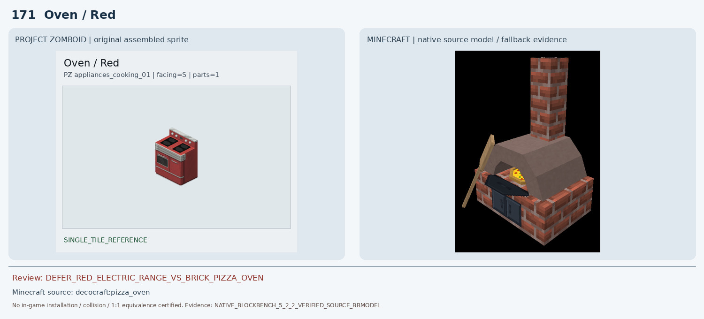
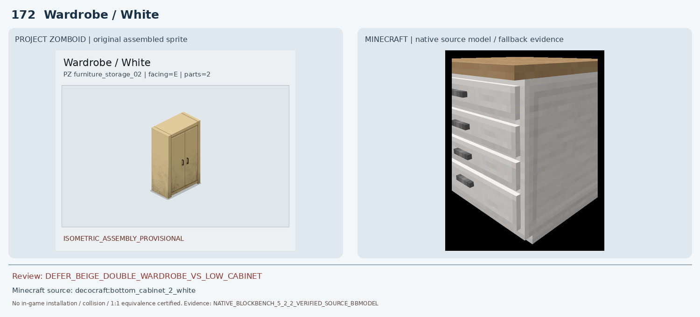
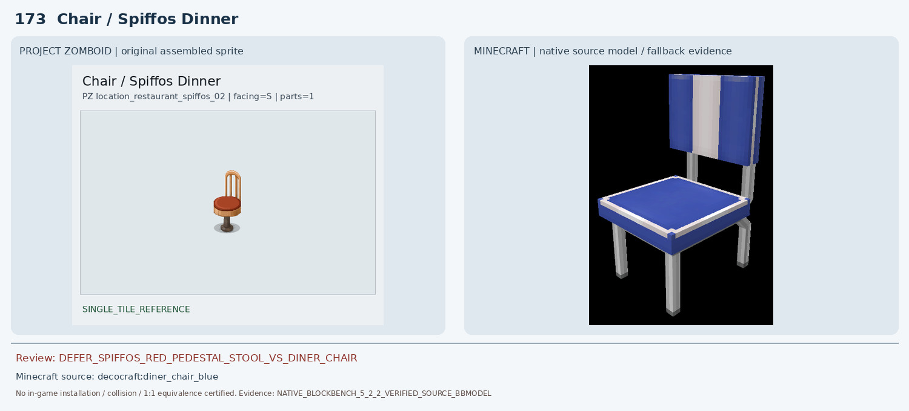
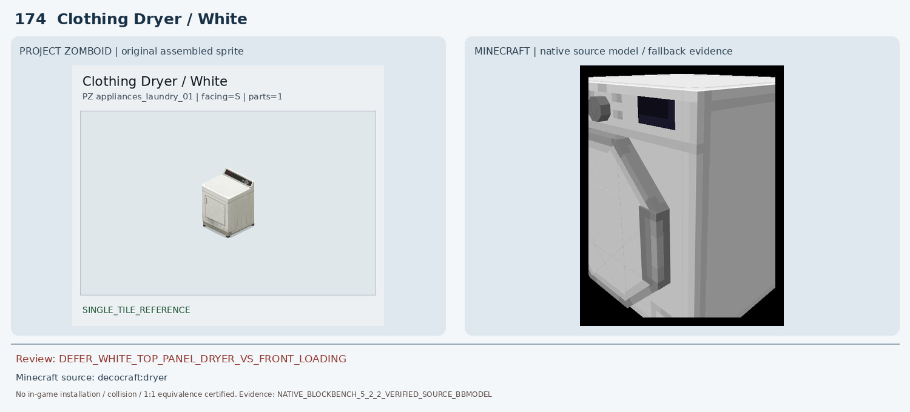
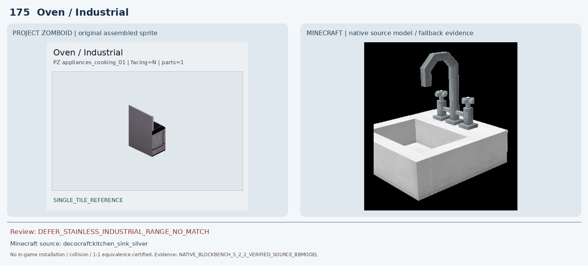
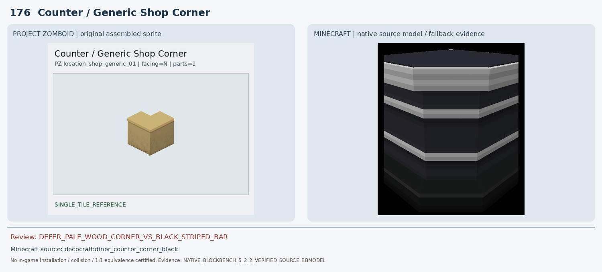
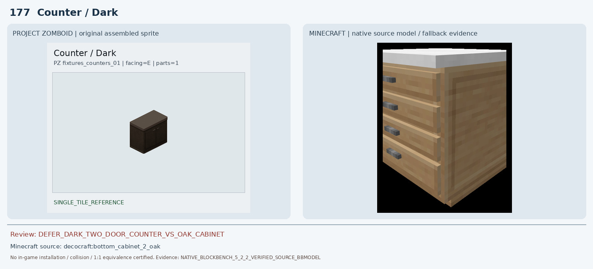
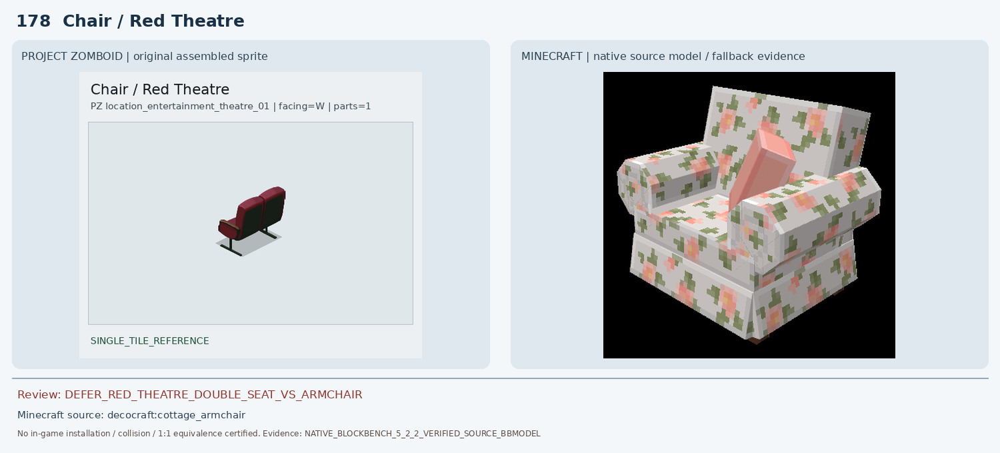
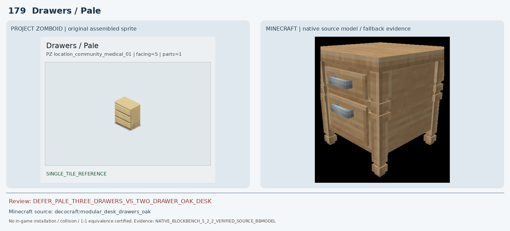
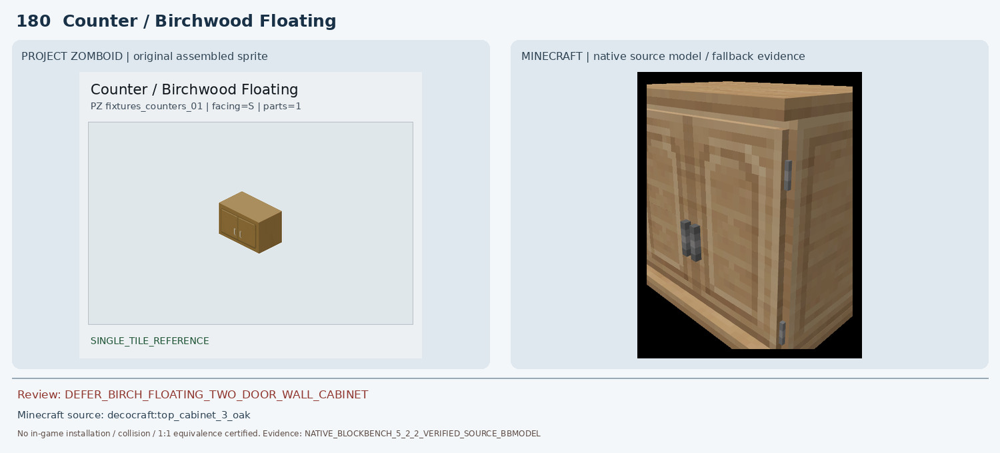

# 171–180 · 로즈우드 가구 이미지 대조

[전체 357종 목록](../README.md) · [원본 검수 PR #260](https://github.com/sanato-nb/PZ_Tile_Analysis/pull/260)

오른쪽 후보는 게임 적용이 확정된 모델이 아니야. **보류**는 추가 탐색 대상이야.

## 171 · Oven / Red

**보류 · 재탐색** · [원본 PR #260](https://github.com/sanato-nb/PZ_Tile_Analysis/pull/260)

기존 decocraft:pizza_oven 네이티브 렌더는 벽돌 화덕+굴뚝+장작형 불구멍이며 PZ 붉은 전기레인지의 금속 본체, 버너, 다이얼, 오븐문이 모두 없다. 화덕을 전기레인지로 승인할 수 없다.

---

## 172 · Wardrobe / White

**보류 · 재탐색** · [원본 PR #260](https://github.com/sanato-nb/PZ_Tile_Analysis/pull/260)

기존 Macaw Acacia Double Wardrobe는 회색 외장/주황 문으로 원본과 색이 정반대. 새 후보 Decocraft White Bottom Cabinet은 밝은 색은 유사해도 높이가 낮은 주방장으로 높은 옷장과 문/손잡이 배치가 다르다.

---

## 173 · Chair / Spiffos Dinner

**보류 · 재탐색** · [원본 PR #260](https://github.com/sanato-nb/PZ_Tile_Analysis/pull/260)

기존 pfm:arm_chair_leather 네이티브 비교는 회색 직육면체 일부만 보이는 불완전 모델이라 좌석 형태를 확인할 수 없다. Decocraft Diner Chair Blue는 다리/등받이/좌판 재질·색·중앙 받침 구조가 다른 일반 의자 후보여서 1:1 아님.

---

## 174 · Clothing Dryer / White

**보류 · 재탐색** · [원본 PR #260](https://github.com/sanato-nb/PZ_Tile_Analysis/pull/260)

Blockbench 5.2.2에서 새로 렌더한 Decocraft Dryer는 전면 상단 디지털 화면·왼쪽 다이얼, 전면의 사선 큰 손잡이와 각진 패널이 확인된다. PZ는 뒤쪽 상단으로 솟은 검은 제어판과 전면 왼쪽의 작은 세로 손잡이, 단순 직사각형 문을 가진다. 같은 건조기 계열이지만 조작부 위치·도어/손잡이 구조가 달라 1:1 승인 불가.

---

## 175 · Oven / Industrial

**보류 · 재탐색** · [원본 PR #260](https://github.com/sanato-nb/PZ_Tile_Analysis/pull/260)

기존 Decocraft Pizza Oven은 벽돌 화덕과 굴뚝이 있는 전혀 다른 종류. 추가 스테인리스 주방 설비 후보 Kitchen Sink Silver도 싱크대이므로 조리 그릴·오븐문·높은 측면 판을 재현하지 못한다. 후보 불승인.

---

## 176 · Counter / Generic Shop Corner

**보류 · 재탐색** · [원본 PR #260](https://github.com/sanato-nb/PZ_Tile_Analysis/pull/260)

Decocraft Diner Counter Corner Black은 L형 상판과 코너 체적은 비슷하지만 검정·흰색 가로 줄무늬 금속/플라스틱 바 형태로 나무 질감·색상과 일치하지 않는다.

---

## 177 · Counter / Dark

**보류 · 재탐색** · [원본 PR #260](https://github.com/sanato-nb/PZ_Tile_Analysis/pull/260)

기존 Macaw Acacia Counter는 주황 상판+회색 석재 측면으로 원본과 재질 불일치. Decocraft Bottom Cabinet 2 Oak는 수납장 계열이지만 밝은 참나무 색과 문·서랍 배치가 달라 어두운 2도어 카운터 대체로 승인 불가.

---

## 178 · Chair / Red Theatre

**보류 · 재탐색** · [원본 PR #260](https://github.com/sanato-nb/PZ_Tile_Analysis/pull/260)

기존 Paladin Oak Chair Classic Red는 막대 프레임 일부만 렌더되어 의자 전체를 입증하지 못한다. 새 Decocraft Cottage Armchair는 꽃무늬 쿠션과 크고 둥근 양팔걸이의 1인 가정용 의자이며, PZ 극장식 붉은 등받이/검정 금속 다리·연결형 구조와 다르다. PZ 좌석 개수는 추가 확인이 필요하다.

---

## 179 · Drawers / Pale

**보류 · 재탐색** · [원본 PR #260](https://github.com/sanato-nb/PZ_Tile_Analysis/pull/260)

새 Blockbench 원본 렌더에서 Decocraft Modular Desk Drawers Oak는 전면 두 개의 큰 서랍, 돌출 회색 손잡이 두 개, 장식된 네 기둥/다리로 구성된다. PZ는 밝은 베이지 직육면체에 세 개의 얇은 수평 서랍과 돌출 손잡이 없는 평면이므로 서랍 수·손잡이·프레임이 명백히 다르다.

---

## 180 · Counter / Birchwood Floating

**보류 · 재탐색** · [원본 PR #260](https://github.com/sanato-nb/PZ_Tile_Analysis/pull/260)

기존 Macaw Birch Counter는 흰 회색 석재 본체+나무 상판의 바닥 설치 블록이어서 원본과 다름. Decocraft Top Cabinet 3 Oak는 벽 부착형 주방 수납장 종류지만 문 분할, 손잡이 수, 길이와 상판 색상 일치가 검증되지 않아 확정 불가.

---

