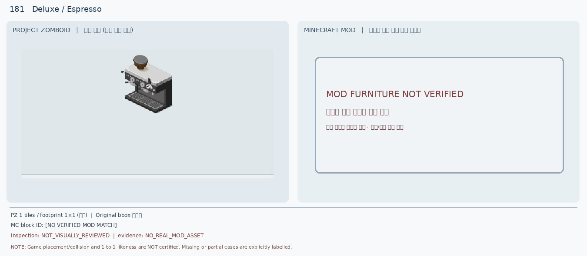
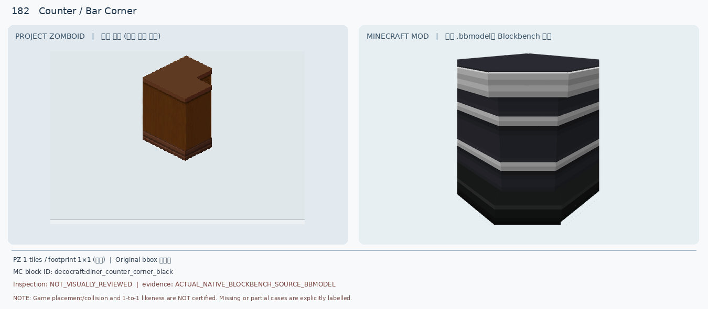
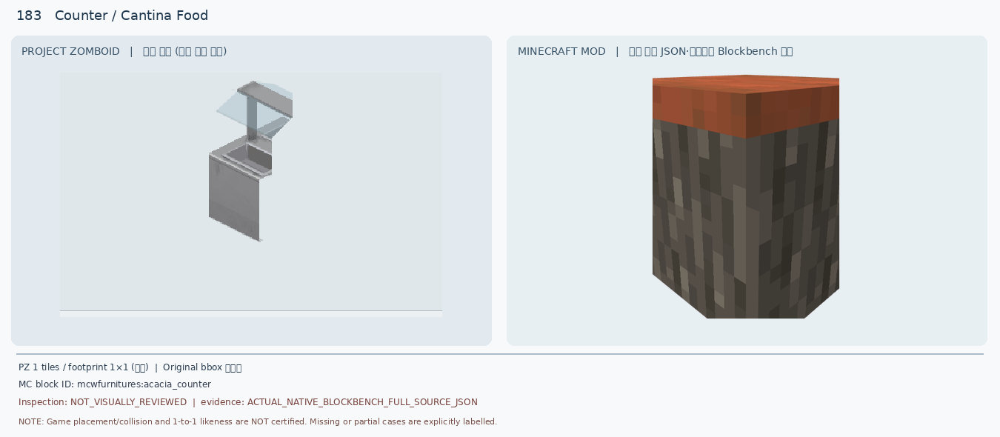
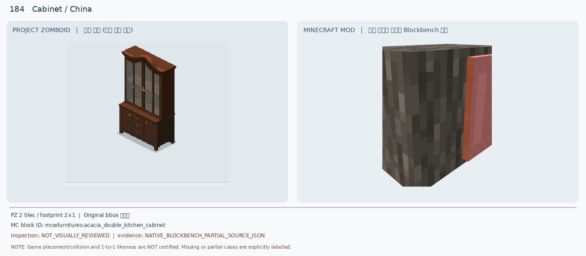
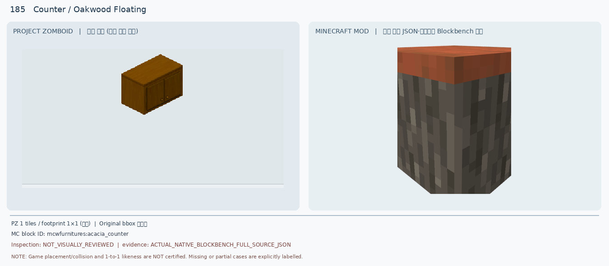
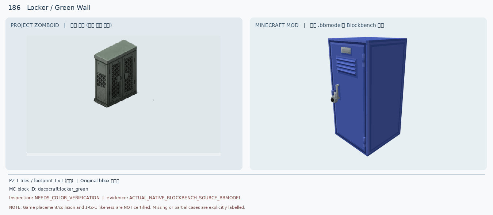
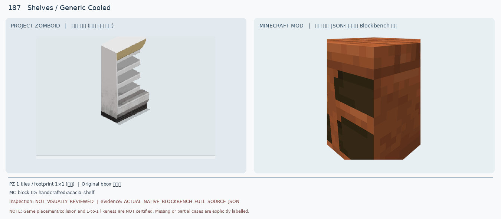
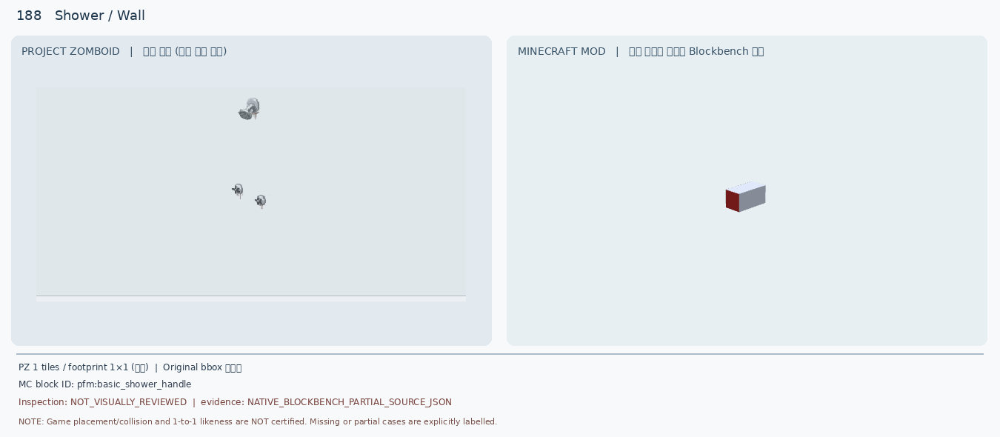
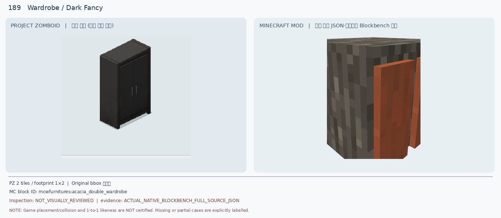
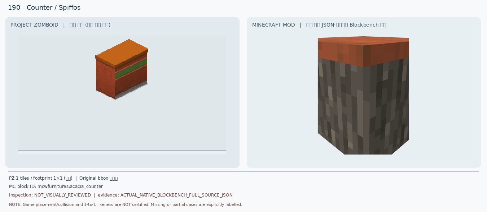

# 181–190 · 로즈우드 가구 이미지 대조

[전체 357종 목록](../README.md) · [원본 검수 PR #261](https://github.com/sanato-nb/PZ_Tile_Analysis/pull/261)

오른쪽 후보는 게임 적용이 확정된 모델이 아니야. **보류**는 추가 탐색 대상이야.

## 181 · Deluxe / Espresso

**보류 · 재탐색** · [원본 PR #261](https://github.com/sanato-nb/PZ_Tile_Analysis/pull/261)

---

## 182 · Counter / Bar Corner

**보류 · 재탐색** · [원본 PR #261](https://github.com/sanato-nb/PZ_Tile_Analysis/pull/261)

---

## 183 · Counter / Cantina Food

**보류 · 재탐색** · [원본 PR #261](https://github.com/sanato-nb/PZ_Tile_Analysis/pull/261)

---

## 184 · Cabinet / China

**보류 · 재탐색** · [원본 PR #261](https://github.com/sanato-nb/PZ_Tile_Analysis/pull/261)

---

## 185 · Counter / Oakwood Floating

**보류 · 재탐색** · [원본 PR #261](https://github.com/sanato-nb/PZ_Tile_Analysis/pull/261)

---

## 186 · Locker / Green Wall

**보류 · 재탐색** · [원본 PR #261](https://github.com/sanato-nb/PZ_Tile_Analysis/pull/261)

---

## 187 · Shelves / Generic Cooled

**보류 · 재탐색** · [원본 PR #261](https://github.com/sanato-nb/PZ_Tile_Analysis/pull/261)

---

## 188 · Shower / Wall

**보류 · 재탐색** · [원본 PR #261](https://github.com/sanato-nb/PZ_Tile_Analysis/pull/261)

---

## 189 · Wardrobe / Dark Fancy

**보류 · 재탐색** · [원본 PR #261](https://github.com/sanato-nb/PZ_Tile_Analysis/pull/261)

---

## 190 · Counter / Spiffos

**보류 · 재탐색** · [원본 PR #261](https://github.com/sanato-nb/PZ_Tile_Analysis/pull/261)

---

