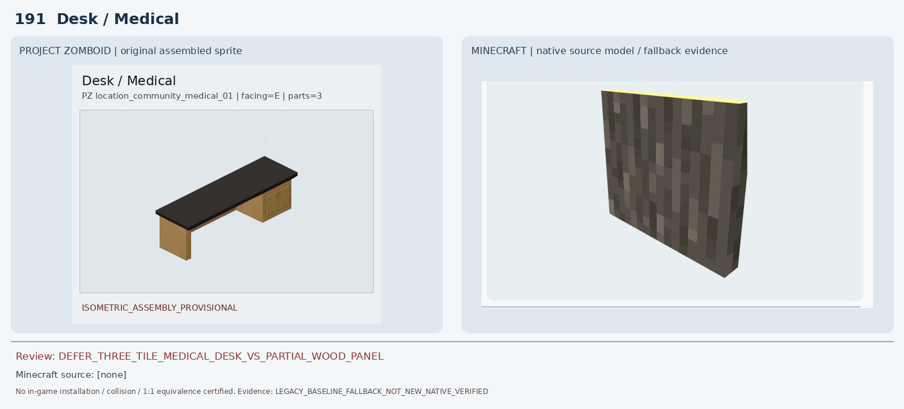
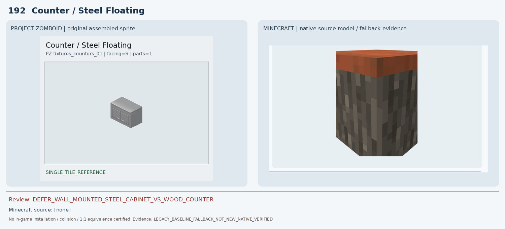
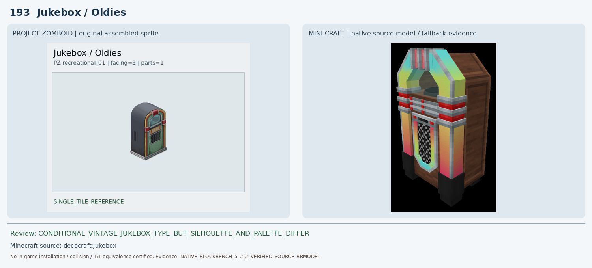
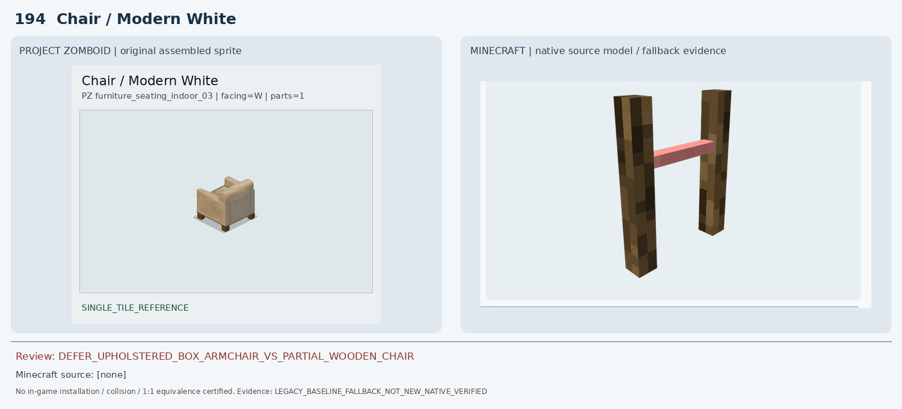
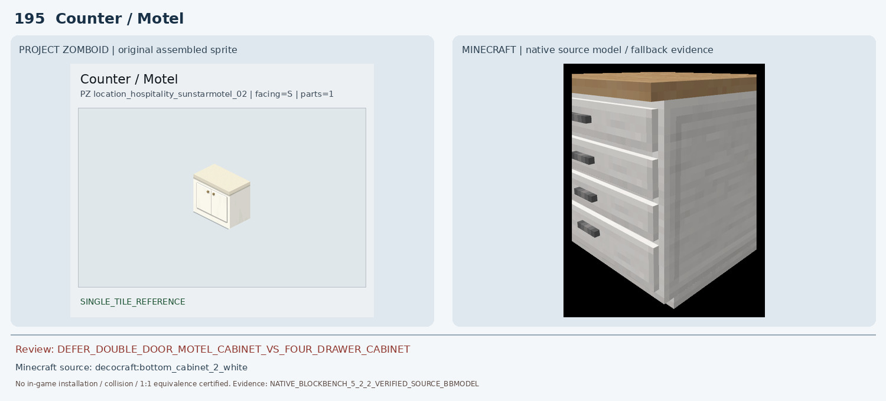
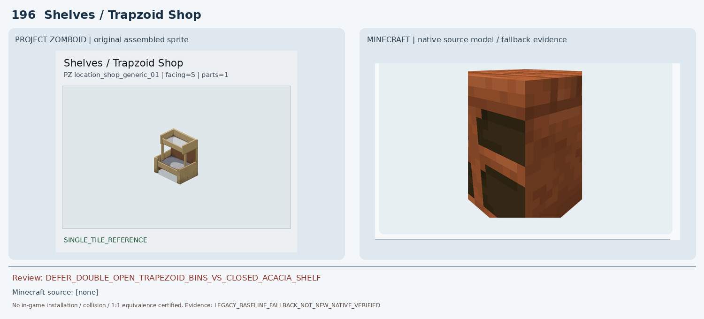
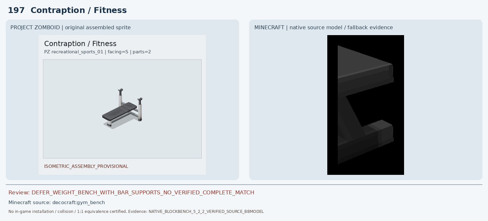
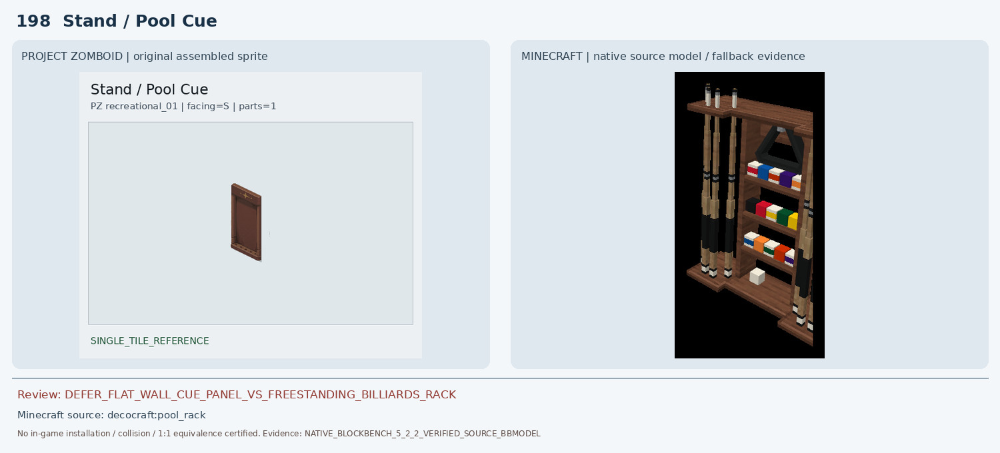
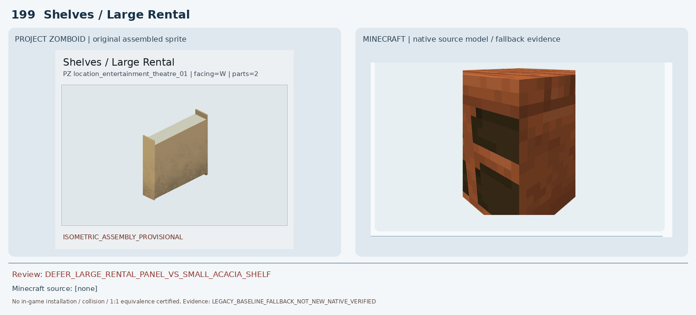
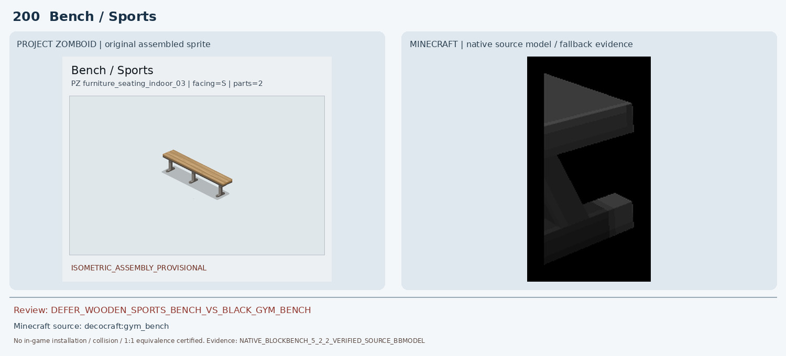

# 191–200 · 로즈우드 가구 이미지 대조

[전체 357종 목록](../README.md) · [원본 검수 PR #259](https://github.com/sanato-nb/PZ_Tile_Analysis/pull/259)

오른쪽 후보는 게임 적용이 확정된 모델이 아니야. **보류**는 추가 탐색 대상이야.

## 191 · Desk / Medical

**보류 · 재탐색** · [원본 PR #259](https://github.com/sanato-nb/PZ_Tile_Analysis/pull/259)

실제 PZ 완성형과 기존 mcwfurnitures:acacia_covered_desk Blockbench 화면을 비교하면 오른쪽에는 책상 전체가 아닌 세로 목재판 한 장만 보인다. 검정 긴 상판·우측 2문 수납장·1×3 조립 근거가 모두 빠져 원본 후보는 부적합.

---

## 192 · Counter / Steel Floating

**보류 · 재탐색** · [원본 PR #259](https://github.com/sanato-nb/PZ_Tile_Analysis/pull/259)

PZ는 금속 벽걸이 이중문 캐비닛인데 기존 mcwfurnitures:acacia_counter 렌더는 갈색 상판과 어두운 목재의 바닥형 카운터. 재질·문·벽면 부착 방식·높이 모두 불일치.

---

## 193 · Jukebox / Oldies

**조건부 후보** · [원본 PR #259](https://github.com/sanato-nb/PZ_Tile_Analysis/pull/259)

PZ 완성형과 Decocraft jukebox의 원본 BBMODEL을 Blockbench 5.2.2로 재렌더한 화면(50 cubes)을 직접 대조했다. 둘 다 빈티지 주크박스이고 아치형 상단·전면 장식·하단 캐비닛이 있지만, Minecraft는 민트·노랑·빨강 네온과 나무 측면, PZ는 회색 둥근 돔과 초록색 하단/검정 전면이다. 크기·음악 재생·1:1 외형은 미검증이므로 조건부만.

---

## 194 · Chair / Modern White

**보류 · 재탐색** · [원본 PR #259](https://github.com/sanato-nb/PZ_Tile_Analysis/pull/259)

PZ는 폭이 넓은 천 쿠션형 암체어인데 기존 pfm:oak_chair_classic_white 네이티브 캡처에는 두 나무 기둥과 분홍 가로막대만 보이며 쿠션·좌판·등받이·팔걸이 전체가 빠져 있다. 부분 모델은 대체 근거로 부적합.

---

## 195 · Counter / Motel

**보류 · 재탐색** · [원본 PR #259](https://github.com/sanato-nb/PZ_Tile_Analysis/pull/259)

기존 mcwfurnitures:acacia_counter는 붉은 상판과 어두운 목재로 PZ 크림색 이중문 캐비닛과 다르다. 추가로 Decocraft bottom_cabinet_2_white의 실제 원본 BBMODEL 11 cubes를 Blockbench로 새로 렌더한 결과, 흰색 몸통과 밝은 상판은 비슷하나 전면에 수평 손잡이 달린 서랍 4개가 있고 PZ의 세로 여닫이문 2개·황동색 둥근 손잡이 2개가 없다. 따라서 추가 후보도 반려.

---

## 196 · Shelves / Trapzoid Shop

**보류 · 재탐색** · [원본 PR #259](https://github.com/sanato-nb/PZ_Tile_Analysis/pull/259)

PZ 원본은 두 개의 위로 열린 목재 진열 바구니인데 기존 handcrafted:acacia_shelf 네이티브 화면은 갈색 직육면체 측면에 검은 사각 개구부 두 개가 있는 캐비닛 형태. 진열 상자 깊이·측판·전면 구조가 불일치.

---

## 197 · Contraption / Fitness

**보류 · 재탐색** · [원본 PR #259](https://github.com/sanato-nb/PZ_Tile_Analysis/pull/259)

PZ는 검정 쿠션 벤치에 높은 은회색 바벨 거치 기둥 2개가 달린 1×2 벤치프레스 기구다. Decocraft gym_bench 실제 원본 BBMODEL 7 cubes를 Blockbench 5.2.2로 새로 렌더했지만 화면에는 검은 좌판과 한쪽 지지대 일부만 보이고 바벨 거치대 2개가 확인되지 않는다. 원본 모델 전체가 캡처되었는지도 불확실하여 승인하지 않는다.

---

## 198 · Stand / Pool Cue

**보류 · 재탐색** · [원본 PR #259](https://github.com/sanato-nb/PZ_Tile_Analysis/pull/259)

PZ 원본은 금색 장식이 있는 얇은 갈색 벽걸이 판자형 큐 스탠드지만 Decocraft pool_rack 실제 원본 BBMODEL 59 cubes의 재렌더는 바닥형 넓은 나무 랙과 여러 큐대·삼각대·컬러 볼 진열을 보여준다. 종류는 연관되어도 폭·깊이·벽 부착 여부·물체 수가 달라 기존 조건부 판정을 보류로 하향한다.

---

## 199 · Shelves / Large Rental

**보류 · 재탐색** · [원본 PR #259](https://github.com/sanato-nb/PZ_Tile_Analysis/pull/259)

PZ 조립 미리보기에는 길고 높은 밝은 베이지색 판 구조가 보이는데 handcrafted:acacia_shelf 원본 렌더는 작은 짙은 적갈색 1블록 선반 캐비닛으로 색상·비율·길이·전면 구조가 다르다. PZ 뒷면이 보이는지 추가 시점 확인 필요.

---

## 200 · Bench / Sports

**보류 · 재탐색** · [원본 PR #259](https://github.com/sanato-nb/PZ_Tile_Analysis/pull/259)

PZ는 2×1 길이의 밝은 목재 좌판과 은회색 금속 다리 3개가 있는 스포츠 벤치다. Decocraft gym_bench 실제 원본 BBMODEL 7 cubes 재렌더는 검은 운동기구 좌판과 한쪽 다리 일부만 보여 목재 재질·세 지지대·2블록 길이와 맞지 않는다. 197 헬스기구와 200 목재 벤치를 같은 Minecraft gym_bench로 자동 매칭한 오류를 확인했다.

---

