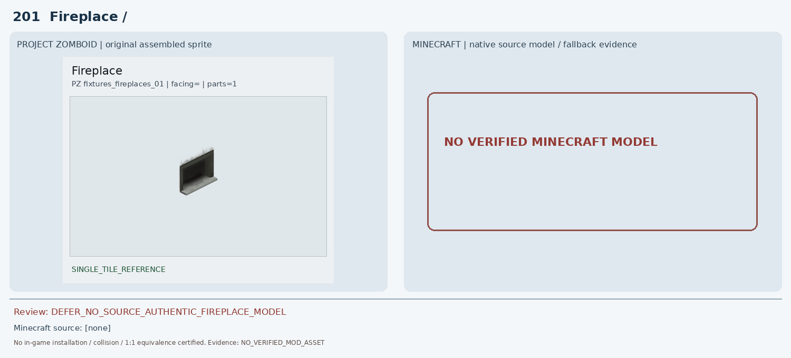
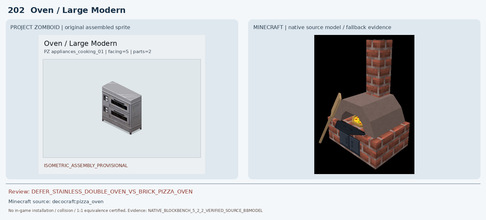
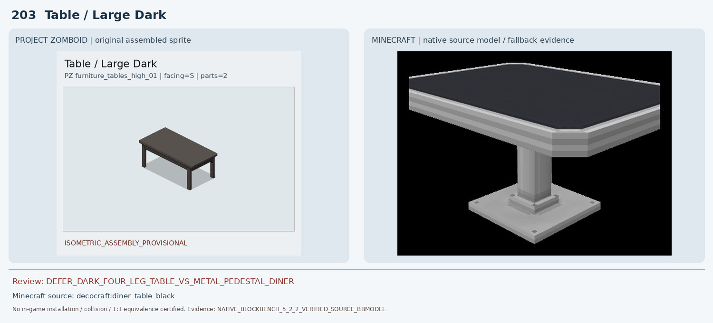
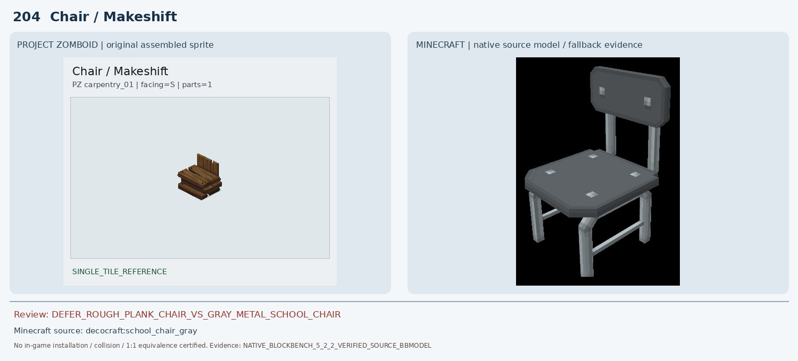
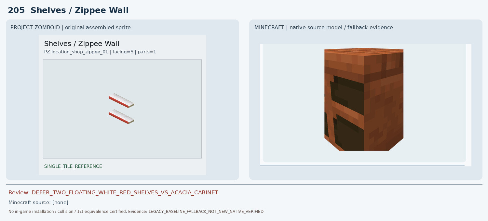
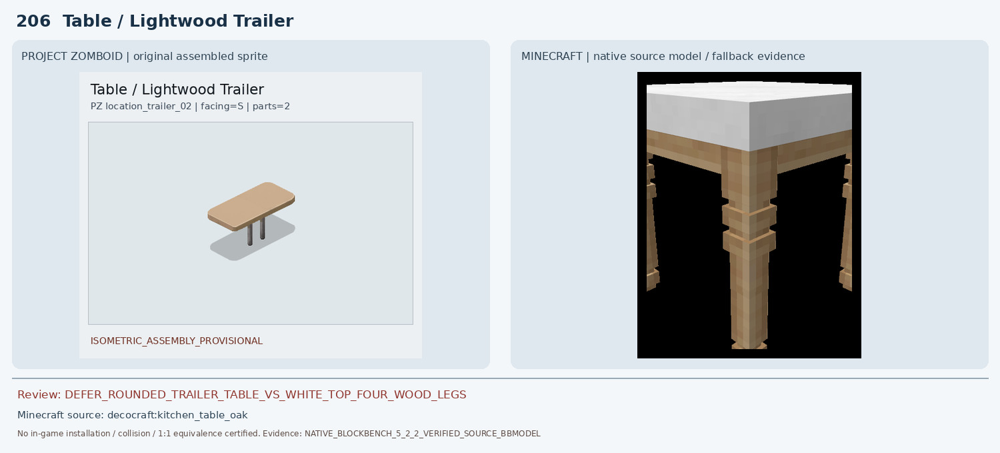
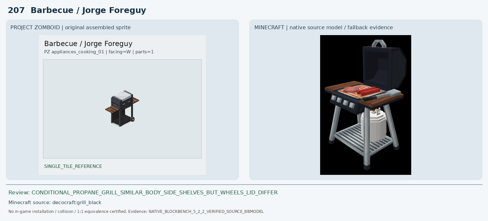
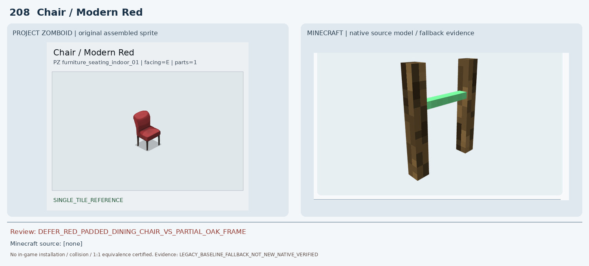
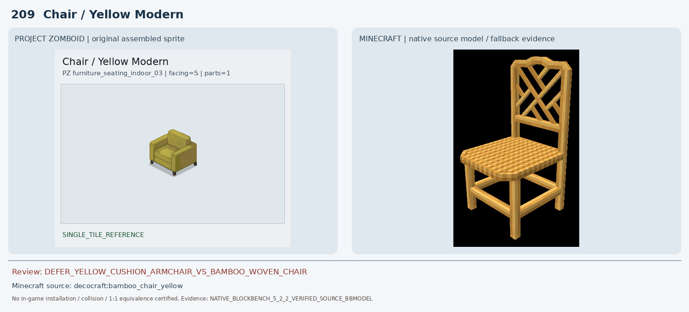
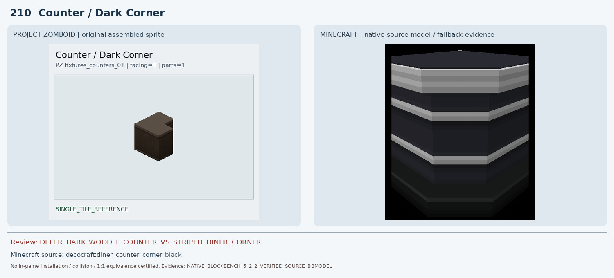

# 201–210 · 로즈우드 가구 이미지 대조

[전체 357종 목록](../README.md) · [원본 검수 PR #262](https://github.com/sanato-nb/PZ_Tile_Analysis/pull/262)

오른쪽 후보는 게임 적용이 확정된 모델이 아니야. **보류**는 추가 탐색 대상이야.

## 201 · Fireplace / 기본

**보류 · 재탐색** · [원본 PR #262](https://github.com/sanato-nb/PZ_Tile_Analysis/pull/262)

PZ 원본 완성형을 직접 확인했으며 기존 357종 비교판에는 실제 Minecraft 모델이 없고 'MOD FURNITURE NOT VERIFIED'로 표시된다. 원본 자산을 확인하지 않은 상태에서 벽난로 모델을 임의 지정하지 않는다.

---

## 202 · Oven / Large Modern

**보류 · 재탐색** · [원본 PR #262](https://github.com/sanato-nb/PZ_Tile_Analysis/pull/262)

PZ 원본은 은색 스테인리스 2단 전기 오븐과 전면 검정 유리문 2개·좌측 조작 패널이다. 공식 Blockbench 5.2.2에서 실제 Decocraft pizza_oven BBMODEL 31 cubes를 다시 렌더해 확인했으나 붉은 벽돌 화덕, 높은 벽돌 굴뚝, 둥근 입구와 불꽃, 삽이 있는 완전히 다른 장치다. 2×1 점유와 전기 오븐 기능도 일치하지 않아 보류.

---

## 203 · Table / Large Dark

**보류 · 재탐색** · [원본 PR #262](https://github.com/sanato-nb/PZ_Tile_Analysis/pull/262)

기존 decocraft:table_setting_double 렌더는 접시·컵·수저만 있는 식기 장식이다. 새로 실제 Blockbench에서 diner_table_black(12 cubes)을 열어 보니 어두운 직사각 상판은 유사하지만 은색 테두리와 중앙 단일 금속 받침/넓은 발판이며 PZ의 짙은 목재 상판·네 모서리 가는 다리와 다르다. wooden_table_oak(25 cubes)도 네 다리 구조는 있으나 밝은 참나무 정사각 상판과 굵고 장식적인 다리로 PZ의 2×1 짙은 긴 테이블과 다르다.

---

## 204 · Chair / Makeshift

**보류 · 재탐색** · [원본 PR #262](https://github.com/sanato-nb/PZ_Tile_Analysis/pull/262)

기존 pfm:arm_chair_leather 네이티브 캡처는 회색 판 한 장만 보이는 부분 모델이다. 새 Decocraft school_chair_gray 원본 BBMODEL 37 cubes를 Blockbench로 렌더한 결과 얇은 회색 금속 네 다리, 평평한 금속 좌판과 분리된 회색 등받이의 교실 의자다. PZ의 두꺼운 거친 목재 널빤지 좌판, 판재 바닥 받침 및 짧은 판자 등받이와 형태·재질·높이가 불일치.

---

## 205 · Shelves / Zippee Wall

**보류 · 재탐색** · [원본 PR #262](https://github.com/sanato-nb/PZ_Tile_Analysis/pull/262)

기존 handcrafted:acacia_shelf의 실제 Blockbench 렌더는 두 개의 검은 개구부가 있는 두꺼운 적갈색 박스형 캐비닛이다. PZ의 개방형 얇은 2단 흰색 벽 선반과 재질·색상·깊이·부착 구조가 다르다.

---

## 206 · Table / Lightwood Trailer

**보류 · 재탐색** · [원본 PR #262](https://github.com/sanato-nb/PZ_Tile_Analysis/pull/262)

기존 mcwfurnitures:acacia_glass_table 네이티브 캡처는 얇은 나무판 한 장만 보이는 부분 렌더다. 새 Decocraft kitchen_table_oak BBMODEL 29 cubes는 흰색 상판과 밝은 참나무의 굵은 4다리 식탁으로 확인했다. PZ는 베이지색 모서리 둥근 1×2 길이 상판과 중앙 금속 기둥 2개이므로 상판 색·모서리·다리 수·재질·길이 모두 불일치.

---

## 207 · Barbecue / Jorge Foreguy

**조건부 후보** · [원본 PR #262](https://github.com/sanato-nb/PZ_Tile_Analysis/pull/262)

기존 refurbished_furniture:black_grill 캡처는 부분 소스만 보여 완성형 근거가 없다. 새로 Decocraft grill_black 원본 BBMODEL 70 cubes를 Blockbench 5.2.2로 열어 확인하니 검정 가스그릴 몸체, 양쪽 갈색 목재 보조 선반, 회색 프레임, 하부 선반이 PZ와 구조적으로 유사하다. 그러나 Minecraft는 뚜껑이 열린 검정색이며 내부 음식과 가스통이 보이고, PZ는 은회색 닫힌 둥근 뚜껑과 측면 바퀴가 있으며 Decocraft 화면에는 바퀴가 보이지 않는다. 따라서 1:1 승인 없이 조건부 후보만 유지한다.

---

## 208 · Chair / Modern Red

**보류 · 재탐색** · [원본 PR #262](https://github.com/sanato-nb/PZ_Tile_Analysis/pull/262)

기존 pfm:oak_chair_classic_red의 Blockbench 캡처는 갈색 수직 막대 2개와 연녹색 가로막대 1개뿐이며 빨간 쿠션·좌판·등받이가 없다. 부분 소스 로딩으로 보이므로 외형 일치 판정에 사용할 수 없다.

---

## 209 · Chair / Yellow Modern

**보류 · 재탐색** · [원본 PR #262](https://github.com/sanato-nb/PZ_Tile_Analysis/pull/262)

기존 pfm:froggy_chair_yellow 네이티브 캡처는 노란 평판 한 장뿐이다. 새 Decocraft bamboo_chair_yellow BBMODEL 30 cubes의 실제 렌더는 노란빛 대나무/라탄 짜임 좌판, X자 등받이, 높은 나무 네 다리, 팔걸이 없는 개방형 의자다. PZ의 두꺼운 겨자색 패브릭 팔걸이·쿠션 등받이·낮은 다리 1인 소파와 전혀 다르다.

---

## 210 · Counter / Dark Corner

**보류 · 재탐색** · [원본 PR #262](https://github.com/sanato-nb/PZ_Tile_Analysis/pull/262)

실제 Decocraft diner_counter_corner_black BBMODEL 11 cubes를 공식 Blockbench 5.2.2로 재렌더한 결과, 검정색 본체에 흰색/은색 가로 줄무늬가 반복되고 전면 모서리가 둥글게 꺾이는 다이너 카운터다. PZ는 어두운 갈색 나뭇결, 장식 없는 평평한 상판과 직각 안쪽 홈이 있는 L자 목재 코너다. 색·재질·모서리 및 인접 카운터 연결이 달라 보류.

---

