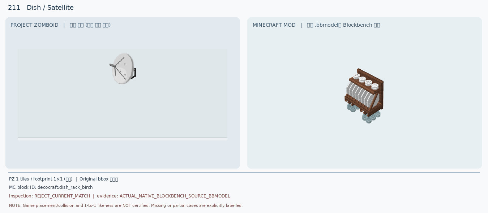
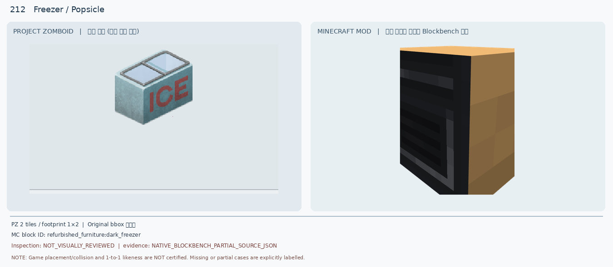
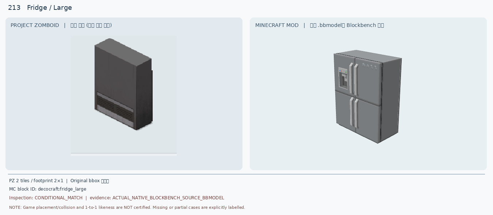
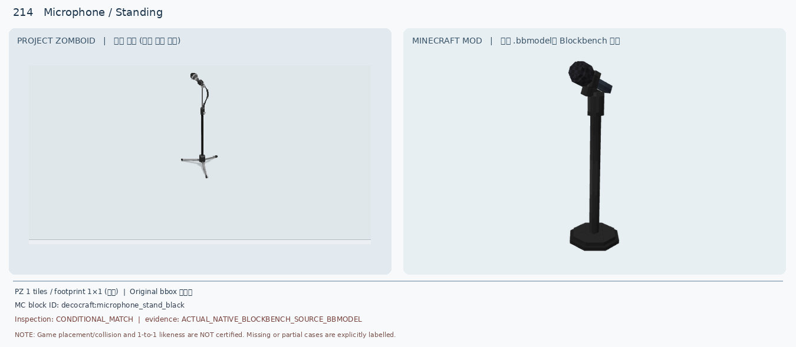
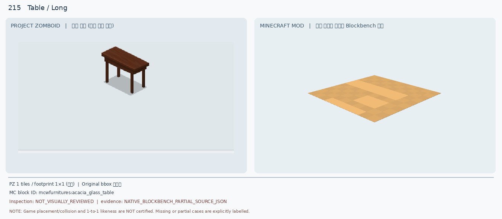
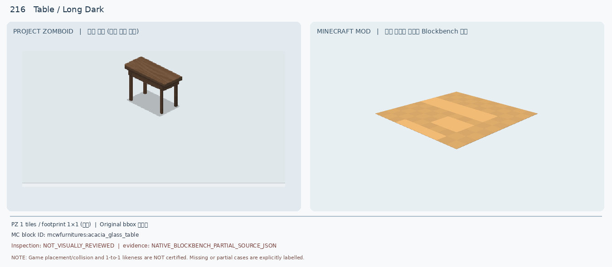
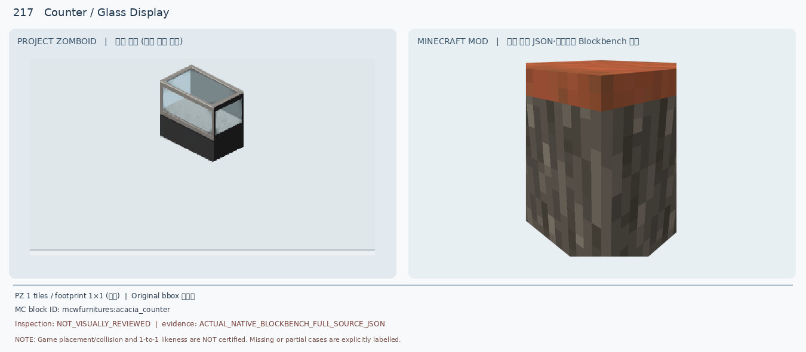
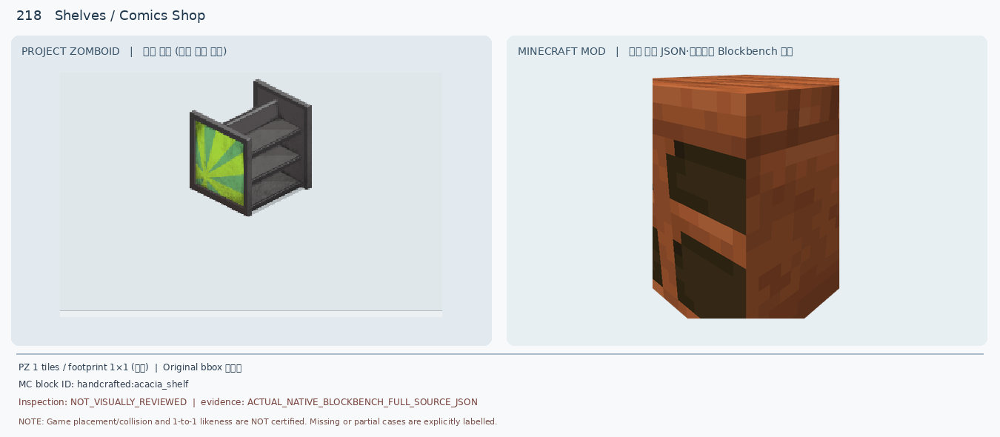
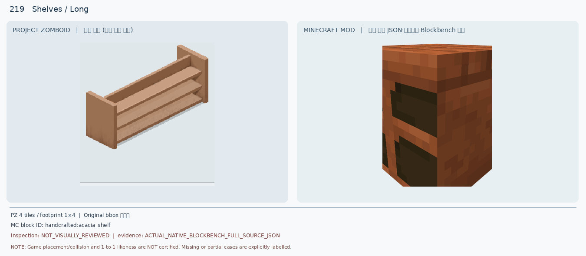
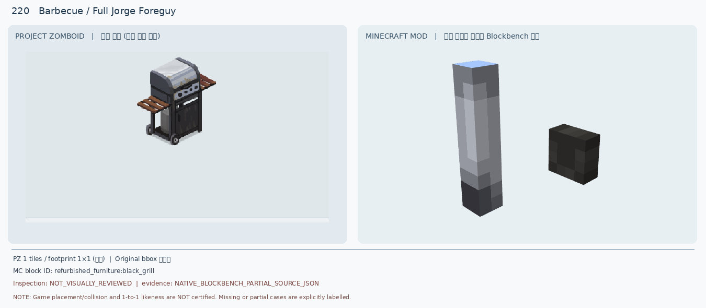

# 211–220 · 로즈우드 가구 이미지 대조

[전체 357종 목록](../README.md) · [원본 검수 PR #264](https://github.com/sanato-nb/PZ_Tile_Analysis/pull/264)

오른쪽 후보는 게임 적용이 확정된 모델이 아니야. **보류**는 추가 탐색 대상이야.

## 211 · Dish / Satellite

**보류 · 재탐색** · [원본 PR #264](https://github.com/sanato-nb/PZ_Tile_Analysis/pull/264)

PZ는 흰 접시형 위성 안테나와 수신 암·벽면 브래킷, MC는 목제 접시 건조대와 그릇이다. Dish라는 영어 동음이의어만 일치하며 용도·형상·벽 부착 모두 다름.

---

## 212 · Freezer / Popsicle

**보류 · 재탐색** · [원본 PR #264](https://github.com/sanato-nb/PZ_Tile_Analysis/pull/264)

PZ는 1×2 수평형 연회색 ICE 냉동고·상단 유리 미닫이 뚜껑 2장, MC는 검정 전면문과 갈색 측판의 세로형 1블록 냉동고 부분 렌더다.

---

## 213 · Fridge / Large

**보류 · 재탐색** · [원본 PR #264](https://github.com/sanato-nb/PZ_Tile_Analysis/pull/264)

PZ는 2×1 검정 산업용 평판 냉장고·하단 통풍 그릴, MC는 은색 4문 가정용 냉장고·손잡이·정수기. 기존 조건부 판정을 외형 불일치로 보류로 변경한다.

---

## 214 · Microphone / Standing

**조건부 후보** · [원본 PR #264](https://github.com/sanato-nb/PZ_Tile_Analysis/pull/264)

둘 다 검정색 수직 스탠드 위에 기울어진 마이크가 있다. PZ의 세 갈래 삼각 받침·가느다란 마이크 목과 MC의 팔각 원형 받침·굵은 헤드가 다르므로 외형 조건부만 인정한다.

---

## 215 · Table / Long

**보류 · 재탐색** · [원본 PR #264](https://github.com/sanato-nb/PZ_Tile_Analysis/pull/264)

PZ는 진갈색 목재 직사각 상판·4개의 가는 다리, MC는 밝은 아카시아색 납작한 부분 렌더만 표시돼 다리·높이·길이가 누락됐다.

---

## 216 · Table / Long Dark

**보류 · 재탐색** · [원본 PR #264](https://github.com/sanato-nb/PZ_Tile_Analysis/pull/264)

PZ는 흑갈색 긴 목제 상판·4다리, MC는 215번과 동일한 밝은 아카시아색 납작한 부분 렌더라 다리·어두운 색·두께가 누락됐다.

---

## 217 · Counter / Glass Display

**보류 · 재탐색** · [원본 PR #264](https://github.com/sanato-nb/PZ_Tile_Analysis/pull/264)

PZ는 검정 받침 위 투명 유리 3면·유리 상판·금속 프레임의 진열 카운터, MC는 불투명 나무 몸통과 주황 상판의 일반 카운터다.

---

## 218 · Shelves / Comics Shop

**보류 · 재탐색** · [원본 PR #264](https://github.com/sanato-nb/PZ_Tile_Analysis/pull/264)

PZ는 회색 금속 3단 개방 선반과 초록·노랑 만화가게 광고 패널, MC는 적갈색 목제 2칸 박스 선반이다.

---

## 219 · Shelves / Long

**보류 · 재탐색** · [원본 PR #264](https://github.com/sanato-nb/PZ_Tile_Analysis/pull/264)

PZ는 4조각을 이은 1×4 긴 밝은 목재 3단 선반, MC는 1×1 적갈색 2칸 박스 선반으로 길이·층수·개방도·색·멀티타일 조립이 다르다.

---

## 220 · Barbecue / Full Jorge Foreguy

**보류 · 재탐색** · [원본 PR #264](https://github.com/sanato-nb/PZ_Tile_Analysis/pull/264)

PZ는 은색 곡면 뚜껑·검정 본체·전면 노브·좌우 선반·바퀴의 가스 바비큐, MC 부분 JSON 렌더는 회색 막대와 검정 블록만 보여 완성 모델 증거가 아니다.

---

