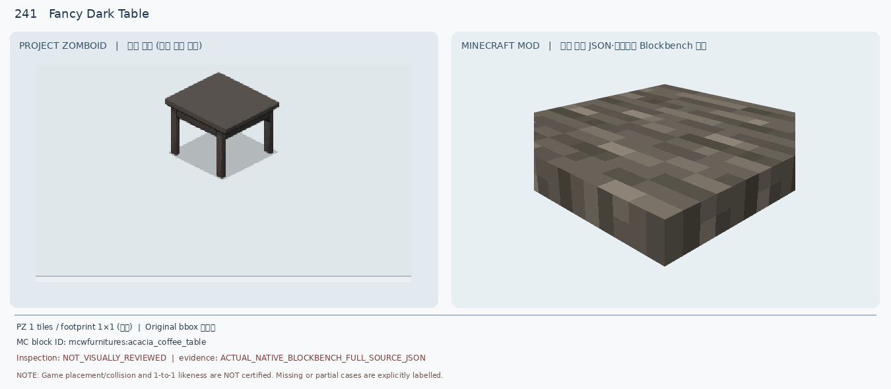
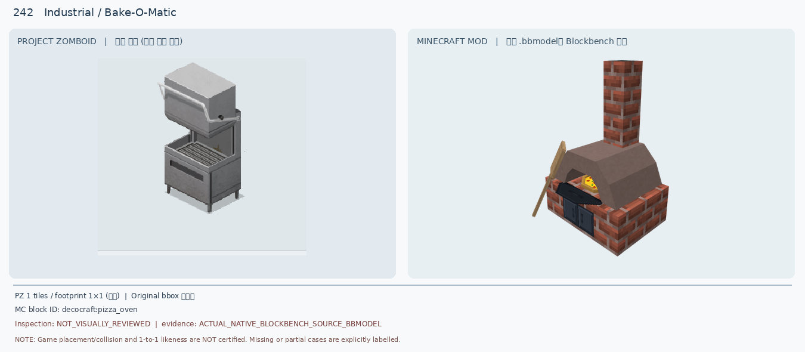
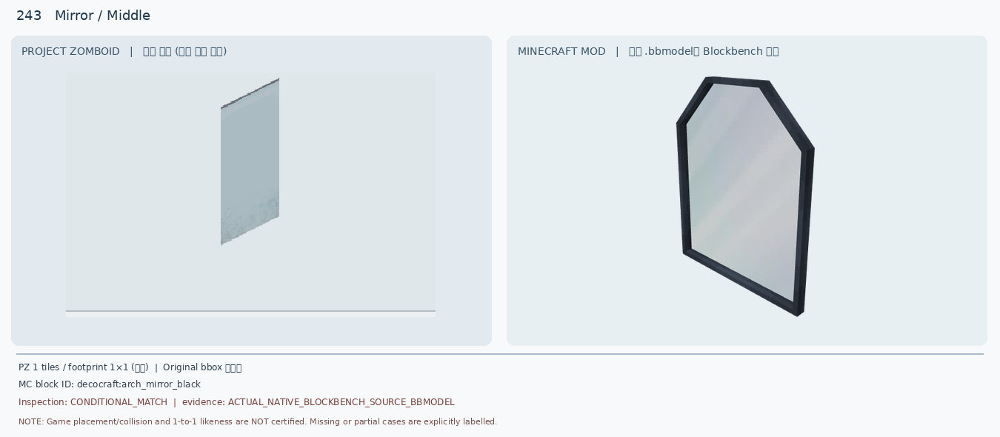
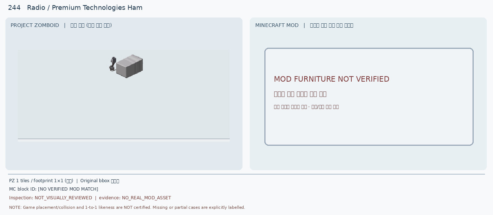
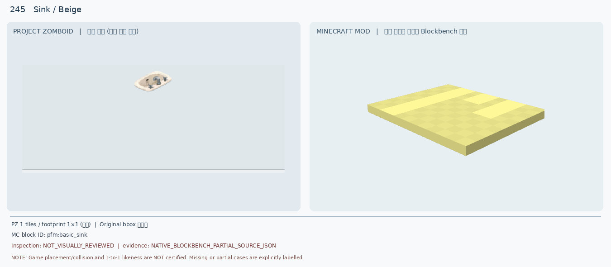
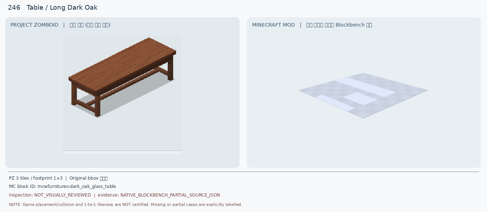
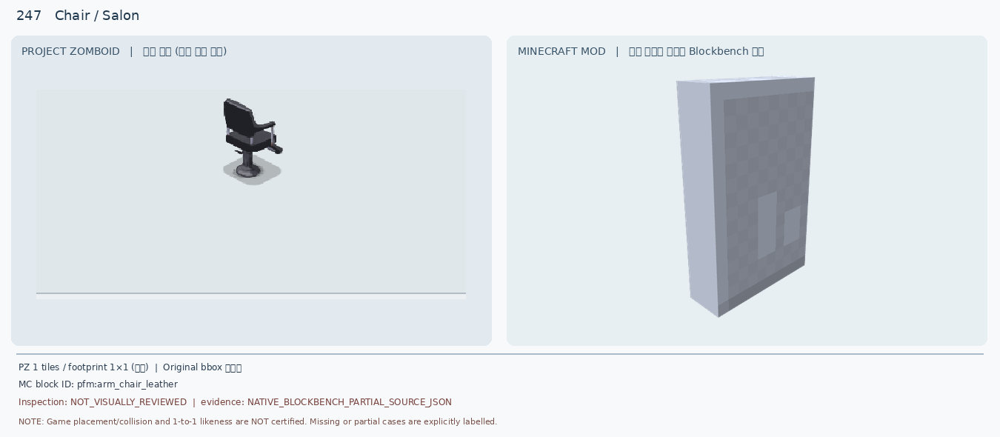
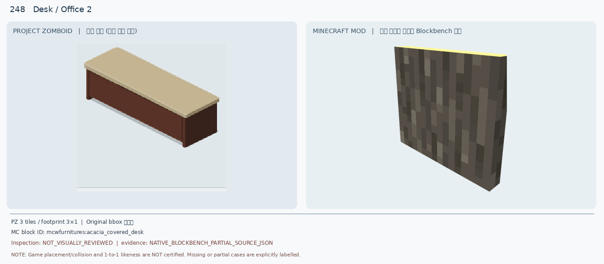
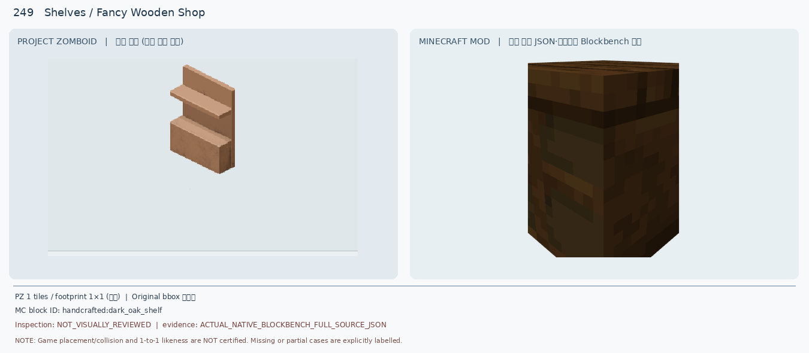
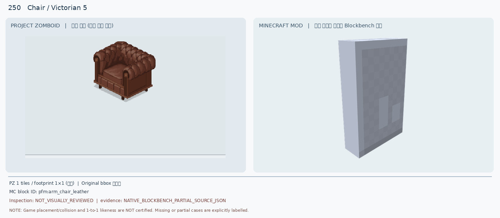

# 241–250 · 로즈우드 가구 이미지 대조

[전체 357종 목록](../README.md) · [원본 검수 PR #267](https://github.com/sanato-nb/PZ_Tile_Analysis/pull/267)

오른쪽 후보는 게임 적용이 확정된 모델이 아니야. **보류**는 추가 탐색 대상이야.

## 241 · Fancy Dark Table / 기본

**보류 · 재탐색** · [원본 PR #267](https://github.com/sanato-nb/PZ_Tile_Analysis/pull/267)

table geometry and wood color absent

---

## 242 · Industrial / Bake-O-Matic

**보류 · 재탐색** · [원본 PR #267](https://github.com/sanato-nb/PZ_Tile_Analysis/pull/267)

different appliance, shape, material, footprint and height

---

## 243 · Mirror / Middle

**보류 · 재탐색** · [원본 PR #267](https://github.com/sanato-nb/PZ_Tile_Analysis/pull/267)

outline and frame strongly differ; downgrade prior conditional match

---

## 244 · Radio / Premium Technologies Ham

**보류 · 재탐색** · [원본 PR #267](https://github.com/sanato-nb/PZ_Tile_Analysis/pull/267)

missing actual MC asset; no visual comparison possible

---

## 245 · Sink / Beige

**보류 · 재탐색** · [원본 PR #267](https://github.com/sanato-nb/PZ_Tile_Analysis/pull/267)

partial import is not complete candidate evidence; no faithful sink shape

---

## 246 · Table / Long Dark Oak

**보류 · 재탐색** · [원본 PR #267](https://github.com/sanato-nb/PZ_Tile_Analysis/pull/267)

material and 1x3 footprint mismatch; partial source render

---

## 247 · Chair / Salon

**보류 · 재탐색** · [원본 PR #267](https://github.com/sanato-nb/PZ_Tile_Analysis/pull/267)

no chair seat, armrests or pedestal; partial model evidence

---

## 248 · Desk / Office 2

**보류 · 재탐색** · [원본 PR #267](https://github.com/sanato-nb/PZ_Tile_Analysis/pull/267)

missing 3x1 desk assembly, tabletop and cabinet; partial side segment

---

## 249 · Shelves / Fancy Wooden Shop

**보류 · 재탐색** · [원본 PR #267](https://github.com/sanato-nb/PZ_Tile_Analysis/pull/267)

open display geometry absent; major material/color mismatch

---

## 250 · Chair / Victorian 5

**보류 · 재탐색** · [원본 PR #267](https://github.com/sanato-nb/PZ_Tile_Analysis/pull/267)

missing upholstery, arms, seat and wood trim; partial model evidence

---

