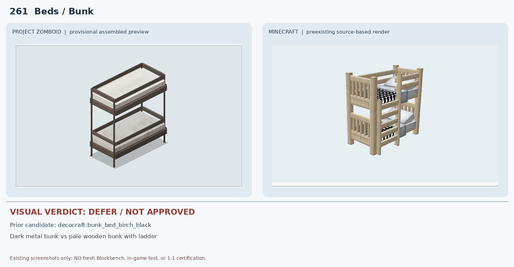
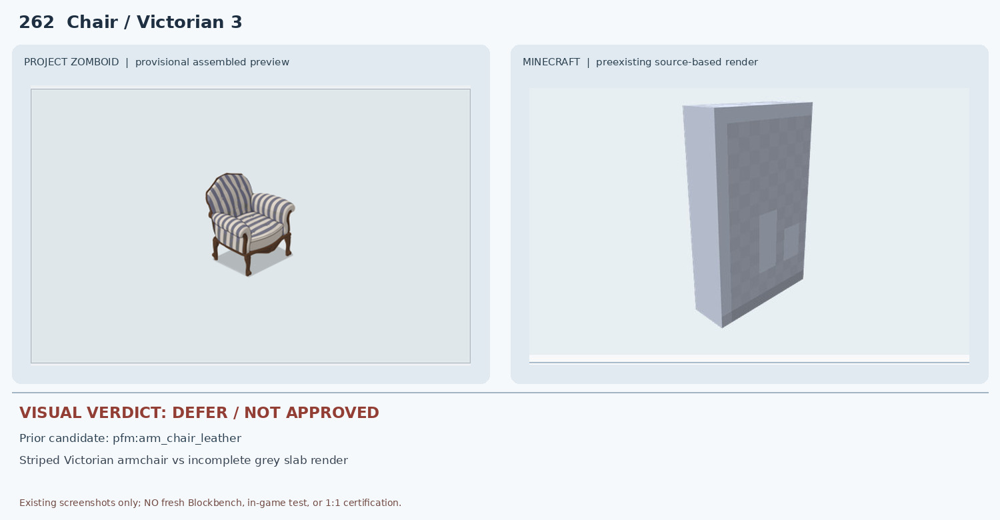
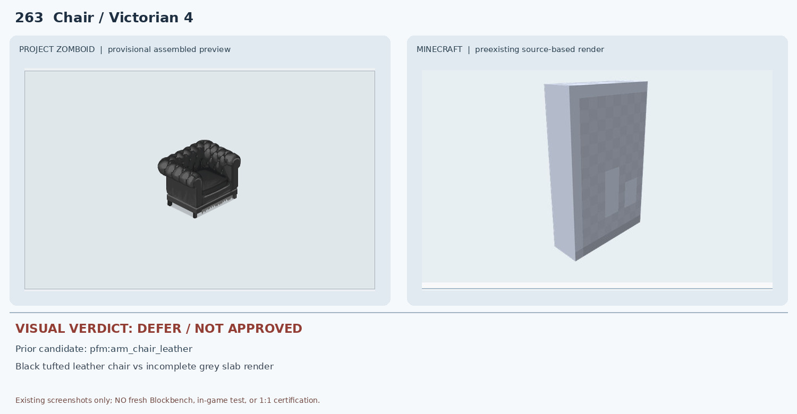
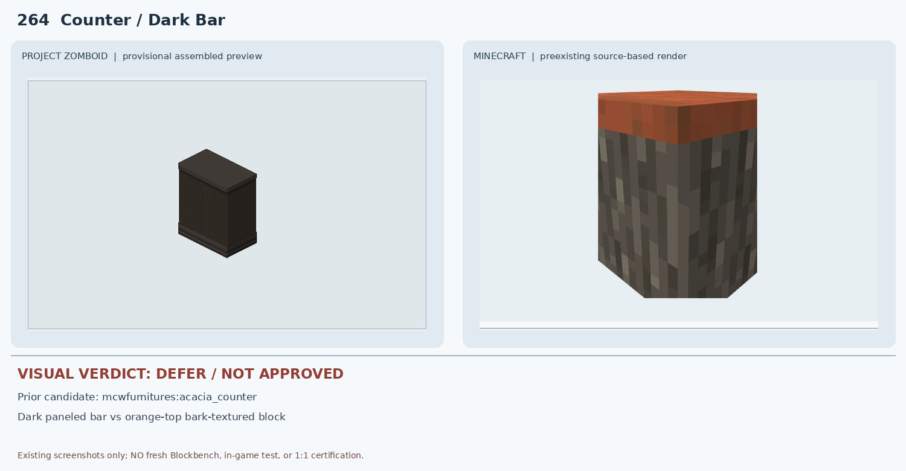
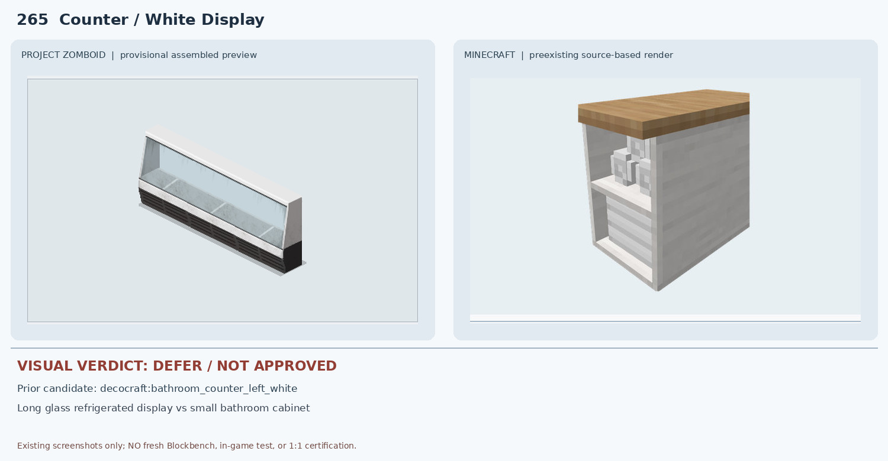
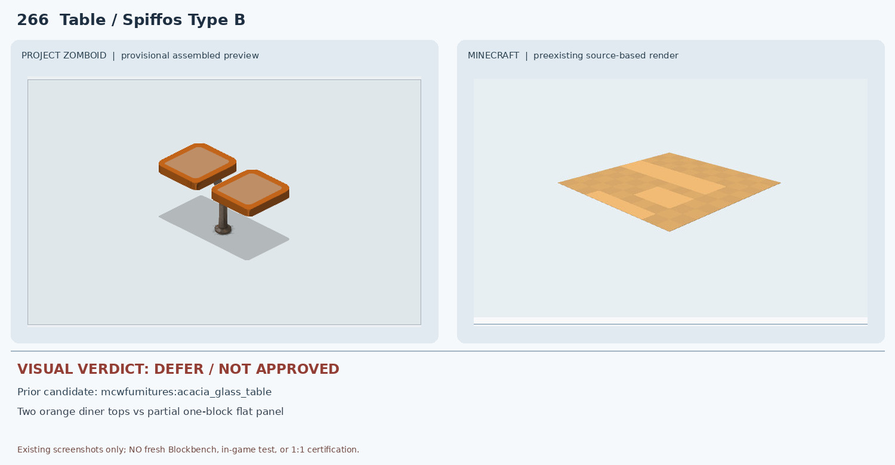
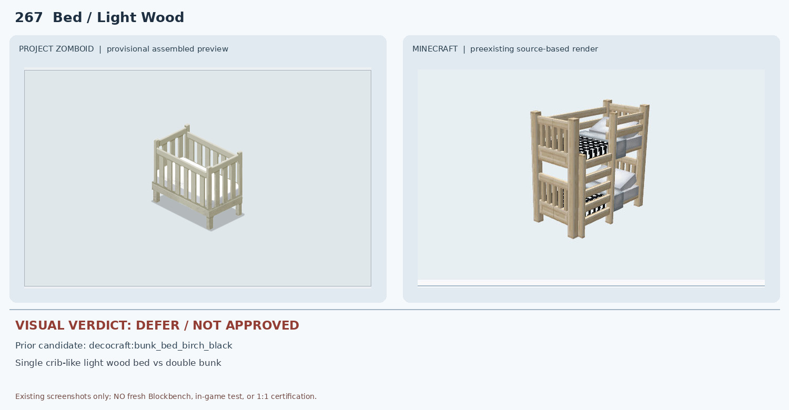
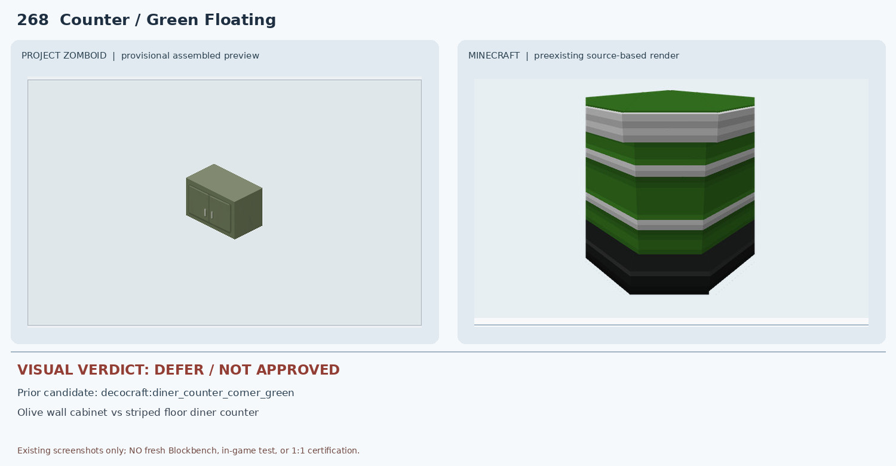
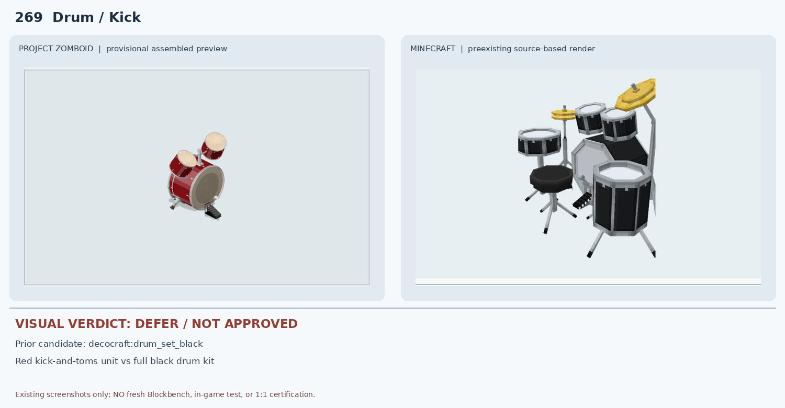
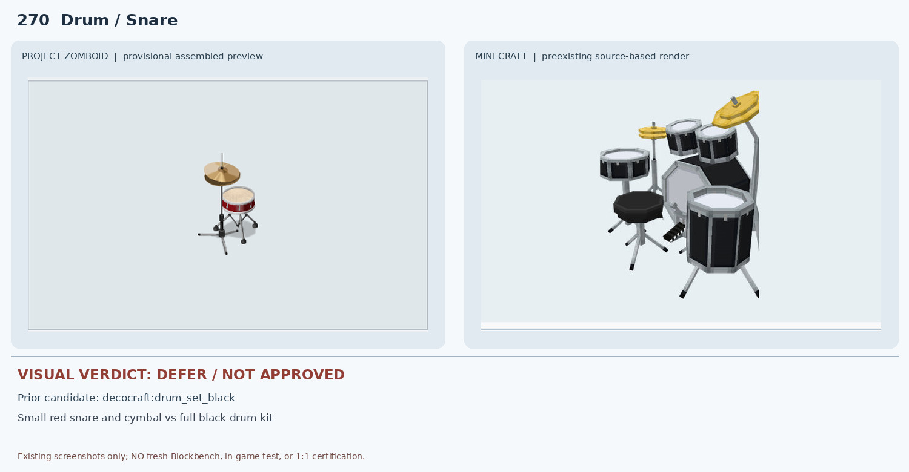

# 261–270 · 로즈우드 가구 이미지 대조

[전체 357종 목록](../README.md) · [원본 검수 PR #269](https://github.com/sanato-nb/PZ_Tile_Analysis/pull/269)

오른쪽 후보는 게임 적용이 확정된 모델이 아니야. **보류**는 추가 탐색 대상이야.

## 261 · Beds / Bunk

**보류 · 재탐색** · [원본 PR #269](https://github.com/sanato-nb/PZ_Tile_Analysis/pull/269)

PZ는 검은색/갈색 금속 프레임과 흰 매트리스의 단순 2단 침대이고 Decocraft 후보는 밝은 자작나무 목재 프레임, 계단형 사다리, 검정 무늬 침구를 가진 침대다. 2단 구성은 유사하지만 프레임 재질·색·사다리·난간·침구가 다르므로 조건부 승인도 보류한다.

---

## 262 · Chair / Victorian 3

**보류 · 재탐색** · [원본 PR #269](https://github.com/sanato-nb/PZ_Tile_Analysis/pull/269)

PZ는 줄무늬 빅토리아풍 천 안락의자다. 현재 Paladin 후보의 Blockbench JSON 비교 화면은 회색 판 형태만 보여 등받이·팔걸이·다리·줄무늬 원단이 검증되지 않는다. 부분 렌더를 완성 가구로 판정할 수 없다.

---

## 263 · Chair / Victorian 4

**보류 · 재탐색** · [원본 PR #269](https://github.com/sanato-nb/PZ_Tile_Analysis/pull/269)

PZ는 검은색 가죽 버튼 퀼팅의 빅토리아 안락의자다. 후보 화면은 262번과 동일한 회색 판형 부분 JSON 렌더로 가죽·버튼·팔걸이·좌석 형상을 전혀 확인할 수 없다.

---

## 264 · Counter / Dark Bar

**보류 · 재탐색** · [원본 PR #269](https://github.com/sanato-nb/PZ_Tile_Analysis/pull/269)

PZ는 거의 검정에 가까운 짙은 목재 카운터다. Macaw's 후보는 주황색 아카시아 상판과 회색/갈색 통나무 껍질 질감 몸체로 색상·패널 재질·하단 몰딩이 다르다.

---

## 265 · Counter / White Display

**보류 · 재탐색** · [원본 PR #269](https://github.com/sanato-nb/PZ_Tile_Analysis/pull/269)

PZ는 세 칸 길이의 유리 식품 진열 냉장 쇼케이스인데 Decocraft 후보는 목재 상판을 가진 1칸 흰색 욕실 카운터/수납장이다. 길이·투명 진열창·냉장 기능·재질이 불일치한다.

---

## 266 · Table / Spiffos Type B

**보류 · 재탐색** · [원본 PR #269](https://github.com/sanato-nb/PZ_Tile_Analysis/pull/269)

PZ 조립 미리보기는 두 개의 주황색 테이블 상판 중 하나의 지지대가 보이지 않아 조립 상태도 추가 검증이 필요하다. 후보 Blockbench JSON은 밝은 단일 평면만 나타나는 부분 렌더로 두 상판·중앙 금속 받침·2×1 연결을 입증하지 못한다.

---

## 267 · Bed / Light Wood

**보류 · 재탐색** · [원본 PR #269](https://github.com/sanato-nb/PZ_Tile_Analysis/pull/269)

PZ 원본 미리보기는 높은 세로 난간으로 둘러싸인 단층 유아 침대(크립) 형태다. Decocraft 후보는 밝은 목재이지만 2층 침대와 사다리가 있어 높이·층수·구조가 다르다. Bed / Light Wood 분류와 실제 크립 형태도 원본 타일 ID로 확인해야 한다.

---

## 268 · Counter / Green Floating

**보류 · 재탐색** · [원본 PR #269](https://github.com/sanato-nb/PZ_Tile_Analysis/pull/269)

PZ는 평평한 상판과 두 문이 있는 올리브색 벽걸이 수납장이다. Decocraft 후보는 녹색·흰색 수평 줄무늬와 검정 하부를 가진 바닥형 식당 카운터 코너로 벽걸이·문·손잡이·색상/형태가 다르다.

---

## 269 · Drum / Kick

**보류 · 재탐색** · [원본 PR #269](https://github.com/sanato-nb/PZ_Tile_Analysis/pull/269)

PZ는 빨간 베이스 드럼/탐 부분 세트이고 Decocraft 후보는 검정/흰색 전체 드럼 키트로 심벌·스네어·의자 등 불필요한 부품이 많고 색상·점유 면적이 다르다.

---

## 270 · Drum / Snare

**보류 · 재탐색** · [원본 PR #269](https://github.com/sanato-nb/PZ_Tile_Analysis/pull/269)

PZ는 붉은 스네어와 심벌이 분리 배치된 작은 1×1 악기다. 후보는 검정 대형 풀 드럼 세트라 악기 수·색·스탠드·전체 크기가 다르다.

---

