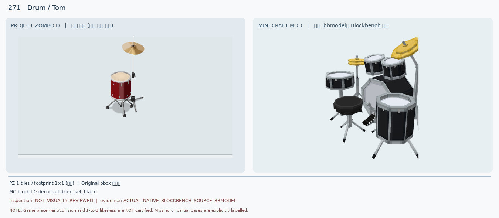
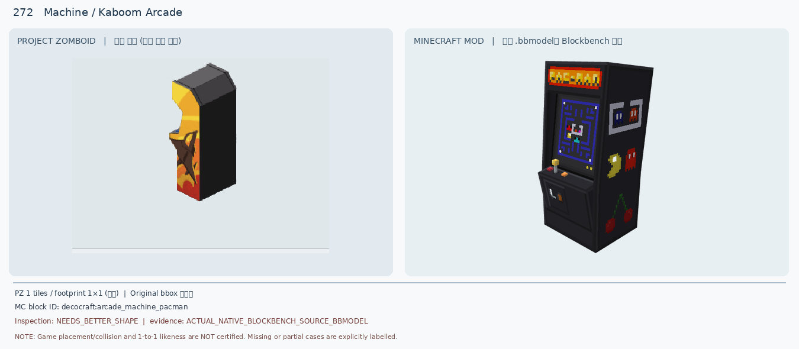
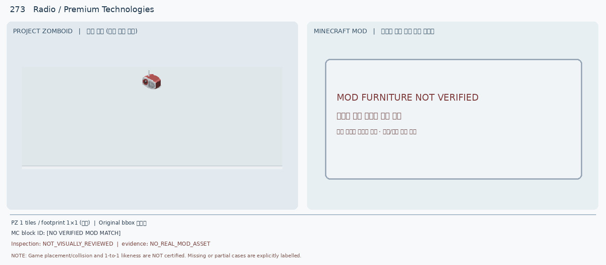
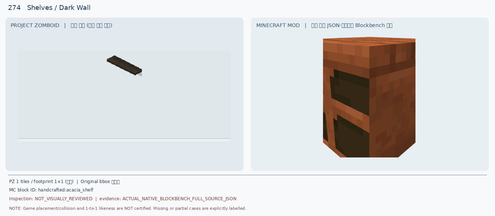
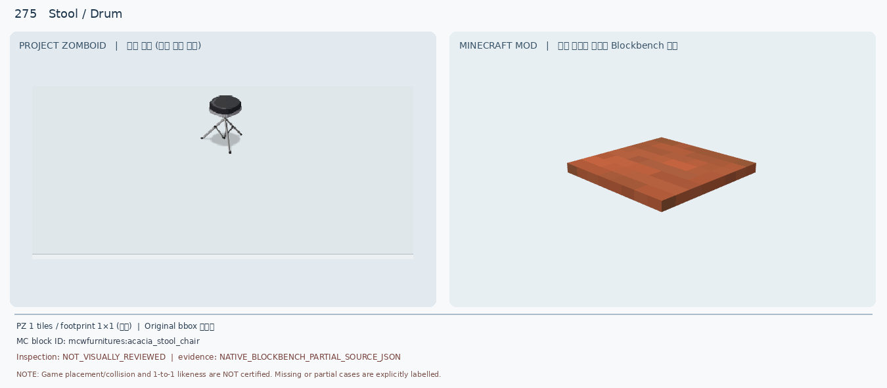
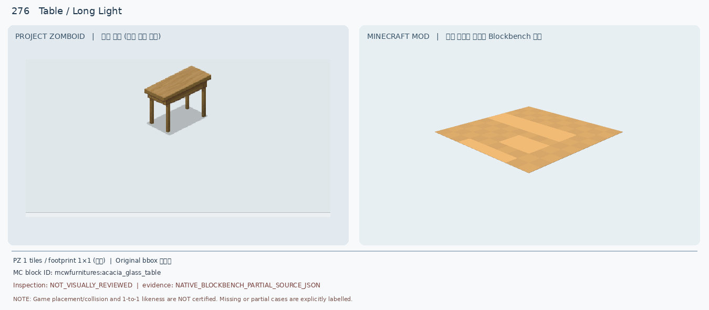
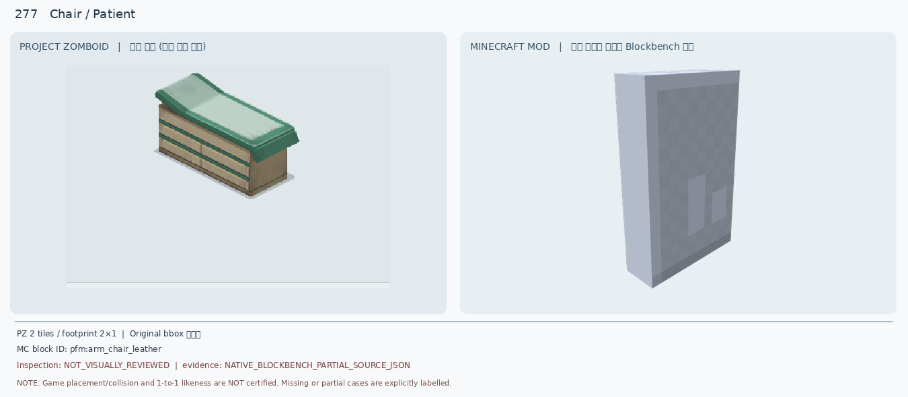
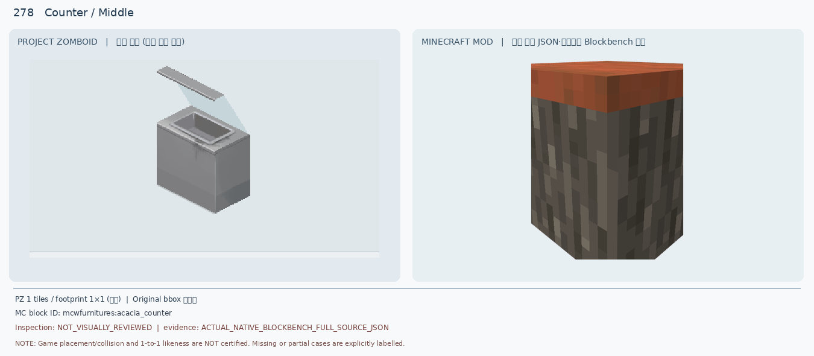
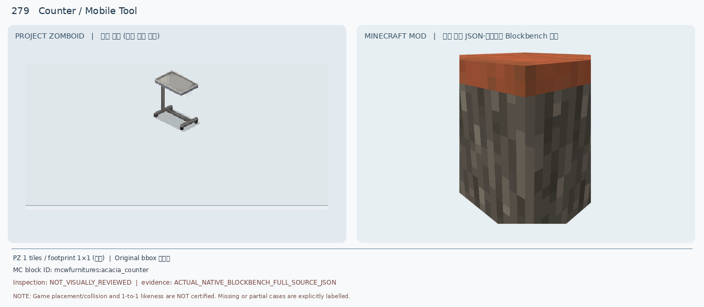
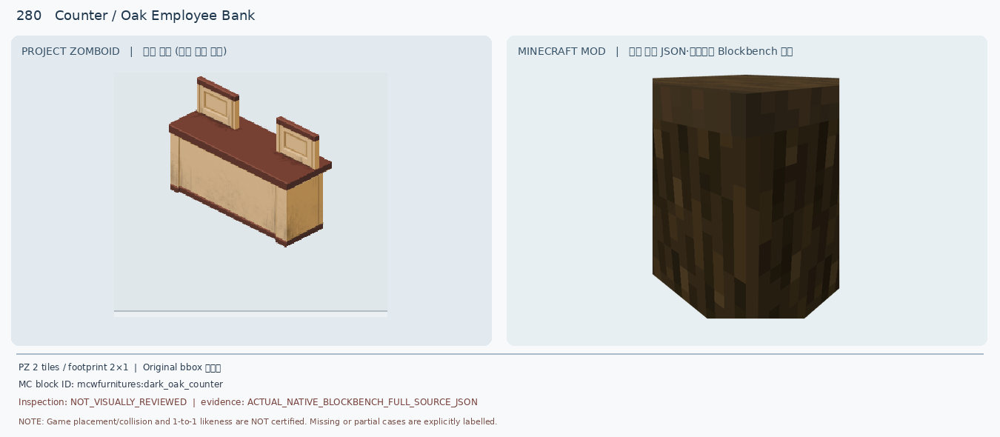

# 271–280 · 로즈우드 가구 이미지 대조

[전체 357종 목록](../README.md) · [원본 검수 PR #270](https://github.com/sanato-nb/PZ_Tile_Analysis/pull/270)

오른쪽 후보는 게임 적용이 확정된 모델이 아니야. **보류**는 추가 탐색 대상이야.

## 271 · Drum / Tom

**보류 · 재탐색** · [원본 PR #270](https://github.com/sanato-nb/PZ_Tile_Analysis/pull/270)

단일 빨간 탐+심벌과 검정 전체 드럼 세트의 색상·개수·크기 불일치

---

## 272 · Machine / Kaboom Arcade

**보류 · 재탐색** · [원본 PR #270](https://github.com/sanato-nb/PZ_Tile_Analysis/pull/270)

아케이드 실루엣만 비슷하고 게임 화면·색상·상단 형태가 다름

---

## 273 · Radio / Premium Technologies

**보류 · 재탐색** · [원본 PR #270](https://github.com/sanato-nb/PZ_Tile_Analysis/pull/270)

원본 모드 자산이 없어 시각 대조 자체가 불가

---

## 274 · Shelves / Dark Wall

**보류 · 재탐색** · [원본 PR #270](https://github.com/sanato-nb/PZ_Tile_Analysis/pull/270)

부유 판자와 두꺼운 수납형 가구의 구조·색·두께 불일치

---

## 275 · Stool / Drum

**보류 · 재탐색** · [원본 PR #270](https://github.com/sanato-nb/PZ_Tile_Analysis/pull/270)

재질·좌판 모양 불일치, 부분 렌더이므로 완전 모델 판정 불가

---

## 276 · Table / Long Light

**보류 · 재탐색** · [원본 PR #270](https://github.com/sanato-nb/PZ_Tile_Analysis/pull/270)

목재 상판·길이·다리 구조 미재현, 부분 렌더

---

## 277 · Chair / Patient

**보류 · 재탐색** · [원본 PR #270](https://github.com/sanato-nb/PZ_Tile_Analysis/pull/270)

의료 진찰대와 가죽 안락의자 후보가 다르고 2×1 점유 미충족

---

## 278 · Counter / Middle

**보류 · 재탐색** · [원본 PR #270](https://github.com/sanato-nb/PZ_Tile_Analysis/pull/270)

유리 덮개·금속 용기·내부 공간이 전혀 없음

---

## 279 · Counter / Mobile Tool

**보류 · 재탐색** · [원본 PR #270](https://github.com/sanato-nb/PZ_Tile_Analysis/pull/270)

이동식 바퀴·트레이·금속 지지대 모두 누락

---

## 280 · Counter / Oak Employee Bank

**보류 · 재탐색** · [원본 PR #270](https://github.com/sanato-nb/PZ_Tile_Analysis/pull/270)

2×1 점유·투톤 색상·위쪽 칸막이 두 개 전부 불일치

---

