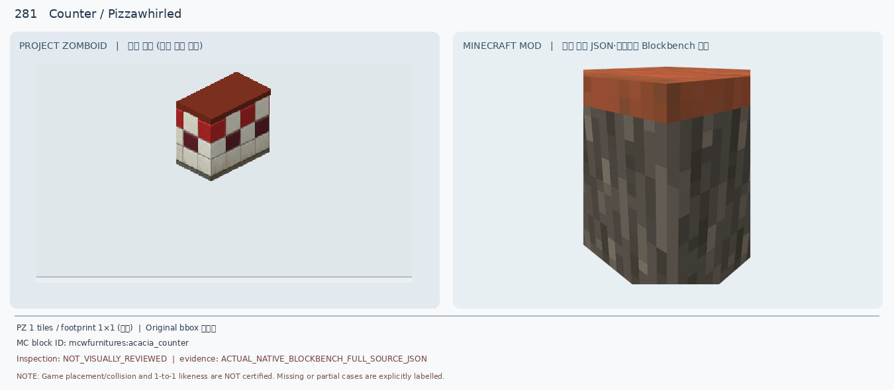
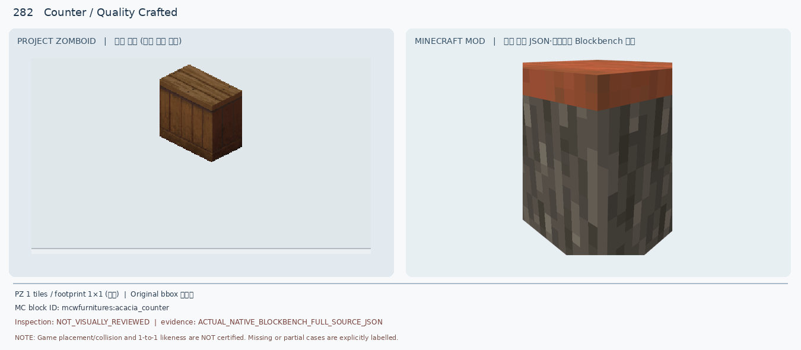
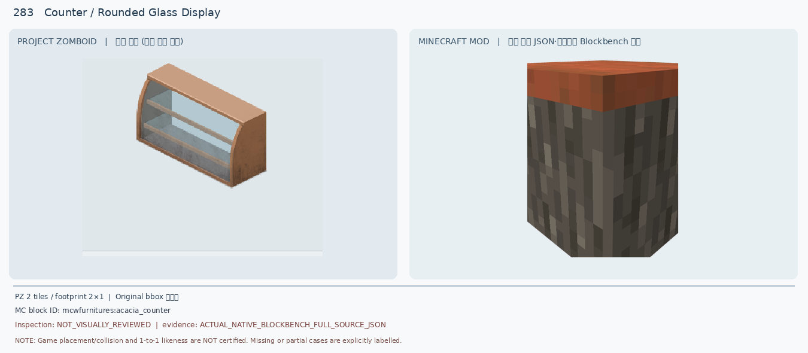
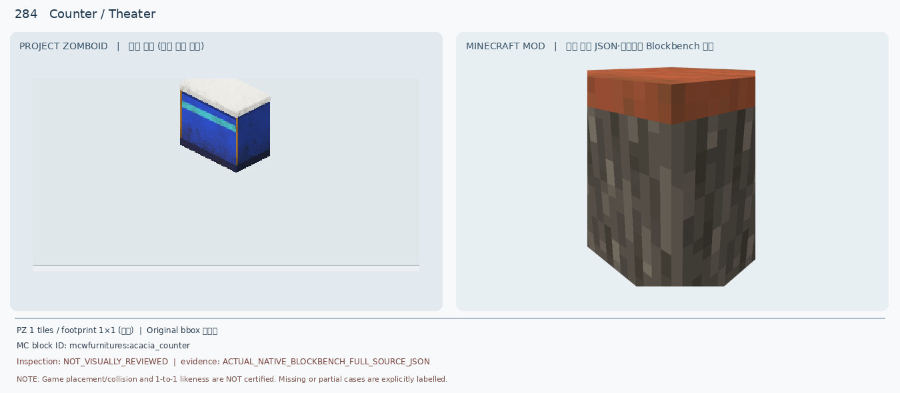
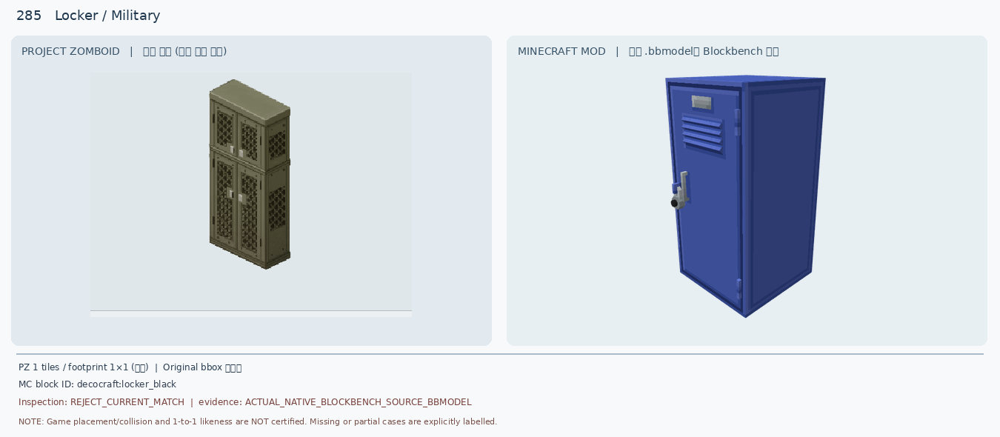
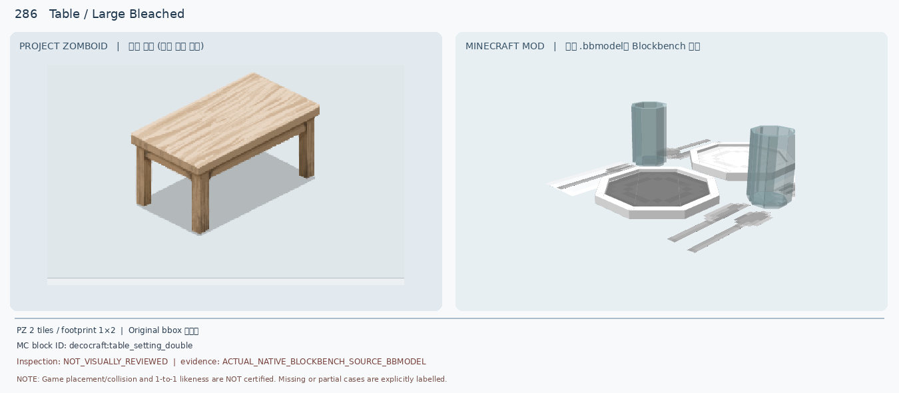
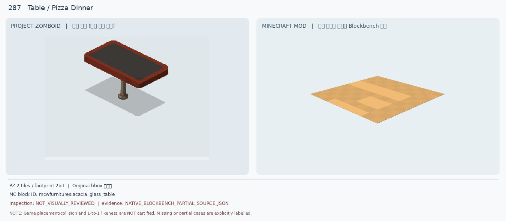
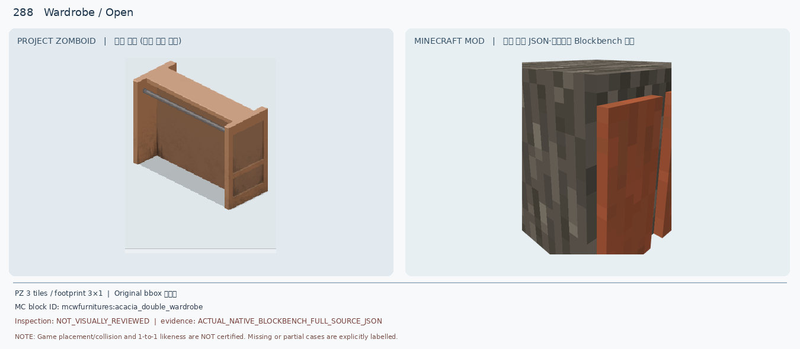
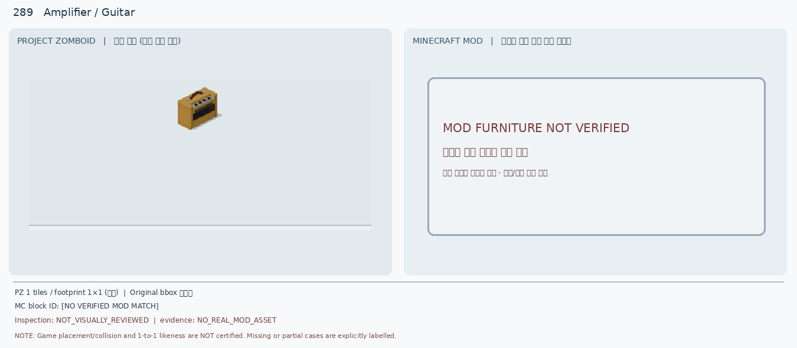
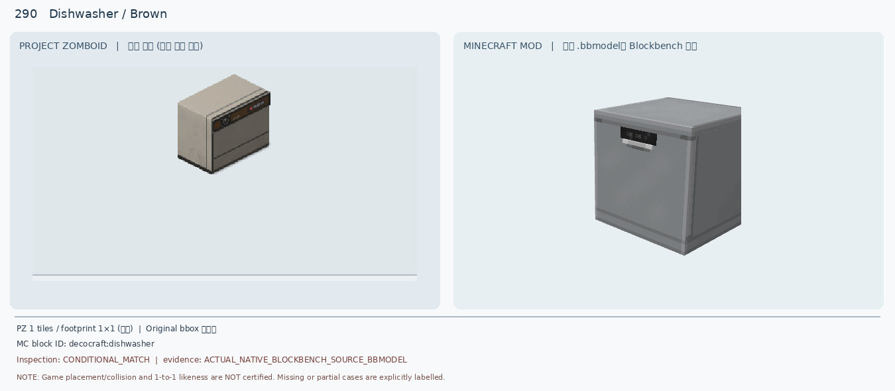

# 281–290 · 로즈우드 가구 이미지 대조

[전체 357종 목록](../README.md) · [원본 검수 PR #268](https://github.com/sanato-nb/PZ_Tile_Analysis/pull/268)

오른쪽 후보는 게임 적용이 확정된 모델이 아니야. **보류**는 추가 탐색 대상이야.

## 281 · Counter / Pizzawhirled

**보류 · 재탐색** · [원본 PR #268](https://github.com/sanato-nb/PZ_Tile_Analysis/pull/268)

---

## 282 · Counter / Quality Crafted

**보류 · 재탐색** · [원본 PR #268](https://github.com/sanato-nb/PZ_Tile_Analysis/pull/268)

---

## 283 · Counter / Rounded Glass Display

**보류 · 재탐색** · [원본 PR #268](https://github.com/sanato-nb/PZ_Tile_Analysis/pull/268)

---

## 284 · Counter / Theater

**보류 · 재탐색** · [원본 PR #268](https://github.com/sanato-nb/PZ_Tile_Analysis/pull/268)

---

## 285 · Locker / Military

**보류 · 재탐색** · [원본 PR #268](https://github.com/sanato-nb/PZ_Tile_Analysis/pull/268)

---

## 286 · Table / Large Bleached

**보류 · 재탐색** · [원본 PR #268](https://github.com/sanato-nb/PZ_Tile_Analysis/pull/268)

---

## 287 · Table / Pizza Dinner

**보류 · 재탐색** · [원본 PR #268](https://github.com/sanato-nb/PZ_Tile_Analysis/pull/268)

---

## 288 · Wardrobe / Open

**보류 · 재탐색** · [원본 PR #268](https://github.com/sanato-nb/PZ_Tile_Analysis/pull/268)

---

## 289 · Amplifier / Guitar

**보류 · 재탐색** · [원본 PR #268](https://github.com/sanato-nb/PZ_Tile_Analysis/pull/268)

---

## 290 · Dishwasher / Brown

**조건부 후보** · [원본 PR #268](https://github.com/sanato-nb/PZ_Tile_Analysis/pull/268)

---

