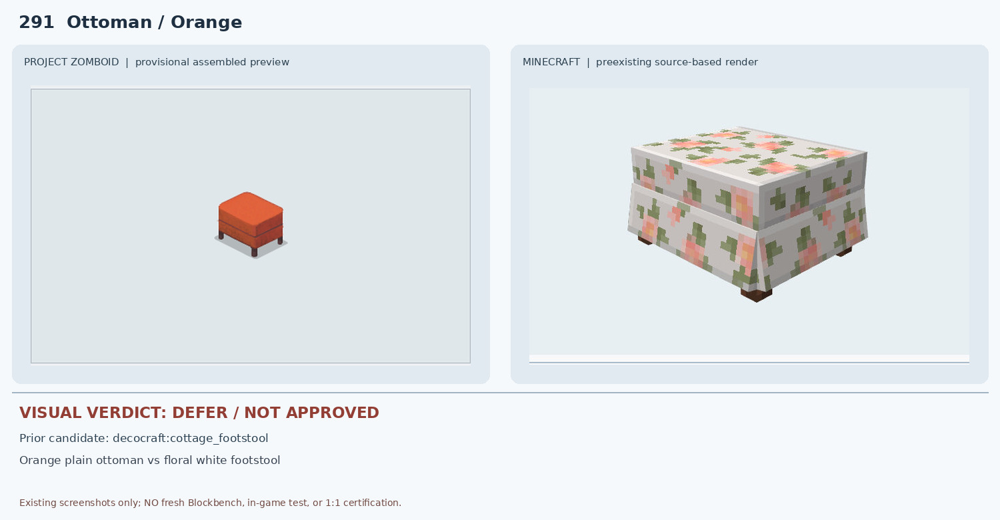
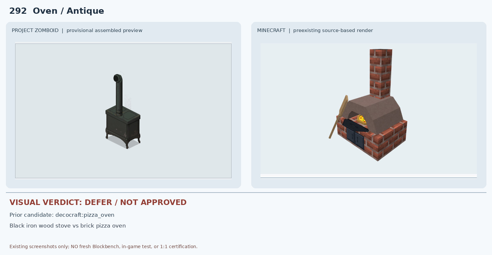
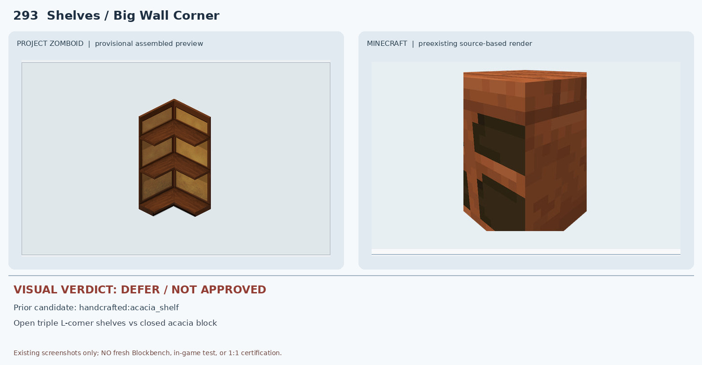
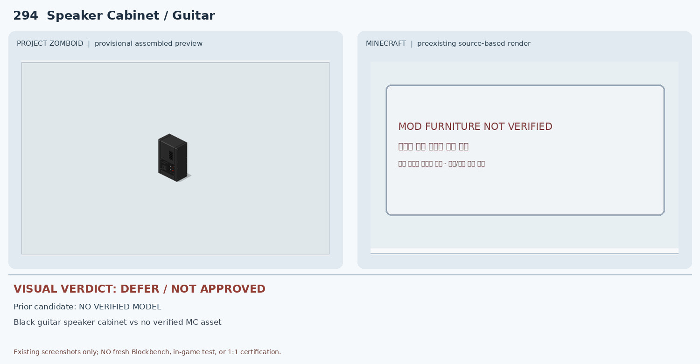
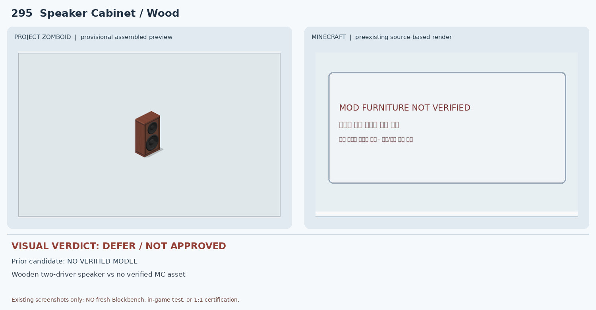
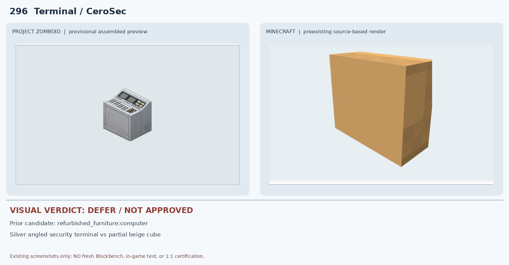
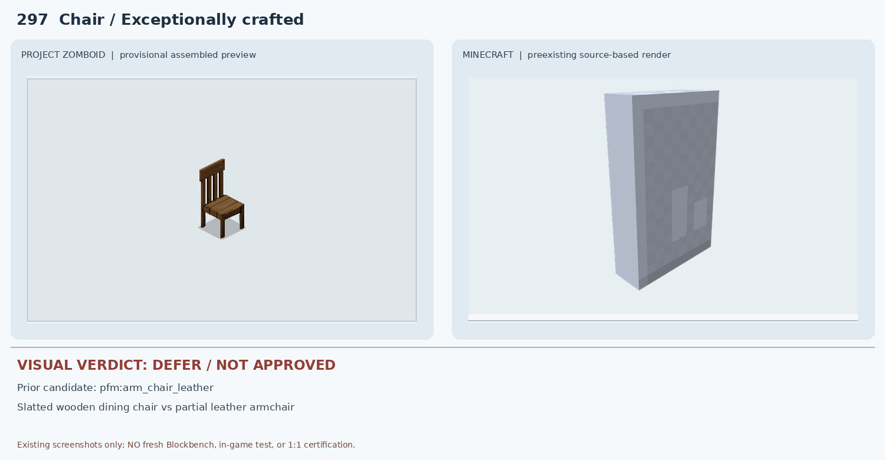
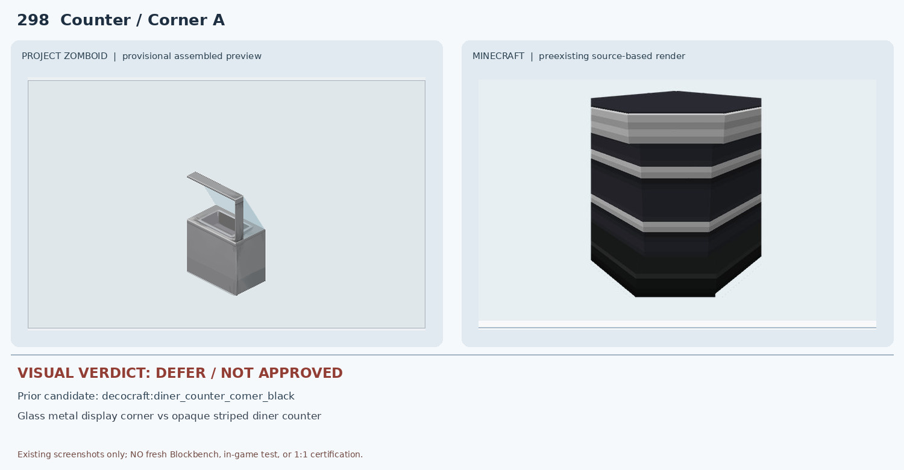
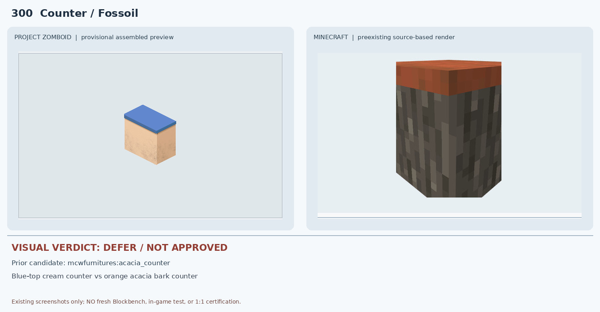

# 291–300 · 로즈우드 가구 이미지 대조

[전체 357종 목록](../README.md) · [원본 검수 PR #274](https://github.com/sanato-nb/PZ_Tile_Analysis/pull/274)

오른쪽 후보는 게임 적용이 확정된 모델이 아니야. **보류**는 추가 탐색 대상이야.

## 291 · Ottoman / Orange

**보류 · 재탐색** · [원본 PR #274](https://github.com/sanato-nb/PZ_Tile_Analysis/pull/274)

PZ는 무늬 없는 주황색 작은 발받침이지만 MC 원본 cottage_footstool은 흰 바탕에 꽃무늬가 반복되는 두꺼운 발받침이다. 용도만 같고 색상·무늬·비례가 다르다.

---

## 292 · Oven / Antique

**보류 · 재탐색** · [원본 PR #274](https://github.com/sanato-nb/PZ_Tile_Analysis/pull/274)

PZ는 검정 철제 장작난로와 가는 금속 연통이지만 MC pizza_oven은 붉은 벽돌 바닥과 넓은 돔 화실·굵은 벽돌 굴뚝의 야외 피자 화덕이다. 재질·실루엣·기능이 다르다.

---

## 293 · Shelves / Big Wall Corner

**보류 · 재탐색** · [원본 PR #274](https://github.com/sanato-nb/PZ_Tile_Analysis/pull/274)

PZ는 직각으로 꺾인 개방형 3단 코너 선반인데 MC acacia_shelf는 단일 목재 상자형 덩어리처럼 보이고 열린 L자 코너와 세 선반 층이 보이지 않는다.

---

## 294 · Speaker Cabinet / Guitar

**보류 · 재탐색** · [원본 PR #274](https://github.com/sanato-nb/PZ_Tile_Analysis/pull/274)

PZ는 검정 세로형 기타 스피커 캐비닛이지만 기존 모드 조사에서 대응 MC 원본 모델이 확인되지 않았다. 오른쪽은 미검증 안내판으로 실제 MC 모델 렌더가 아니다.

---

## 295 · Speaker Cabinet / Wood

**보류 · 재탐색** · [원본 PR #274](https://github.com/sanato-nb/PZ_Tile_Analysis/pull/274)

PZ는 두 원형 드라이버가 노출된 목재 스피커인데 기존 MC 원본 후보가 없고 오른쪽은 안내판이다. 실제 모델 비교가 없어 승인 불가다.

---

## 296 · Terminal / CeroSec

**보류 · 재탐색** · [원본 PR #274](https://github.com/sanato-nb/PZ_Tile_Analysis/pull/274)

PZ는 버튼과 디스플레이가 다수 있는 경사형 보안 콘솔이지만 MC computer 비교는 베이지색 단순 상자형 부분 JSON 렌더다. 화면·키패드·경사 제어판이 보이지 않고 완성 모델도 검증되지 않았다.

---

## 297 · Chair / Exceptionally crafted

**보류 · 재탐색** · [원본 PR #274](https://github.com/sanato-nb/PZ_Tile_Analysis/pull/274)

PZ는 팔걸이 없는 목재 의자지만 MC arm_chair_leather는 가죽 안락의자 종류이며 기존 Blockbench JSON 화면도 회색 판형 부분 렌더다. 종류·재질·등받이 구조가 불일치한다.

---

## 298 · Counter / Corner A

**보류 · 재탐색** · [원본 PR #274](https://github.com/sanato-nb/PZ_Tile_Analysis/pull/274)

PZ는 금속/유리 코너 진열대와 투명 가림막이지만 MC는 검정 몸체와 회색 줄무늬의 불투명 카운터다. 유리·진열홈·상부 프레임이 없다.

---

## 299 · Counter / Corner B

**보류 · 재탐색** · [원본 PR #274](https://github.com/sanato-nb/PZ_Tile_Analysis/pull/274)

PZ는 298번과 프레임 방향이 반대인 유리 진열 코너인데 MC는 298과 동일한 불투명 검정 카운터를 재사용한다. 유리와 상단 구조도 없고 회전별 차이도 입증되지 않았다.

---

## 300 · Counter / Fossoil

**보류 · 재탐색** · [원본 PR #274](https://github.com/sanato-nb/PZ_Tile_Analysis/pull/274)

PZ는 크림색 몸체와 파란 상판의 주유소 카운터인데 MC acacia_counter는 주황색 아카시아 상판과 회색/갈색 나무껍질 질감 몸체다. 색상·재질·패널이 불일치한다.

---

