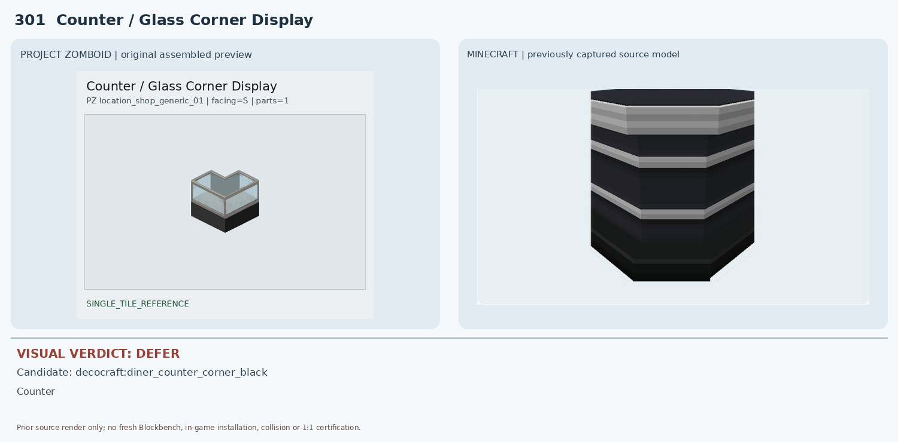
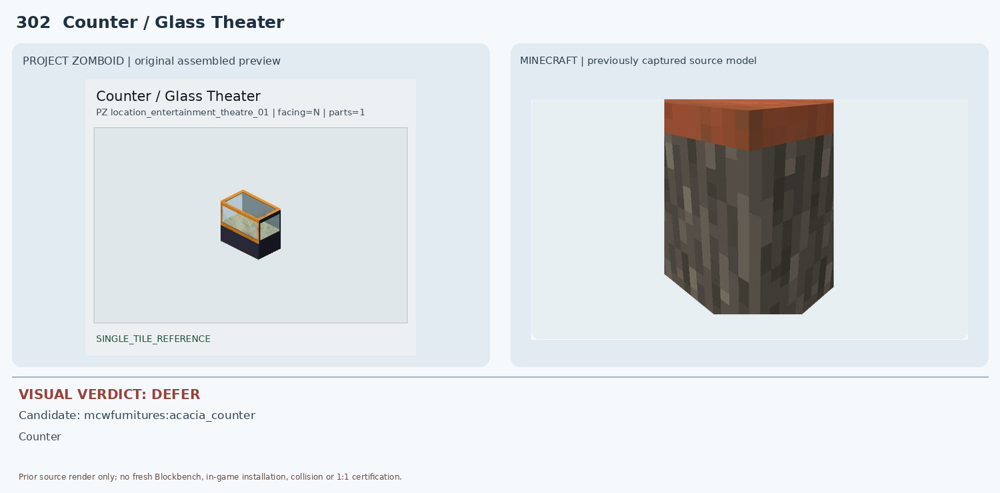
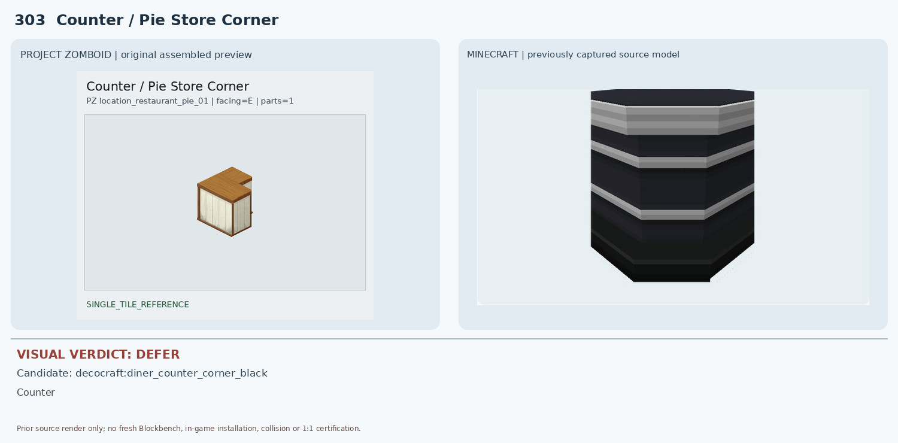
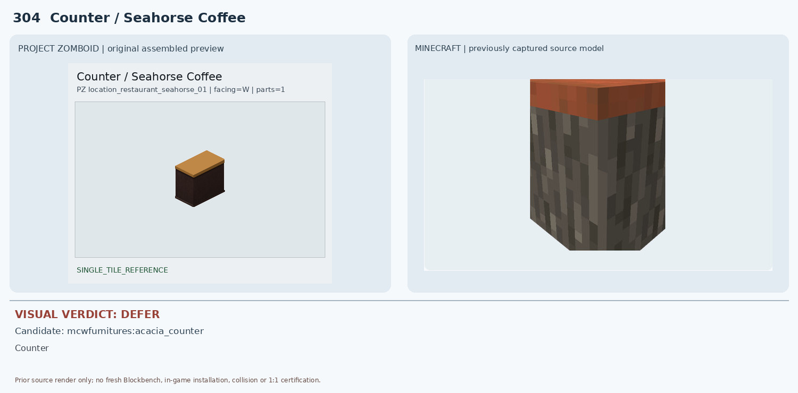
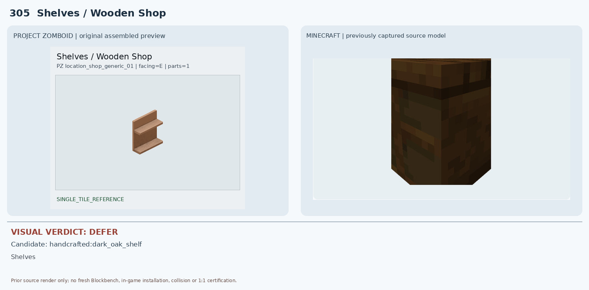
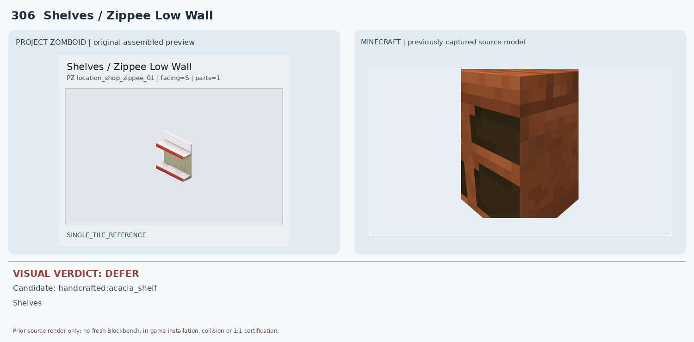
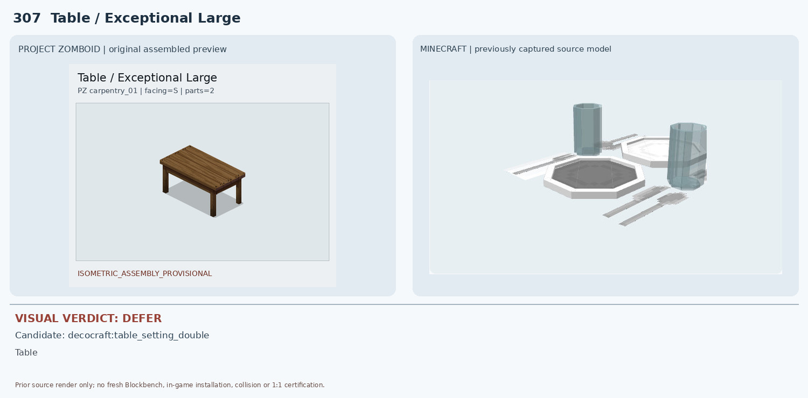
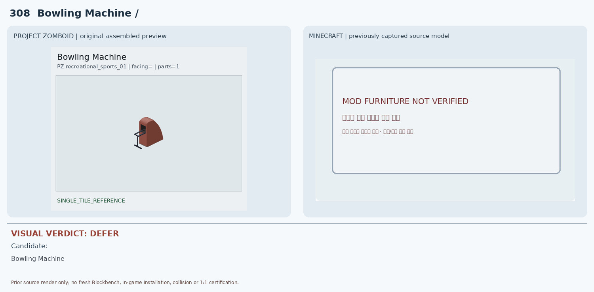
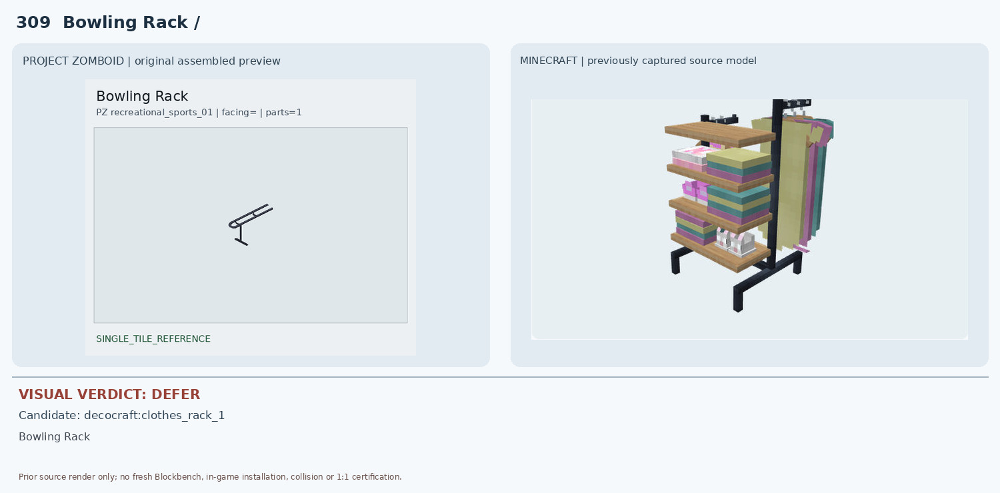
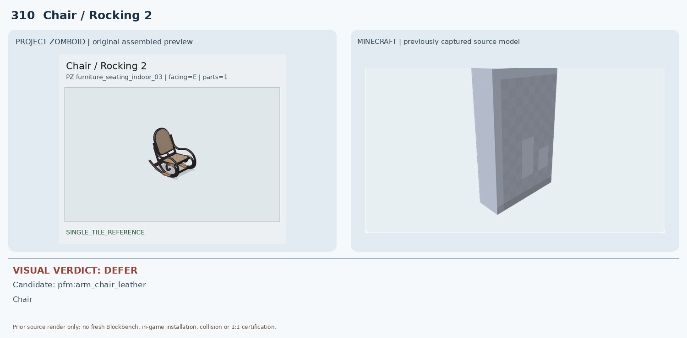

# 301–310 · 로즈우드 가구 이미지 대조

[전체 357종 목록](../README.md) · [원본 검수 PR #272](https://github.com/sanato-nb/PZ_Tile_Analysis/pull/272)

오른쪽 후보는 게임 적용이 확정된 모델이 아니야. **보류**는 추가 탐색 대상이야.

## 301 · Counter / Glass Corner Display

**보류 · 재탐색** · [원본 PR #272](https://github.com/sanato-nb/PZ_Tile_Analysis/pull/272)

MC는 검정 본체에 은색 수평 줄무늬만 있는 불투명 다이너 카운터로 투명 유리와 열린 진열 공간이 없음

---

## 302 · Counter / Glass Theater

**보류 · 재탐색** · [원본 PR #272](https://github.com/sanato-nb/PZ_Tile_Analysis/pull/272)

MC 아카시아 카운터는 회갈색 불투명 몸체와 주황색 상판으로 투명 유리·전면 개구부가 없음

---

## 303 · Counter / Pie Store Corner

**보류 · 재탐색** · [원본 PR #272](https://github.com/sanato-nb/PZ_Tile_Analysis/pull/272)

MC 검정 금속 다이너 코너 카운터는 재질과 검정/은색 띠가 다르고 나무 상판과 크림색 패널이 없음

---

## 304 · Counter / Seahorse Coffee

**보류 · 재탐색** · [원본 PR #272](https://github.com/sanato-nb/PZ_Tile_Analysis/pull/272)

MC 아카시아 카운터는 밝은 주황 상판과 회색/갈색 거친 나무무늬 몸체로 색상·표면 질감이 다름

---

## 305 · Shelves / Wooden Shop

**보류 · 재탐색** · [원본 PR #272](https://github.com/sanato-nb/PZ_Tile_Analysis/pull/272)

MC 짙은 갈색 상자형 렌더로 전면 2개 선반판과 개방된 구조가 확인되지 않음

---

## 306 · Shelves / Zippee Low Wall

**보류 · 재탐색** · [원본 PR #272](https://github.com/sanato-nb/PZ_Tile_Analysis/pull/272)

MC는 주황/갈색 나무 질감의 단단한 상자형 선반 렌더로 흰색·빨간 테두리 및 얇은 판 구조가 없음

---

## 307 · Table / Exceptional Large

**보류 · 재탐색** · [원본 PR #272](https://github.com/sanato-nb/PZ_Tile_Analysis/pull/272)

MC 후보는 접시·컵·포크·나이프 테이블 세팅 소품뿐이며 탁자 본체·다리·2×1 점유가 없음

---

## 308 · Bowling Machine / 기본

**보류 · 재탐색** · [원본 PR #272](https://github.com/sanato-nb/PZ_Tile_Analysis/pull/272)

MC 비교 화면에 검증된 실제 모드 모델이 없어 3D 비교 자체 불가

---

## 309 · Bowling Rack / 기본

**보류 · 재탐색** · [원본 PR #272](https://github.com/sanato-nb/PZ_Tile_Analysis/pull/272)

MC는 목재 선반·옷걸이·다색 의류가 달린 큰 의류 진열대라 사물 용도와 형상이 다름

---

## 310 · Chair / Rocking 2

**보류 · 재탐색** · [원본 PR #272](https://github.com/sanato-nb/PZ_Tile_Analysis/pull/272)

MC 후보는 회색 평판만 보이는 부분 JSON 렌더로 의자 좌석·팔걸이·곡선 흔들다리 전혀 확인 불가

---

