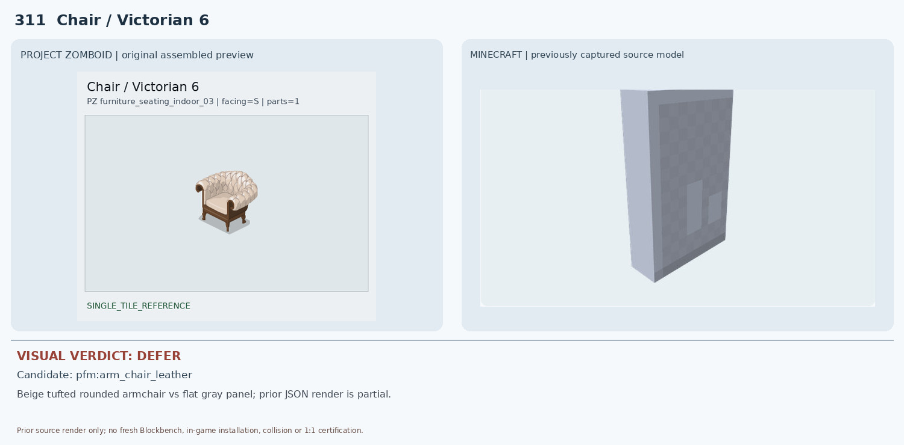
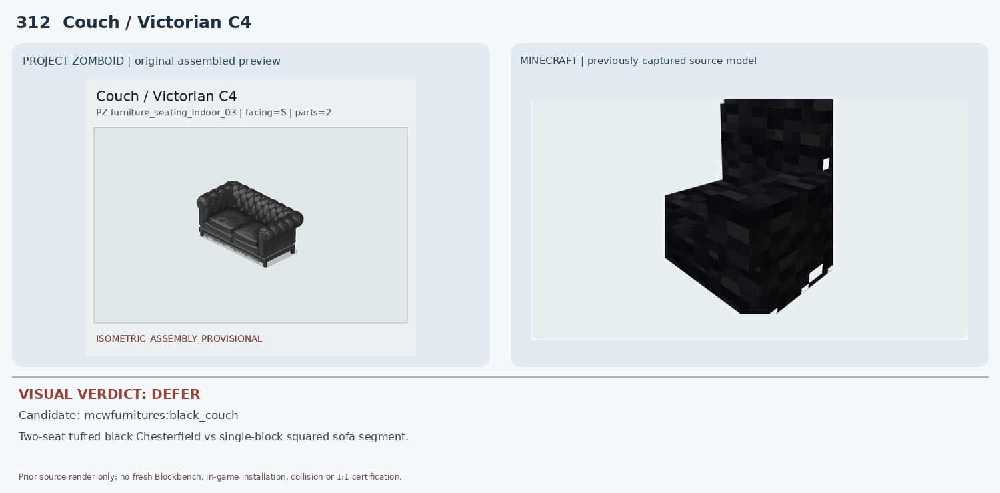
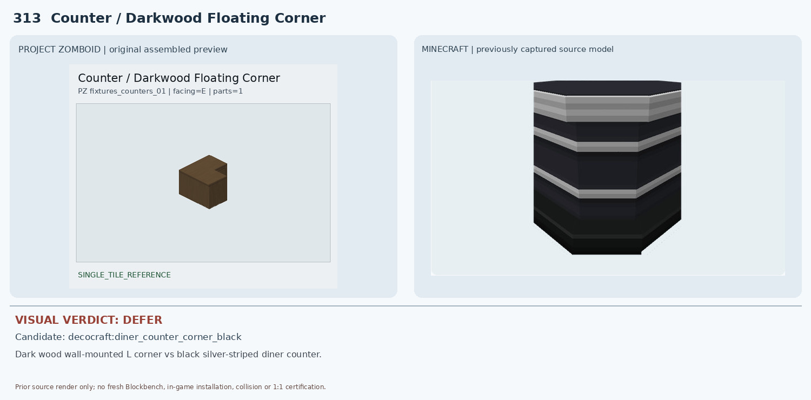
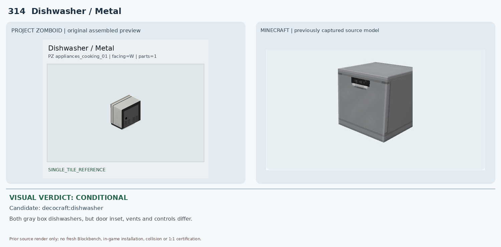
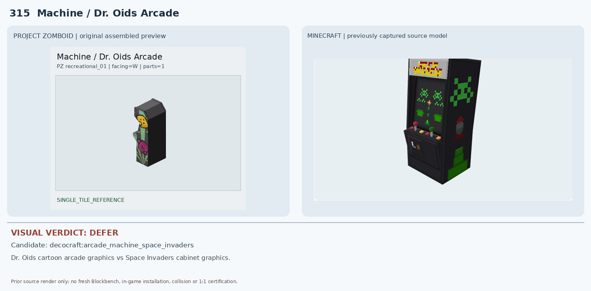
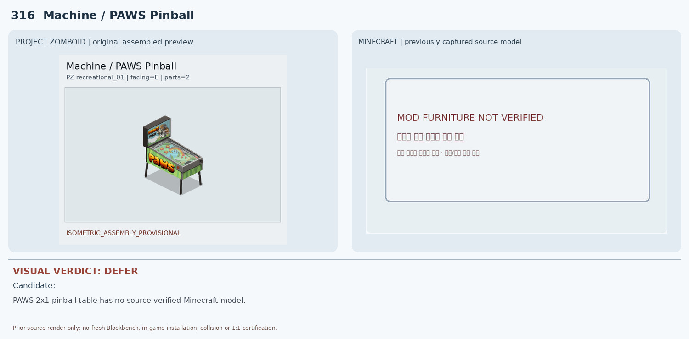
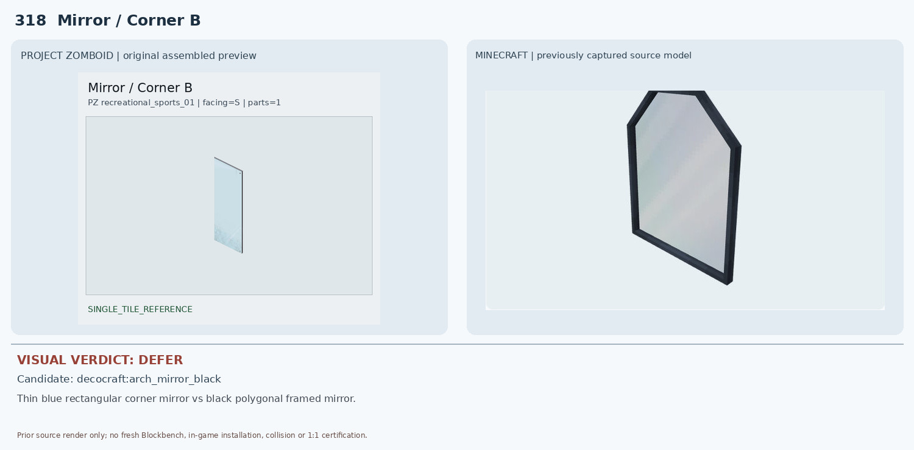
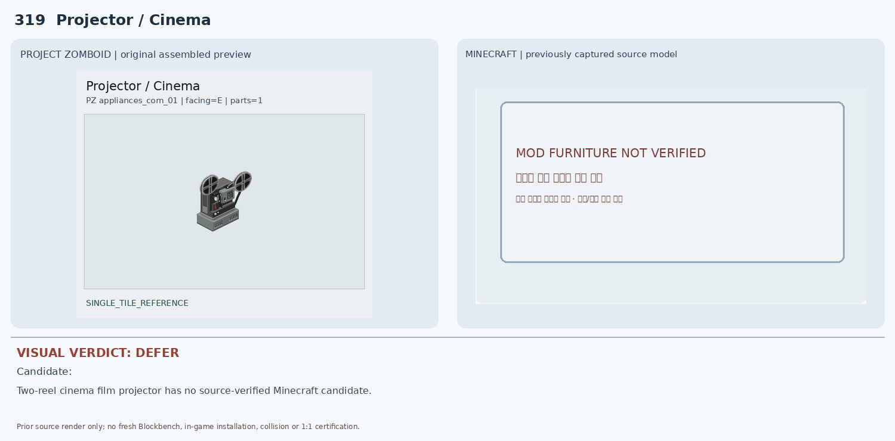
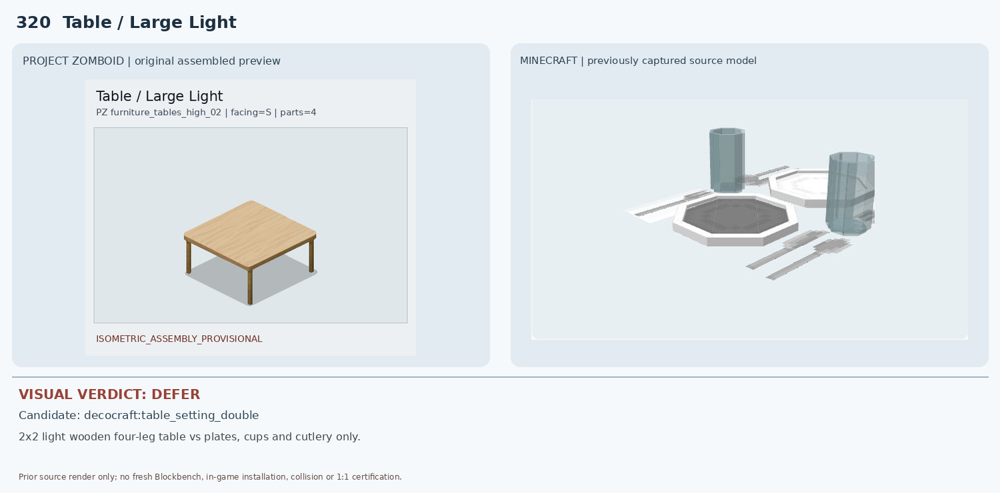

# 311–320 · 로즈우드 가구 이미지 대조

[전체 357종 목록](../README.md) · [원본 검수 PR #271](https://github.com/sanato-nb/PZ_Tile_Analysis/pull/271)

오른쪽 후보는 게임 적용이 확정된 모델이 아니야. **보류**는 추가 탐색 대상이야.

## 311 · Chair / Victorian 6

**보류 · 재탐색** · [원본 PR #271](https://github.com/sanato-nb/PZ_Tile_Analysis/pull/271)

PZ는 빅토리아식 베이지 버튼터프팅 안락의자. 기존 Minecraft 이미지는 회색 평판/벽면 형태만 나타나 좌석·팔걸이·다리·쿠션이 확인되지 않는다. 원본 JSON 부분 렌더이므로 실제 가구 외형 비교 불가능.

---

## 312 · Couch / Victorian C4

**보류 · 재탐색** · [원본 PR #271](https://github.com/sanato-nb/PZ_Tile_Analysis/pull/271)

PZ는 2×1 검정 가죽 체스터필드 소파로 둥근 팔걸이와 버튼 장식이 뚜렷하다. Minecraft 후보는 각진 검정 단일 소파 블록/부분 모듈이며 원본의 2좌석 길이·팔걸이·터프팅을 재현하지 않는다.

---

## 313 · Counter / Darkwood Floating Corner

**보류 · 재탐색** · [원본 PR #271](https://github.com/sanato-nb/PZ_Tile_Analysis/pull/271)

PZ는 나무 상판이 꺾인 짙은 갈색 벽부착 코너 수납장이다. 후보는 검은색 본체와 은색 가로 띠의 바닥형 다이너 카운터로 재질·설치 높이·색상·구조가 모두 다르다.

---

## 314 · Dishwasher / Metal

**조건부 후보** · [원본 PR #271](https://github.com/sanato-nb/PZ_Tile_Analysis/pull/271)

PZ와 Minecraft 후보 모두 회색 직육면체 식기세척기 형태여서 구조적 유사성이 있다. 그러나 PZ는 넓은 검정 전면 사각 패널과 하부 통풍구, 후보는 회색 전면도어와 상단 작은 조작부/손잡이여서 전면 구성과 비율이 다르다. 인게임 기능·충돌 미검증.

---

## 315 · Machine / Dr. Oids Arcade

**보류 · 재탐색** · [원본 PR #271](https://github.com/sanato-nb/PZ_Tile_Analysis/pull/271)

양쪽 모두 직립형 아케이드 캐비닛이지만 PZ의 노란 얼굴·분홍 캐릭터/문양과 후보의 초록 스페이스 인베이더 픽셀 그래픽은 완전히 다르다. 상단 장식과 조작부, 측면 디자인도 불일치한다.

---

## 316 · Machine / PAWS Pinball

**보류 · 재탐색** · [원본 PR #271](https://github.com/sanato-nb/PZ_Tile_Analysis/pull/271)

PZ 원본은 PAWS 로고가 있는 2×1 핀볼 기계로 경사판·백박스·다리가 모두 보인다. 기존 비교 이미지에는 Minecraft 모델이 없다고 표시되어 실제 원본 모델 대조 자체가 불가능하다.

---

## 317 · Mirror / Corner A

**보류 · 재탐색** · [원본 PR #271](https://github.com/sanato-nb/PZ_Tile_Analysis/pull/271)

PZ는 얇은 회색 테두리의 높은 직사각 평면 거울이다. 후보는 두꺼운 검은 다각형 아치 프레임으로 상단 모양·프레임 두께·재질이 다르다. 벽부착/반사 기능도 미검증.

---

## 318 · Mirror / Corner B

**보류 · 재탐색** · [원본 PR #271](https://github.com/sanato-nb/PZ_Tile_Analysis/pull/271)

PZ 코너 B는 얇은 테두리와 푸른 유리의 직사각 거울이며 A와 배치 방향만 다르다. Minecraft 후보는 317번과 동일한 두꺼운 검은 아치 거울이라 외곽 형태와 프레임 색이 맞지 않고 A/B 방향 대응도 검증되지 않았다.

---

## 319 · Projector / Cinema

**보류 · 재탐색** · [원본 PR #271](https://github.com/sanato-nb/PZ_Tile_Analysis/pull/271)

PZ는 좌우의 원형 필름 릴이 뚜렷한 구식 영화 영사기다. Minecraft 후보 이미지가 'MOD FURNITURE NOT VERIFIED'로 비어 있어 비교할 실제 3D 모델이 없다.

---

## 320 · Table / Large Light

**보류 · 재탐색** · [원본 PR #271](https://github.com/sanato-nb/PZ_Tile_Analysis/pull/271)

PZ는 밝은 원목 2×2 식탁 전체와 네 다리다. Minecraft 후보는 접시·컵·수저 세팅 소품으로 식탁 본체/다리가 전혀 없다. 2×2 멀티타일 구조도 대응하지 못한다.

---

