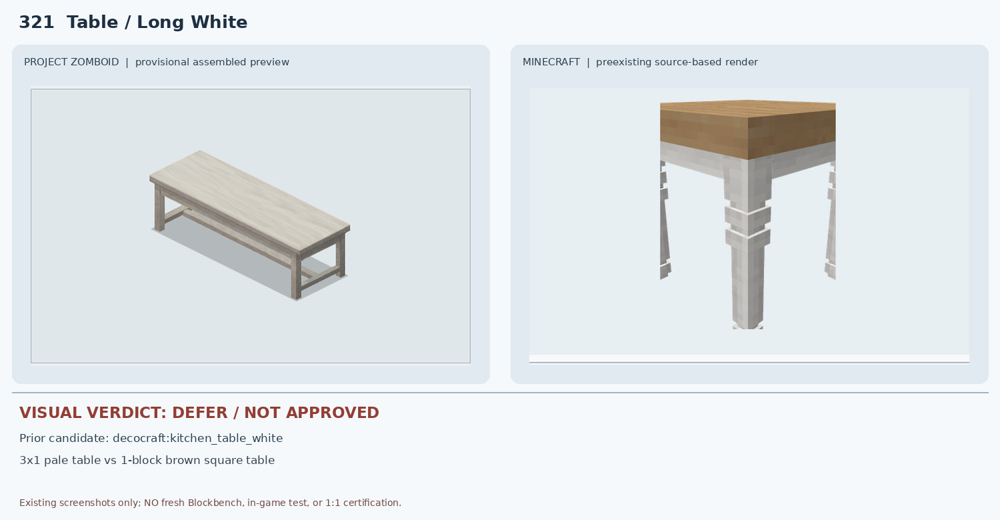
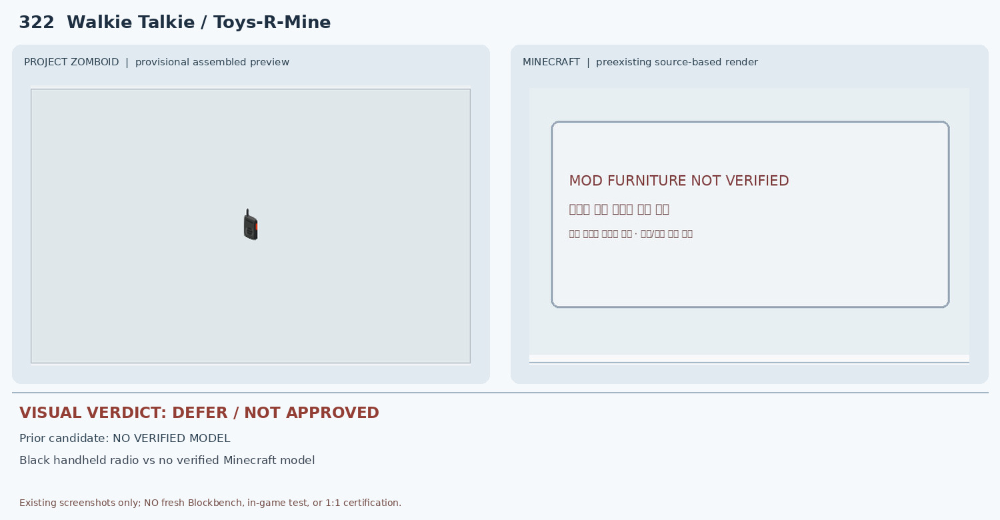
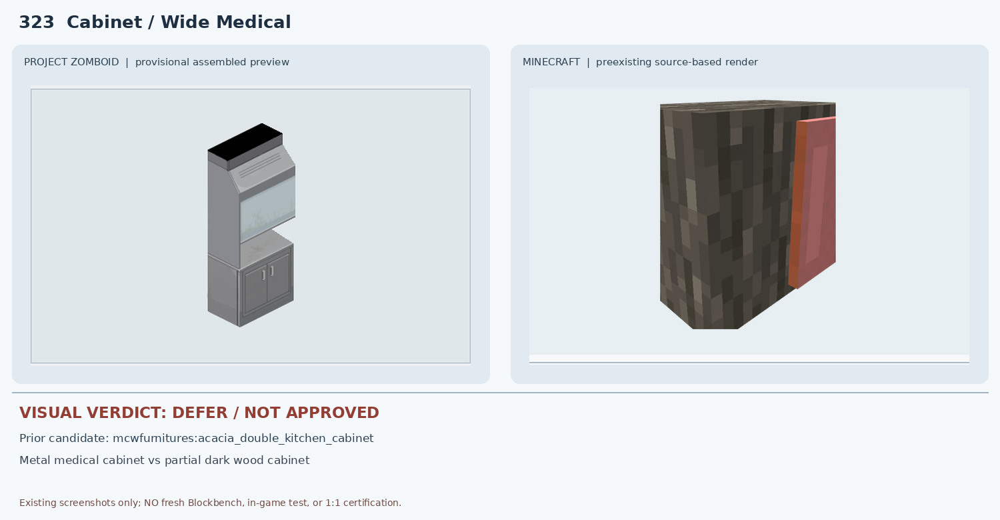
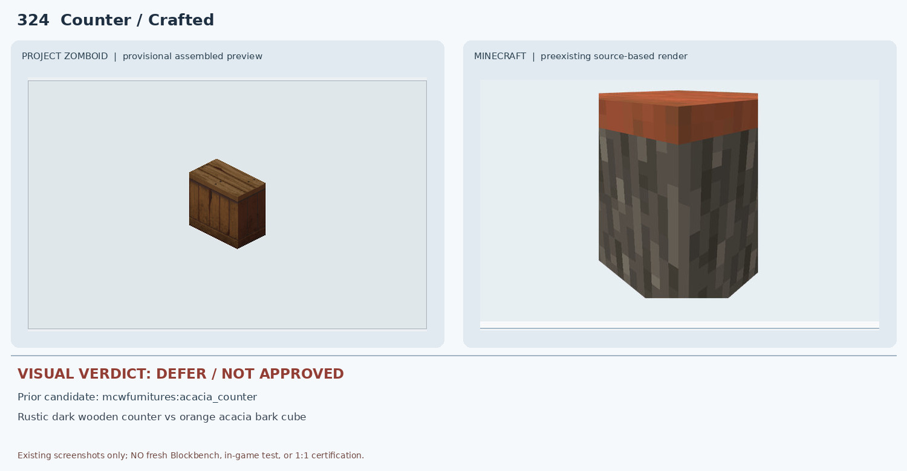
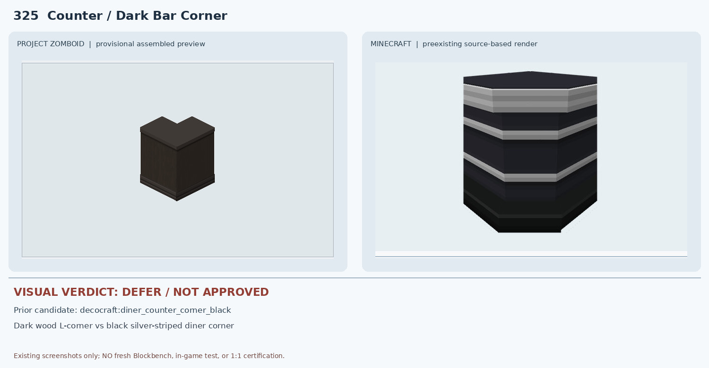
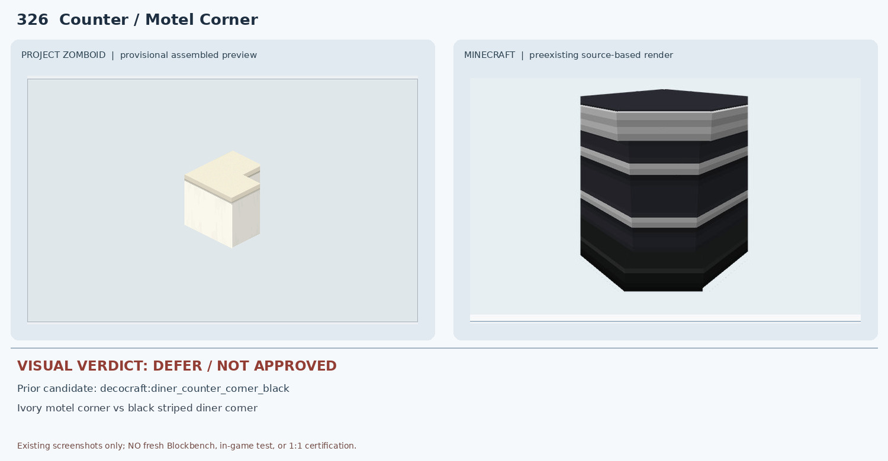
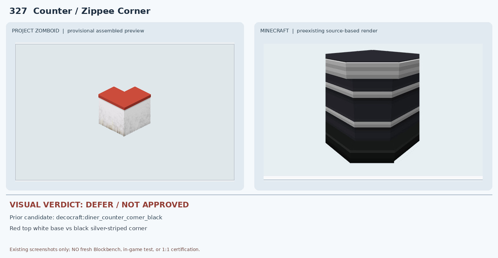
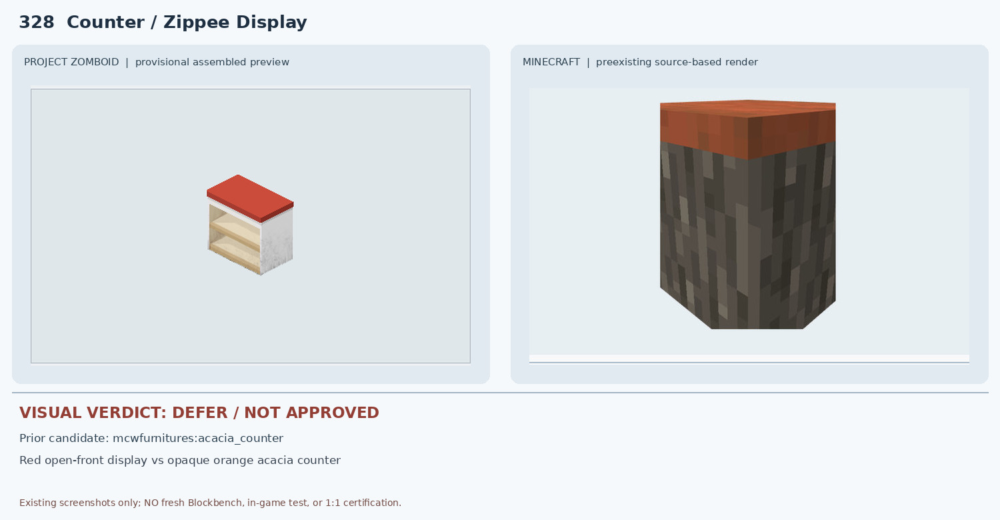
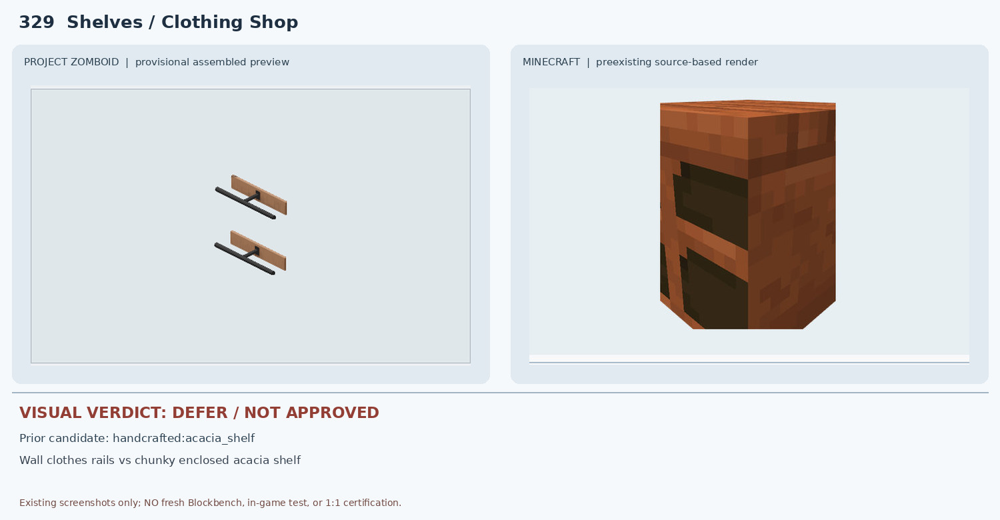
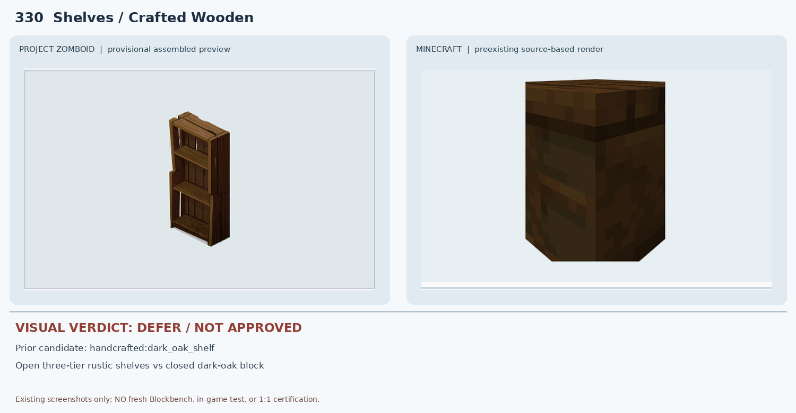

# 321–330 · 로즈우드 가구 이미지 대조

[전체 357종 목록](../README.md) · [원본 검수 PR #275](https://github.com/sanato-nb/PZ_Tile_Analysis/pull/275)

오른쪽 후보는 게임 적용이 확정된 모델이 아니야. **보류**는 추가 탐색 대상이야.

## 321 · Table / Long White

**보류 · 재탐색** · [원본 PR #275](https://github.com/sanato-nb/PZ_Tile_Analysis/pull/275)

PZ는 3×1 길이의 연한 목재 상판과 긴 가로 지지대가 있는 테이블이다. MC kitchen_table_white는 정사각형 1블록 갈색 상판·밝은 다리로 렌더되어 길이·색·지지대·멀티타일 점유가 불일치한다.

---

## 322 · Walkie Talkie / Toys-R-Mine

**보류 · 재탐색** · [원본 PR #275](https://github.com/sanato-nb/PZ_Tile_Analysis/pull/275)

PZ는 작은 검정 무전기지만 검증된 Minecraft 모드 원본 모델이 없다. 우측은 안내 카드로 실제 3D 렌더가 아니다. 통신 기능도 검증되지 않았다.

---

## 323 · Cabinet / Wide Medical

**보류 · 재탐색** · [원본 PR #275](https://github.com/sanato-nb/PZ_Tile_Analysis/pull/275)

PZ는 금속 의료 수납장에 경사진 상단과 밝은 패널·하단 양문이 있지만 MC 후보는 어두운 아카시아 통나무 질감과 붉은 문처럼 보이는 부분 JSON 렌더다. 재질·색·형상이 다르고 완성 모델 증거도 부족하다.

---

## 324 · Counter / Crafted

**보류 · 재탐색** · [원본 PR #275](https://github.com/sanato-nb/PZ_Tile_Analysis/pull/275)

PZ는 짙은 갈색 판재를 수직으로 조립한 카운터인데 MC acacia_counter는 주황 상판과 회흑색 나무껍질 질감의 단순 상자다. 판재 배열·재질·색상이 다르다.

---

## 325 · Counter / Dark Bar Corner

**보류 · 재탐색** · [원본 PR #275](https://github.com/sanato-nb/PZ_Tile_Analysis/pull/275)

둘 다 코너형이지만 PZ는 짙은 갈색 목재이고 MC는 검정 몸체에 굵은 은회색 가로 줄무늬가 반복되는 식당 카운터다. 상판·전면 질감이 다르다.

---

## 326 · Counter / Motel Corner

**보류 · 재탐색** · [원본 PR #275](https://github.com/sanato-nb/PZ_Tile_Analysis/pull/275)

PZ는 밝은 아이보리색 모텔 코너 카운터인데 MC 후보는 검정 몸체와 은회색 띠의 식당 카운터다. 코너 실루엣 외 색상·패널·재질이 다르다.

---

## 327 · Counter / Zippee Corner

**보류 · 재탐색** · [원본 PR #275](https://github.com/sanato-nb/PZ_Tile_Analysis/pull/275)

PZ는 빨간 상판과 흰색 하부의 Zippee 코너인데 MC 후보는 검정·은색 줄무늬 카운터다. 상판·하부 색상과 패널 질감이 다르다.

---

## 328 · Counter / Zippee Display

**보류 · 재탐색** · [원본 PR #275](https://github.com/sanato-nb/PZ_Tile_Analysis/pull/275)

PZ는 빨간 상판 아래 열린 진열 선반이 있지만 MC acacia_counter는 주황 상판과 어두운 나무껍질 질감의 불투명 상자다. 열린 진열공간·색상·재질이 다르다.

---

## 329 · Shelves / Clothing Shop

**보류 · 재탐색** · [원본 PR #275](https://github.com/sanato-nb/PZ_Tile_Analysis/pull/275)

PZ는 검정 의류 걸이 봉과 갈색 받침이 분리된 벽걸이 구조인데 MC acacia_shelf는 두꺼운 갈색 목재 덩어리 형태의 선반이다. 금속 봉·벽 고정 구조·빈 공간이 다르다.

---

## 330 · Shelves / Crafted Wooden

**보류 · 재탐색** · [원본 PR #275](https://github.com/sanato-nb/PZ_Tile_Analysis/pull/275)

PZ는 전면이 크게 열린 3단 원목 선반인데 MC dark_oak_shelf JSON 렌더는 어두운 목재의 닫힌 상자처럼 보여 개방된 3단 구조가 확인되지 않는다. 승인할 수 없다.

---

