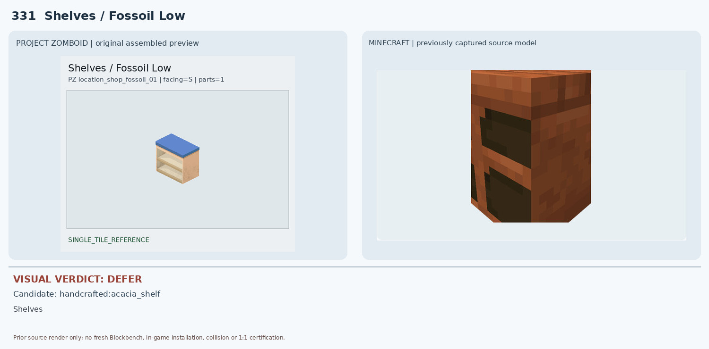
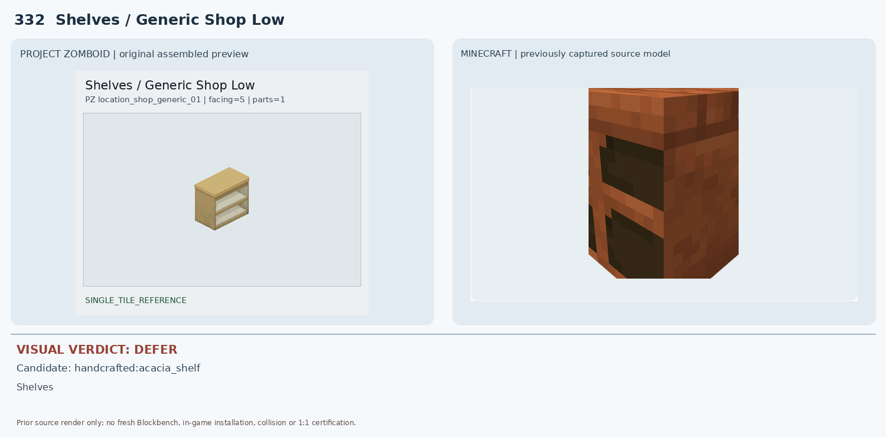
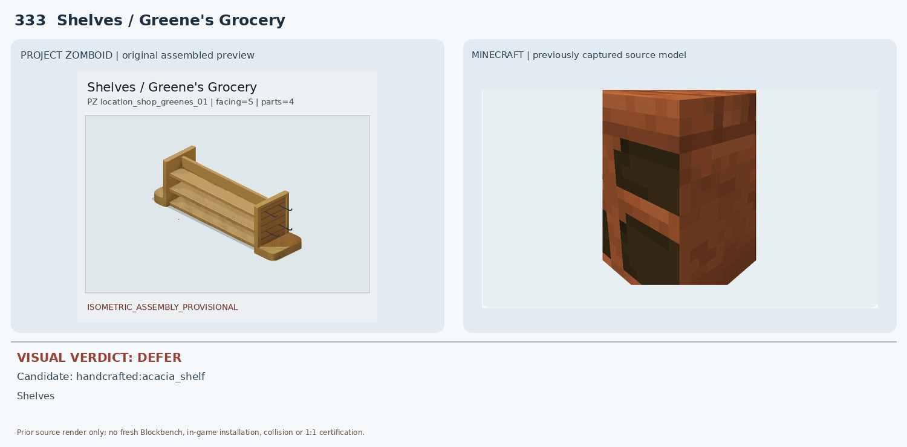
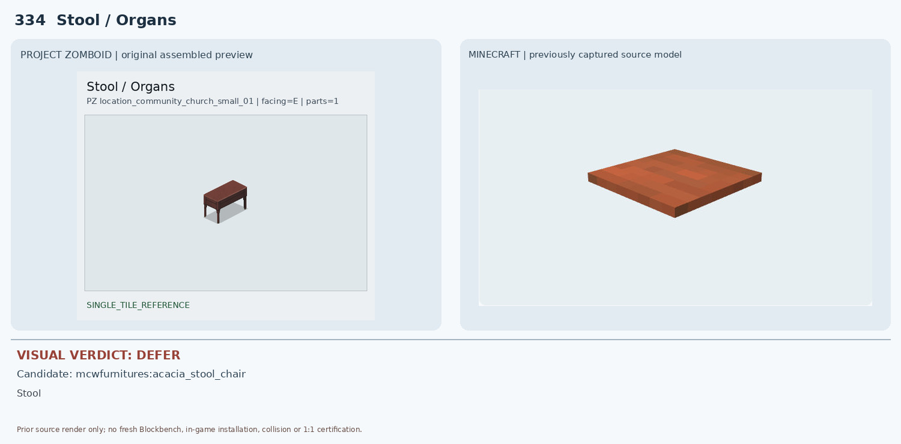
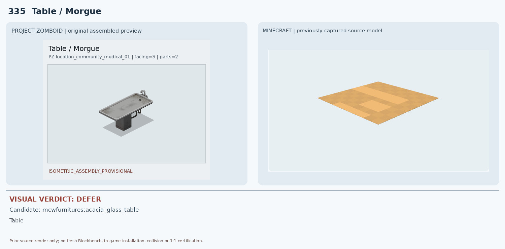
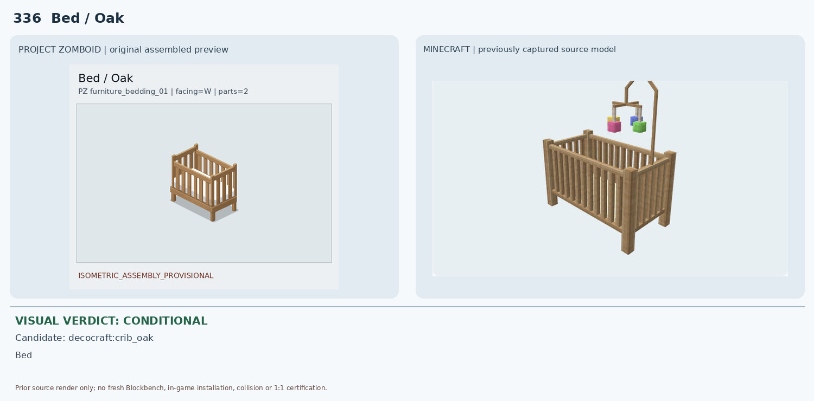
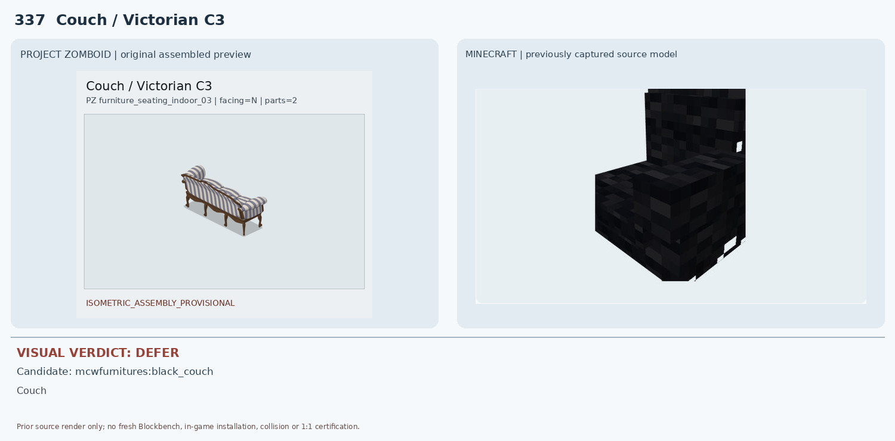
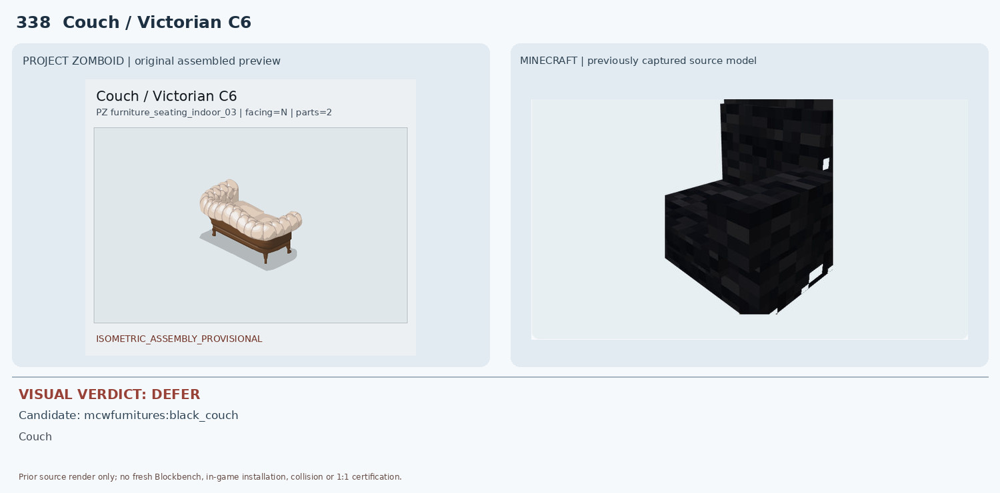
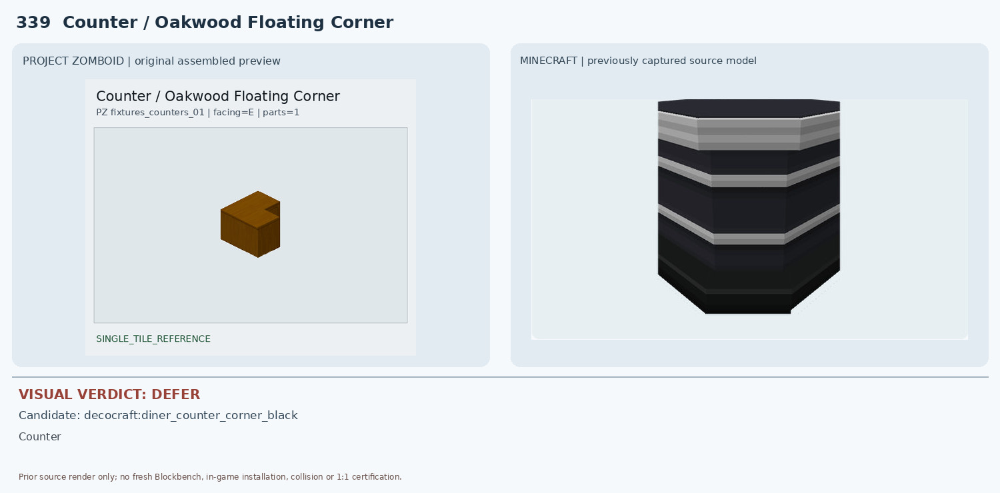
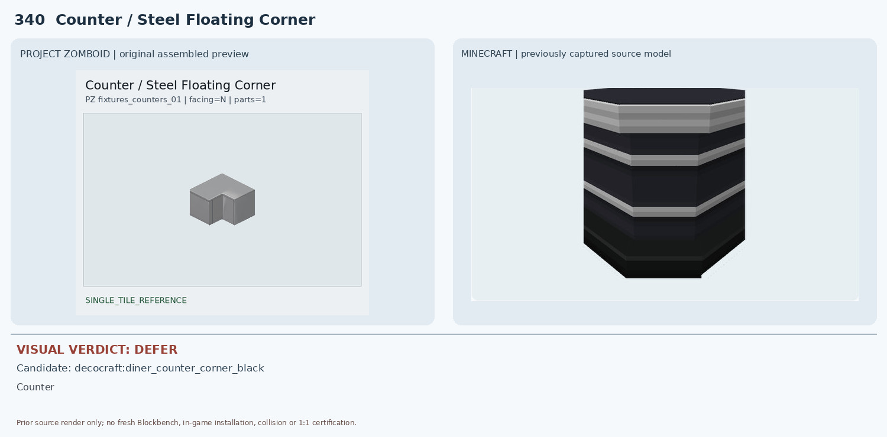

# 331–340 · 로즈우드 가구 이미지 대조

[전체 357종 목록](../README.md) · [원본 검수 PR #276](https://github.com/sanato-nb/PZ_Tile_Analysis/pull/276)

오른쪽 후보는 게임 적용이 확정된 모델이 아니야. **보류**는 추가 탐색 대상이야.

## 331 · Shelves / Fossoil Low

**보류 · 재탐색** · [원본 PR #276](https://github.com/sanato-nb/PZ_Tile_Analysis/pull/276)

Handcrafted 아카시아 후보는 주황빛 닫힌 상자처럼 보이고 어두운 전면 구멍만 있으며 파란 상판·밝은 2단 오픈 선반 구조가 없음

---

## 332 · Shelves / Generic Shop Low

**보류 · 재탐색** · [원본 PR #276](https://github.com/sanato-nb/PZ_Tile_Analysis/pull/276)

Handcrafted 아카시아 후보는 어두운 주황 갈색 상자형 렌더이며 열린 밝은 선반판 두 개가 나타나지 않음

---

## 333 · Shelves / Greene's Grocery

**보류 · 재탐색** · [원본 PR #276](https://github.com/sanato-nb/PZ_Tile_Analysis/pull/276)

MC 1×1 상자형 아카시아 선반은 4블록 길이와 3단 선반, 측면 걸이 및 개방형 구조를 재현하지 못함

---

## 334 · Stool / Organs

**보류 · 재탐색** · [원본 PR #276](https://github.com/sanato-nb/PZ_Tile_Analysis/pull/276)

Macaw 아카시아 스툴은 얇은 평판 일부만 렌더되어 네 다리·측면 프레임이 전혀 검증되지 않으며 색도 밝은 주황 계열

---

## 335 · Table / Morgue

**보류 · 재탐색** · [원본 PR #276](https://github.com/sanato-nb/PZ_Tile_Analysis/pull/276)

MC 아카시아 유리 탁자 후보는 노란색 평판 부분만 보이며 금속 트레이·수도꼭지·중앙 기둥 및 1×2 길이가 없음

---

## 336 · Bed / Oak

**조건부 후보** · [원본 PR #276](https://github.com/sanato-nb/PZ_Tile_Analysis/pull/276)

Decocraft crib_oak는 밝은 목재 난간·다리의 전체적인 사물 종류와 형태가 상당히 비슷하지만 상부 모빌과 장식물이 추가되고 높이·크기 및 설치 점유가 불확실

---

## 337 · Couch / Victorian C3

**보류 · 재탐색** · [원본 PR #276](https://github.com/sanato-nb/PZ_Tile_Analysis/pull/276)

MC 검정 소파는 단색 검정 직각 쿠션과 블록형 형태로 줄무늬·곡선 팔걸이·목재 장식 다리가 전혀 다름

---

## 338 · Couch / Victorian C6

**보류 · 재탐색** · [원본 PR #276](https://github.com/sanato-nb/PZ_Tile_Analysis/pull/276)

MC 검정 직선형 소파는 색상과 등받이 곡률, 크림색 버튼 장식, 다리 구조가 전부 불일치

---

## 339 · Counter / Oakwood Floating Corner

**보류 · 재탐색** · [원본 PR #276](https://github.com/sanato-nb/PZ_Tile_Analysis/pull/276)

Decocraft 검정·은색 줄무늬 다이너 코너 카운터는 재질·색·전면 패널이 다르고 바닥형 모델로 벽면 부착 상부 가구를 대체할 수 없음

---

## 340 · Counter / Steel Floating Corner

**보류 · 재탐색** · [원본 PR #276](https://github.com/sanato-nb/PZ_Tile_Analysis/pull/276)

Decocraft 검정·은색 줄무늬 다이너 코너 카운터는 검정 바닥형 가구로 회색 벽걸이 코너 금속장의 색상·재질·설치 높이가 다름

---

