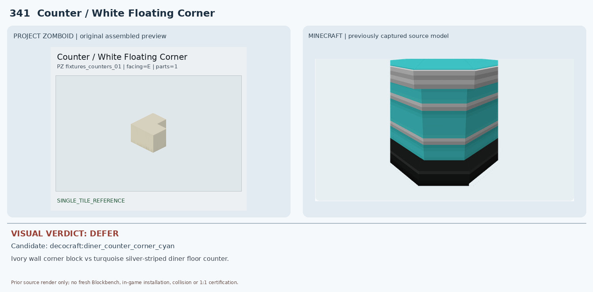
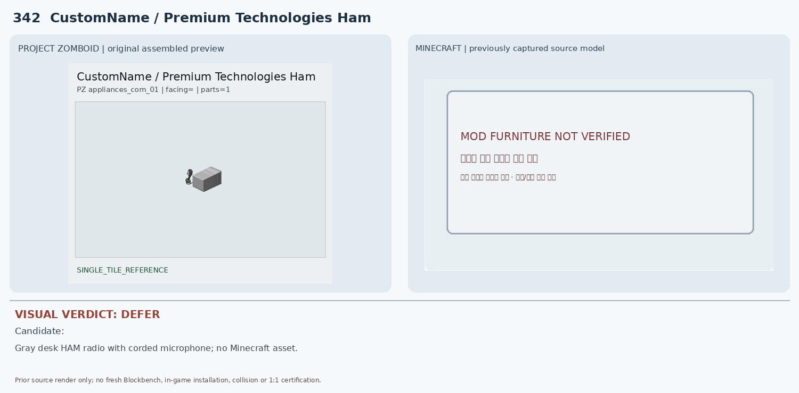
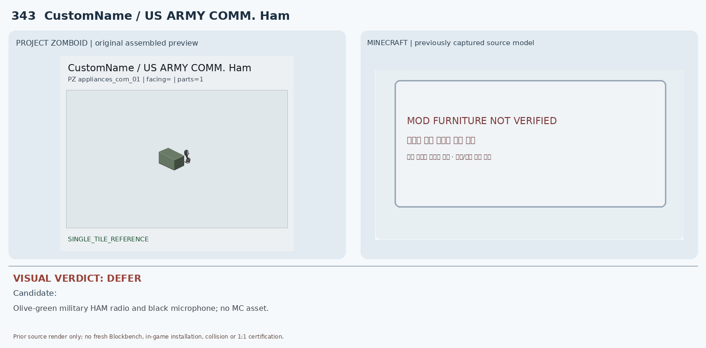
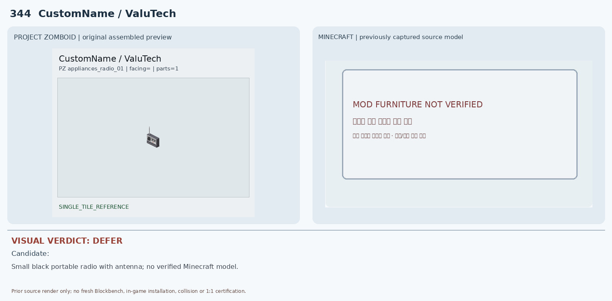
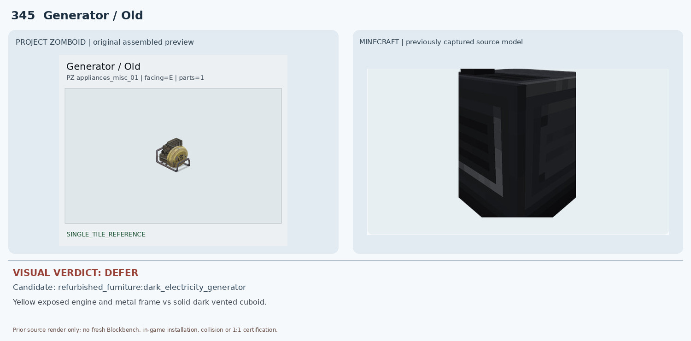
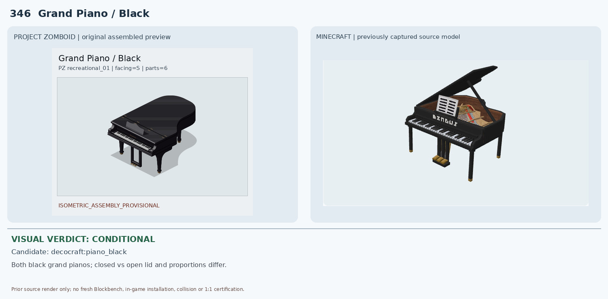
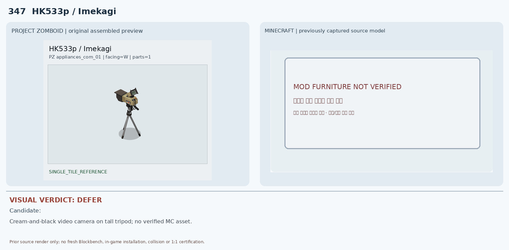
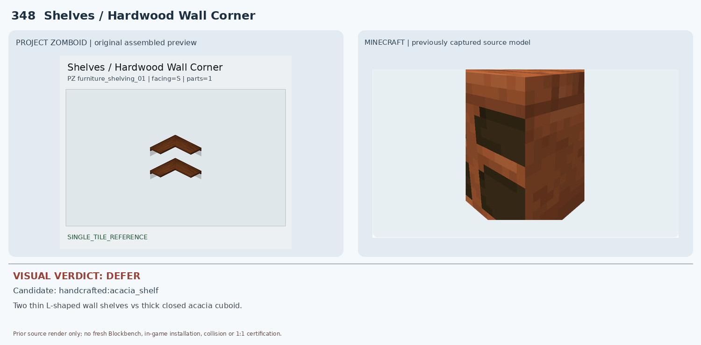
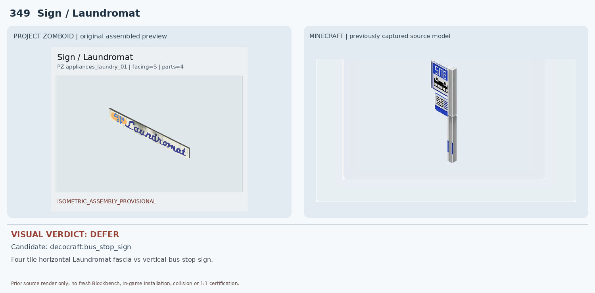
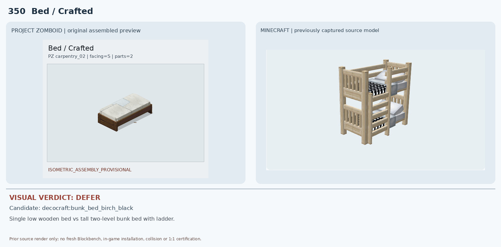

# 341–350 · 로즈우드 가구 이미지 대조

[전체 357종 목록](../README.md) · [원본 검수 PR #273](https://github.com/sanato-nb/PZ_Tile_Analysis/pull/273)

오른쪽 후보는 게임 적용이 확정된 모델이 아니야. **보류**는 추가 탐색 대상이야.

## 341 · Counter / White Floating Corner

**보류 · 재탐색** · [원본 PR #273](https://github.com/sanato-nb/PZ_Tile_Analysis/pull/273)

PZ는 밝은 아이보리색의 ㄱ자 형태로 한쪽에 파인 홈이 있으며 금속 줄무늬가 없다. Decocraft 후보는 청록색 금속 띠가 둘러진 검정 바닥 받침형 카운터로 색상, 표면, 설치 높이와 구조가 모두 다르다.

---

## 342 · CustomName / Premium Technologies Ham

**보류 · 재탐색** · [원본 PR #273](https://github.com/sanato-nb/PZ_Tile_Analysis/pull/273)

PZ Premium Technologies Ham은 작은 회색 직육면체 본체와 검정 유선 핸드마이크가 연결된 탁상형 무전기다. Minecraft 측은 원본 검증 모델이 없어 형상·재질·기능 비교 자체가 불가능하다.

---

## 343 · CustomName / US ARMY COMM. Ham

**보류 · 재탐색** · [원본 PR #273](https://github.com/sanato-nb/PZ_Tile_Analysis/pull/273)

PZ US ARMY COMM. Ham은 짙은 올리브색 군용 통신기 본체와 검정 유선 마이크를 갖는다. 원본 검증된 Minecraft 모델이 없으며 342번 회색 민간용과 색상·외형이 다르다.

---

## 344 · CustomName / ValuTech

**보류 · 재탐색** · [원본 PR #273](https://github.com/sanato-nb/PZ_Tile_Analysis/pull/273)

PZ ValuTech는 작은 검정/회색 휴대용 라디오이며 상부 안테나와 전면 다이얼/표시부가 있다. Minecraft 후보 모델이 비어 있어 정확한 모델 비교가 불가능하다.

---

## 345 · Generator / Old

**보류 · 재탐색** · [원본 PR #273](https://github.com/sanato-nb/PZ_Tile_Analysis/pull/273)

PZ Old 발전기는 원형 황색 부품과 노출된 엔진을 금속 파이프 프레임이 감싼 구조다. 기존 Minecraft 렌더는 검정 통풍구가 있는 막힌 직육면체로 원형 엔진·파이프 프레임이 없다. 또한 JSON 렌더는 부분 증거여서 전체 모델도 미확인.

---

## 346 · Grand Piano / Black

**조건부 후보** · [원본 PR #273](https://github.com/sanato-nb/PZ_Tile_Analysis/pull/273)

PZ와 Decocraft 후보는 모두 검정 그랜드 피아노이고 건반·페달·다리가 확인돼 물체 종류는 잘 맞는다. 그러나 PZ는 닫힌 둥근 곡면 상판인 반면 후보는 뚜껑이 열려 내부 현과 악보대가 드러난다. 다리 수·몸통 비율·2×3 배치와 기능은 확인되지 않았다.

---

## 347 · HK533p / Imekagi

**보류 · 재탐색** · [원본 PR #273](https://github.com/sanato-nb/PZ_Tile_Analysis/pull/273)

PZ HK533p Imekagi는 높은 삼각대에 설치된 크림색/검정 카메라로 상부 뷰파인더와 렌즈/손잡이가 보인다. Minecraft 후보가 없어서 삼각대와 카메라 구조를 비교할 수 없다.

---

## 348 · Shelves / Hardwood Wall Corner

**보류 · 재탐색** · [원본 PR #273](https://github.com/sanato-nb/PZ_Tile_Analysis/pull/273)

PZ Hardwood Wall Corner는 벽 모서리에 걸린 두 개의 얇은 ㄱ자 선반 판이며 하부가 완전히 열려 있다. Minecraft Handcrafted acacia_shelf 렌더는 큰 육면체 상자에 두 개의 검은 전면 틈이 있는 구조로 ㄱ자 판, 벽 코너 결합, 개방성이 재현되지 않는다.

---

## 349 · Sign / Laundromat

**보류 · 재탐색** · [원본 PR #273](https://github.com/sanato-nb/PZ_Tile_Analysis/pull/273)

PZ는 가로로 네 타일 이어지는 세탁소 간판이다. 기존 후보는 세로형 파란 버스정류장 표지판으로 문구, 방향, 길이, 설치 방식이 전혀 다르며 기존 렌더도 LEGACY_3D_APPROXIMATION 등급이다.

---

## 350 · Bed / Crafted

**보류 · 재탐색** · [원본 PR #273](https://github.com/sanato-nb/PZ_Tile_Analysis/pull/273)

PZ Crafted Bed는 낮은 단층 침대 1개로 갈색 목재 프레임과 흰 매트리스가 보인다. Minecraft 후보는 밝은 목재 사다리·난간이 있는 2층 침대여서 층수, 높이, 프레임 색상, 1×2 구조가 다르다.

---

