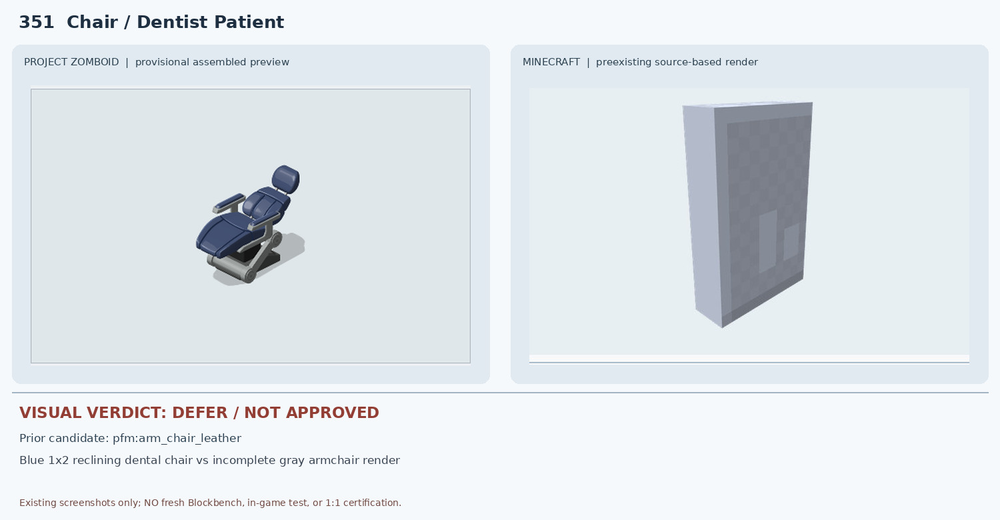
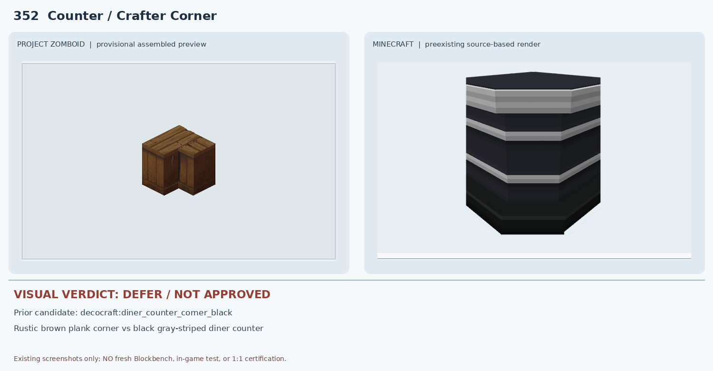
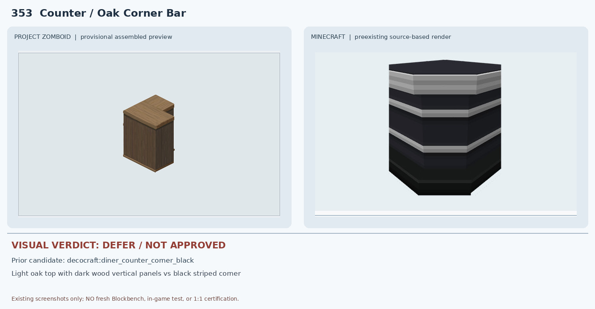
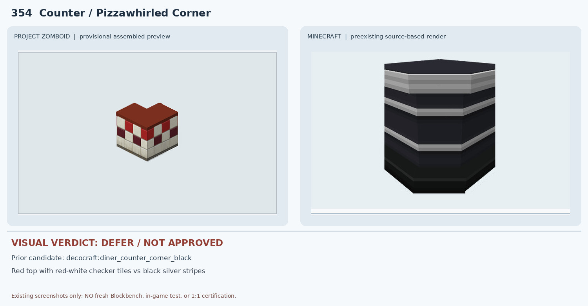
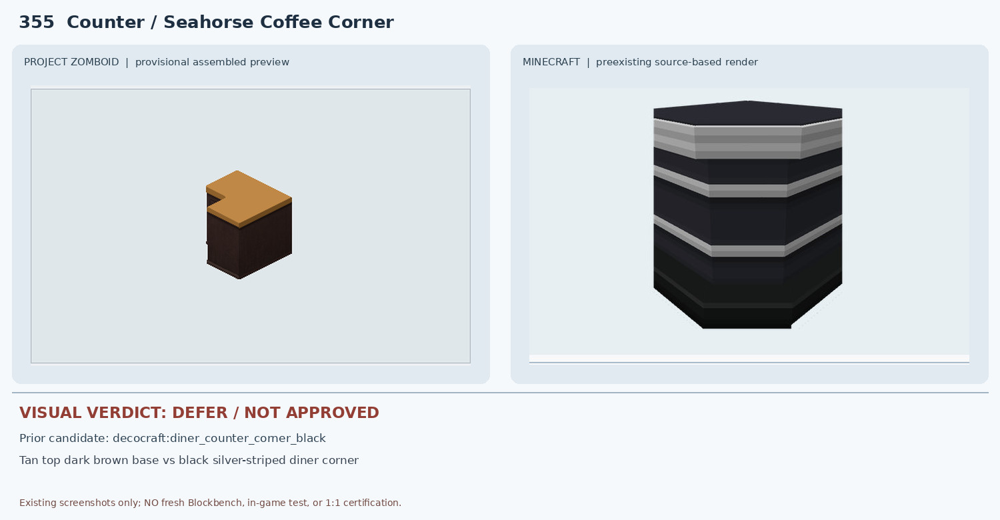
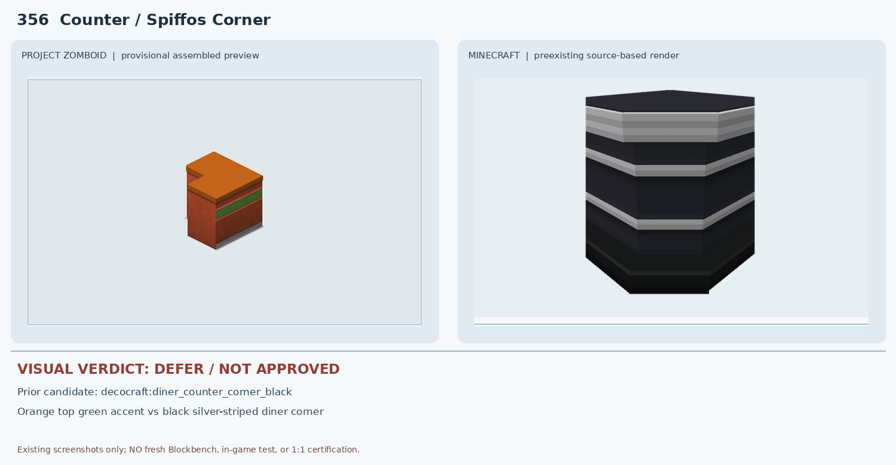
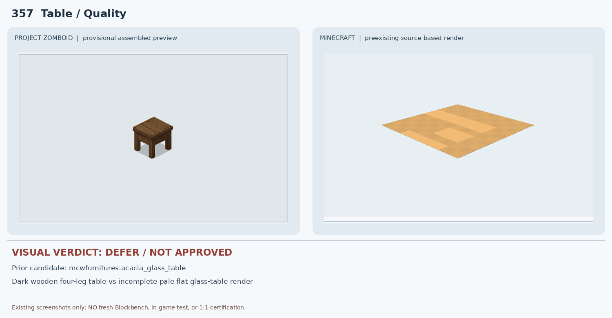

# 351–357 · 로즈우드 가구 이미지 대조

[전체 357종 목록](../README.md) · [원본 검수 PR #277](https://github.com/sanato-nb/PZ_Tile_Analysis/pull/277)

오른쪽 후보는 게임 적용이 확정된 모델이 아니야. **보류**는 추가 탐색 대상이야.

## 351 · Chair / Dentist Patient

**보류 · 재탐색** · [원본 PR #277](https://github.com/sanato-nb/PZ_Tile_Analysis/pull/277)

PZ는 1×2 진료용 리클라이닝 체어와 발받침·금속 프레임이 일체화되어 있다. 기존 MC pfm:arm_chair_leather의 Blockbench 결과는 회색 평판처럼 보이는 부분 JSON 렌더라 팔걸이·발받침·기울기·1×2 형상을 검증할 수 없다. 용도도 일반 가죽 안락의자여서 승인 불가.

---

## 352 · Counter / Crafter Corner

**보류 · 재탐색** · [원본 PR #277](https://github.com/sanato-nb/PZ_Tile_Analysis/pull/277)

PZ는 거친 갈색 목재 판재로 만든 L자 수제 코너이고, MC는 검정 본체와 은회색 가로띠가 두드러지는 식당 카운터다. 코너 실루엣만 비슷하며 색상·재질·판재 방향이 다르다.

---

## 353 · Counter / Oak Corner Bar

**보류 · 재탐색** · [원본 PR #277](https://github.com/sanato-nb/PZ_Tile_Analysis/pull/277)

PZ는 밝은 오크 상판과 진한 목재 세로 패널을 조합한 코너 바인데 MC는 검정 상판과 회색 수평 줄무늬가 있는 식당 카운터다. 상판 색·세로 나뭇결·L자 길이와 방향이 불일치한다.

---

## 354 · Counter / Pizzawhirled Corner

**보류 · 재탐색** · [원본 PR #277](https://github.com/sanato-nb/PZ_Tile_Analysis/pull/277)

PZ는 붉은 상판과 빨강·흰색 체크 타일 벽면이 특징인데 MC는 검정 본체와 회색 가로 띠다. 색상·체커보드 패턴·매장 정체성이 모두 다르다.

---

## 355 · Counter / Seahorse Coffee Corner

**보류 · 재탐색** · [원본 PR #277](https://github.com/sanato-nb/PZ_Tile_Analysis/pull/277)

PZ는 밝은 황토색 상판과 어두운 갈색의 무늬 없는 목재 몸체로 구성되지만 MC는 검정 상판과 은회색 가로 줄무늬다. 상판 색상·하부 재질·띠 유무가 다르다.

---

## 356 · Counter / Spiffos Corner

**보류 · 재탐색** · [원본 PR #277](https://github.com/sanato-nb/PZ_Tile_Analysis/pull/277)

PZ는 주황 상판·갈색 몸체·초록색 장식 띠가 핵심인데 MC는 검정 상판과 은회색 줄무늬다. 주황/초록 배색과 전면 패널 구조가 모두 불일치한다.

---

## 357 · Table / Quality

**보류 · 재탐색** · [원본 PR #277](https://github.com/sanato-nb/PZ_Tile_Analysis/pull/277)

PZ는 짙은 갈색 원목 상판과 네 개의 굵은 다리가 있는 소형 목재 테이블이다. MC acacia_glass_table의 비교 이미지는 밝은 주황색 평판만 보이는 불완전한 부분 JSON 렌더이며 유리/다리 구조가 확인되지 않는다. 재질·색상·형상이 일치하지 않는다.

---

