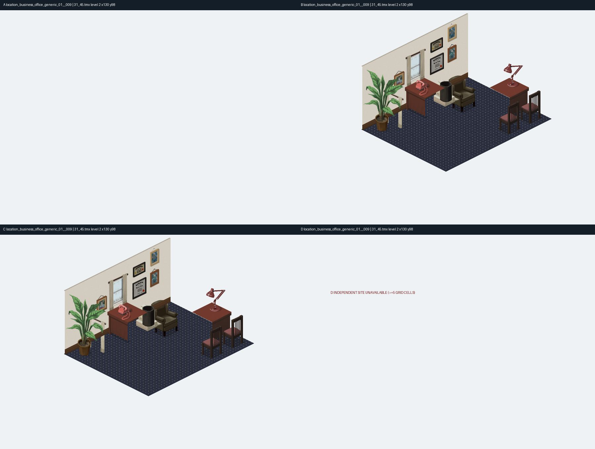
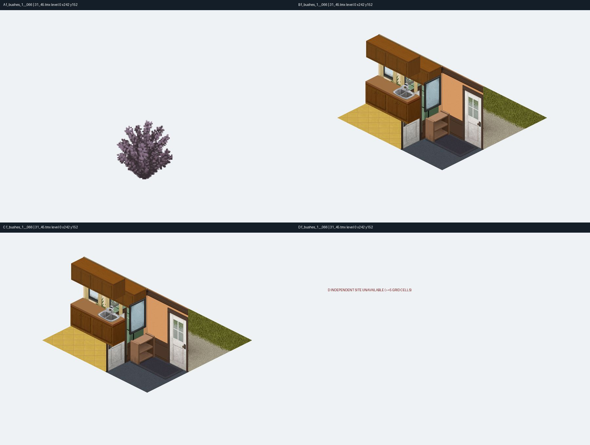
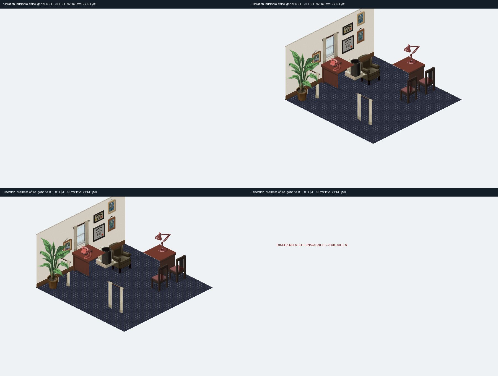
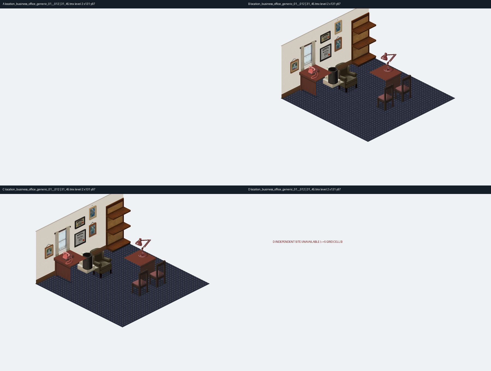
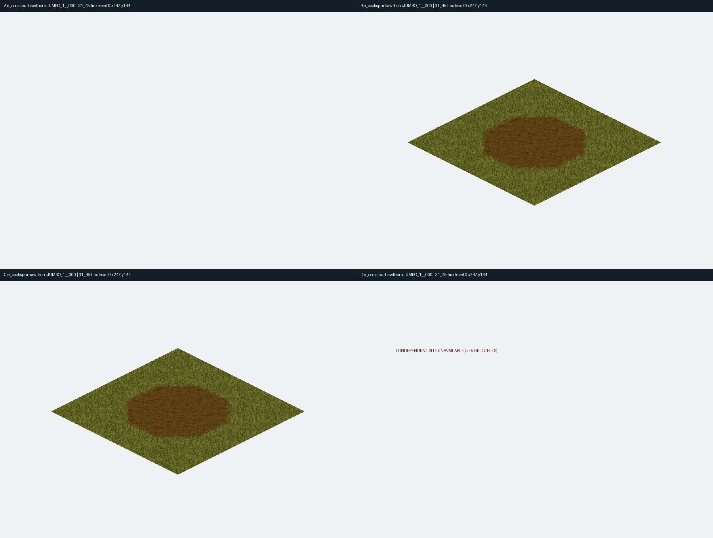
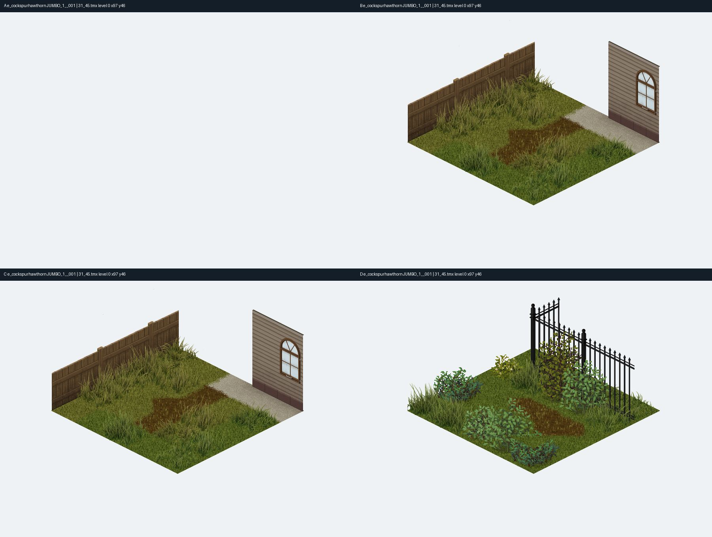
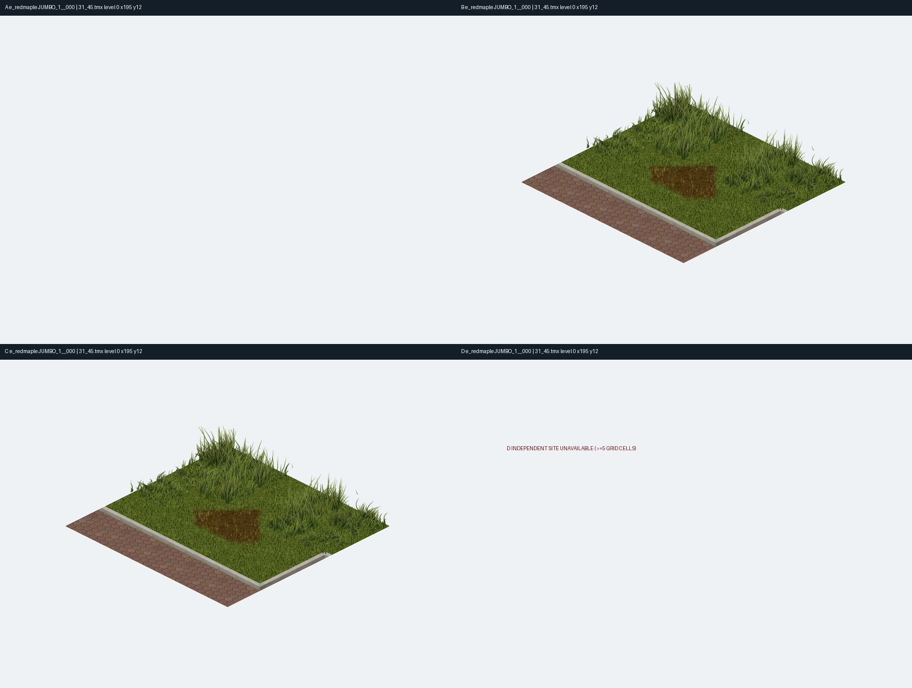

# 프로젝트 좀보이드 B42 — 미관찰 9종 사용자 직접 검수

> **기준:** v111 검증 SQLite (5,400/5,409종 관찰, 미관찰 9종, 최종 인증 0종). v112 원본 소스 재조사 반영. **이 페이지는 사용자 검수용이며 관찰 수·공식 인증 수를 올리지 않습니다.**

**이미지 보는 방법:** A=원본 타일, B=해당 TMX 층의 주변 5×5 합성, C=선택 타일 배치만 제거, D=다른 TMX 사용 위치(없으면 안내판). B/C 차이가 0이라도 그 타일이 원래부터 ‘빈 타일’이라고 최종 단정할 수는 없습니다. 격자·Local ID 정합은 아직 미검증입니다.

## 9종 한눈에 보기

| 번호 | 타일셋 / Local ID | 지금까지 확인된 상태 | 비교 이미지 |
|---|---|---|---|
| 1 | `location_business_office_generic_01` / **9** | A 완전 투명 · B–C 변화 0 | [비교판 보기](../checkpoints/v111_singleuse_preview/location_business_office_generic_01__009_ABCD.jpg) |
| 2 | `f_bushes_1` / **66** | A 불투명 4,837픽셀 · B–C 변화 0 | [비교판 보기](../checkpoints/v111_singleuse_preview/f_bushes_1__066_ABCD.jpg) |
| 3 | `location_business_office_generic_01` / **11** | A 완전 투명 · B–C 변화 0 | [비교판 보기](../checkpoints/v111_singleuse_preview/location_business_office_generic_01__011_ABCD.jpg) |
| 4 | `location_business_office_generic_01` / **12** | A 완전 투명 · B–C 변화 0 | [비교판 보기](../checkpoints/v111_singleuse_preview/location_business_office_generic_01__012_ABCD.jpg) |
| 5 | `camping_03 (ayrton orio's conflicted copy 2025-09-10)` / **19** | 정확한 이름 PNG 미확보 | [원본 후보 보기](../Tiles/2x/camping_03.png) |
| 6 | `e_cockspurhawthornJUMBO_1` / **0** | 하위폴더 PNG 발견 · A 빈 프레임 · B–C 변화 0 | [비교판 보기](../checkpoints/v112_jumbo_preview/e_cockspurhawthornJUMBO_1__000_ABCD.jpg) |
| 7 | `e_cockspurhawthornJUMBO_1` / **1** | 하위폴더 PNG 발견 · A 빈 프레임 · B–C 변화 0 | [비교판 보기](../checkpoints/v112_jumbo_preview/e_cockspurhawthornJUMBO_1__001_ABCD.jpg) |
| 8 | `e_redmapleJUMBO_1` / **0** | 하위폴더 PNG 발견 · A 빈 프레임 · B–C 변화 0 | [비교판 보기](../checkpoints/v112_jumbo_preview/e_redmapleJUMBO_1__000_ABCD.jpg) |
| 9 | `jumbo_tree_01` / **0** | 정확한 이름의 PNG 미확보 | 원본 없음 |

## 개별 검수 자료

### 1. `location_business_office_generic_01` — Local ID 9

**상태:** A 완전 투명 · B–C 변화 0

**근거:** 사무실 FloorOverlay1 타일. 주변에 책상·서류가 보이지만 해당 타일의 가시 픽셀은 0입니다.

**배치:** 31_45.tmx / 2층 / (130,98) / FloorOverlay1 / GID 10034

[이미지 원본 크게 열기](../checkpoints/v111_singleuse_preview/location_business_office_generic_01__009_ABCD.jpg)

[A의 실제 RGBA·투명도 크롭 확인](../audits/v112_remaining9/location_business_office_generic_01_9_A_rgba.png)

**사용자 검수 포인트:** 빈 프레임인지, 다른 원본/Local ID가 필요한지 확인

- [ ] 이 타일이 실제 나타내는 사물이나 부품을 식별했다.
- [ ] 원본 PNG·실제 GID/Local ID 또는 TileZed 렌더 대응을 확인했다.
**판정 / 근거 / 추가 파일 위치:** (사용자가 기입)

---

### 2. `f_bushes_1` — Local ID 66

**상태:** A 불투명 4,837픽셀 · B–C 변화 0

**근거:** A에는 식생 형태가 있으나 5×5 TMX 합성 장면에서 제거해도 변화가 나타나지 않습니다.

**배치:** 31_45.tmx / 0층 / (242,152) / FloorOverlay2 / GID 8347

[이미지 원본 크게 열기](../checkpoints/v111_singleuse_preview/f_bushes_1__066_ABCD.jpg)

[A의 실제 RGBA·투명도 크롭 확인](../audits/v112_remaining9/f_bushes_1_66_A_rgba.png)

**사용자 검수 포인트:** 가림·알파·배치 순서·Local ID 매핑을 확인

- [ ] 이 타일이 실제 나타내는 사물이나 부품을 식별했다.
- [ ] 원본 PNG·실제 GID/Local ID 또는 TileZed 렌더 대응을 확인했다.
**판정 / 근거 / 추가 파일 위치:** (사용자가 기입)

---

### 3. `location_business_office_generic_01` — Local ID 11

**상태:** A 완전 투명 · B–C 변화 0

**근거:** 사무실의 컴퓨터·책상은 주변 타일 이미지에만 존재하며 해당 원본 크롭은 투명합니다.

**배치:** 31_45.tmx / 2층 / (131,98) / FloorOverlay1 / GID 10036

[이미지 원본 크게 열기](../checkpoints/v111_singleuse_preview/location_business_office_generic_01__011_ABCD.jpg)

[A의 실제 RGBA·투명도 크롭 확인](../audits/v112_remaining9/location_business_office_generic_01_11_A_rgba.png)

**사용자 검수 포인트:** 빈 프레임인지 확인

- [ ] 이 타일이 실제 나타내는 사물이나 부품을 식별했다.
- [ ] 원본 PNG·실제 GID/Local ID 또는 TileZed 렌더 대응을 확인했다.
**판정 / 근거 / 추가 파일 위치:** (사용자가 기입)

---

### 4. `location_business_office_generic_01` — Local ID 12

**상태:** A 완전 투명 · B–C 변화 0

**근거:** 사무실 선반·책상이 보이지만 선택된 타일은 투명 원본이며 제거 변화가 없습니다.

**배치:** 31_45.tmx / 2층 / (131,97) / FloorOverlay1 / GID 10037

[이미지 원본 크게 열기](../checkpoints/v111_singleuse_preview/location_business_office_generic_01__012_ABCD.jpg)

[A의 실제 RGBA·투명도 크롭 확인](../audits/v112_remaining9/location_business_office_generic_01_12_A_rgba.png)

**사용자 검수 포인트:** 빈 프레임인지 확인

- [ ] 이 타일이 실제 나타내는 사물이나 부품을 식별했다.
- [ ] 원본 PNG·실제 GID/Local ID 또는 TileZed 렌더 대응을 확인했다.
**판정 / 근거 / 추가 파일 위치:** (사용자가 기입)

---

### 5. `camping_03 (ayrton orio's conflicted copy 2025-09-10)` — Local ID 19

**상태:** 정확한 이름 PNG 미확보

**근거:** `Tiles/2x/camping_03.png`는 존재하지만 Git 충돌 사본과 같은 이미지인지 확인되지 않았습니다.

**배치:** TMX에서 사용됨 · 원본명 충돌 사본

[연결된 PNG 파일 열기 — **현재 Local ID 대응 미검증**](../Tiles/2x/camping_03.png)

*이 타일은 현재 검증된 개별 A/B/C/D 비교판이 없습니다. 원본 미확보 또는 파일 동일성 미검증을 이미지 대신 명시합니다.*

**사용자 검수 포인트:** 대체 이미지가 실제 같은 타일셋인지 확인(근거 없이 대체 금지)

- [ ] 이 타일이 실제 나타내는 사물이나 부품을 식별했다.
- [ ] 원본 PNG·실제 GID/Local ID 또는 TileZed 렌더 대응을 확인했다.
**판정 / 근거 / 추가 파일 위치:** (사용자가 기입)

---

### 6. `e_cockspurhawthornJUMBO_1` — Local ID 0

**상태:** 하위폴더 PNG 발견 · A 빈 프레임 · B–C 변화 0

**근거:** 원본 PNG는 `Tiles/2x/jumbo/`에 발견됐으나 현재 격자가 맞지 않아 A가 비어 있습니다.

**배치:** 31_45.tmx / 0층 / (247,144) / FloorOverlay / GID 3681

[이미지 원본 크게 열기](../checkpoints/v112_jumbo_preview/e_cockspurhawthornJUMBO_1__000_ABCD.jpg)

[연결된 PNG 파일 열기 — **현재 Local ID 대응 미검증**](../Tiles/2x/jumbo/e_cockspurhawthornJUMBO_1.png)

**사용자 검수 포인트:** JUMBO 이미지의 진짜 타일 셀 크기와 Local ID 0 대응 확인

- [ ] 이 타일이 실제 나타내는 사물이나 부품을 식별했다.
- [ ] 원본 PNG·실제 GID/Local ID 또는 TileZed 렌더 대응을 확인했다.
**판정 / 근거 / 추가 파일 위치:** (사용자가 기입)

---

### 7. `e_cockspurhawthornJUMBO_1` — Local ID 1

**상태:** 하위폴더 PNG 발견 · A 빈 프레임 · B–C 변화 0

**근거:** 같은 원본 PNG를 사용합니다. 다른 TMX 배치 D는 있으나 타일 정체를 나타내는 A 픽셀이 확인되지 않았습니다.

**배치:** 31_45.tmx / 0층 / (97,46) / FloorOverlay2 / GID 3682; 다른 위치 (187,10)

[이미지 원본 크게 열기](../checkpoints/v112_jumbo_preview/e_cockspurhawthornJUMBO_1__001_ABCD.jpg)

[연결된 PNG 파일 열기 — **현재 Local ID 대응 미검증**](../Tiles/2x/jumbo/e_cockspurhawthornJUMBO_1.png)

**사용자 검수 포인트:** Local ID 1 스프라이트와 다른 배치 D의 동일성 확인

- [ ] 이 타일이 실제 나타내는 사물이나 부품을 식별했다.
- [ ] 원본 PNG·실제 GID/Local ID 또는 TileZed 렌더 대응을 확인했다.
**판정 / 근거 / 추가 파일 위치:** (사용자가 기입)

---

### 8. `e_redmapleJUMBO_1` — Local ID 0

**상태:** 하위폴더 PNG 발견 · A 빈 프레임 · B–C 변화 0

**근거:** `Tiles/2x/jumbo/e_redmapleJUMBO_1.png`는 존재하지만 잠정 격자 추출이 실패해 정체 판정 보류입니다.

**배치:** 31_45.tmx / 0층 / (195,12) / FloorOverlay2 / GID 3881

[이미지 원본 크게 열기](../checkpoints/v112_jumbo_preview/e_redmapleJUMBO_1__000_ABCD.jpg)

[연결된 PNG 파일 열기 — **현재 Local ID 대응 미검증**](../Tiles/2x/jumbo/e_redmapleJUMBO_1.png)

**사용자 검수 포인트:** JUMBO 격자·Local ID 0 대응 확인

- [ ] 이 타일이 실제 나타내는 사물이나 부품을 식별했다.
- [ ] 원본 PNG·실제 GID/Local ID 또는 TileZed 렌더 대응을 확인했다.
**판정 / 근거 / 추가 파일 위치:** (사용자가 기입)

---

### 9. `jumbo_tree_01` — Local ID 0

**상태:** 정확한 이름의 PNG 미확보

**근거:** 동일한 이름의 원본 PNG가 발견되지 않았습니다. 유사 이름의 다른 타일 이미지를 잘못 대입하면 안 됩니다.

**배치:** TMX에서 사용됨 · 원본 파일 미확보

*이 타일은 현재 검증된 개별 A/B/C/D 비교판이 없습니다. 원본 미확보 또는 파일 동일성 미검증을 이미지 대신 명시합니다.*

**사용자 검수 포인트:** 정확한 `jumbo_tree_01.png` 또는 타일셋 정의 확인

- [ ] 이 타일이 실제 나타내는 사물이나 부품을 식별했다.
- [ ] 원본 PNG·실제 GID/Local ID 또는 TileZed 렌더 대응을 확인했다.
**판정 / 근거 / 추가 파일 위치:** (사용자가 기입)

---

## 사용자 검수 결과 보내는 방법

함께 제공된 [`review_unobserved_9_template.csv`](./review_unobserved_9_template.csv)를 열어 `user_identification`, `user_verdict`, `user_evidence`, `user_notes`를 채운 다음 채팅에 업로드해 주세요. 예를 들어 `식별 완료`만 적기보다는 **어떤 물체/어느 부분인지 + 어떤 이미지나 원본 파일에 근거하는지** 적어야 기존 추정과 구분할 수 있습니다.

**참고 원본:** [v111 미해결 CSV](../checkpoints/v111/unresolved_9.csv) · [v112 소스 진단 보고서](./V112_SOURCE_AUDIT.md) · [v112 증거 ZIP](../audits/v112_remaining9/v112_nine_unresolved_source_evidence.zip)
